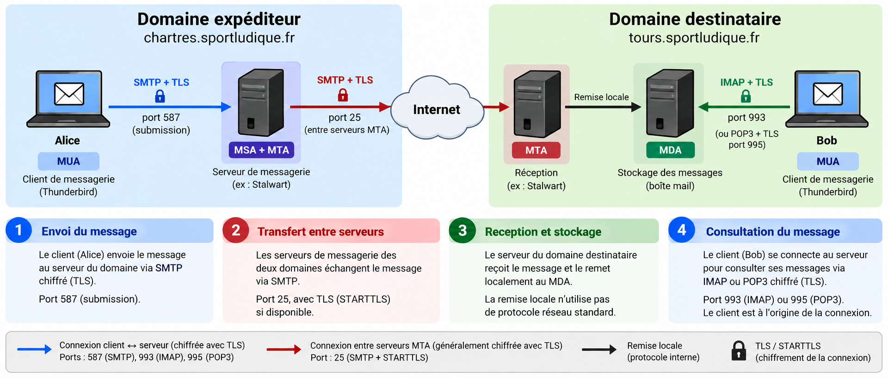

# La messagerie électronique — Principes et protocoles

!!! abstract "Objectifs pédagogiques"
    À l'issue de ce chapitre, vous devez savoir :

    - expliquer le parcours d'un courriel entre deux domaines ;
    - distinguer **SMTP**, **IMAP** et **POP3** ;
    - expliquer le rôle du **DNS (MX)** dans la distribution des messages ;
    - distinguer **TLS implicite** et **STARTTLS** ;
    - comprendre pourquoi **SPF, DKIM et DMARC** sont nécessaires.

!!! info "Contexte SportLudique"
    Les antennes SportLudique possèdent leurs propres domaines DNS. Elles doivent pouvoir échanger des courriels dans le **faux Internet SportLudique**, sans dépendre d'Internet public.

## 1. Comment circule un courriel ?

Alice (`alice@chartres.sportludique.fr`) envoie un message à Bob (`bob@tours.sportludique.fr`). Plusieurs logiciels interviennent entre le clic sur **Envoyer** et la lecture du message.



Les principaux rôles sont les suivants :

| Sigle | Rôle | À retenir |
|---|---|---|
| **MUA** (*Mail User Agent*) | Logiciel utilisé par Alice ou Bob | Thunderbird, Outlook… |
| **MSA** (*Mail Submission Agent*) | Reçoit le message envoyé par Alice | Soumission SMTP, généralement port **587** |
| **MTA** (*Mail Transfer Agent*) | Transfère le message vers le domaine de Bob | SMTP, généralement port **25** |
| **MDA** (*Mail Delivery Agent*) | Dépose le message dans la boîte de Bob | Remise locale |
| **Serveur IMAP/POP3** | Permet à Bob de consulter sa boîte | IMAP ou POP3 |

!!! tip "Un rôle n'est pas forcément une machine"
    Le MSA, le MTA et le MDA peuvent fonctionner sur **un même serveur**. Stalwart regroupe ces fonctions ; une architecture classique utilise notamment Postfix et Dovecot.

Le parcours est simple : **Alice soumet** son message, le serveur de Chartres **trouve le serveur de Tours grâce au DNS**, les serveurs **transfèrent** le message, puis Bob **consulte** sa boîte aux lettres.

## 2. SMTP : envoyer et transférer les courriels

**SMTP** (*Simple Mail Transfer Protocol*) est utilisé pour l'envoi et le transfert des courriels. Il repose sur un dialogue : un serveur envoie des commandes, l'autre répond avec des **codes numériques**.

| Usage | Port TCP | Fonction |
|---|---:|---|
| **Soumission SMTP** | **587** | Alice envoie son message à son serveur, avec authentification et généralement STARTTLS |
| **Soumission avec TLS implicite** | **465** | Variante sécurisée dès le début de la connexion |
| **Transfert SMTP** | **25** | Le MTA de Chartres transmet le message au MTA de Tours |

### 2.1 Un dialogue SMTP entre Chartres et Tours

Le serveur de Chartres a trouvé celui de Tours grâce au DNS. Il se connecte au **port TCP 25** du serveur de Tours.

- 🔵 **Chartres** envoie les commandes.
- 🟢 **Tours** répond.
- 🟠 **Message** désigne le contenu transmis après `DATA`.

| Émetteur | Dialogue SMTP |
|---|---|
| 🟢 Tours | `220 Service SMTP disponible` |
| 🔵 Chartres | `EHLO mail.chartres.sportludique.fr` |
| 🟢 Tours | `250 Bonjour` |
| 🔵 Chartres | `MAIL FROM:<alice@chartres.sportludique.fr>` |
| 🟢 Tours | `250 OK` |
| 🔵 Chartres | `RCPT TO:<bob@tours.sportludique.fr>` |
| 🟢 Tours | `250 OK` |
| 🔵 Chartres | `DATA` |
| 🟢 Tours | `354 Envoyez le message` |
| 🟠 Message | `From: direction@chartres.sportludique.fr` |
| 🟠 Message | `To: bob@tours.sportludique.fr` |
| 🟠 Message | `Subject: Réunion importante` |
| 🟠 Message | ` ` (ligne vide séparant les en-têtes du corps) |
| 🟠 Message | `Bonjour Bob, rendez-vous demain.` |
| 🔵 Chartres | `.` (fin du message) |
| 🟢 Tours | `250 Message accepté` |
| 🔵 Chartres | `QUIT` |
| 🟢 Tours | `221 Au revoir` |

!!! warning "Deux identités différentes : observez bien !"
    Dans l'**enveloppe SMTP**, l'expéditeur déclaré est `alice@chartres.sportludique.fr` (`MAIL FROM`).

    Dans le **message**, l'en-tête `From:` indique `direction@chartres.sportludique.fr`. C'est généralement cette adresse que Bob verra dans Thunderbird.

    Le code **`250 OK` ne prouve pas l'identité d'Alice** : il indique que le serveur accepte la commande. Cette différence entre l'enveloppe et l'en-tête visible peut être légitime, mais aussi exploitée pour **usurper une adresse**.

!!! tip "Un serveur peut être client et serveur SMTP"
    Ici, le serveur de Chartres est **client SMTP** : il initie la connexion. Celui de Tours est **serveur SMTP** : il reçoit la connexion. Les rôles s'inversent lorsque Tours envoie un message vers Chartres.

!!! danger "Attention au relais ouvert (open relay)"
    Un serveur SMTP ne doit pas accepter de relayer les messages de n'importe quel expéditeur vers n'importe quel destinataire. Sinon, il peut être utilisé pour diffuser du spam.

## 3. IMAP et POP3 : lire les courriels

**SMTP sert à envoyer les messages, pas à consulter une boîte aux lettres.** Pour lire ses messages dans Thunderbird, Bob utilise généralement **IMAP**.

| | **IMAP** | **POP3** |
|---|---|---|
| Fonction | Consulte et synchronise la boîte sur le serveur | Récupère les messages |
| Plusieurs appareils | Très adapté | Synchronisation limitée |
| Dossiers et état « lu/non lu » | Synchronisés | Pas de synchronisation équivalente |
| Port sans TLS implicite | 143 | 110 |
| Port avec TLS implicite | **993** | **995** |

!!! note "POP3 ne supprime pas obligatoirement les messages"
    Le client POP3 peut conserver une copie sur le serveur. Sa principale limite est la **synchronisation des dossiers et des états** entre plusieurs appareils.

!!! tip "Qui ouvre la connexion IMAP ?"
    C'est **Thunderbird, sur le poste de Bob**, qui se connecte au serveur IMAP. Le serveur lui renvoie ensuite les messages demandés sur cette connexion.

## 4. Le DNS : trouver le serveur du destinataire

Pour transmettre un courriel à `bob@tours.sportludique.fr`, le serveur de Chartres doit découvrir **quel serveur reçoit les messages du domaine** `tours.sportludique.fr`.

Le DNS utilise notamment deux types d'enregistrements :

- **MX** : indique le **nom du serveur de messagerie** du domaine ;
- **A / AAAA** : permet de retrouver l'**adresse IP** de ce serveur.

Exemple dans la zone DNS de Tours :

```dns
@       IN MX 10 mail.tours.sportludique.fr.
mail    IN A     192.0.2.25
```

Le nombre `10` est la **préférence MX** : lorsqu'il existe plusieurs MX, la plus petite valeur est prioritaire. L'adresse `192.0.2.25` est une adresse d'exemple à remplacer dans SportLudique.

!!! note "Le DNS ne transporte pas les courriels"
    Le DNS permet de **localiser** le serveur destinataire. Le message est ensuite transmis par **SMTP**. Un MX correct ne suffit donc pas : le serveur de messagerie doit aussi être joignable et accepter les messages du domaine.

## 5. TLS et STARTTLS : protéger les connexions

Sans chiffrement, des données peuvent être interceptées sur le réseau. **TLS** protège les échanges entre deux machines. Le certificat du serveur permet également de vérifier son identité, à condition qu'il soit correctement contrôlé.

| Méthode | Principe | Exemple |
|---|---|---|
| **TLS implicite** | TLS est négocié dès le début de la connexion | IMAP **993**, SMTP Submission **465** |
| **STARTTLS** | La connexion commence sans chiffrement, puis passe à TLS | SMTP Submission **587**, SMTP entre serveurs **25** |

!!! warning "Port 25 ne signifie pas forcément « en clair »"
    Entre deux MTA, SMTP utilise généralement le **port 25** et peut activer **STARTTLS**. Mais ce chiffrement est souvent **opportuniste** : sans politique complémentaire, un transfert peut parfois avoir lieu sans TLS.

    Pour la soumission par les utilisateurs, on doit au contraire **exiger une connexion sécurisée**.

Dans SportLudique, les certificats des serveurs peuvent être délivrés par la **PKI interne**, à condition que les clients fassent confiance à cette autorité de certification.

!!! info "MIME : comment envoyer des pièces jointes ?"
    À l'origine, les courriels transportaient essentiellement du texte ASCII. **MIME** (*Multipurpose Internet Mail Extensions*) permet d'organiser les contenus : texte, HTML, images et pièces jointes.

    - `Content-Type` indique le type de contenu (`text/plain`, `application/pdf`…).
    - `Content-Disposition` précise notamment s'il s'agit d'une pièce jointe.
    - `Content-Transfer-Encoding` indique un encodage comme **Base64**.

    MIME illustre des fonctions de la **couche 6 — Présentation** du modèle OSI. Dans TCP/IP, elles appartiennent à la couche Application. **Base64 est un encodage, pas un chiffrement.**

## 6. Pourquoi faut-il authentifier les domaines expéditeurs ?

Nous avons vu qu'un courriel peut afficher une adresse `From:` différente de celle de son enveloppe SMTP. Cette possibilité peut être exploitée pour envoyer un message qui **semble provenir d'un domaine légitime**.

Trois mécanismes de sécurité complètent les contrôles de messagerie :

| Mécanisme | Question à se poser |
|---|---|
| **SPF** | L'adresse IP du serveur émetteur est-elle autorisée à envoyer pour le domaine de l'enveloppe SMTP ? |
| **DKIM** | Le message porte-t-il une signature cryptographique valide associée à un domaine ? |
| **DMARC** | Le domaine affiché dans `From:` est-il aligné avec un domaine ayant réussi SPF ou DKIM, et quelle politique appliquer en cas d'échec ? |

!!! success "À connaître dès le socle"
    **SPF, DKIM et DMARC** sont indispensables à la compréhension de la cybersécurité des courriels. Leur configuration sera étudiée dans un **chapitre commun**, puis mise en pratique avec **Stalwart** et **Postfix/Dovecot**.

!!! warning "Ces mécanismes ne font pas tout"
    SPF, DKIM et DMARC **ne chiffrent pas** les courriels et ne garantissent pas qu'un message est inoffensif. Un message de phishing peut provenir d'un domaine correctement authentifié.

## 7. Synthèse : les ports essentiels

| Protocole | Port TCP | Utilisation |
|---|---:|---|
| SMTP | **25** | Transfert entre serveurs |
| SMTP Submission | **587** | Envoi authentifié, généralement avec STARTTLS |
| SMTP Submission TLS | **465** | Envoi avec TLS implicite |
| IMAP / IMAPS | **143 / 993** | Consultation des messages |
| POP3 / POP3S | **110 / 995** | Récupération des messages |
| DNS | **53 TCP/UDP** | Recherche MX et résolution des noms |


## Vérifiez vos connaissances

<quiz>
Quelle est la fonction principale du protocole SMTP ?

- [ ] Consulter les messages reçus
- [x] Soumettre et transférer des courriels
- [ ] Synchroniser les dossiers de messagerie
- [ ] Télécharger les messages depuis le serveur

SMTP sert à soumettre et transférer les messages. IMAP et POP3 permettent de récupérer les courriels.
</quiz>

<quiz>
À quoi sert un enregistrement DNS MX ?

- [ ] Indiquer directement l'adresse IPv4 du serveur
- [ ] Identifier le serveur DNS faisant autorité
- [x] Désigner les serveurs chargés de recevoir les courriels d'un domaine
- [ ] Autoriser les adresses IP des serveurs expéditeurs

Un enregistrement MX indique le nom d'un serveur de messagerie et sa priorité. Les enregistrements A ou AAAA permettent ensuite de résoudre son adresse IP.
</quiz>

<quiz>
Pourquoi IMAP est-il plus adapté que POP3 à une utilisation sur plusieurs appareils ?

- [ ] Il permet d'envoyer des courriels
- [ ] Il ne nécessite aucune connexion au serveur
- [ ] Il supprime automatiquement les messages du serveur
- [x] Il synchronise les dossiers et les états des messages

IMAP conserve les messages sur le serveur et synchronise leur état entre les appareils.
</quiz>

<quiz>
Que signifie une réponse SMTP `250 OK` ?

- [ ] L'identité de l'expéditeur a été vérifiée
- [x] Le serveur a accepté la commande SMTP
- [ ] Le message a été livré au destinataire final
- [ ] La connexion est désormais chiffrée

Le code 250 indique que la commande a été acceptée. Il ne garantit ni l'authentification de l'expéditeur ni la livraison finale.
</quiz>

<quiz>
Une connexion SMTP sur le port 25 est-elle toujours non chiffrée ?

- [ ] Oui, le port 25 interdit TLS
- [ ] Oui, seul le port 465 permet le chiffrement
- [x] Non, STARTTLS peut permettre de chiffrer la connexion
- [ ] Non, TLS est automatiquement obligatoire sur le port 25

STARTTLS permet de négocier TLS sur le port 25. Entre serveurs de messagerie, ce chiffrement est souvent opportuniste.
</quiz>

<quiz>
Quelle proposition décrit correctement SPF, DKIM et DMARC ?

- [ ] SPF chiffre les messages, DKIM protège les pièces jointes et DMARC bloque les spams
- [ ] SPF vérifie les mots de passe, DKIM authentifie les utilisateurs et DMARC chiffre SMTP
- [x] SPF vérifie l'autorisation de l'IP émettrice, DKIM vérifie une signature et DMARC contrôle l'alignement des domaines
- [ ] SPF, DKIM et DMARC sont des protocoles de consultation des courriels

SPF vérifie l'autorisation de l'adresse IP émettrice pour le domaine SMTP. DKIM vérifie une signature cryptographique. DMARC vérifie l'alignement avec le domaine visible dans From et publie une politique de traitement.
</quiz>


## Pour aller plus loin

- [RFC 5321 — SMTP](https://www.rfc-editor.org/rfc/rfc5321)
- [RFC 9051 — IMAP](https://www.rfc-editor.org/rfc/rfc9051)
- [RFC 7208 — SPF](https://www.rfc-editor.org/rfc/rfc7208)
- [RFC 6376 — DKIM](https://www.rfc-editor.org/rfc/rfc6376)
- [RFC 7489 — DMARC](https://www.rfc-editor.org/rfc/rfc7489)
