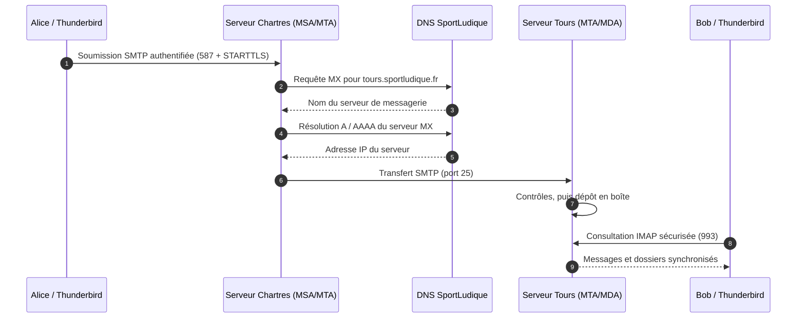
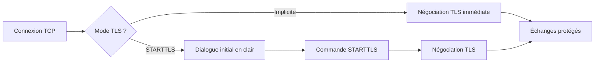

# La messagerie électronique — Principes et protocoles

!!! abstract "Objectifs pédagogiques"
    À l'issue de ce chapitre, vous devez être capable de :

    - décrire le parcours d'un courriel entre deux domaines ;
    - distinguer les rôles d'un **client de messagerie**, d'un serveur de transfert et d'un serveur de consultation ;
    - expliquer les fonctions de **SMTP**, **IMAP** et **POP3** ;
    - identifier les enregistrements DNS nécessaires à la messagerie ;
    - distinguer **TLS implicite** et **STARTTLS** ;
    - expliquer le rôle de **SPF**, **DKIM** et **DMARC** dans la lutte contre l'usurpation.

!!! info "Contexte SportLudique"
    Les différents sites de SportLudique disposent de domaines DNS et de réseaux interconnectés. Chaque équipe doit pouvoir héberger des boîtes aux lettres, envoyer et recevoir des courriels et protéger son domaine contre les usurpations d'identité.

    Les manipulations se déroulent dans le **faux Internet SportLudique**, sans nécessiter l'envoi de courriels vers Internet public. Les noms et adresses de ce document sont des exemples : adaptez-les au plan d'adressage de votre site.

## 1. Les différents acteurs d'une messagerie électronique

L'acheminement d'un courriel repose sur plusieurs composants logiciels, chacun assurant un rôle précis :

- **MUA (Mail User Agent)** : client de messagerie utilisé pour rédiger, envoyer et consulter les courriels (ex. : Thunderbird, Outlook).
- **MSA (Mail Submission Agent)** : reçoit les messages envoyés par les utilisateurs, généralement via SMTP authentifié sur le port **587**.
- **MTA (Mail Transfer Agent)** : assure le transfert des courriels entre serveurs de messagerie à l'aide du protocole **SMTP (port 25)**.
- **MDA (Mail Delivery Agent)** : assure la remise des messages dans les boîtes aux lettres des destinataires.
- **Serveur IMAP/POP3** : permet aux utilisateurs de consulter ou récupérer leurs messages, généralement avec TLS (**IMAPS : 993**, **POP3S : 995**).

!!! info "Des rôles logiciels, pas nécessairement des machines différentes"

    Ces composants représentent des **fonctions logiques**. Plusieurs rôles peuvent être assurés par un même serveur.

    Par exemple, **Stalwart** intègre ces différentes fonctions, tandis qu'une architecture classique utilise souvent **Postfix** (MSA/MTA) et **Dovecot** (distribution et consultation des messages).


## 2. Qu'est-ce qu'un service de messagerie ?

Une messagerie électronique est un **ensemble de services**. Le logiciel utilisé pour lire ses courriels ne réalise pas nécessairement leur transport ni leur stockage.

Un message comprend notamment :

- une **enveloppe SMTP** : expéditeur technique (`MAIL FROM`) et destinataires (`RCPT TO`), utilisés pendant le transport ;
- des **en-têtes** : `From:`, `To:`, `Date:`, `Subject:`, `Message-ID:`… ;
- un **corps** : texte et éventuellement pièces jointes, encodées selon les règles MIME.


!!! info "MIME — Le format des courriels et la couche Présentation"

    À l'origine, SMTP transportait essentiellement du texte ASCII 7 bits. Les extensions **MIME (Multipurpose Internet Mail Extensions)** permettent de structurer les courriels et d'y intégrer des contenus variés : texte HTML, images, documents et pièces jointes.

    MIME définit notamment :

    - **`Content-Type`** : nature du contenu (`text/html`, `image/png`, `application/pdf`...).
    - **`Content-Transfer-Encoding`** : encodage utilisé, notamment `base64`.
    - **`Content-Disposition`** : affichage direct ou pièce jointe.
    - **`multipart/mixed`** : regroupement de plusieurs contenus dans un même message.

    **Exemple simplifié :**

    ```text
    MIME-Version: 1.0
    Content-Type: application/pdf
    Content-Disposition: attachment; filename="document.pdf"
    Content-Transfer-Encoding: base64

    JVBERi0xLjQK...
    ```

    MIME illustre les fonctions de la **couche 6 — Présentation du modèle OSI**, chargée notamment de la représentation et de l'encodage des données. Dans le modèle TCP/IP, ces fonctions sont intégrées à la **couche Application**.

    **À retenir :** SMTP transporte les messages, MIME organise leur contenu. L'encodage Base64 permet de représenter des données binaires sous forme de texte, mais **ne constitue pas un chiffrement**.


!!! warning "Deux expéditeurs à ne pas confondre"
    L'adresse indiquée dans l'en-tête visible `From:` n'est pas nécessairement identique à l'adresse de l'enveloppe SMTP (`MAIL FROM`). Cette distinction est essentielle pour comprendre **SPF** et **DMARC**.

### 2.1 Les rôles dans une architecture de messagerie

| Sigle | Signification | Fonction | Exemple |
|---|---|---|---|
| **MUA** | *Mail User Agent* | Rédiger, envoyer et consulter des courriels. On parle de client de messagerie | Thunderbird, Outlook, webmail |
| **MSA** | *Mail Submission Agent* | Accepter les messages soumis par les utilisateurs, généralement après authentification | Service de soumission SMTP |
| **MTA** | *Mail Transfer Agent* | Transférer les messages entre serveurs | Postfix, moteur SMTP Stalwart |
| **MDA** | *Mail Delivery Agent* | Déposer les messages dans les boîtes aux lettres | Service de distribution locale |
| **Serveur d'accès** | Service IMAP ou POP3 | Permettre la consultation des messages stockés | Dovecot, Stalwart |

Un même logiciel peut assurer plusieurs de ces rôles. **Stalwart** les regroupe largement, tandis qu'une architecture classique sépare notamment **Postfix** (SMTP) et **Dovecot** (IMAP/POP3 et services associés).

### 1.2 Parcours d'un courriel entre deux domaines

Exemple : `alice@chartres.sportludique.fr` écrit à `bob@tours.sportludique.fr`.



!!! note "Le DNS ne transporte pas les messages"
    Le DNS permet notamment de **localiser** le serveur destinataire. Le transport est réalisé par **SMTP** ; la consultation se fait généralement avec **IMAP**. Un enregistrement MX pointe vers un **nom d'hôte**, pas directement vers une adresse IP.

## 3. SMTP : envoyer et transférer les messages

**SMTP** (*Simple Mail Transfer Protocol*) sert à soumettre et à transférer des courriels. Il fonctionne selon un dialogue de commandes et de réponses entre client et serveur.

### 3.1 Soumission et transfert : deux usages distincts

| Usage | Port TCP | Fonction |
|---|---:|---|
| SMTP entre serveurs | **25** | Transfert de messages entre MTA |
| Submission | **587** | Envoi par un utilisateur, avec authentification et généralement STARTTLS |
| Submissions | **465** | Envoi par un utilisateur avec TLS établi dès l'ouverture de la connexion |

Le port 25 n'est **pas** le port à privilégier pour configurer Thunderbird afin d'envoyer les messages d'un utilisateur. On utilise généralement **587** ou **465**.


### 3.2 Comment SMTP transmet-il un courriel ?

Prenons un exemple dans l'environnement SportLudique :

- **Alice**, à Chartres, envoie un courriel à `bob@tours.sportludique.fr`.
- Le serveur de messagerie de Chartres doit transmettre ce message au serveur de Tours.
- Grâce au **DNS (enregistrement MX)**, il identifie le serveur chargé de recevoir les courriels du domaine `tours.sportludique.fr`.
- Il établit alors une connexion SMTP avec ce serveur, généralement sur le **port TCP 25**.

Les deux serveurs échangent des commandes et des réponses, un peu comme une conversation.

Dans le dialogue suivant :

- 🔵 **Bleu** : commandes envoyées par le serveur de Chartres.
- 🟢 **Vert** : réponses du serveur de Tours.
- 🟠 **Orange** : contenu du courriel transmis après `DATA`.

| Émetteur | Dialogue SMTP |
|---|---|
| 🟢 Tours | `220 Service SMTP disponible` |
| 🔵 Chartres | `EHLO mail.chartres.sportludique.fr` |
| 🟢 Tours | `250 Bonjour, connexion acceptée` |
| 🔵 Chartres | `MAIL FROM:<alice@chartres.sportludique.fr>` |
| 🟢 Tours | `250 OK` |
| 🔵 Chartres | `RCPT TO:<bob@tours.sportludique.fr>` |
| 🟢 Tours | `250 OK` |
| 🔵 Chartres | `DATA` |
| 🟢 Tours | `354 Vous pouvez transmettre le message` |
| 🟠 Message | `From: direction@chartres.sportludique.fr` |
| 🟠 Message | `To: bob@tours.sportludique.fr` |
| 🟠 Message | `Subject: Réunion importante` |
| 🟠 Message | `Bonjour Bob, merci de transmettre vos identifiants.` |
| 🔵 Chartres | `.` |
| 🟢 Tours | `250 Message accepté` |
| 🔵 Chartres | `QUIT` |
| 🟢 Tours | `221 Fin de connexion` |

!!! warning "Deux identités différentes dans un même courriel !"

    Observez attentivement :

    - **Enveloppe SMTP :** `MAIL FROM:<alice@chartres.sportludique.fr>`
    - **En-tête du message :** `From: direction@chartres.sportludique.fr`

    Le serveur de Tours a répondu **`250 OK`** à la commande `MAIL FROM`, mais cela signifie seulement qu'il accepte cette adresse dans le cadre de la transaction SMTP. **Il n'a pas nécessairement vérifié que l'expéditeur est réellement Alice.**

    Lorsque le contenu du message est transmis avec `DATA`, une autre adresse apparaît dans l'en-tête `From:`.

    C'est généralement cette seconde adresse que **Thunderbird affiche comme expéditeur** !

    **Conclusion :** SMTP permet de déclarer des identités différentes dans l'enveloppe et dans le message. Cette possibilité ne constitue pas systématiquement une attaque, mais elle peut être exploitée pour usurper une identité.

    Les mécanismes **SPF, DKIM et DMARC** permettent de renforcer la vérification des domaines expéditeurs, notamment grâce à l'alignement DMARC.


!!! tip "À retenir : SMTP fonctionne selon le principe client/serveur"

    Dans cet échange, **le serveur de Chartres joue le rôle de client SMTP** puisqu'il initie la connexion vers le serveur de Tours.

    Le serveur de Tours joue le rôle de **serveur SMTP** puisqu'il reçoit la connexion et le message.

    Un même serveur de messagerie peut donc être **client SMTP lorsqu'il envoie un courriel** et **serveur SMTP lorsqu'il en reçoit un**.

!!! warning "Attention à l'identité de l'expéditeur"

    Les adresses déclarées dans les commandes SMTP ne constituent pas une preuve d'identité.

    C'est notamment pour lutter contre l'usurpation des domaines expéditeurs que les mécanismes **SPF, DKIM et DMARC** ont été développés.


**Les principales commandes SMTP :**

| Commande | Rôle |
|---|---|
| `EHLO` | Identifie le client SMTP et demande les extensions disponibles. |
| `MAIL FROM` | Indique l'expéditeur dans l'enveloppe SMTP. |
| `RCPT TO` | Indique le destinataire dans l'enveloppe SMTP. |
| `DATA` | Commence la transmission du message (en-têtes et corps). |
| `.` | Termine la transmission du message lorsqu'il est seul sur une ligne. |
| `QUIT` | Termine la session SMTP. |

!!! warning "SMTP ne garantit pas l'identité de l'expéditeur"

    Les adresses indiquées dans `MAIL FROM` et dans l'en-tête `From:` peuvent être différentes et ne prouvent pas, à elles seules, l'identité de l'expéditeur.

    Cette faiblesse historique explique notamment l'apparition des mécanismes **SPF, DKIM et DMARC**, étudiés dans le chapitre cybersécurité.


Ce dialogue est **illustratif** : les capacités annoncées, les réponses, l'authentification et les contrôles varient selon les serveurs. Après STARTTLS, le client doit à nouveau annoncer ses capacités avec `EHLO`.

!!! danger "Le relais SMTP ouvert (open relay)"
    Un serveur mal configuré peut accepter de transférer des messages provenant de n'importe qui vers n'importe quel domaine. Il devient alors un **relais ouvert**, exploitable pour diffuser du spam ou des courriels frauduleux.

    Un MTA doit distinguer les messages **destinés à ses propres domaines** des messages **à relayer** pour des utilisateurs ou serveurs autorisés.

## 4. IMAP et POP3 : consulter les messages

**SMTP ne sert pas à lire une boîte aux lettres.** Pour cela, un client utilise généralement IMAP, plus rarement POP3, ou un webmail utilisant ses propres échanges HTTP(S) avec le serveur.

| Critère | IMAP | POP3 |
|---|---|---|
| Principe | Consultation et synchronisation avec le serveur | Récupération des messages |
| Dossiers côté serveur | Oui | Pas de gestion standard comparable à IMAP |
| Synchronisation multi-appareils | Adaptée | Limitée |
| États « lu », « non lu », drapeaux | Synchronisés | Fonctionnalités très limitées |
| Conservation sur le serveur | Principe courant | Possible selon les réglages du client |
| Port standard | 143 | 110 |
| TLS implicite | **993** | **995** |

!!! tip "POP3 ne supprime pas systématiquement les messages"
    Dire que « POP3 télécharge puis efface obligatoirement les courriels » est **faux**. Le client peut être configuré pour laisser une copie sur le serveur. Sa limite principale est l'absence d'un modèle riche de synchronisation des dossiers et des états entre plusieurs appareils.

### Exemple concret

Alice consulte sa messagerie sur un ordinateur au lycée puis sur son téléphone :

- avec **IMAP**, les messages et leur état peuvent rester cohérents entre les deux appareils ;
- avec **POP3**, chaque client récupère les messages, mais les dossiers et états ne sont pas synchronisés de manière équivalente.

## 5. DNS : comment trouver le serveur de messagerie ?

Le DNS intervient dans la **distribution** des messages et dans la **publication des politiques de sécurité**.

### 5.1 Les enregistrements MX, A et AAAA

Exemple de zone DNS :

```dns
$ORIGIN chartres.sportludique.fr.
@       IN MX 10 mail.chartres.sportludique.fr.
mail    IN A     192.0.2.25
```

!!! warning "Exemple uniquement"
    `192.0.2.25` appartient à une plage réservée à la documentation : remplacez cette valeur par l'adresse réelle de votre serveur SportLudique.

- `MX` désigne un serveur chargé de recevoir les messages du domaine.
- `10` est une **préférence** : plus le nombre est faible, plus le serveur est prioritaire.
- `A` ou `AAAA` permet de retrouver l'adresse IP du serveur désigné.

Pour vérifier :

```bash
dig MX chartres.sportludique.fr
dig A mail.chartres.sportludique.fr
```

!!! note "Attention aux noms DNS"
    La cible d'un MX doit être un nom d'hôte résolvable ; elle ne doit pas être un alias CNAME. En cas d'absence de MX, SMTP prévoit des règles de repli vers les adresses du domaine, mais une infrastructure correctement documentée publie explicitement ses MX.

### 5.2 DNS et transport : deux diagnostics différents

Un MX correct ne garantit pas que la messagerie fonctionne : le serveur peut être arrêté, le port 25 filtré, le domaine non déclaré sur le serveur ou la boîte du destinataire inexistante.

## 6. TLS et STARTTLS : protéger les connexions

Sans chiffrement, certaines informations échangées sur le réseau peuvent être observées. **TLS** apporte le chiffrement du canal, l'intégrité des échanges et, sous réserve de vérification du certificat, l'authentification du serveur.

| Mode | Fonctionnement | Exemples |
|---|---|---|
| **TLS implicite** | La négociation TLS commence dès l'établissement de la connexion | IMAPS 993, POP3S 995, Submissions 465 |
| **STARTTLS** | La connexion débute en clair, puis une commande déclenche la négociation TLS | Submission 587, IMAP 143, SMTP 25 |



!!! warning "STARTTLS ne garantit pas à lui seul la sécurité"
    Pour les clients de messagerie, on doit **exiger TLS** et vérifier le certificat. Entre serveurs SMTP sur le port 25, STARTTLS est souvent **opportuniste** : sans politique complémentaire, une connexion peut être établie sans chiffrement si TLS n'est pas disponible. 

### 6.1 Certificats et PKI SportLudique

Un certificat X.509 lie un nom DNS à une clé publique. Le client vérifie notamment le nom du serveur, la validité du certificat et la confiance accordée à son autorité de certification.

Dans SportLudique, un certificat issu de la **PKI interne** peut convenir aux clients qui font confiance à cette autorité. Un client extérieur ne lui fera pas automatiquement confiance.

### 6.2 Commandes de vérification

```bash
# SMTP Submission avec STARTTLS
openssl s_client -connect mail.chartres.sportludique.fr:587 \
  -starttls smtp -servername mail.chartres.sportludique.fr

# IMAP avec TLS implicite
openssl s_client -connect mail.chartres.sportludique.fr:993 \
  -servername mail.chartres.sportludique.fr
```

Observez le certificat présenté, son nom DNS et les informations de négociation TLS. Pour une vérification stricte de la chaîne de confiance, il faut également disposer de l'autorité de certification appropriée.

## 7. Pourquoi la messagerie est-elle exposée à l'usurpation ?

Le protocole SMTP a été conçu à une époque où l'authentification des domaines émetteurs n'était pas systématique. Le champ visible `From:` peut être falsifié si aucun contrôle ne l'empêche.

Un attaquant peut tenter d'envoyer un message affichant :

```text
From: Direction SportLudique <direction@chartres.sportludique.fr>
Subject: Modification urgente de votre mot de passe
```

L'affichage de cette adresse **ne prouve pas** que le message a été envoyé par un serveur autorisé ou par le titulaire légitime de la boîte.

### 7.1 Les trois mécanismes fondamentaux

| Mécanisme | Question posée | Principe |
|---|---|---|
| **SPF** | L'adresse IP émettrice est-elle autorisée pour le domaine de l'enveloppe SMTP ? | Politique publiée dans un enregistrement DNS TXT |
| **DKIM** | Le message possède-t-il une signature cryptographique vérifiable pour le domaine signataire ? | Signature et clé publique publiée dans le DNS |
| **DMARC** | Le domaine visible dans `From:` est-il aligné avec un domaine ayant réussi SPF ou DKIM ? | Politique DNS et rapports d'authentification |

!!! success "Indispensable dès le socle"
    Tout étudiant doit savoir **expliquer SPF, DKIM et DMARC**, même si leur configuration est fortement guidée. Ce sont des mécanismes de base de la sécurité d'une messagerie moderne.

### 7.2 Exemples d'enregistrements DNS

Les valeurs ci-dessous illustrent la **syntaxe**. Elles ne constituent pas une configuration complète à copier sans adaptation.

**SPF** — autoriser les serveurs identifiés par les MX du domaine :

```dns
@ IN TXT "v=spf1 mx -all"
```

**DKIM** — publier la clé publique du sélecteur `s1` :

```dns
s1._domainkey IN TXT "v=DKIM1; k=rsa; p=CLE_PUBLIQUE_BASE64"
```

**DMARC** — commencer par observer sans demander le rejet :

```dns
_dmarc IN TXT "v=DMARC1; p=none; rua=mailto:dmarc@chartres.sportludique.fr"
```

La boîte destinataire des rapports `rua` doit être opérationnelle ; dans le faux Internet SportLudique, les rapports ne seront disponibles que si les serveurs récepteurs les génèrent et les transmettent.

!!! warning "DMARC : l'alignement est essentiel"
    Pour réussir DMARC, il suffit que **SPF ou DKIM** réussisse **avec un domaine aligné** sur le domaine visible dans `From:`. Il n'est pas nécessaire que les deux réussissent. À l'inverse, une réussite SPF sur un domaine sans alignement peut laisser DMARC en échec.

!!! danger "Ce que SPF, DKIM et DMARC ne font pas"
    Ils ne chiffrent pas le contenu du message, ne prouvent pas qu'une personne précise l'a rédigé et ne garantissent pas l'absence de phishing, de malware ou de spam. Un message malveillant peut être parfaitement authentifié pour le domaine de l'attaquant.

La configuration complète et les scénarios d'usurpation seront étudiés dans le chapitre **Cybersécurité de la messagerie**, puis mis en pratique sur **Stalwart** et sur **Postfix/Dovecot**.

## 8. Deux architectures pour un même service

| Architecture | Logiciels | Objectif pédagogique |
|---|---|---|
| **Socle** | Stalwart | Déployer rapidement une messagerie et comprendre les protocoles |
| **Avancé** | Postfix + Dovecot | Identifier et configurer séparément les composants |

Les deux architectures répondent aux mêmes besoins fonctionnels : transporter, distribuer et consulter les messages. Les protocoles et les mécanismes de sécurité restent les mêmes, mais l'administration diffère.

## 9. Synthèse : les ports à connaître

| Protocole | Port TCP | Usage |
|---|---:|---|
| SMTP | 25 | Transfert entre serveurs |
| SMTP Submission | 587 | Soumission avec STARTTLS |
| SMTP Submissions | 465 | Soumission avec TLS implicite |
| IMAP | 143 | Consultation, STARTTLS possible |
| IMAPS | 993 | Consultation avec TLS implicite |
| POP3 | 110 | Récupération, STARTTLS possible |
| POP3S | 995 | Récupération avec TLS implicite |
| DNS | 53 TCP/UDP | Résolution DNS, dont MX et TXT |

!!! note "Ne pas confondre port et sécurité"
    Un numéro de port ne prouve pas à lui seul qu'une connexion est correctement sécurisée : il faut vérifier le protocole négocié, la politique TLS et le certificat.

## Pour aller plus loin

- [RFC 5321 — SMTP](https://www.rfc-editor.org/rfc/rfc5321)
- [RFC 9051 — IMAP4rev2](https://www.rfc-editor.org/rfc/rfc9051)
- [RFC 1939 — POP3](https://www.rfc-editor.org/rfc/rfc1939)
- [RFC 7208 — SPF](https://www.rfc-editor.org/rfc/rfc7208)
- [RFC 6376 — DKIM](https://www.rfc-editor.org/rfc/rfc6376)
- [RFC 7489 — DMARC](https://www.rfc-editor.org/rfc/rfc7489)
- [RFC 8314 — TLS et soumission/consultation des messages](https://www.rfc-editor.org/rfc/rfc8314)
