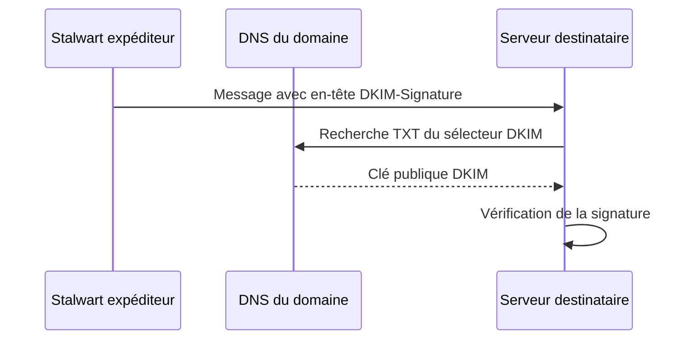

# SPF, DKIM et DMARC — Comprendre et mettre en œuvre avec Stalwart

!!! abstract "Mission — Cybersécurité pour tous"
    Comprendre comment un domaine protège son identité dans les courriels, puis **configurer et vérifier SPF, DKIM et DMARC** sur le serveur Stalwart de votre groupe.

**Prérequis :** serveur Stalwart opérationnel, deux comptes de messagerie, accès à l'administration de la zone DNS BIND du groupe, Thunderbird configuré avec TLS et authentification SMTP (TP Avancé).

!!! info "À retenir"
    SPF, DKIM et DMARC **ne chiffrent pas les courriels**. Ils permettent de vérifier certains éléments de l'identité du domaine expéditeur et de limiter son usurpation. Le chiffrement des connexions reste assuré par TLS.

### Examiner les en-têtes d'un message avec Thunderbird

Ouvrez un message reçu dans Thunderbird, puis utilisez le raccourci **`Ctrl + U`** pour afficher son code source complet.

Repérez les éléments suivants :

| Élément | Rôle |
|---|---|
| `From:` | Adresse de l'expéditeur affichée |
| `Return-Path:` | Adresse de retour utilisée pour les erreurs de livraison |
| `Received:` | Serveurs traversés par le message |
| `DKIM-Signature:` | Signature DKIM ajoutée par le serveur expéditeur |
| `Authentication-Results:` | Résultats des vérifications SPF, DKIM et DMARC, lorsqu'elles sont effectuées |

Recherchez notamment les indications `spf=pass`, `dkim=pass` et `dmarc=pass`, lorsqu'elles sont présentes.

!!! question "Analyse"
    - Quelle différence observez-vous entre `From:` et `Return-Path:` ?
    - Retrouvez-vous une signature DKIM dans le message ?
    - Les résultats SPF, DKIM et DMARC sont-ils présents ? Si oui, quelles conclusions pouvez-vous en tirer ?

!!! info "À retenir"
    **L'absence de `Authentication-Results` ne signifie pas que les vérifications ont échoué.** Le serveur destinataire peut ne pas les avoir effectuées ou ne pas avoir ajouté leurs résultats aux en-têtes.

    Les résultats d'authentification doivent être interprétés en tenant compte du serveur qui les a ajoutés.

## 1. Pourquoi ces mécanismes ?

Dans SMTP, l'adresse de l'expéditeur peut être annoncée par le client. Sans vérification complémentaire, un serveur distant peut recevoir un message prétendant provenir de `alice@chartres.sportludique.fr` alors qu'il a été émis par un autre serveur.

| Mécanisme | Question posée par le serveur destinataire | Moyen utilisé |
|---|---|---|
| **SPF** | L'adresse IP du serveur émetteur est-elle autorisée pour le domaine de l'enveloppe SMTP ? | Enregistrement **TXT** dans le DNS |
| **DKIM** | Une signature du message est-elle valide pour le domaine signataire ? | Signature avec une **clé privée** et clé publique dans le DNS |
| **DMARC** | SPF ou DKIM valide-t-il un domaine aligné avec celui visible dans le champ **From** ? | Enregistrement **TXT** contenant une politique |

!!! warning "Trois vérifications complémentaires"
    SPF vérifie le domaine utilisé dans l'enveloppe SMTP (ou le domaine HELO/EHLO dans certains cas), **pas directement le champ From affiché par Thunderbird**. DKIM vérifie une signature associée à un domaine. DMARC relie ces résultats au domaine du champ From.

## 2. SPF — Autoriser les serveurs expéditeurs

Exemple pour le domaine `chartres.sportludique.fr` :

```dns
chartres.sportludique.fr. IN TXT "v=spf1 mx -all"
```

| Élément | Signification |
|---|---|
| `v=spf1` | Version SPF |
| `mx` | Autorise les adresses IP des serveurs désignés par les MX du domaine |
| `-all` | Tous les autres serveurs sont déclarés non autorisés (**fail**) |

!!! question "Réflexion"
    Si votre groupe utilise aussi un autre serveur pour envoyer des courriels, que faudra-t-il modifier dans la politique SPF ?

**Attention :** SPF n'est pas un pare-feu. Le résultat SPF est interprété par le serveur destinataire, qui applique sa propre politique. Ne publiez pas plusieurs enregistrements `v=spf1` pour le même nom.

## 3. DKIM — Signer les messages

Le serveur expéditeur calcule une signature avec sa **clé privée**. Le destinataire récupère la **clé publique** dans le DNS et vérifie la signature.



Un exemple de nom DNS :

```dns
selecteur1._domainkey.chartres.sportludique.fr. IN TXT "v=DKIM1; k=rsa; p=CLE_PUBLIQUE"
```

| Élément | Rôle |
|---|---|
| `selecteur1` | Identifie la clé utilisée pour signer |
| `_domainkey` | Sous-domaine réservé à DKIM |
| `k=rsa` | Algorithme de la clé publique |
| `p=...` | Clé publique, **jamais la clé privée** |

!!! info "À ne pas confondre avec la PKI TLS"
    La clé DKIM sert à **signer des messages**. Le certificat TLS sert à **sécuriser une connexion**. Ce sont deux usages distincts de la cryptographie asymétrique.

## 4. DMARC — Définir une politique

DMARC utilise les résultats SPF et DKIM, en vérifiant leur **alignement** avec le domaine du champ `From` visible par le destinataire.

**Un seul mécanisme aligné et valide (SPF ou DKIM) suffit à faire réussir DMARC.**

Exemple de politique d'observation :

```dns
_dmarc.chartres.sportludique.fr. IN TXT "v=DMARC1; p=none; rua=mailto:postmaster@chartres.sportludique.fr"
```

| Politique | Signification |
|---|---|
| `p=none` | Observer les résultats sans demander de traitement particulier des échecs DMARC |
| `p=quarantine` | Demander de traiter les messages en échec comme suspects |
| `p=reject` | Demander le rejet des messages en échec |

`rua` indique une adresse de réception des **rapports agrégés**. Elle doit correspondre à une boîte réellement utilisable si vous souhaitez recevoir ces rapports.

!!! warning "Progressivité"
    Commencez par `p=none`. Une politique `p=reject` mal préparée peut pénaliser des messages légitimes. Les serveurs destinataires restent responsables de leur décision finale.

## 5. Activité — Activer SPF, DKIM et DMARC avec Stalwart

Dans les exemples, remplacez `ville` par **Chartres, Orléans, Tours, Bourges ou Blois**, selon votre groupe, et utilisez votre **véritable domaine de messagerie**. Ne remplacez pas aveuglément `sportludique.fr` par un sous-domaine si votre serveur héberge le domaine central.

### Étape 1 — Vérifier le domaine et les protections entrantes

Dans l'interface d'administration Stalwart :

1. Ouvrez **Management › Domains › Domains** et sélectionnez votre domaine.
2. Vérifiez qu'il est activé et que les adresses de vos comptes appartiennent bien à ce domaine.
3. Ouvrez **Settings › MTA › Inbound › Sender Authentication**.
4. Repérez les paramètres de vérification **SPF**, **DKIM** et **DMARC**. Relevez leurs valeurs actuelles avant toute modification.

| Contrôle | Résultat attendu de l'observation |
|---|---|
| SPF | Une politique de vérification des messages entrants est définie |
| DKIM | La vérification des signatures entrantes n'est pas désactivée |
| DMARC | Une politique de vérification des messages entrants est définie |

!!! info "Activation ≠ publication DNS"
    La vérification des messages **reçus** et la protection des messages **envoyés par votre domaine** sont deux opérations différentes. Ne changez pas les contrôles entrants en mode strict sans en mesurer les conséquences.

### Étape 2 — Vérifier la signature DKIM sortante

1. Dans **Management › Domains › DKIM Signatures**, recherchez les clés associées à votre domaine.
2. Si aucune clé n'est disponible, vérifiez les options de gestion DKIM du domaine et utilisez la génération prévue par votre version de Stalwart. **Ne créez pas de clé à la main si Stalwart peut la gérer.**
3. Dans **Settings › MTA › Session › DATA Stage**, repérez le paramètre de **signature DKIM** (`DKIM Sign Domain` / `dkimSignDomain`). Vérifiez qu'il sélectionne votre domaine pour les messages envoyés par un utilisateur authentifié.
4. Notez le ou les **sélecteurs DKIM** utilisés.

!!! warning "Important pour notre laboratoire"
    Les messages envoyés **sans authentification SMTP** lors du Socle peuvent ne pas être signés par défaut. Réalisez les tests DKIM avec **Thunderbird authentifié et TLS**, comme dans le TP Avancé.

### Étape 3 — Publier les enregistrements dans BIND

Dans **Management › Domains › Domains**, consultez les **DNS Records** ou la **zone DNS proposée** par Stalwart pour votre domaine.

Repérez uniquement les enregistrements utiles à cette activité :

| Type | Nom DNS | Contenu attendu |
|---|---|---|
| SPF | `ville.sportludique.fr` | TXT commençant par `v=spf1` |
| DKIM | `selecteur._domainkey.ville.sportludique.fr` | TXT commençant par `v=DKIM1` |
| DMARC | `_dmarc.ville.sportludique.fr` | TXT commençant par `v=DMARC1` |

**Sur le serveur BIND autoritatif de votre groupe :**

1. Ajoutez ou adaptez l'enregistrement SPF à votre architecture réelle.
2. Publiez **exactement la ou les clés publiques DKIM générées par Stalwart**, avec leurs véritables sélecteurs.
3. Publiez une politique DMARC avec `p=none` pour cette première mise en œuvre.
4. Incrémentez le numéro de série de la zone, vérifiez sa syntaxe et rechargez BIND selon votre procédure habituelle.

!!! danger "Clés privées et cohérence DNS"
    **Ne publiez jamais une clé privée DKIM dans le DNS.** Ne copiez pas non plus les enregistrements TLSA, MTA-STS ou autres proposés par Stalwart : ils sont hors du périmètre de cette activité.

### Étape 4 — Vérifier les enregistrements DNS

Depuis un poste du laboratoire, interrogez votre serveur DNS autoritatif ou un résolveur capable d'atteindre votre zone :

```bash
# SPF
dig ville.sportludique.fr TXT +short

# DMARC
dig _dmarc.ville.sportludique.fr TXT +short

# DKIM : remplacer selecteur par celui affiché dans Stalwart
dig selecteur._domainkey.ville.sportludique.fr TXT +short
```

Pour DKIM, la valeur `p=` doit contenir une **véritable clé publique** et non l'exemple `CLE_PUBLIQUE` du cours.

### Étape 5 — Tester avec Thunderbird

1. Configurez Thunderbird avec **SMTP authentifié et TLS**.
2. Envoyez un message d'un compte du groupe vers un autre compte disponible dans votre environnement.
3. Ouvrez le message reçu et affichez sa **source / ses en-têtes complets**.
4. Recherchez `DKIM-Signature` et, si le serveur destinataire les ajoute, `Authentication-Results`.

| Indice | Ce qu'il permet de vérifier |
|---|---|
| `DKIM-Signature` | Le message porte une signature DKIM |
| `dkim=pass` | Le serveur destinataire a validé la signature |
| `spf=pass` | Le serveur destinataire a validé SPF |
| `dmarc=pass` | Au moins un mécanisme aligné a réussi |

!!! warning "Attention à l'interprétation"
    L'absence de `Authentication-Results` ne prouve pas un échec : tous les serveurs ne produisent pas ces en-têtes de la même manière. Un message échangé **localement entre deux comptes du même Stalwart** ne démontre pas nécessairement la vérification SPF/DMARC d'une réception SMTP externe. Pour valider ces contrôles, utilisez un **serveur destinataire distinct** qui effectue réellement les vérifications.

!!! success "Point de validation"
    Présentez les **trois types d'enregistrements DNS** publiés, le sélecteur DKIM utilisé, un message signé et expliquez la différence entre **signature DKIM présente** et **signature DKIM vérifiée**.

## 6. Synthèse

| | SPF | DKIM | DMARC |
|---|---|---|---|
| Vérifie principalement | IP autorisée pour un domaine d'enveloppe | Signature liée à un domaine | Alignement avec le From visible |
| S'appuie sur le DNS | Oui | Oui | Oui |
| Protège le contenu par chiffrement | Non | Non | Non |
| Remplace TLS | Non | Non | Non |

## 7. Quiz — Vérifiez vos connaissances

<quiz>
**1 — À quoi sert SPF ?**

- [x] À indiquer quels serveurs peuvent envoyer des messages pour un domaine.
- [ ] À chiffrer le contenu des messages.
- [ ] À signer les messages.

**Explication :** SPF publie dans le DNS une politique concernant les serveurs expéditeurs autorisés.
</quiz>

<quiz>
**2 — Quel enregistrement DNS est utilisé pour publier SPF ?**

- [x] TXT
- [ ] MX
- [ ] PTR

**Explication :** SPF est publié sous la forme d'un enregistrement TXT commençant par `v=spf1`.
</quiz>

<quiz>
**3 — Que signifie `-all` dans `v=spf1 mx -all` ?**

- [x] Les serveurs non autorisés par les mécanismes précédents sont déclarés en échec SPF.
- [ ] Tous les serveurs peuvent envoyer des messages.
- [ ] Le courrier est chiffré.

**Explication :** `-all` exprime un résultat SPF fail pour les autres sources.
</quiz>

<quiz>
**4 — Quelle clé DKIM publie-t-on dans le DNS ?**

- [x] La clé publique.
- [ ] La clé privée.
- [ ] Le mot de passe du compte administrateur.

**Explication :** la clé privée reste sur le serveur qui signe les messages.
</quiz>

<quiz>
**5 — À quoi sert le sélecteur DKIM ?**

- [x] À identifier la clé publique à consulter dans le DNS.
- [ ] À choisir le port SMTP.
- [ ] À définir le destinataire du message.

**Explication :** le sélecteur apparaît dans le nom DNS `selecteur._domainkey.domaine`.
</quiz>

<quiz>
**6 — Un message portant `DKIM-Signature` est-il forcément authentifié ?**

- [ ] Oui, toujours.
- [x] Non, le serveur destinataire doit encore vérifier la signature.

**Explication :** la présence d'une signature ne prouve pas qu'elle est valide.
</quiz>

<quiz>
**7 — Pour réussir DMARC, que faut-il ?**

- [x] Un résultat SPF ou DKIM valide et aligné avec le domaine du From.
- [ ] SPF et DKIM obligatoirement tous les deux valides.
- [ ] Un certificat TLS autosigné.

**Explication :** un seul des deux mécanismes alignés suffit.
</quiz>

<quiz>
**8 — Quelle politique DMARC choisir pour commencer à observer sans demander de rejet ?**

- [x] `p=none`
- [ ] `p=reject`
- [ ] `p=quarantine`

**Explication :** `p=none` permet une phase d'observation.
</quiz>

<quiz>
**9 — SPF, DKIM et DMARC remplacent-ils TLS ?**

- [ ] Oui.
- [x] Non.

**Explication :** ils ne chiffrent pas les connexions SMTP ou IMAP.
</quiz>

<quiz>
**10 — Stalwart affiche une clé publique DKIM dans ses DNS Records. Est-elle déjà publiée dans BIND ?**

- [ ] Oui, nécessairement.
- [x] Non, il faut vérifier la publication effective dans la zone DNS.

**Explication :** dans notre laboratoire, les zones BIND sont administrées séparément.
</quiz>

## Documentation

- [Stalwart — DNS Records](https://stalw.art/docs/install/dns/){:target="_blank"}
- [Stalwart — DKIM](https://stalw.art/docs/mta/authentication/dkim/){:target="_blank"}
- [Stalwart — DMARC](https://stalw.art/docs/mta/authentication/dmarc/){:target="_blank"}
- [Stalwart — Sender Authentication](https://stalw.art/docs/ref/object/sender-auth/){:target="_blank"}
