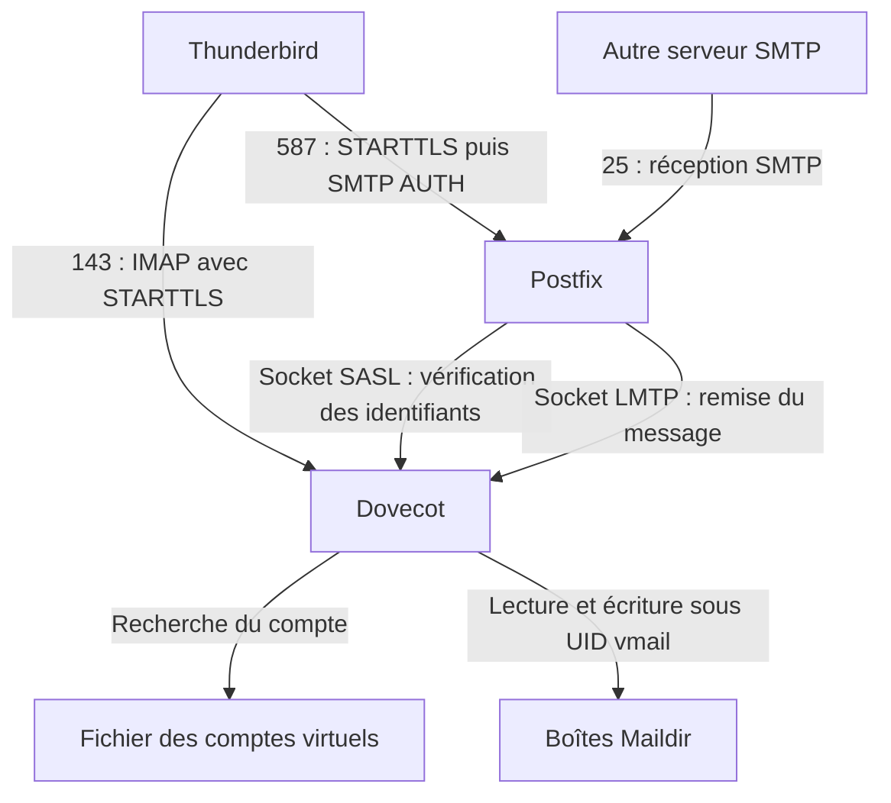
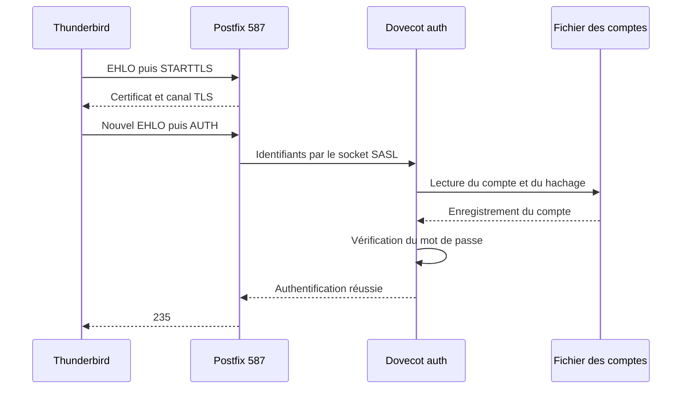
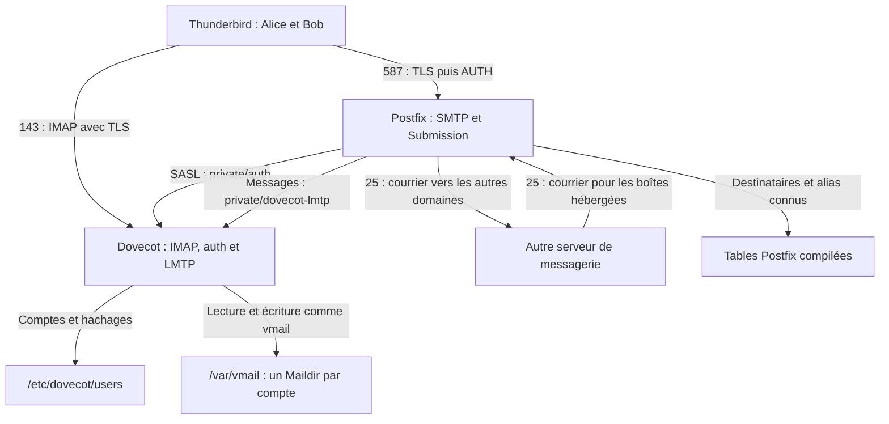

# Postfix et Dovecot

**SportLudique BTS SIO SISR Expert**

## Avant de commencer

Ce tutoriel présente l'installation et la configuration d'un serveur de messagerie sous Linux reposant sur **Postfix** et **Dovecot**.

Les utilisateurs de messagerie, Alice et Bob, sont des **comptes virtuels gérés par Dovecot**. Ils ne disposent donc pas de compte utilisateur sur le système Linux et ne peuvent pas ouvrir de session locale ou SSH.

Un compte système dédié, nommé `vmail`, assure le stockage et la gestion des fichiers de leurs boîtes aux lettres.

| Élément | Valeur retenue |
| --- | --- |
| Domaine de courrier | `ville.sportludique.fr` |
| Serveur | `mail.ville.sportludique.fr` |
| Comptes de courrier et identifiants de connexion | `alice@ville.sportludique.fr` et `bob@ville.sportludique.fr` |
| Base des comptes | `/etc/dovecot/users`, avec des mots de passe hachés |
| Racine du stockage | `/var/vmail` |
| Réception SMTP | TCP 25 ; sans authentification ; STARTTLS opportuniste |
| Envoi des utilisateurs | TCP 587 ; STARTTLS et authentification obligatoires |
| Consultation IMAP | TCP 143 ; STARTTLS avant authentification réseau |
| Distribution finale | Postfix transmet à Dovecot par un socket Unix LMTP |
| Authentification SMTP | Postfix interroge Dovecot par un autre socket Unix, SASL |
| Certificat | Certificat serveur signé par l'intermédiaire de la PKI SportLudique |

### Versions utilisées

Ce tutoriel repose sur **Postfix 3.10** et **Dovecot 2.4**, disponibles sous Debian 13 (Trixie).

**Attention :** Dovecot 2.4 introduit des changements importants dans la syntaxe des fichiers de configuration. Les configurations destinées à Dovecot 2.3 ne sont donc pas directement réutilisables.


| Fonction | Configuration Dovecot 2.4 | Explication |
| --- | --- | --- |
| Comptes virtuels | `passdb passwd-file` et `userdb passwd-file` | `passdb` vérifie les identifiants et mots de passe. `userdb` fournit les informations nécessaires à l'accès aux boîtes aux lettres, notamment leur répertoire personnel virtuel. |
| Format de stockage | `mail_driver = maildir` | Les messages sont stockés au format **Maildir** : chaque courriel est enregistré dans un fichier distinct, organisé dans les sous-répertoires `new`, `cur` et `tmp`. |
| Emplacement des boîtes | `mail_path = ~/Maildir` | Le symbole `~` désigne le répertoire personnel **virtuel** défini par `userdb`. Il ne nécessite pas de compte Linux. Chaque utilisateur possède ainsi son propre répertoire de messagerie, dont les fichiers appartiennent au compte technique `vmail`. |
| Sécurité de l'authentification | `auth_allow_cleartext = no` | Refuse l'authentification par mot de passe en clair lorsque la connexion n'est pas protégée par TLS. |
| Certificat TLS | `ssl_server_cert_file` et `ssl_server_key_file` | Indiquent les fichiers contenant le certificat du serveur (avec sa chaîne de certification si nécessaire) et sa clé privée. Ils permettent de sécuriser les connexions des clients. |


!!! tip "Comprendre les boîtes aux lettres virtuelles"
    Alice et Bob ne possèdent **aucun compte utilisateur Linux**. Dovecot leur associe un répertoire personnel virtuel grâce à `userdb`.

    Par exemple, si le répertoire virtuel d'Alice est `/var/mail/vhosts/sportludique.fr/alice`, la directive `mail_path = ~/Maildir` désigne `/var/mail/vhosts/sportludique.fr/alice/Maildir`.

    Les fichiers des différentes boîtes aux lettres appartiennent au **compte système `vmail`**, mais Dovecot identifie chaque utilisateur et lui donne accès uniquement à sa propre messagerie.


!!! danger "Attention à la syntaxe Dovecot 2.4"
    Le niveau de syntaxe `2.4.0` est compatible avec Dovecot 2.4.1.

    **N'utilisez pas les anciennes directives** `mail_location`, `disable_plaintext_auth`, `ssl_cert` ou `ssl_key`, présentes dans de nombreux tutoriels destinés à Dovecot 2.3. 
    
    Elles ne sont plus valides avec la syntaxe Dovecot 2.4.


## Partie 1 — Comprendre les rôles et les deux sockets

### 1.1 — Les composants

| Composant | Son rôle ici |
| --- | --- |
| Postfix | Reçoit les messages sur port TCP 25 d'autres serveurs de messagerie, reçoit les demande d'envois d'utilisateurs authentifiés sur TCP 587, gère la file et l'acheminement SMTP. |
| Dovecot | Vérifie les comptes, distribue les messages reçus par LMTP et présente les boîtes en IMAP. |
| Fichier de comptes | Contient les adresses de connexion et leurs mots de passe hachés. Il est lu par Dovecot. |
| `vmail` | Compte technique Linux sous lequel les fichiers des boîtes sont écrits et lus. |
| SASL | Permet à Postfix de demander à Dovecot si les identifiants SMTP sont valides. |
| LMTP | Permet à Postfix de remettre un message à Dovecot pour sa distribution dans la boîte. |
| Maildir | Stocke chaque message dans un fichier distinct. |
| TLS | Chiffre la connexion réseau et permet au client de vérifier l'identité du serveur. |




!!! warning "Attention : SASL et LMTP sont deux services distincts"
    - **SASL** permet à Postfix d'authentifier les utilisateurs via Dovecot. Si le socket SASL est indisponible, **l'envoi authentifié échoue**, même si la réception des messages fonctionne.
    - **LMTP** permet à Postfix de transmettre les messages à Dovecot pour leur dépôt dans les boîtes aux lettres. Si le socket LMTP est indisponible, **l'authentification peut réussir**, mais les messages restent en attente dans la file d'attente de Postfix.


### 1.2 — Compte virtuel et compte Linux

Le compte système Linux `vmail` est utilisé pour stocker les fichiers des boîtes aux lettres. Il ne permet pas d'ouvrir une session interactive et ne doit pas être utilisé pour se connecter à la messagerie.

Les utilisateurs s'authentifient avec leur **adresse électronique complète**, par exemple `alice@ville.sportludique.fr`. Dovecot vérifie leurs identifiants et mots de passe dans son fichier de comptes virtuels, indépendamment des comptes utilisateurs Linux.

Contrairement à une configuration reposant sur des comptes système, **le nom de domaine fait ici partie intégrante de l'identifiant**. Ainsi, `alice@ville.sportludique.fr` et `alice@autreville.sportludique.fr` sont deux identifiants distincts.


!!! tip "Identifiant de connexion : nom court ou adresse complète ?"
    La directive `auth_username_format` permet de définir comment Dovecot interprète l'identifiant fourni par le client de messagerie.

    Deux configurations sont possibles :

    | Configuration | Comportement |
    | --- | --- |
    | `auth_username_format = %{user \| lower}` | Conserve l'adresse complète et la convertit en minuscules. |
    | `auth_username_format = %{user \| username \| lower}` | Ne conserve que la partie avant `@` et la convertit en minuscules. |

    Le filtre `lower` garantit que l'identifiant est toujours traité en minuscules, même si l'utilisateur saisit accidentellement des majuscules.

    **À vous de choisir !** Les comptes déclarés dans le fichier `passwd-file` doivent correspondre au format retenu. Dans Thunderbird, le champ **Nom d'utilisateur** doit être renseigné en conséquence.

    Ce choix concerne uniquement **l'authentification** : l'adresse électronique utilisée pour envoyer et recevoir les messages reste complète.


### 1.3 — TLS et authentification

**TLS** protège les communications en chiffrant les données échangées entre le client et le serveur. **SASL** permet d'authentifier l'utilisateur auprès du serveur SMTP, mais ne chiffre pas lui-même la communication.

Les mécanismes d'authentification **PLAIN** et **LOGIN** peuvent transmettre les identifiants et mots de passe encodés en **Base64**.

!!! warning "SASL n'assure pas le chiffrement des échanges"
    Par exemple, le mot de passe `azerty` devient :

    ```text
    YXplcnR5
    ```

    Pour le vérifier sous Linux :

    ```bash
    echo -n "azerty" | base64
    ```

    Et pour retrouver le mot de passe :

    ```bash
    echo -n "YXplcnR5" | base64 -d
    ```

    **Le Base64 n'est pas un chiffrement !** N'importe qui peut retrouver le mot de passe à partir de sa représentation encodée.

    C'est pourquoi l'authentification PLAIN ou LOGIN doit être réalisée **après l'établissement d'une connexion TLS**, notamment grâce à STARTTLS sur le port SMTP 587.

## Partie 2 — Préparer Debian, le DNS et les fichiers TLS

### 2.1 — Configurer le nom de la VM

Configurez le nom d'hôte de votre serveur (`mail.ville.sportludique.fr`) et vérifiez sa résolution DNS, conformément au plan d'adressage de votre infrastructure.

Reportez-vous aux missions **Socle** ou **Avancé** pour la configuration DNS.

**Vérifiez la résolution directe et inverse**, ainsi que la résolution locale du nom du serveur via le fichier `/etc/hosts`. Une entrée incorrecte dans ce fichier peut provoquer des dysfonctionnements de Postfix et Dovecot.

Corrigez les éventuelles incohérences avant de poursuivre.

### 2.2 — Installer les logiciels sur la VM mail

```bash
apt update
apt install postfix dovecot-core dovecot-imapd dovecot-lmtpd
```

Si l'assistant Postfix pose les questions, choisir **Site Internet**, puis `ville.sportludique.fr` comme nom de courrier du système. La configuration sera explicitée en partie 4.

Installer les outils de test et l'éditeur :

```bash
apt install swaks libnet-ssleay-perl libio-socket-ssl-perl libterm-readkey-perl
```

Swaks permet de tester SMTP, STARTTLS, AUTH et LMTP. Les modules Perl installés avec lui rendent les tests TLS et la saisie masquée utilisables.
Relever les versions :

```bash
dovecot --version
```

```bash
dpkg-query -W postfix dovecot-core dovecot-imapd dovecot-lmtpd
postconf -a
```

### 2.3 — Sauvegarder les configurations installées

**Modification — copies de sauvegarde sur la VM neuve :**

```bash
cp -a /etc/postfix /etc/postfix.old
cp -a /etc/dovecot /etc/dovecot.old
cp -a /etc/aliases /etc/aliases.old
```

### 2.4 — Placer les quatre fichiers de la PKI

Obtenir les fichiers PEM existants : certificat serveur, clé privée serveur, certificat intermédiaire et certificat racine. Le certificat serveur doit contenir le SAN **`DNS:mail.ville.sportludique.fr`** et être utilisable pour l'authentification d'un serveur TLS.

Les chemins `/CHEMIN/REEL/...` ci-dessous sont les emplacements où vous avez effectivement déposé ces fichiers. **Aucune clé privée de la racine ou de l'intermédiaire ne doit être copiée sur cette VM.**

**Modification — répertoires d'installation :**

```bash
mkdir -p /etc/ssl/certs/sportludique
mkdir -p /etc/ssl/private/sportludique
chmod 700 /etc/ssl/private/sportludique
```

Copier les certificats publics :

```bash
cp /CHEMIN/REEL/mail.crt /etc/ssl/certs/sportludique/mail.crt
cp /CHEMIN/REEL/intermediate.crt /etc/ssl/certs/sportludique/intermediate.crt
cp /CHEMIN/REEL/root.crt /etc/ssl/certs/sportludique/root.crt
```

Fixer les droits des fichiers publics :

```bash
chmod 755 /etc/ssl/certs/sportludique
chmod 644 /etc/ssl/certs/sportludique/mail.crt /etc/ssl/certs/sportludique/intermediate.crt /etc/ssl/certs/sportludique/root.crt
```

### 2.5 — Construire les fichiers de chaîne

Dovecot utilise un fichier public contenant **le certificat serveur, puis l'intermédiaire** :

**Modification :**

```bash
cat /etc/ssl/certs/sportludique/mail.crt /etc/ssl/certs/sportludique/intermediate.crt > /etc/ssl/certs/sportludique/fullchain.pem
chmod 644 /etc/ssl/certs/sportludique/fullchain.pem
```

Postfix utilise la directive moderne `smtpd_tls_chain_files`. Son fichier contient **la clé privée serveur, puis ce fullchain** :

```bash
cat /etc/ssl/private/sportludique/mail.key /etc/ssl/certs/sportludique/fullchain.pem > /etc/ssl/private/sportludique/postfix-chain.pem
chmod 600 /etc/ssl/private/sportludique/postfix-chain.pem
```

La racine sera reconnue par les clients. Il n'est pas nécessaire de l'envoyer dans le fullchain. Le fichier combiné Postfix est **privé**, puisqu'il contient la clé.

```bash
ls -l /etc/ssl/certs/sportludique/fullchain.pem
ls -l /etc/ssl/private/sportludique/postfix-chain.pem
```

**Validation :** fullchain public, fichier combiné privé. Ne pas afficher le contenu du fichier combiné dans une capture ou un livrable.

### 2.6 — Valider les certificats avant de démarrer les services

Examiner le SAN et les usages :

```bash
openssl x509 -in /etc/ssl/certs/sportludique/mail.crt -noout -ext subjectAltName,extendedKeyUsage
```

Vérifier le certificat avec la racine et l'intermédiaire :

```bash
openssl verify -purpose sslserver -verify_hostname mail.orleans.sportludique.fr \
  -CAfile /etc/ssl/certs/sportludique/root.crt \
  -untrusted /etc/ssl/certs/sportludique/intermediate.crt \
  /etc/ssl/certs/sportludique/mail.crt
```

Vérifier que la clé privée correspond au certificat. Les deux commandes calculent une empreinte de la **clé publique**, avec la même représentation :

```bash
openssl x509 -in /etc/ssl/certs/sportludique/mail.crt -pubkey -noout | openssl pkey -pubin -outform DER | openssl dgst -sha256
```

```bash
openssl pkey -in /etc/ssl/private/sportludique/mail.key -pubout -outform DER | openssl dgst -sha256
```

Comparer enfin la racine à l'empreinte fournie par l'enseignant :

```bash
openssl x509 -in /etc/ssl/certs/sportludique/root.crt -noout -fingerprint -sha256
```

**Validation :** SAN correct, `openssl verify` renvoie `OK`, les deux empreintes de clé publique sont identiques et la racine est bien celle attendue. Si l'une des commandes OpenSSL affiche une erreur, ne pas considérer son empreinte de sortie comme un résultat valide.

### 2.11 — Préparer le poste client et les accès réseau

**Sur le poste Linux de test, modification — outils de contrôle :**

```bash
sudo apt update
sudo apt install openssl dnsutils netcat-openbsd swaks libnet-ssleay-perl libio-socket-ssl-perl libterm-readkey-perl
```

Copier le **certificat public racine vérifié** dans le répertoire personnel du compte qui réalisera les tests, sous le nom `sportludique-root.crt`. Les commandes client utiliseront `~/sportludique-root.crt`.

```bash
openssl x509 -in ~/sportludique-root.crt -noout -fingerprint -sha256
```

Sur le réseau du laboratoire, autoriser TCP 25 vers la VM depuis les autres serveurs, et TCP 143/587 depuis les clients. Si NAT, prévoir les redirections correspondantes. Pour l'envoi vers les autres domaines, autoriser aussi SMTP 25 sortant et la résolution DNS.

**Validation de la partie 2 :** paramètres connus, DNS correct, logiciels présents, sauvegardes faites et fichiers TLS vérifiés. Les essais réseau des services auront lieu après leur activation.

## Partie 3 — Créer les comptes virtuels et préparer Dovecot

Dans cette architecture, Dovecot doit être prêt à recevoir les messages par LMTP avant de tester la distribution Postfix. On le prépare donc avant la réception SMTP. **Aucune authentification SMTP n'est encore activée.**

### 3.1 — Créer le compte technique `vmail`

**Sur la VM mail, vérifier d'abord s'il existe :**

```bash
getent passwd vmail
getent group vmail
```

Sur la VM neuve, ces commandes ne doivent rien afficher. Si le compte existe déjà, vérifier sa fonction au lieu de le recréer ou de modifier son UID à l'aveugle.

**Modification — création du groupe puis du compte technique :**

```bash
groupadd vmail
useradd -g vmail -d /var/vmail -M -s /usr/sbin/nologin vmail
```

Le compte reçoit automatiquement un UID d'utilisateur ordinaire disponible. `-M` laisse la création du répertoire à l'étape suivante. Le shell `nologin` interdit la session interactive. **Ne pas définir de mot de passe pour `vmail`.**

```bash
id vmail
getent passwd vmail
passwd -S vmail
```

**Validation :** `vmail` existe, son domicile déclaré est `/var/vmail`, son shell est `/usr/sbin/nologin` et son mot de passe est verrouillé. Relever l'UID et le GID affichés, qui serviront à interpréter les contrôles de fichiers. Alice et Bob ne sont pas créés dans Linux.

### 3.2 — Préparer les répertoires de stockage

**Modification :**

```bash
mkdir -p /var/vmail/orleans.sportludique.fr/alice
mkdir -p /var/vmail/orleans.sportludique.fr/bob
chown -R vmail:vmail /var/vmail
```

Ce changement récursif concerne uniquement la nouvelle arborescence dédiée aux boîtes. Ne pas appliquer cette commande à `/var` ni à `/var/spool/postfix`.

Protéger l'accès à l'arborescence :

```bash
chmod 700 /var/vmail
chmod 700 /var/vmail/orleans.sportludique.fr/alice
chmod 700 /var/vmail/orleans.sportludique.fr/bob
```

```bash
ls -ld /var/vmail /var/vmail/orleans.sportludique.fr/alice /var/vmail/orleans.sportludique.fr/bob
```

**Validation :** ces répertoires appartiennent à `vmail:vmail`. Le sous-répertoire `Maildir` sera créé par Dovecot lors de la première distribution ; on ne fabrique pas un fichier appelé `Maildir`.

### 3.3 — Générer le hachage du mot de passe d'Alice

Vérifier les algorithmes disponibles :

```bash
doveadm pw -l
```

**Validation préalable :** la liste contient `ARGON2ID`, fourni par le paquet Dovecot de Debian 13.

Générer le hachage d'Alice :

```bash
doveadm pw -s ARGON2ID
```

Saisir deux fois le mot de passe choisi. Copier **toute la ligne produite**, depuis `{ARGON2ID}` jusqu'au dernier caractère. Le mot de passe n'est ni un argument de commande ni un texte à enregistrer dans le fichier de comptes.

**Validation :** une ligne de hachage est produite sans erreur. Le hachage n'est pas une clé de chiffrement ; Dovecot l'utilisera pour vérifier le mot de passe fourni par le client.

### 3.4 — Créer le fichier des comptes

**Modification :**

```bash
nano /etc/dovecot/users
```

Ajouter la ligne d'Alice en remplaçant le libellé de hachage par la sortie réelle de la commande précédente :

```text
alice@orleans.sportludique.fr:HACHAGE_COMPLET_ALICE_A_REMPLACER
```

Il n'y a **pas d'espace** autour du `:`. Ne pas ajouter de guillemets autour du hachage. Dans `nano`, les caractères `$` du hachage restent du texte : ils ne sont pas interprétés par le shell.

Générer ensuite un hachage propre au mot de passe de Bob :

```bash
doveadm pw -s ARGON2ID
```

Rouvrir le fichier et ajouter Bob :

```bash
nano /etc/dovecot/users
```

Le fichier contient maintenant deux lignes, avec leurs **vrais hachages distincts** :

```text
alice@orleans.sportludique.fr:HACHAGE_COMPLET_ALICE_A_REMPLACER
bob@orleans.sportludique.fr:HACHAGE_COMPLET_BOB_A_REMPLACER
```

Protéger ce fichier :

```bash
chown root:dovecot /etc/dovecot/users
chmod 640 /etc/dovecot/users
ls -l /etc/dovecot/users
```

**Validation :** propriétaire `root`, groupe `dovecot`, permissions `-rw-r-----`. Les deux lignes contiennent chacune une adresse complète et un hachage commençant par `{ARGON2ID}`. Ce fichier est sensible ; ne pas le recopier dans les captures du compte rendu.

### 3.5 — Configurer Dovecot dans un seul fichier

**Modification — remplacer le contenu de `/etc/dovecot/dovecot.conf`, sauvegardé précédemment :**

```bash
nano /etc/dovecot/dovecot.conf
```

Copier cette configuration complète :

```ini
dovecot_config_version = 2.4.0
dovecot_storage_version = 2.4.0

protocols {
  imap = yes
  lmtp = yes
}
listen = *

auth_mechanisms = plain login
auth_allow_cleartext = no
auth_username_format = %{user | lower}

passdb passwd-file {
  passwd_file_path = /etc/dovecot/users
}
userdb passwd-file {
  passwd_file_path = /etc/dovecot/users
  fields {
    uid:default = vmail
    gid:default = vmail
    home:default = /var/vmail/%{user | domain}/%{user | username}
  }
}

mail_driver = maildir
mail_path = ~/Maildir
namespace inbox {
  inbox = yes
  separator = /
}

ssl = required
ssl_min_protocol = TLSv1.2
ssl_server_cert_file = /etc/ssl/certs/sportludique/fullchain.pem
ssl_server_key_file = /etc/ssl/private/sportludique/mail.key

service imap-login {
  inet_listener imap {
    port = 143
  }
  inet_listener imaps {
    port = 0
  }
}

service lmtp {
  unix_listener /var/spool/postfix/private/dovecot-lmtp {
    mode = 0600
    user = postfix
    group = postfix
  }
}
protocol lmtp {
  postmaster_address = postmaster@orleans.sportludique.fr
}

log_path = syslog
syslog_facility = mail
```

**Ne conserver aucune ligne `!include` de l'ancien fichier.** Cette configuration autonome ne charge ni `conf.d/*.conf`, ni `local.conf`, ni une pile PAM. Les fichiers d'exemple restent sur disque ; il n'est pas nécessaire de les supprimer.

Fixer les permissions du fichier :

```bash
chown root:root /etc/dovecot/dovecot.conf
chmod 644 /etc/dovecot/dovecot.conf
```

| Réglage | Ce qu'il réalise |
| --- | --- |
| `protocols` | Active IMAP et LMTP ; aucun serveur SMTP Dovecot n'est utilisé. |
| `passdb passwd-file` | Vérifie le mot de passe dans `/etc/dovecot/users`. |
| `userdb passwd-file` | Recherche le même utilisateur pour obtenir son identité de stockage ; un compte absent n'est pas accepté. |
| `uid:default`, `gid:default` | Font travailler les boîtes sous le compte technique `vmail`, sans recopier son numéro d'UID dans chaque ligne de compte. |
| `home:default` | Calcule un domicile différent pour chaque adresse : domaine, puis utilisateur. |
| `auth_username_format` | Met l'identifiant en minuscules en conservant le domaine. |
| `mail_path = ~/Maildir` | Place les messages sous `Maildir` dans le domicile fourni par `userdb`. |
| `ssl = required` | Exige une connexion protégée pour l'authentification des clients réseau. |
| `auth_allow_cleartext = no` | Refuse PLAIN/LOGIN sur une connexion réseau non protégée. |
| Listener IMAP `143` | Fournit IMAP avec STARTTLS ; le listener implicite 993 est désactivé avec `port = 0`. |
| Socket LMTP | Reçoit les messages de Postfix ; son mode `0600` limite l'accès au propriétaire `postfix`. |

Contrôler la syntaxe **avant** de redémarrer :

```bash
doveconf -n
```

**Validation :** aucune erreur de syntaxe. La sortie montre une seule base de mots de passe et une seule base d'utilisateurs, toutes deux `passwd-file`. Elle peut présenter les réglages TLS sous un bloc normalisé `ssl_server` : c'est équivalent aux directives saisies.

### 3.6 — Démarrer et tester les comptes

**Modification — activation du service :**

```bash
systemctl enable dovecot
systemctl restart dovecot
systemctl status dovecot --no-pager
```

Tester Alice et Bob ; le mot de passe est demandé :

```bash
doveadm auth test alice@orleans.sportludique.fr
doveadm auth test bob@orleans.sportludique.fr
```

**Validation :** les bons mots de passe produisent `auth succeeded`. Refaire un essai avec un mot de passe volontairement faux : il doit être refusé. Un nom court tel que `alice` ne correspond pas à une ligne du fichier et doit aussi échouer.

Ces tests passent par une interface locale d'administration. Ils ne prouvent pas encore le certificat réseau ni SMTP AUTH dans Postfix.

### 3.7 — Vérifier le domicile et le socket LMTP

```bash
doveadm user alice@orleans.sportludique.fr
doveadm user bob@orleans.sportludique.fr
```

Les UID/GID doivent correspondre à `id vmail`. Les domiciles attendus sont :

```text
/var/vmail/orleans.sportludique.fr/alice
/var/vmail/orleans.sportludique.fr/bob
```

Vérifier aussi qu'un compte inexistant n'est pas trouvé :

```bash
doveadm user inconnu@orleans.sportludique.fr
```

Puis vérifier le socket :

```bash
ls -l /var/spool/postfix/private/dovecot-lmtp
ss -xlpn | grep dovecot-lmtp
```

**Validation :** le compte inconnu est refusé ; le socket existe, commence par `s` dans la sortie `ls`, appartient à `postfix:postfix` et porte les droits `srw-------`. Si le répertoire Postfix manque, vérifier l'installation du paquet Postfix ; ne pas improviser toute son arborescence à la main.

### 3.8 — Tester LMTP et le premier fichier de message

Ce test est effectué **sur la VM, en root**. Il utilise directement le socket LMTP, sans SMTP AUTH ni connexion TLS réseau :

```bash
swaks --protocol LMTP --socket /var/spool/postfix/private/dovecot-lmtp \
  --from alice@orleans.sportludique.fr --to bob@orleans.sportludique.fr \
  --header 'Subject: SL-LMTP-001' --body 'Premier message remis directement a Dovecot.'
```

**Validation de la remise :** LMTP accepte Bob puis confirme la sauvegarde du message après DATA. Une erreur ici concerne LMTP, le compte ou le stockage ; elle ne concerne pas SASL Postfix.

Vérifier le répertoire et rechercher le sujet :

```bash
ls -l /var/vmail/orleans.sportludique.fr/bob/Maildir/new
grep -R 'SL-LMTP-001' /var/vmail/orleans.sportludique.fr/bob/Maildir/new
```

**Validation sur disque :** un message appartient à `vmail:vmail`, généralement avec le mode `0600`, et contient le sujet attendu.

| Répertoire Maildir | Fonction |
| --- | --- |
| `tmp/` | Message en cours d'écriture. |
| `new/` | Message nouvellement distribué. |
| `cur/` | Messages pris en charge comme messages courants, avec des indicateurs dans les noms de fichiers. |

Le passage vers `cur/` ne signifie pas nécessairement que le message a été lu ; l'indicateur `S` correspond à « vu ». Dovecot crée également des fichiers d'index et de suivi autour de ces répertoires.

**Validation de la partie 3 :** comptes virtuels reconnus, compte inconnu refusé, authentification vérifiée, LMTP disponible et premier message présent sur disque. On peut maintenant vérifier le trajet complet passant par Postfix.

## Partie 4 — Configurer la réception Postfix et la distribution LMTP

### 4.1 — Déclarer les destinataires connus dans Postfix

Dovecot connaît les mots de passe et l'emplacement des boîtes. Postfix a seulement besoin de savoir **quelles adresses du domaine existent**, pour refuser les erreurs de destinataire avant d'accepter les messages.

**Modification — créer cette liste :**

```bash
nano /etc/postfix/vmailbox
```

Contenu complet :

```text
alice@orleans.sportludique.fr 1
bob@orleans.sportludique.fr 1
```

Le `1` signifie ici « adresse connue ». **Il ne désigne pas un fichier de boîte** : Dovecot choisira le chemin lors de la distribution LMTP. Aucun mot de passe ne figure dans cette table.

Compiler la table texte en une base lisible par Postfix :

```bash
postmap /etc/postfix/vmailbox
chmod 644 /etc/postfix/vmailbox /etc/postfix/vmailbox.db
```

Tester les recherches :

```bash
postmap -q bob@orleans.sportludique.fr hash:/etc/postfix/vmailbox
postmap -q inconnu@orleans.sportludique.fr hash:/etc/postfix/vmailbox
```

**Validation :** Bob renvoie `1`, le compte inconnu ne renvoie rien. Après chaque modification du fichier texte, il faudra refaire `postmap`. Sans cela, Postfix lit une ancienne version de la liste.

### 4.2 — Prévoir l'adresse `postmaster`

**Modification — créer la table d'alias virtuels :**

```bash
nano /etc/postfix/virtual
```

Contenu :

```text
postmaster@orleans.sportludique.fr alice@orleans.sportludique.fr
```

Cet alias n'est pas un troisième compte : les messages destinés à `postmaster` sont redirigés vers Alice.

```bash
postmap /etc/postfix/virtual
chmod 644 /etc/postfix/virtual /etc/postfix/virtual.db
postmap -q postmaster@orleans.sportludique.fr hash:/etc/postfix/virtual
```

**Validation :** la recherche renvoie l'adresse complète d'Alice.

### 4.3 — Écrire `main.cf`

**Modification — remplacer `/etc/postfix/main.cf` :**

```bash
nano /etc/postfix/main.cf
```

Contenu complet :

```ini
compatibility_level = 3.10

myhostname = mail.orleans.sportludique.fr
mydomain = orleans.sportludique.fr
myorigin = $mydomain
mydestination = $myhostname, localhost.$mydomain, localhost

inet_interfaces = all
inet_protocols = ipv4
mynetworks = 127.0.0.0/8
relay_domains =
relayhost =

alias_maps = hash:/etc/aliases
alias_database = hash:/etc/aliases
virtual_mailbox_domains = orleans.sportludique.fr
virtual_mailbox_maps = hash:/etc/postfix/vmailbox
virtual_alias_maps = hash:/etc/postfix/virtual
virtual_transport = lmtp:unix:private/dovecot-lmtp

smtpd_relay_restrictions = permit_mynetworks, permit_sasl_authenticated, reject_unauth_destination
smtpd_recipient_restrictions = reject_unlisted_recipient

smtpd_sasl_type = dovecot
smtpd_sasl_path = private/auth
smtpd_sasl_security_options = noanonymous
smtpd_sasl_auth_enable = no
smtpd_tls_auth_only = yes

smtpd_tls_chain_files = /etc/ssl/private/sportludique/postfix-chain.pem
smtpd_tls_security_level = may
smtpd_tls_protocols = >=TLSv1.2
smtpd_tls_mandatory_protocols = >=TLSv1.2
smtpd_tls_loglevel = 1

smtp_tls_security_level = may
smtp_tls_protocols = >=TLSv1.2

biff = no
append_dot_mydomain = no
```

Le fournisseur SASL est déjà indiqué, mais `smtpd_sasl_auth_enable = no` laisse AUTH **désactivé**. Seul le service 587 l'activera en partie 5. TCP 25 restera sans SMTP AUTH.

| Directive | Rôle et conséquence |
| --- | --- |
| `myhostname` | Identité DNS de cette machine dans les échanges SMTP. |
| `mydomain` | Domaine de référence utilisé par les autres paramètres ; ce réglage seul ne déclare pas des boîtes. |
| `myorigin` | Domaine ajouté aux adresses non qualifiées des messages injectés localement. |
| `mydestination` | Domaines traités par la distribution locale vers les comptes système. **Le domaine des comptes virtuels ne doit pas y figurer.** |
| `virtual_mailbox_domains` | Domaine pour lequel Postfix héberge les boîtes virtuelles. |
| `virtual_mailbox_maps` | Liste des destinataires réels, utilisée pour refuser une adresse inexistante. |
| `virtual_alias_maps` | Redirections d'adresses, ici `postmaster` vers Alice. |
| `virtual_transport` | Remet les messages des comptes virtuels au socket LMTP Dovecot. |
| `mynetworks` | Autorise seulement la boucle locale à relayer sans authentification sur le service SMTP général. |
| `smtpd_relay_restrictions` | Autorise les origines de confiance et les utilisateurs authentifiés ; refuse le relais distant non autorisé. |
| `reject_unlisted_recipient` | Refuse un destinataire inconnu du domaine hébergé au lieu d'accepter un message impossible à distribuer. |
| `relay_domains` | Vide : aucun domaine distant n'est déclaré comme domaine relayé pour des tiers. |
| `relayhost` | Vide : les destinations distantes sont acheminées par SMTP avec leur DNS/MX, sans relais imposé. |
| `inet_protocols` | IPv4 pour ce TP ; cohérent avec l'écoute Dovecot `listen = *`. |

**Point essentiel :** un domaine virtuel est bien hébergé sur cette VM, mais appartient à la classe `virtual_mailbox_domains`. Le placer aussi dans `mydestination` mélange deux modes de distribution. On n'utilise ici ni `home_mailbox = Maildir/` ni un UID virtuel Postfix : **Dovecot écrit les fichiers**.

Vérifier les permissions et la lecture du fichier :

```bash
chown root:root /etc/postfix/main.cf
chmod 644 /etc/postfix/main.cf
postconf -n
```

**Validation :** aucune directive inconnue ou erreur de lecture ; le domaine est présent dans `virtual_mailbox_domains` et absent de `mydestination`.

### 4.4 — Configurer les adresses système et l'écoute sur 25

**Modification — nom de courrier de Debian :**

```bash
echo orleans.sportludique.fr > /etc/mailname
```

Ouvrir les alias locaux :

```bash
nano /etc/aliases
```

Conserver les autres alias système éventuels. Faire en sorte que ces deux définitions existent une seule fois :

```text
postmaster: root
root: alice@orleans.sportludique.fr
```

Ici, `root` est une adresse système redirigée vers une boîte virtuelle. **La cible est l'adresse complète d'Alice**, pas un compte Linux `alice`.

```bash
newaliases
```

Ouvrir le fichier des services Postfix :

```bash
nano /etc/postfix/master.cf
```

Vérifier que cette ligne d'écoute est active, sans `#` initial :

```ini
smtp      inet  n       -       y       -       -       smtpd
```

Conserver les services internes du paquet. Ne pas activer Postscreen, 465 ou Submission à cette étape. Le fichier final complet figure en partie 10.

```bash
postconf -M smtp/inet
postfix check
```

**Validation :** le service réseau SMTP utilise `smtpd` et le contrôle Postfix ne signale pas d'erreur bloquante.

### 4.5 — Démarrer Postfix et vérifier le port

**Modification :**

```bash
systemctl enable postfix
systemctl restart postfix
systemctl status postfix --no-pager
```

```bash
postfix status
ss -ltnp 'sport = :25'
```

**Depuis le poste client :**

```bash
nc -vz mail.orleans.sportludique.fr 25
```

**Validation :** Postfix fonctionne et le port 25 est joignable depuis le client. Si seul le test réseau échoue, examiner le DNS, le routage, le NAT et les pare-feux avant de modifier les comptes.

### 4.6 — Envoyer un message local sans Thunderbird et sans SASL

**Sur la VM mail, modification — créer un petit message de test :**

```bash
nano /root/test-mail.txt
```

Contenu du fichier, avec une ligne vide entre les en-têtes et le corps :

```text
From: alice@orleans.sportludique.fr
To: bob@orleans.sportludique.fr
Subject: SL-LOCAL-001

Message local injecte dans Postfix puis distribue par Dovecot LMTP.
```

Injecter ce fichier dans la file Postfix :

```bash
sendmail -i -f alice@orleans.sportludique.fr bob@orleans.sportludique.fr < /root/test-mail.txt
```

Cette commande est l'interface locale fournie par Postfix. Elle ne demande pas le mot de passe d'Alice et ne teste pas SMTP AUTH.

```bash
postqueue -p
journalctl -u postfix -n 40 --no-pager
```

**Validation de la distribution :** retrouver le traitement par `postfix/lmtp`, avec `status=sent`. La distribution est asynchrone ; rejouer les lectures après quelques secondes si nécessaire.

Vérifier le message réel sur disque :

```bash
grep -R 'SL-LOCAL-001' /var/vmail/orleans.sportludique.fr/bob/Maildir/new /var/vmail/orleans.sportludique.fr/bob/Maildir/cur
```

**Validation :** le sujet est retrouvé dans un fichier de la boîte de Bob. Un message accepté dans une file n'est pas encore une preuve de distribution ; le journal LMTP et le fichier confirment celle-ci.

### 4.7 — Tester la réception SMTP et les deux refus attendus

**Depuis le poste client**, envoyer un message pour un compte réel :

```bash
swaks --server mail.orleans.sportludique.fr --port 25 \
  --from alice@orleans.sportludique.fr --to bob@orleans.sportludique.fr \
  --header 'Subject: SL-SMTP25-001' --body 'Reception SMTP sans authentification vers une boite hebergee.'
```

**Attendu :** message accepté après DATA puis retrouvé chez Bob. Recevoir du courrier pour une boîte hébergée est le rôle normal du port 25 ; cela ne constitue pas du relais ouvert.

Tester une adresse inexistante du domaine :

```bash
swaks --server mail.orleans.sportludique.fr --port 25 \
  --from alice@orleans.sportludique.fr --to inconnu@orleans.sportludique.fr --quit-after RCPT
```

**Attendu :** refus au destinataire, typiquement `550 5.1.1 ... User unknown in virtual mailbox table`. Ce message ne doit pas être accepté puis rejeté après distribution.

Tester le relais vers un domaine extérieur :

```bash
swaks --server mail.orleans.sportludique.fr --port 25 \
  --from test@example.net --to destinataire@example.org --quit-after RCPT
```

**Attendu :** refus de relais, typiquement `554 5.7.1 Relay access denied`. Les domaines `example.net` et `example.org` servent uniquement au test, interrompu avant DATA : aucun courrier ne leur est envoyé.

Effectuer ce dernier contrôle depuis un poste extérieur à `mynetworks`. La boucle locale sur la VM est volontairement autorisée à relayer ; elle ne convient pas pour ce contre-test.

**Validation de la partie 4 :** réception SMTP, distribution LMTP et fichier Maildir fonctionnent avant toute activation de SMTP AUTH. Le compte inconnu et le relais distant non autorisé sont refusés.

## Partie 5 — Activer SASL Dovecot et Submission sur 587

### 5.1 — Ajouter le socket SASL, sans toucher au socket LMTP

**Sur la VM mail, modification — ouvrir le fichier Dovecot :**

```bash
nano /etc/dovecot/dovecot.conf
```

Ajouter ce bloc, une seule fois, à la fin :

```ini
service auth {
  unix_listener /var/spool/postfix/private/auth {
    mode = 0660
    user = postfix
    group = postfix
  }
}
```

Le bloc `service lmtp` reste présent. Ne pas remplacer son chemin `dovecot-lmtp` par `auth` : les deux sockets ont des fonctions distinctes.

```bash
doveconf -n
```

Si la lecture réussit, appliquer la modification :

```bash
systemctl restart dovecot
ls -l /var/spool/postfix/private/auth
```

**Validation :** le nouveau socket existe, commence par `s`, appartient à `postfix:postfix` et porte les droits `srw-rw----`, soit `0660`. Il est créé par Dovecot ; ne pas le créer avec `touch`.

### 5.2 — Comprendre les chemins et le chroot

| Interface | Chemin vu depuis Debian | Réglage Postfix |
| --- | --- | --- |
| Authentification | `/var/spool/postfix/private/auth` | `smtpd_sasl_path = private/auth` |
| Distribution | `/var/spool/postfix/private/dovecot-lmtp` | `virtual_transport = lmtp:unix:private/dovecot-lmtp` |

Sur Debian, les services indiqués avec `y` dans la colonne `chroot` de `master.cf` utilisent la file Postfix comme racine de leur environnement. `private/auth` est relatif à `queue_directory`, normalement `/var/spool/postfix`.

**Ne pas transformer le chemin relatif en un chemin absolu redoublé dans le chroot.** Ne pas rendre globalement les répertoires de la file accessibles à tous pour contourner un problème de socket.

```bash
postconf queue_directory smtpd_sasl_type smtpd_sasl_path
ls -ld /var/spool/postfix /var/spool/postfix/private
```

**Validation :** les chemins correspondent au tableau, le fournisseur est `dovecot` et l'utilisateur Postfix peut traverser son répertoire `private`. Les permissions des répertoires de file restent celles gérées par le paquet.

### 5.3 — Tester explicitement SASL sans dépendre de TLS réseau

Tester l'authentification **sur le socket destiné à Postfix** :

```bash
doveadm auth test -a /var/spool/postfix/private/auth -x service=smtp alice@orleans.sportludique.fr
```

Saisir le mot de passe de messagerie d'Alice. Puis refaire un essai en saisissant un mot de passe volontairement faux.

**Validation :** le bon mot de passe réussit et le faux échoue. Ce test admin local vérifie le socket et le backend de comptes indépendamment de la négociation TLS avec Postfix. La connexion SMTP AUTH ultérieure vérifiera aussi que le processus Postfix accède effectivement à ce service avec ses propres droits.

Si le test d'authentification ordinaire de la partie 3 réussit mais que celui-ci échoue, comparer le chemin du socket, sa présence et le journal Dovecot. **Le certificat n'est pas la première cause à rechercher pour cet échec local.**

### 5.4 — Vérifier les paramètres SASL de Postfix

Les paramètres ont été préparés dans `main.cf`. Les lire :

```bash
postconf -a
postconf smtpd_sasl_type smtpd_sasl_path smtpd_sasl_auth_enable
```

**Validation :** Dovecot apparaît parmi les fournisseurs disponibles, le type sélectionné est `dovecot`, le chemin est `private/auth` et l'activation globale est encore `no`.

Le réglage global `no` est volontaire. On activera AUTH uniquement pour le service Submission, en conservant le port 25 pour les échanges entre serveurs.

### 5.5 — Activer le service 587 dans `master.cf`

**Modification :**

```bash
nano /etc/postfix/master.cf
```

Après la ligne SMTP sur 25, ajouter ce bloc complet, ou remplacer l'ancien bloc Submission s'il existe déjà :

```ini
submission inet n       -       y       -       -       smtpd
  -o syslog_name=postfix/submission
  -o smtpd_tls_security_level=encrypt
  -o smtpd_sasl_auth_enable=yes
  -o smtpd_tls_auth_only=yes
  -o smtpd_relay_restrictions=permit_sasl_authenticated,reject
```

La première ligne commence en début de ligne. Chaque option `-o` commence par des espaces. **Conserver un seul service Submission actif** et ne pas activer 465.

| Option | Résultat |
| --- | --- |
| `smtpd_tls_security_level=encrypt` | STARTTLS est obligatoire avant la soumission. |
| `smtpd_sasl_auth_enable=yes` | AUTH est activé pour ce service, en surcharge du `no` global. |
| `smtpd_tls_auth_only=yes` | AUTH n'est proposé et accepté qu'après TLS. |
| `permit_sasl_authenticated,reject` | Tout destinataire exige une authentification réussie, y compris une boîte du domaine et y compris depuis la boucle locale. |
| `syslog_name` | Les messages de ce service sont identifiables comme `postfix/submission/smtpd`. |

Vérifier avant d'appliquer :

```bash
postfix check
postconf -M submission/inet
postconf -P
```

**Modification — redémarrage, après réussite du contrôle :**

```bash
systemctl restart postfix
ss -ltnp 'sport = :587'
```

**Validation :** le port 587 écoute et les surcharges apparaissent dans `postconf -P`. La seule lecture globale de `smtpd_sasl_auth_enable` renvoie toujours `no` ; elle ne montre pas la surcharge du service.

### 5.6 — Vérifier AUTH avant et après STARTTLS

**Depuis le poste client**, demander les capacités SMTP sans transmettre d'identifiants :

```bash
swaks --server mail.orleans.sportludique.fr --port 587 --quit-after EHLO
```

**Validation avant TLS :** `STARTTLS` apparaît et `AUTH` n'apparaît pas.

Demander ensuite une connexion STARTTLS en vérifiant aussi la chaîne et le nom du serveur :

```bash
swaks --server mail.orleans.sportludique.fr --port 587 \
  --tls --tls-verify --tls-ca-path ~/sportludique-root.crt --quit-after EHLO
```

**Validation après TLS :** le second EHLO contient `AUTH PLAIN LOGIN`, éventuellement dans un autre ordre. `--tls-ca-path` accepte ici le fichier racine. Swaks ne vérifie pas strictement le certificat par défaut : l'option `--tls-verify` est nécessaire.

### 5.7 — Tester la véritable authentification SMTP

Toujours depuis le client :

```bash
swaks --server mail.orleans.sportludique.fr --port 587 \
  --tls --tls-verify --tls-ca-path ~/sportludique-root.crt \
  --auth PLAIN --auth-user alice@orleans.sportludique.fr \
  --protect-prompt --auth-hide-password --quit-after AUTH
```

Swaks demande le mot de passe de messagerie d'Alice. `--protect-prompt` protège la saisie et `--auth-hide-password` masque le secret dans la transcription d'AUTH.

**Validation :** la réponse est **`235`**, par exemple `235 2.7.0 Authentication successful`. Une négociation TLS réussie sans cette réponse ne valide pas l'authentification. Répéter le test avec un faux mot de passe doit produire un refus.

Le déroulement réussi est le suivant :



### 5.8 — Envoyer un vrai message authentifié

```bash
swaks --server mail.orleans.sportludique.fr --port 587 \
  --tls --tls-verify --tls-ca-path ~/sportludique-root.crt \
  --auth PLAIN --auth-user alice@orleans.sportludique.fr --protect-prompt --auth-hide-password \
  --from alice@orleans.sportludique.fr --to bob@orleans.sportludique.fr \
  --header 'Subject: SL-AUTH-001' --body 'Message soumis apres STARTTLS et SMTP AUTH.'
```

**Sur le serveur**, contrôler le résultat :

```bash
doveadm search -u bob@orleans.sportludique.fr mailbox INBOX subject SL-AUTH-001
journalctl -u postfix -n 60 --no-pager
```

**Validation :** réponse SMTP `235`, puis `250 ... queued as ...` après DATA ; journal contenant `sasl_username=alice@orleans.sportludique.fr`, puis distribution `postfix/lmtp` avec `status=sent`. Dovecot retrouve le message chez Bob.

### 5.9 — Vérifier les deux interdictions sur 587

**Depuis le client**, essayer sans STARTTLS et sans authentification :

```bash
swaks --server mail.orleans.sportludique.fr --port 587 \
  --from alice@orleans.sportludique.fr --to bob@orleans.sportludique.fr --quit-after RCPT
```

**Attendu :** refus, généralement `530 Must issue a STARTTLS command first`.

Puis essayer avec STARTTLS mais sans AUTH :

```bash
swaks --server mail.orleans.sportludique.fr --port 587 \
  --tls --tls-verify --tls-ca-path ~/sportludique-root.crt \
  --from alice@orleans.sportludique.fr --to bob@orleans.sportludique.fr --quit-after RCPT
```

**Attendu :** destinataire refusé, par exemple `554 5.7.1 ... Access denied`. Le texte peut varier ; aucune de ces tentatives ne doit permettre la transmission du message.

**Validation de la partie 5 :** le socket SASL et la vérification du mot de passe ont été testés indépendamment de TLS, puis AUTH a réellement réussi sur 587 après STARTTLS. Les soumissions sans TLS ou sans AUTH sont refusées.

## Partie 6 — Vérifier TLS, les chaînes et les connexions IMAP

Les fichiers TLS ont été préparés en partie 2 pour que Dovecot et Submission puissent démarrer directement avec le bon certificat. Cette partie vérifie la configuration complète sur le réseau.

### 6.1 — Distinguer certificat, clé et confiance

| Fichier | Contenu | Qui l'utilise ? |
| --- | --- | --- |
| `mail.crt` | Certificat public du serveur, signé par l'intermédiaire | Vérifications et construction du fullchain |
| `mail.key` | Clé privée correspondant au certificat serveur | Dovecot ; reprise dans le fichier privé Postfix |
| `intermediate.crt` | Certificat public de l'autorité intermédiaire | Chaîne présentée par les services |
| `root.crt` | Certificat public racine | Clients qui reconnaissent cette autorité comme fiable |
| `fullchain.pem` | Serveur puis intermédiaire | Dovecot |
| `postfix-chain.pem` | Clé serveur puis serveur puis intermédiaire | Postfix, avec `smtpd_tls_chain_files` |

La chaîne envoyée par un serveur permet au client de remonter jusqu'à une racine déjà reconnue. Envoyer la racine ne la rend pas automatiquement fiable. La confiance se configure **sur le client**.

**Sur la VM**, afficher seulement les certificats publics du fullchain :

```bash
openssl crl2pkcs7 -nocrl -certfile /etc/ssl/certs/sportludique/fullchain.pem | openssl pkcs7 -print_certs -noout
```

**Validation :** deux certificats, serveur puis intermédiaire. La clé privée ne figure pas dans ce fichier public.

### 6.2 — Relire la politique effective

```bash
postconf smtpd_tls_chain_files smtpd_tls_security_level
postconf smtpd_tls_protocols smtpd_tls_mandatory_protocols
postconf -P submission/inet/smtpd_tls_security_level
```

**Attendu côté Postfix :** TLS opportuniste `may` sur 25, minimum TLS 1.2 dans les deux catégories de protocoles, et surcharge `encrypt` sur 587.

```bash
doveconf -h ssl
doveconf -h ssl_min_protocol
doveconf -h auth_allow_cleartext
```

**Attendu côté Dovecot :** `required`, `TLSv1.2`, `no`. `doveconf -n` peut omettre un réglage égal à sa valeur par défaut ; les lectures ci-dessus confirment la valeur effective.

Sur TCP 25, un serveur distant peut encore envoyer sans STARTTLS. Si TLS est négocié, le minimum configuré s'applique. Sur 587 et pour l'authentification IMAP réseau sur 143, TLS est obligatoire.

`smtp_tls_security_level = may` concerne le **client Postfix sortant** : il utilise TLS si le pair le propose. Ce niveau ne garantit pas, à lui seul, un trajet SMTP toujours chiffré et authentifié entre tous les serveurs. Les connexions client de ce TP sont, elles, obligatoires et vérifiées.

**Validation :** les réglages lus correspondent à ces rôles ; aucun plafond ne désactive TLS 1.3.

### 6.3 — Observer les certificats présentés

**Depuis le poste client :**

```bash
openssl s_client -connect mail.orleans.sportludique.fr:587 -starttls smtp -showcerts
```

```bash
openssl s_client -connect mail.orleans.sportludique.fr:143 -starttls imap -showcerts
```

Terminer chaque observation avec **Ctrl+C**. Ces commandes sont utiles pour voir la chaîne, mais ne suffisent pas à prouver la confiance : OpenSSL peut afficher une erreur puis poursuivre la connexion.

**Validation de l'observation :** le service présente le certificat attendu et l'intermédiaire. Le contrôle strict suit immédiatement.

### 6.4 — Valider la chaîne et le FQDN sur 587

Le certificat racine public se trouve sur ce poste dans `~/sportludique-root.crt`. Il doit contenir **la racine seule**, afin de ne pas masquer un intermédiaire absent du serveur.

```bash
openssl s_client -connect mail.orleans.sportludique.fr:587 -starttls smtp \
  -servername mail.orleans.sportludique.fr -verify_hostname mail.orleans.sportludique.fr \
  -CAfile ~/sportludique-root.crt -no-CApath -no-CAstore \
  -verify_return_error -showcerts </dev/null
```

Les lignes de continuation appartiennent à **une seule commande**. `-servername` envoie le nom SNI ; `-verify_hostname` vérifie le nom ; `-CAfile` indique la racine ; `-verify_return_error` rend un échec de vérification bloquant. Les options `-no-CApath` et `-no-CAstore` empêchent un autre magasin local de masquer une chaîne incomplète.

**Validation :** `Verification: OK` et/ou `Verify return code: 0 (ok)`, avec TLS 1.2 ou 1.3. Un certificat simplement affiché ne suffit pas.

### 6.5 — Valider la chaîne et le FQDN sur 143

```bash
openssl s_client -connect mail.orleans.sportludique.fr:143 -starttls imap \
  -servername mail.orleans.sportludique.fr -verify_hostname mail.orleans.sportludique.fr \
  -CAfile ~/sportludique-root.crt -no-CApath -no-CAstore \
  -verify_return_error -showcerts </dev/null
```

**Validation :** même réussite que pour 587. Si un seul service échoue, comparer les fichiers qu'il utilise : modifier le fullchain ne reconstruit pas automatiquement le fichier combiné Postfix.

### 6.6 — Vérifier TLS 1.2 et TLS 1.3

Toujours depuis le client, forcer TLS 1.2 sur Submission :

```bash
openssl s_client -connect mail.orleans.sportludique.fr:587 -starttls smtp \
  -tls1_2 -verify_hostname mail.orleans.sportludique.fr \
  -CAfile ~/sportludique-root.crt -verify_return_error -brief </dev/null
```

Puis TLS 1.3 :

```bash
openssl s_client -connect mail.orleans.sportludique.fr:587 -starttls smtp \
  -tls1_3 -verify_hostname mail.orleans.sportludique.fr \
  -CAfile ~/sportludique-root.crt -verify_return_error -brief </dev/null
```

Refaire ces deux commandes pour IMAP en remplaçant **`:587 -starttls smtp` par `:143 -starttls imap`**. Les autres paramètres restent identiques.

**Validation :** chaque commande négocie la version forcée et la vérification réussit. Si TLS 1.3 seul échoue, vérifier les bibliothèques, les politiques cryptographiques ou un équipement intermédiaire. Le minimum TLS 1.2 reste explicitement imposé dans les configurations.

### 6.7 — Diagnostiquer un certificat refusé

| Résultat | Recherche à effectuer |
| --- | --- |
| `hostname mismatch` | Le SAN ne correspond pas au nom utilisé, ou le DNS mène à un autre serveur. |
| `unable to get local issuer certificate` | Racine absente/inadaptée côté client ou intermédiaire absent/inadapté dans la chaîne envoyée. |
| `unable to verify the first certificate` | Vérifier le fullchain et la racine du client ; ne pas conclure seulement sur le certificat serveur. |
| Vérification hors ligne réussie avec l'intermédiaire, mais vérification réseau échouée avec la racine seule | Le service présente probablement une autre chaîne ou omet l'intermédiaire ; comparer les certificats réellement reçus. |
| `certificate has expired` ou `not yet valid` | Période de validité ou horloge incorrecte. |
| `key values mismatch` au démarrage | Clé privée différente de celle du certificat ; refaire les comparaisons de la partie 2. |

**Validation du diagnostic :** une nouvelle connexion stricte réussit après correction. Une exception de certificat dans Thunderbird n'est pas une correction.

### 6.8 — Lire réellement la boîte de Bob en IMAP

**Depuis le client**, ouvrir une connexion IMAP avec STARTTLS vérifié :

```bash
openssl s_client -connect mail.orleans.sportludique.fr:143 -starttls imap \
  -servername mail.orleans.sportludique.fr -verify_hostname mail.orleans.sportludique.fr \
  -CAfile ~/sportludique-root.crt -verify_return_error -crlf -quiet
```

Une fois connecté, saisir ces commandes **dans la session IMAP**, pas dans Bash. Remplacer le mot de passe entre guillemets :

```text
a1 LOGIN "bob@orleans.sportludique.fr" "MOT_DE_PASSE_BOB_A_REMPLACER"
a2 SELECT INBOX
a3 SEARCH SUBJECT "SL-LOCAL-001"
a4 FETCH 1:* (FLAGS BODY.PEEK[HEADER.FIELDS (FROM TO SUBJECT)])
a5 LOGOUT
```

Dans le mot de passe d'une commande IMAP entre guillemets, échapper un éventuel `"` par `\"` et un `\` par `\\`. Aucun mot de passe réel ne doit être ajouté au document.

**Validation :** LOGIN réussit, INBOX contient les messages et SEARCH retourne un numéro pour le sujet attendu. La lecture `BODY.PEEK` ne marque pas le contenu comme vu.

**Sur le serveur**, comparer le chemin et les compteurs :

```bash
doveadm mailbox path -u bob@orleans.sportludique.fr -t mailbox INBOX
doveadm mailbox status -u bob@orleans.sportludique.fr 'messages unseen' INBOX
```

**Validation :** le chemin est `/var/vmail/orleans.sportludique.fr/bob/Maildir`. Si le message est présent sur disque mais absent de ces outils, rechercher une mauvaise identité ou un mauvais chemin avant d'accuser Thunderbird.

### 6.9 — Contrôler l'interdiction de LOGIN sans TLS

**Depuis un autre poste**, ouvrir une connexion non chiffrée :

```bash
nc mail.orleans.sportludique.fr 143
```

Saisir seulement :

```text
b1 CAPABILITY
b2 LOGOUT
```

**Validation :** la capacité STARTTLS est proposée et `LOGINDISABLED` indique le refus de LOGIN avant protection. Aucun mot de passe n'est envoyé pendant ce test.

Ne pas faire ce contrôle depuis `127.0.0.1` pour conclure sur la sécurité réseau : Dovecot considère les connexions locales comme protégées, même sans TLS. Le socket d'administration utilisé par `doveadm` est également distinct d'une connexion IMAP réseau.

**Validation de la partie 6 :** certificats vérifiés sur les deux ports, négociations TLS conformes, consultation IMAP réussie et authentification non protégée interdite pour les clients réseau.

## Partie 7 — Configurer Thunderbird et échanger les messages

### 7.1 — Faire reconnaître la racine de votre PKI

Sur le poste client, comparer l'empreinte du certificat public racine à celle fournie par l'enseignant. Utiliser le même certificat que pour les tests OpenSSL.

Dans Thunderbird :

1. Ouvrir **Paramètres → Vie privée et sécurité**.
2. Dans **Certificats**, ouvrir **Gérer les certificats** ou **Voir les certificats**, selon la version.
3. Aller dans l'onglet **Autorités**, puis **Importer**.
4. Sélectionner `sportludique-root.crt`.
5. Autoriser cette racine à **identifier les sites web**. Ce libellé correspond à la confiance pour les certificats de serveurs TLS, y compris IMAP et SMTP.
6. Vérifier le nom et l'empreinte de l'autorité importée.

La confiance pour les « utilisateurs de courrier » concerne S/MIME et n'est pas nécessaire ici. Ne pas importer la clé serveur dans les certificats personnels du client. Ne pas accorder une confiance indépendante à l'intermédiaire pour masquer un fullchain incomplet.

L'import de la racine dans le système d'exploitation ne prouve pas que **le profil Thunderbird utilisé** lui fait déjà confiance. L'import explicite dans ce profil rend l'étape reproductible.

**Validation :** la bonne racine apparaît parmi les autorités et aucune exception de certificat n'est nécessaire.

### 7.2 — Configurer Alice

Créer un compte de courrier existant puis passer en configuration manuelle :

| Paramètre | IMAP entrant | SMTP sortant |
| --- | --- | --- |
| Nom du serveur | `mail.orleans.sportludique.fr` | `mail.orleans.sportludique.fr` |
| Port | **143** | **587** |
| Sécurité | **STARTTLS** | **STARTTLS** |
| Authentification | **Mot de passe normal** | **Mot de passe normal** |
| Nom d'utilisateur | **`alice@orleans.sportludique.fr`** | **`alice@orleans.sportludique.fr`** |
| Mot de passe | Celui défini dans les comptes Dovecot | Le même mot de passe de messagerie |

L'adresse de courrier du compte est également `alice@orleans.sportludique.fr`. Ici, adresse et identifiant sont identiques par choix de configuration.

**Mot de passe normal** désigne le mécanisme d'authentification, pas l'absence de chiffrement. Les informations passent dans le canal TLS établi au préalable.

**Validation :** le compte s'ouvre sans avertissement de certificat. Ne pas utiliser `alice` seul, `vmail`, OAuth2, l'absence d'authentification, ni le port 25 comme serveur d'envoi Thunderbird.

### 7.3 — Configurer Bob et les entrées SMTP

Créer Bob avec les mêmes serveurs, ports et sécurités, mais avec l'identifiant complet `bob@orleans.sportludique.fr` et son mot de passe propre.

Dans **Paramètres des comptes → Serveur sortant (SMTP)**, vérifier l'association de chaque compte :

| Identité de courrier | Identifiant du SMTP associé |
| --- | --- |
| Alice | `alice@orleans.sportludique.fr` |
| Bob | `bob@orleans.sportludique.fr` |

Les deux entrées contactent le même serveur. Elles utilisent chacune le compte prévu ; une ancienne entrée SMTP provenant d'un autre TP peut fausser le test.

**Validation :** Bob voit ses messages précédents. Il n'ouvre pas le compte d'Alice ni une boîte vide sous un autre nom.

### 7.4 — Envoyer Alice vers Bob, puis répondre

Depuis Alice, envoyer à Bob un message de sujet **`SL-THUNDERBIRD-ALLER`**. Depuis Bob, ouvrir le message et répondre. Si les deux comptes sont dans le même Thunderbird, choisir explicitement Bob comme identité de réponse.

**Sur le serveur :**

```bash
doveadm search -u bob@orleans.sportludique.fr mailbox INBOX subject SL-THUNDERBIRD-ALLER
doveadm search -u alice@orleans.sportludique.fr mailbox INBOX subject SL-THUNDERBIRD-ALLER
```

Lire les journaux :

```bash
journalctl -u postfix -n 80 --no-pager
journalctl -u dovecot -n 40 --no-pager
```

**Validation :** Bob reçoit l'aller et Alice reçoit la réponse. Le journal Submission indique le bon `sasl_username` pour chaque envoi ; le journal de distribution confirme le passage par LMTP.

Dans Thunderbird, **Ctrl+U** affiche la source et les en-têtes du message reçu. La présence du message dans « Envoyés » ne remplace pas la vérification dans la boîte du destinataire.

**Validation de la partie 7 :** échange dans les deux sens, bons comptes authentifiés, messages visibles et aucune exception de certificat.

## Partie 8 — Recette complète, dans l'ordre

Réaliser cette recette après la configuration. Conserver les résultats et l'heure de chaque essai. Pour chaque message accepté, relever son identifiant de file afin de suivre **le même message** jusqu'à sa distribution.

Les commandes de journal courantes, **sur le serveur**, sont :

```bash
journalctl -u postfix -n 80 --no-pager
journalctl -u dovecot -n 80 --no-pager
```

Les lignes Postfix sont identifiées notamment par `smtpd`, `submission/smtpd`, `qmgr` et `lmtp`. Si un composant n'apparaît pas avec le filtre de service, le sélectionner directement, par exemple `journalctl -t postfix/lmtp -n 30 --no-pager`. Un fichier `/var/log/mail.log` n'est disponible que si un collecteur syslog le crée ; il n'est pas présumé présent sur une Debian minimale.

### Test 1 — DNS A et MX

**Serveur puis client :**

```bash
dig mail.orleans.sportludique.fr A +short
dig orleans.sportludique.fr MX +short
```

**Attendu :** A approprié au réseau de test et MX pointant vers le FQDN. **Journal :** BIND pour une erreur de rechargement ; ses requêtes ne sont pas nécessairement journalisées. **Échecs possibles :** mauvais résolveur, mauvaise zone, serial non modifié, cache ou résolution interne/NAT incohérente.

### Test 2 — SMTP 25 accessible

**Client :**

```bash
nc -vz mail.orleans.sportludique.fr 25
swaks --server mail.orleans.sportludique.fr --port 25 --quit-after BANNER
```

**Attendu :** connexion puis bannière SMTP `220`. **Journal :** Postfix, composant `smtpd`. **Échecs :** service arrêté, écoute absente, mauvaise adresse, filtrage, routage ou NAT.

### Test 3 — Message injecté localement

**Serveur :** rouvrir `/root/test-mail.txt` et remplacer son sujet par `SL-RECETTE-LOCAL`, en conservant le corps et les en-têtes :

```bash
nano /root/test-mail.txt
sendmail -i -f alice@orleans.sportludique.fr bob@orleans.sportludique.fr < /root/test-mail.txt
```

**Attendu :** message pris en charge puis distribué par LMTP. **Journal :** Postfix, `pickup`, `cleanup`, `qmgr`, puis `lmtp`. **Échecs :** routage du domaine, socket LMTP, compte Dovecot ou permissions du stockage.

### Test 4 — Message présent dans Maildir

**Serveur :**

```bash
grep -R 'SL-RECETTE-LOCAL' /var/vmail/orleans.sportludique.fr/bob/Maildir/new /var/vmail/orleans.sportludique.fr/bob/Maildir/cur
```

**Attendu :** fichier trouvé sous la bonne boîte, à rapprocher de l'heure et du traitement du test 3. **Journal :** Postfix `lmtp` avec `status=sent`, Dovecot pour une erreur de sauvegarde. **Échecs :** répertoire calculé incorrect, compte absent, propriété ou espace disque.

### Test 5 — Authentification Dovecot

**Serveur :**

```bash
doveadm auth test alice@orleans.sportludique.fr
doveadm auth test bob@orleans.sportludique.fr
```

**Attendu :** bons mots de passe acceptés ; un nouvel essai avec un mot de passe faux échoue. **Journal :** Dovecot, composants d'authentification. **Échecs :** adresse courte utilisée, hachage incomplet, erreur de saisie, fichier illisible ou ancien `passdb` encore chargé.

### Test 6 — Consultation IMAP

**Client :**

```bash
openssl s_client -connect mail.orleans.sportludique.fr:143 -starttls imap \
  -verify_hostname mail.orleans.sportludique.fr \
  -CAfile ~/sportludique-root.crt -verify_return_error -crlf -quiet
```

Dans la session IMAP, saisir :

```text
c1 LOGIN "bob@orleans.sportludique.fr" "MOT_DE_PASSE_BOB_A_REMPLACER"
c2 SELECT INBOX
c3 SEARCH SUBJECT "SL-RECETTE-LOCAL"
c4 LOGOUT
```

**Attendu :** LOGIN et SELECT réussissent ; SEARCH retourne un numéro. **Journal :** Dovecot `imap-login` et `imap`. **Échecs :** TLS, compte, chemin de boîte ou droits. Comparer avec `doveadm mailbox path` de la partie 6.

### Test 7 — Socket SASL et backend indépendants de TLS

**Serveur :**

```bash
ls -l /var/spool/postfix/private/auth
doveadm auth test -a /var/spool/postfix/private/auth -x service=smtp alice@orleans.sportludique.fr
```

**Attendu :** socket `0660 postfix:postfix` et authentification réussie. **Journal :** Dovecot auth. **Échecs :** mauvais chemin, bloc non chargé, Dovecot arrêté ou fichier de comptes inaccessible. Ce test n'utilise pas STARTTLS réseau.

### Test 8 — SMTP AUTH sur 587

**Client :**

```bash
swaks --server mail.orleans.sportludique.fr --port 587 \
  --tls --tls-verify --tls-ca-path ~/sportludique-root.crt \
  --auth PLAIN --auth-user alice@orleans.sportludique.fr \
  --protect-prompt --auth-hide-password --quit-after AUTH
```

**Attendu :** réponse `235`. **Journal :** Postfix Submission et Dovecot en cas de refus. **Échecs :** surcharge 587, socket inaccessible à Postfix, mécanismes absents ou compte refusé. Vérifier la réponse AUTH elle-même ; le seul succès de TLS ne suffit pas.

### Test 9 — STARTTLS et certificats valides

**Client, sur 587 :**

```bash
openssl s_client -connect mail.orleans.sportludique.fr:587 -starttls smtp \
  -verify_hostname mail.orleans.sportludique.fr \
  -CAfile ~/sportludique-root.crt -no-CApath -no-CAstore -verify_return_error -showcerts </dev/null
```

**Puis sur 143 :**

```bash
openssl s_client -connect mail.orleans.sportludique.fr:143 -starttls imap \
  -verify_hostname mail.orleans.sportludique.fr \
  -CAfile ~/sportludique-root.crt -no-CApath -no-CAstore -verify_return_error -showcerts </dev/null
```

**Attendu :** vérification réussie pour les deux services, chaîne correcte et TLS au moins 1.2 ; reprendre les essais forcés de 6.6. **Journal :** sortie OpenSSL du client pour la confiance, journaux serveur pour la négociation. **Échecs :** SAN, dates, racine, intermédiaire absent, mauvaise paire clé/certificat ou version TLS.

### Test 10 — Thunderbird, Alice vers Bob

Envoyer depuis Alice un message de sujet **`SL-RECETTE-ALLER`** vers Bob. Ouvrir Bob.

**Serveur :**

```bash
doveadm search -u bob@orleans.sportludique.fr mailbox INBOX subject SL-RECETTE-ALLER
```

**Attendu :** message reçu, `sasl_username=alice@orleans.sportludique.fr` pour la soumission et distribution LMTP réussie. **Journal :** Postfix et Dovecot. **Échecs :** mauvais SMTP associé au compte, identifiant incomplet, mauvais mot de passe, port/sécurité ou confiance dans le profil Thunderbird.

### Test 11 — Réponse de Bob vers Alice

Répondre depuis l'identité de Bob, puis ouvrir Alice.

**Serveur :**

```bash
doveadm search -u alice@orleans.sportludique.fr mailbox INBOX subject SL-RECETTE-ALLER
```

**Attendu :** réponse reçue, `sasl_username=bob@orleans.sportludique.fr` et bonne boîte destinataire. **Journal :** Postfix et Dovecot. **Échecs :** identité de réponse ou entrée SMTP de Bob, compte d'Alice ou distribution.

### Test 12 — Réception depuis le MTA d'un autre serveur

Depuis un **compte réellement hébergé sur un autre serveur de messagerie du laboratoire**, envoyer à `bob@orleans.sportludique.fr` un message de sujet **`SL-INTERSERVEURS-001`**. Utiliser son client configuré avec le serveur de ce compte : le message doit passer par ce MTA distant, qui résout le MX et contacte Orléans sur TCP 25.

Avant l'envoi, vérifier sur ce serveur expéditeur :

```bash
dig orleans.sportludique.fr MX +short
dig mail.orleans.sportludique.fr A +short
```

**Sur le serveur d'Orléans :**

```bash
doveadm search -u bob@orleans.sportludique.fr mailbox INBOX subject SL-INTERSERVEURS-001
journalctl -u postfix -n 80 --no-pager
```

**Attendu :** réception depuis le MTA distant par le service SMTP 25, sans identifiants SASL d'Alice ou de Bob, puis distribution. **Journal :** MTA expéditeur pour la mise en file/connexion, puis Postfix destinataire et Dovecot. **Échecs :** DNS du serveur expéditeur, filtrage/NAT 25, domaine non déclaré, confiance TLS si le MTA expéditeur l'exige ou message différé à la source.

Un test Swaks adressé directement au serveur peut isoler la réception TCP, comme en 4.7 ; il ne remplace pas cette vérification du routage par l'autre MTA.

### Test 13 — Refus du relais SMTP non autorisé

**Client extérieur à `mynetworks`, sans authentification :**

```bash
swaks --server mail.orleans.sportludique.fr --port 25 \
  --from test@example.net --to destinataire@example.org --quit-after RCPT
```

**Attendu :** refus de relais à RCPT TO. **Journal :** Postfix `smtpd`, souvent `NOQUEUE: reject: RCPT`. **Échecs :** test depuis une origine autorisée, `mynetworks` élargi, domaine distant déclaré hébergé/relayé ou restriction trop permissive.

Compléter avec le test du compte inconnu de 4.7 et les deux refus de soumission sur 587 de 5.9. Il faut distinguer : **destinataire inconnu**, **relais interdit**, **STARTTLS absent** et **AUTH absent**.

**Validation de la partie 8 :** les treize résultats sont observés et consignés. Les messages acceptés sont suivis jusqu'aux boîtes ; les refus sont effectivement constatés.

## Partie 9 — Diagnostic systématique

### 9.1 — Les premiers contrôles

**Sur la VM mail**, commencer par les configurations :

```bash
postfix check
postconf -n
doveconf -n
```

Puis les services :

```bash
systemctl status postfix --no-pager
systemctl status dovecot --no-pager
```

Puis la file et les derniers messages :

```bash
postqueue -p
journalctl -u postfix -n 80 --no-pager
journalctl -u dovecot -n 80 --no-pager
```

**Validation :** rattacher la panne à une étape précise : configuration, réseau, TLS, compte, socket SASL, socket LMTP, stockage ou client. Ne pas modifier simultanément plusieurs maillons.

### 9.2 — Distinguer les erreurs d'authentification

| Erreur | Interprétation | Contrôle utile |
| --- | --- | --- |
| `535 Authentication failed`, souvent `5.7.8` | Identifiants ou politique d'authentification refusés | Refaire `doveadm auth test` avec la même adresse complète. |
| `454 Temporary authentication failure`, souvent `4.7.0` | Vérification momentanément impossible : service/backend ou erreur interne | Tester le socket SASL et lire les deux journaux au même instant. Une panne de socket peut aussi fermer la connexion SMTP. |
| `SASL authentication failure` | Message générique ; ce n'est pas la cause complète | Lire les lignes voisines et la cause indiquée par Dovecot. |
| `No such file or directory` pour `private/auth` | Socket absent ou mauvais chemin/chroot | Vérifier `ls -l`, `smtpd_sasl_path`, `queue_directory`, puis le fichier Dovecot chargé. |
| `Permission denied` sur le socket | Propriétaire, droits de traversée ou contrôle d'accès du système | Vérifier le socket et les répertoires parents ; la connexion SMTP réelle doit réussir sous l'identité du service Postfix. |
| Messages PAM dans ce scénario | Une ancienne configuration PAM est encore chargée | Remplacer la configuration effective par celle de ce document, sans anciens includes. |

Ordre d'isolement de SASL : **fichier de comptes → `doveadm auth test` → test sur le socket Postfix → réglages du service 587 → AUTH après STARTTLS**. Installer Cyrus SASL ne corrige aucun de ces maillons.

### 9.3 — Tableau de dépannage

| Symptôme | Cause probable | Commande de diagnostic | Correction |
| --- | --- | --- | --- |
| Postfix ne démarre pas | Syntaxe, fichier TLS illisible ou port occupé | `postfix check` ; `journalctl -u postfix -n 80` ; `ss -ltnp 'sport = :25'` | Corriger l'erreur précise puis redémarrer. |
| Dovecot ne démarre pas | Syntaxe 2.3, certificat absent, bloc incorrect ou paquet LMTP absent | `doveconf -n` ; `journalctl -u dovecot -n 80` ; `dpkg-query -W dovecot-lmtpd` | Utiliser le fichier 2.4 complet, installer le paquet requis et vérifier les chemins. |
| Port 587 absent | Bloc Submission non actif ou double définition mal éditée | `postconf -M submission/inet` ; `ss -ltnp 'sport = :587'` | Conserver un bloc actif conforme à 5.5, contrôler puis redémarrer Postfix. |
| STARTTLS absent sur 587 | Mauvaise destination ou politique TLS/fichiers non chargés | EHLO Swaks de 5.6 ; `postconf -P` ; journal Postfix | Vérifier le service joint, sa surcharge `encrypt` et le fichier combiné. |
| STARTTLS absent sur 143 | Mauvaise instance ou TLS désactivé | `doveconf -h ssl` ; CAPABILITY de 6.9 | Restaurer `ssl = required`, les fichiers TLS et l'écoute IMAP attendue. |
| Certificat refusé | SAN, confiance, dates ou horloge | Commandes OpenSSL strictes de 6.4/6.5 ; `timedatectl status` | Corriger la cause, importer la bonne racine ; aucune exception de certificat. |
| Chaîne incomplète | Intermédiaire absent ou ancien fichier toujours servi | `openssl s_client` avec `-showcerts` comme en 6.4 ; contrôle hors ligne de 2.10 | Reconstruire les deux fichiers de chaîne et redémarrer les services concernés. |
| IMAP fonctionne mais SMTP AUTH échoue | Backend correct, mais socket/fournisseur/surcharge Postfix incorrect | `postconf smtpd_sasl_type smtpd_sasl_path` ; `postconf -P` ; test 5.3 | Corriger uniquement le maillon Postfix/SASL qui échoue. |
| Socket SASL absent | Bloc `service auth` non lu ou Dovecot arrêté | `ls -l /var/spool/postfix/private/auth` ; `doveconf -n` | Ajouter le bloc au fichier réellement chargé et redémarrer Dovecot. |
| Socket SASL inaccessible | Mode, propriétaire ou répertoire parent incorrect | `ls -ld /var/spool/postfix/private` ; `ls -l /var/spool/postfix/private/auth` | `0660 postfix:postfix` dans le bloc Dovecot ; conserver les droits de file du paquet. |
| Fichier de comptes illisible | Mauvais propriétaire, groupe ou droits | `ls -l /etc/dovecot/users` ; journal Dovecot | `root:dovecot 0640` ; vérifier aussi que le répertoire parent est traversable par le service. |
| Adresse courte refusée | La base contient des adresses complètes | `doveadm auth test alice@orleans.sportludique.fr` | Utiliser cette adresse complète dans IMAP et SMTP, comme dans le fichier. |
| Hachage refusé | Ligne tronquée, mauvais hachage ou espaces ajoutés | `doveadm auth test alice@orleans.sportludique.fr` ; `doveadm pw -l` | Regénérer avec `doveadm pw -s ARGON2ID`, remplacer la ligne exacte dans `nano`. |
| AUTH absent même après TLS | Pas d'activation sur 587 ou aucun mécanisme disponible | `postconf -P` ; `doveconf -h auth_mechanisms` | Surcharge AUTH à `yes`, mécanismes `plain login`, socket valide ; ne pas filtrer PLAIN/LOGIN avec une politique effective `noplaintext`. |
| Message accepté mais non distribué | File différée, problème LMTP, compte ou stockage | `postqueue -p` ; journal Postfix `lmtp` ; journal Dovecot | Corriger la cause de la mise en attente ; l'acceptation SMTP n'est pas une distribution. |
| Socket LMTP absent | Paquet/protocole/bloc LMTP manquant | `ls -l /var/spool/postfix/private/dovecot-lmtp` ; `doveconf -n` | Installer `dovecot-lmtpd`, activer `lmtp` et son listener ; redémarrer Dovecot. |
| Boîte inconnue à la distribution, alors que SMTP l'a acceptée | Compte présent dans Postfix mais absent de Dovecot | `postmap -q bob@orleans.sportludique.fr hash:/etc/postfix/vmailbox` ; `doveadm user bob@orleans.sportludique.fr` | Mettre les deux listes en cohérence ; contrôler les fautes d'adresse. |
| SMTP refuse une boîte pourtant connue de Dovecot | Adresse absente de `vmailbox` ou `.db` non reconstruite | Recherche `postmap -q` de 4.1 ; `doveadm user` de 3.7 | Ajouter l'adresse puis refaire `postmap /etc/postfix/vmailbox` et recharger Postfix. |
| Maildir absent | Aucun message distribué, mauvais domicile ou droits | `doveadm user bob@orleans.sportludique.fr` ; `ls -ld /var/vmail` ; journal Dovecot | Corriger le chemin et la propriété `vmail`, puis refaire une remise ; la première remise crée Maildir. |
| Message présent sur disque mais invisible dans Thunderbird | Mauvaise boîte, mauvais compte ou problème d'affichage/index | `doveadm mailbox path -u bob@orleans.sportludique.fr -t mailbox INBOX` ; `doveadm search -u bob@orleans.sportludique.fr mailbox INBOX all` | Corriger l'identité ou le chemin ; si Dovecot voit le message, contrôler le compte et les dossiers affichés dans le client. |
| Domaine traité par les comptes Linux | Domaine virtuel ajouté à `mydestination` | `postconf mydestination virtual_mailbox_domains` | Le retirer de `mydestination`, le conserver uniquement dans `virtual_mailbox_domains`. |
| Domaine traité comme destination distante | Domaine absent des domaines virtuels | Même commande ; journal du client SMTP Postfix | Rétablir `virtual_mailbox_domains` ; un MX seul ne déclare pas l'hébergement dans Postfix. |
| Relais refusé sur 587 pour Alice | AUTH absent ou refusé | Réponse AUTH dans Swaks ; journal Submission | Obtenir d'abord `235`, puis refaire la soumission ; conserver le refus des connexions non authentifiées. |
| Relais distant accepté sans AUTH sur 25 | Test depuis une origine autorisée ou restrictions trop larges | `postconf mynetworks relay_domains smtpd_relay_restrictions` ; test 13 depuis un autre poste | Réduire `mynetworks`, vérifier les domaines déclarés et rétablir `reject_unauth_destination`. |
| Refus persistant malgré les droits Unix corrects | Contrôle d'accès du noyau ou durcissement local | `journalctl -k -n 50` ; `systemctl cat postfix` ; `systemctl cat dovecot` | Corriger le chemin ou l'autorisation ciblée indiquée ; ne pas désactiver globalement les protections. |

### 9.4 — Examiner un message en attente sans le supprimer

```bash
postqueue -p
```

Relever son identifiant de file, puis le remplacer dans la commande suivante :

```bash
postcat -q ID_DE_FILE_A_REMPLACER
```

Cette commande montre le contenu du message. Utiliser les messages de test et ne pas diffuser de données privées.

Après correction de la cause, **Modification — demander une nouvelle tentative pour ce seul message** :

```bash
postqueue -i ID_DE_FILE_A_REMPLACER
postqueue -p
```

**Validation :** le journal montre la nouvelle tentative et la distribution ; le message sort de la file et apparaît dans la bonne boîte. Aucune purge n'est nécessaire.

### 9.5 — Obtenir temporairement plus de détails sur Dovecot

**Modification — ajouter temporairement à `/etc/dovecot/dovecot.conf` :**

```ini
log_debug = category=auth
```

```bash
nano /etc/dovecot/dovecot.conf
doveconf -n
systemctl restart dovecot
```

Refaire **un seul essai ciblé**, puis lire :

```bash
journalctl -u dovecot -n 100 --no-pager
```

Retirer la ligne de diagnostic après usage, contrôler avec `doveconf -n` puis redémarrer. Ne pas activer la journalisation des mots de passe et ne pas diffuser de réponse AUTH, même encodée en Base64.

**Validation :** la cause du refus apparaît sans secret dans le compte rendu ; le diagnostic temporaire est retiré.

### 9.6 — Maintenir les deux listes de comptes en cohérence

| Action | Fichier Dovecot | Fichiers Postfix | Opérations après modification |
| --- | --- | --- | --- |
| Ajouter une boîte | Ajouter l'adresse et son hachage dans `/etc/dovecot/users` | Ajouter l'adresse dans `/etc/postfix/vmailbox` | Préparer son répertoire sous `vmail`, refaire `postmap`, recharger les services et tester. |
| Changer un mot de passe | Remplacer uniquement le hachage de l'adresse existante | Aucun changement | Recharger Dovecot et refaire le test d'authentification. |
| Ajouter un alias | Aucun nouveau compte si l'alias vise une boîte existante | Ajouter l'alias dans `/etc/postfix/virtual` | Refaire `postmap /etc/postfix/virtual`, recharger Postfix et tester la réception. |

Les commandes ordinaires de rechargement sont :

```bash
systemctl reload dovecot
systemctl reload postfix
```

**Validation de la partie 9 :** chaque panne a été isolée et corrigée au bon endroit. Aucune deuxième source d'authentification ni aucun composant supplémentaire n'a été introduit.

## Partie 10 — Configuration finale de référence

### 10.1 — Arborescence des fichiers utilisés

- `/etc/postfix/`
    - `main.cf` : paramètres globaux.
    - `master.cf` : services réseau et transports internes.
    - `vmailbox` et `vmailbox.db` : adresses de boîtes connues.
    - `virtual` et `virtual.db` : alias virtuels.
- `/etc/dovecot/`
    - `dovecot.conf` : configuration autonome ; les anciens includes ne sont pas chargés.
    - `users` : comptes virtuels et mots de passe hachés.
- `/etc/ssl/certs/sportludique/`
    - `mail.crt`, `intermediate.crt`, `root.crt` : certificats publics.
    - `fullchain.pem` : serveur puis intermédiaire.
- `/etc/ssl/private/sportludique/`
    - `mail.key` : clé privée serveur.
    - `postfix-chain.pem` : clé privée serveur puis fullchain.
- `/etc/`
    - `aliases` et `aliases.db` : adresses système et base générée par `newaliases`.
    - `mailname`, `hosts`, `hostname` : identité de la machine.
- `/var/spool/postfix/private/`
    - `auth` : socket SASL créé par Dovecot.
    - `dovecot-lmtp` : socket de distribution créé par Dovecot.
- `/var/vmail/orleans.sportludique.fr/`
    - `alice/Maildir/` : boîte d'Alice, avec `new`, `cur`, `tmp` et les fichiers de suivi.
    - `bob/Maildir/` : boîte de Bob, selon la même structure.
- `/run/dovecot/` : état d'exécution et interfaces locales d'administration.

### 10.2 — `/etc/postfix/main.cf` complet

Ce fichier est identique à celui de 4.3. L'activation d'AUTH pour 587 est dans `master.cf`, pas dans cette valeur globale.

```ini
compatibility_level = 3.10

myhostname = mail.orleans.sportludique.fr
mydomain = orleans.sportludique.fr
myorigin = $mydomain
mydestination = $myhostname, localhost.$mydomain, localhost

inet_interfaces = all
inet_protocols = ipv4
mynetworks = 127.0.0.0/8
relay_domains =
relayhost =

alias_maps = hash:/etc/aliases
alias_database = hash:/etc/aliases
virtual_mailbox_domains = orleans.sportludique.fr
virtual_mailbox_maps = hash:/etc/postfix/vmailbox
virtual_alias_maps = hash:/etc/postfix/virtual
virtual_transport = lmtp:unix:private/dovecot-lmtp

smtpd_relay_restrictions = permit_mynetworks, permit_sasl_authenticated, reject_unauth_destination
smtpd_recipient_restrictions = reject_unlisted_recipient

smtpd_sasl_type = dovecot
smtpd_sasl_path = private/auth
smtpd_sasl_security_options = noanonymous
smtpd_sasl_auth_enable = no
smtpd_tls_auth_only = yes

smtpd_tls_chain_files = /etc/ssl/private/sportludique/postfix-chain.pem
smtpd_tls_security_level = may
smtpd_tls_protocols = >=TLSv1.2
smtpd_tls_mandatory_protocols = >=TLSv1.2
smtpd_tls_loglevel = 1

smtp_tls_security_level = may
smtp_tls_protocols = >=TLSv1.2

biff = no
append_dot_mydomain = no
```

### 10.3 — `/etc/postfix/master.cf` complet

Les exemples commentés du paquet sont omis. `smtp/inet` reçoit les connexions réseau ; `smtp/unix` est le transport client sortant. Le transport Unix `lmtp` permet la remise à Dovecot ; il n'ouvre aucun port réseau.

```ini
# service  type       private unpriv chroot wakeup maxproc command + args
smtp       inet       n       -      y      -      -       smtpd
submission inet       n       -      y      -      -       smtpd
  -o syslog_name=postfix/submission
  -o smtpd_tls_security_level=encrypt
  -o smtpd_sasl_auth_enable=yes
  -o smtpd_tls_auth_only=yes
  -o smtpd_relay_restrictions=permit_sasl_authenticated,reject

pickup     unix       n       -      y      60     1       pickup
cleanup    unix       n       -      y      -      0       cleanup
qmgr       unix       n       -      n      300    1       qmgr
tlsmgr     unix       -       -      y      1000?  1       tlsmgr
rewrite    unix       -       -      y      -      -       trivial-rewrite
bounce     unix       -       -      y      -      0       bounce
defer      unix       -       -      y      -      0       bounce
trace      unix       -       -      y      -      0       bounce
verify     unix       -       -      y      -      1       verify
flush      unix       n       -      y      1000?  0       flush
proxymap   unix       -       -      n      -      -       proxymap
proxywrite unix       -       -      n      -      1       proxymap
smtp       unix       -       -      y      -      -       smtp
relay      unix       -       -      y      -      -       smtp
  -o syslog_name=${multi_instance_name?{$multi_instance_name}:{postfix}}/$service_name
showq      unix       n       -      y      -      -       showq
error      unix       -       -      y      -      -       error
retry      unix       -       -      y      -      -       error
discard    unix       -       -      y      -      -       discard
local      unix       -       n      n      -      -       local
virtual    unix       -       n      n      -      -       virtual
lmtp       unix       -       -      y      -      -       lmtp
anvil      unix       -       -      y      -      1       anvil
scache     unix       -       -      y      -      1       scache
postlog    unix-dgram n       -      n      -      1       postlogd
```

Les entrées natives `local` et `virtual` restent disponibles dans Postfix ; le courrier des boîtes du domaine utilise **`virtual_transport = lmtp:unix:private/dovecot-lmtp`**.

### 10.4 — `/etc/dovecot/dovecot.conf` complet

C'est le fichier de 3.5 complété par le bloc SASL de 5.1. Il n'utilise ni PAM ni SQL ni LDAP.

```ini
dovecot_config_version = 2.4.0
dovecot_storage_version = 2.4.0

protocols {
  imap = yes
  lmtp = yes
}
listen = *

auth_mechanisms = plain login
auth_allow_cleartext = no
auth_username_format = %{user | lower}

passdb passwd-file {
  passwd_file_path = /etc/dovecot/users
}
userdb passwd-file {
  passwd_file_path = /etc/dovecot/users
  fields {
    uid:default = vmail
    gid:default = vmail
    home:default = /var/vmail/%{user | domain}/%{user | username}
  }
}

mail_driver = maildir
mail_path = ~/Maildir
namespace inbox {
  inbox = yes
  separator = /
}

ssl = required
ssl_min_protocol = TLSv1.2
ssl_server_cert_file = /etc/ssl/certs/sportludique/fullchain.pem
ssl_server_key_file = /etc/ssl/private/sportludique/mail.key

service imap-login {
  inet_listener imap {
    port = 143
  }
  inet_listener imaps {
    port = 0
  }
}

service lmtp {
  unix_listener /var/spool/postfix/private/dovecot-lmtp {
    mode = 0600
    user = postfix
    group = postfix
  }
}
protocol lmtp {
  postmaster_address = postmaster@orleans.sportludique.fr
}

log_path = syslog
syslog_facility = mail

service auth {
  unix_listener /var/spool/postfix/private/auth {
    mode = 0660
    user = postfix
    group = postfix
  }
}
```

### 10.5 — Fichiers annexes complets

`/etc/dovecot/users` : conserver les **hachages réels** générés en 3.3/3.4. Les libellés suivants sont uniquement des repères :

```text
alice@orleans.sportludique.fr:HACHAGE_COMPLET_ALICE_A_REMPLACER
bob@orleans.sportludique.fr:HACHAGE_COMPLET_BOB_A_REMPLACER
```

`/etc/postfix/vmailbox` :

```text
alice@orleans.sportludique.fr 1
bob@orleans.sportludique.fr 1
```

`/etc/postfix/virtual` :

```text
postmaster@orleans.sportludique.fr alice@orleans.sportludique.fr
```

Alias nécessaires dans `/etc/aliases`, en conservant les autres alias système éventuels :

```text
postmaster: root
root: alice@orleans.sportludique.fr
```

`/etc/mailname` :

```text
orleans.sportludique.fr
```

Les fichiers `.db` sont générés par `postmap` pour les deux tables Postfix, et par `newaliases` pour les alias système. Ils ne sont pas édités dans `nano`.

### 10.6 — Permissions attendues

| Objet | Propriétaire | Mode |
| --- | --- | --- |
| `main.cf`, `master.cf`, `dovecot.conf` | `root:root` | `0644` |
| `/etc/dovecot/users` | `root:dovecot` | `0640` |
| Tables virtuelles Postfix texte et `.db` | `root:root` | `0644` |
| `/etc/ssl/certs/sportludique` | `root:root` | `0755` |
| Certificats publics et fullchain | `root:root` | `0644` |
| `/etc/ssl/private/sportludique` | `root:root` | `0700` |
| Clé serveur et fichier combiné Postfix | `root:root` | `0600` |
| Socket SASL `private/auth` | `postfix:postfix` | `0660` |
| Socket LMTP `private/dovecot-lmtp` | `postfix:postfix` | `0600` |
| Racine `/var/vmail` et domiciles des boîtes | `vmail:vmail` | `0700` pour les répertoires explicitement protégés en 3.2 |
| Messages | `vmail:vmail` | Normalement `0600` |

Les répertoires `Maildir/new`, `cur` et `tmp` créés par Dovecot doivent être accessibles et inscriptibles par `vmail`, avec des droits privés. L'accès au stockage passe par le répertoire parent protégé. Les autres permissions de `/var/spool/postfix` restent celles du paquet.

### 10.7 — Contrôles finaux et services activés

**Sur le serveur**, vérifier les fichiers chargés :

```bash
postfix check
doveconf -n
```

Vérifier les deux sockets :

```bash
ls -l /var/spool/postfix/private/auth
ls -l /var/spool/postfix/private/dovecot-lmtp
```

Vérifier le démarrage automatique et l'état :

```bash
systemctl is-enabled postfix dovecot
systemctl is-active postfix dovecot
```

Vérifier les écoutes :

```bash
ss -ltnp
```

| Port ou interface | État attendu |
| --- | --- |
| TCP 25 | Postfix SMTP, sans AUTH ; destinataires hébergés acceptés, relais non autorisé refusé |
| TCP 587 | Postfix Submission, STARTTLS puis AUTH obligatoires |
| TCP 143 | Dovecot IMAP, STARTTLS avant authentification réseau |
| TCP 465 et 993 | Non activés par ce tutoriel |
| Socket SASL | Authentification locale Dovecot pour Postfix |
| Socket LMTP | Distribution locale Postfix vers Dovecot ; aucune ouverture TCP 24 nécessaire |

**Validation :** services activés et actifs, bonnes écoutes et bons sockets. La recette fonctionnelle de la partie 8 reste nécessaire pour valider le service complet.

### 10.8 — Checklist

- [ ] Versions Debian, Postfix et Dovecot relevées ; dépôts cohérents.
- [ ] FQDN, A et MX corrects depuis toutes les machines de test.
- [ ] Certificat serveur avec SAN correct, dates valides et clé correspondante.
- [ ] Fullchain complet et fichiers privés correctement protégés.
- [ ] Un compte technique `vmail` sans session interactive ; aucun compte Linux Alice/Bob nécessaire.
- [ ] Deux comptes Dovecot avec adresses complètes et hachages distincts.
- [ ] Une seule source de comptes effective ; aucun ancien include PAM chargé.
- [ ] Bon domicile par adresse et UID/GID de `vmail`.
- [ ] Liste des destinataires Postfix à jour et bases `.db` reconstruites.
- [ ] Domaine présent dans `virtual_mailbox_domains`, absent de `mydestination`.
- [ ] Réception et distribution LMTP testées avant SMTP AUTH.
- [ ] Message réellement présent dans le Maildir du destinataire.
- [ ] Socket SASL testé indépendamment de TLS réseau ; bons mots de passe acceptés et faux refusés.
- [ ] AUTH absent avant STARTTLS sur 587 et réponse `235` après négociation vérifiée.
- [ ] Soumission 587 refusée sans TLS ou sans AUTH.
- [ ] TLS 1.2 minimum configuré et TLS 1.3 vérifié.
- [ ] IMAP réseau non protégé sans possibilité de LOGIN.
- [ ] Racine reconnue par le profil Thunderbird, sans exception.
- [ ] Alice vers Bob puis réponse fonctionnelles, bons utilisateurs SASL dans les journaux.
- [ ] Réception depuis le MTA d'un autre serveur sur 25.
- [ ] Destinataire inconnu et relais distant non autorisé refusés.
- [ ] Aucune erreur différée inexpliquée ; diagnostic temporaire retiré.

### 10.9 — Architecture opérationnelle finale



**Validation finale :** les tests sont observés et la checklist est complète. Conserver les versions, configurations effectives et traces utiles, sans mot de passe ni copie du fichier privé de clés.

## Sources officielles et vérifications de rédaction

### Documentation de référence

- [Debian — Postfix Trixie](https://packages.debian.org/trixie/postfix), [dovecot-core](https://packages.debian.org/trixie/dovecot-core) et [dovecot-lmtpd](https://packages.debian.org/trixie/dovecot-lmtpd).
- [Debian — paramètres Postfix](https://manpages.debian.org/trixie/postfix/postconf.5.en.html), notamment les domaines virtuels, la validation des destinataires, les restrictions de relais et `smtpd_tls_chain_files`.
- [Postfix — SASL](https://www.postfix.org/SASL_README.html) et [TLS](https://www.postfix.org/TLS_README.html) ; les manuels Debian et Dovecot versionnés permettent aussi de recouper les réglages.
- [Dovecot 2.4.1 — migration 2.3 vers 2.4](https://doc.dovecot.org/2.4.1/installation/upgrade/2.3-to-2.4.html) et [syntaxe](https://doc.dovecot.org/2.4.1/core/settings/syntax.html).
- [Dovecot 2.4.1 — fichier de comptes](https://doc.dovecot.org/2.4.1/core/config/auth/databases/passwd_file.html) et [utilisateurs virtuels](https://doc.dovecot.org/2.4.1/core/config/auth/users/virtual.html).
- [Dovecot 2.4.1 — LMTP avec Postfix](https://doc.dovecot.org/2.4.1/howto/lmtp/postfix.html) et [SASL avec Postfix](https://doc.dovecot.org/2.4.1/howto/sasl/postfix.html).
- [Dovecot 2.4.1 — Maildir](https://doc.dovecot.org/2.4.1/core/config/mailbox_formats/maildir.html) et [TLS](https://doc.dovecot.org/2.4.1/core/config/ssl.html).
- [Dovecot — `doveadm auth`](https://doc.dovecot.org/2.4.1/core/man/doveadm-auth.1.html), [`doveadm user`](https://doc.dovecot.org/2.4.1/core/man/doveadm-user.1.html), [`doveadm pw`](https://doc.dovecot.org/2.4.1/core/man/doveadm-pw.1.html) et [`doveadm mailbox`](https://doc.dovecot.org/2.4.1/core/man/doveadm-mailbox.1.html).
- [Debian — manuel Swaks](https://manpages.debian.org/trixie/swaks/swaks.1.en.html).
- [OpenSSL — `s_client`](https://docs.openssl.org/3.5/man1/openssl-s_client/) et [`verify`](https://docs.openssl.org/3.5/man1/openssl-verify/).
- [Mozilla — gestion des certificats dans Thunderbird](https://support.mozilla.org/fr/kb/panneau-avance-systeme-reseau-mises-jour-et-autres-preferences). Les libellés peuvent varier entre les interfaces.

### Portée des contrôles réalisés

La syntaxe a été contrôlée avec les outils réels des paquets officiels Debian Postfix `3.10.13-0+deb13u1` et Dovecot `1:2.4.1+dfsg1-6+deb13u6`, dont le paquet LMTP. Les révisions de sécurité disponibles peuvent être plus récentes. Les lectures par `postconf` et `doveconf` réussissent ; les configurations progressives et finales correspondent. ARGON2ID figure parmi les mécanismes disponibles et les blocs Bash passent le contrôle de syntaxe.

La compilation des tables par `postmap` n'a pas pu être validée dans l'environnement de contrôle, qui interdit l'énumération réseau demandée par cet outil ; les recherches positives et négatives sont donc à exécuter sur la VM comme indiqué en 4.1/4.2. Cela ne constitue pas une erreur de compilation observée sur une VM Debian du laboratoire.

Il ne s'agit pas d'un procès-verbal de déploiement sur votre VM : la création des comptes sur cette VM, les permissions des services en fonctionnement, la PKI SportLudique, les flux réseau, les remises de messages et Thunderbird doivent être vérifiés avec la recette fournie. Les résultats « attendus » ne sont pas présentés comme des essais de terrain déjà exécutés.
