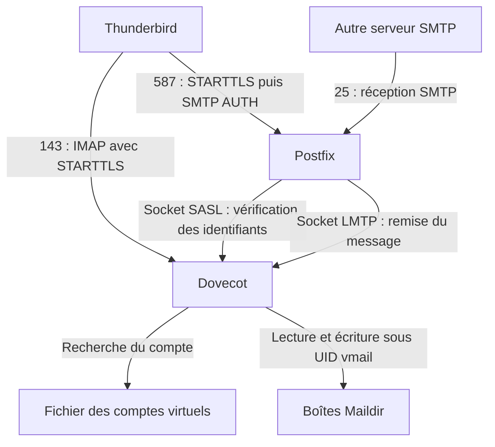
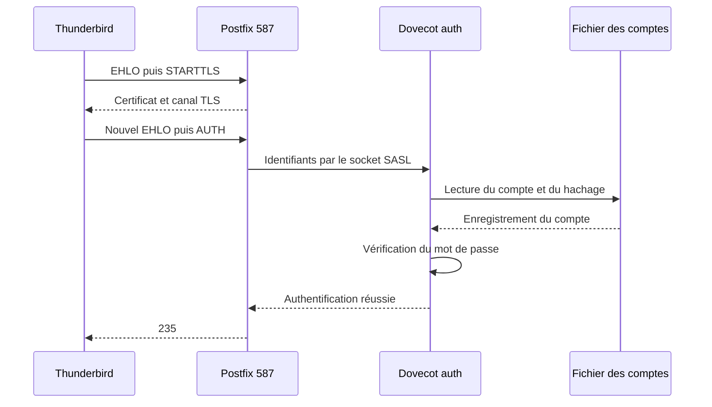
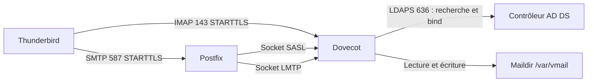

# Postfix / Dovecot et Authentification Active Directory

**SportLudique BTS SIO SISR Expert**

## Avant de commencer

Ce tutoriel présente l'installation et la configuration d'un serveur de messagerie sous Linux reposant sur **Postfix** et **Dovecot**.

Les utilisateurs de messagerie, Alice et Bob, sont des **comptes virtuels gérés par Dovecot**. Ils ne disposent donc pas de compte utilisateur sur le système Linux et ne peuvent pas ouvrir de session locale ou SSH.

Un compte système dédié, nommé `vmail`, assure le stockage et la gestion des fichiers de leurs boîtes aux lettres.

| Élément | Valeur retenue |
| --- | --- |
| Domaine de courrier | `ville.sportludique.fr` |
| Serveur | `mail.ville.sportludique.fr` |
| Comptes de courrier et identifiants de connexion | `alice@ville.sportludique.fr` et `bob@ville.sportludique.fr` |
| Base des comptes | `/etc/dovecot/users`, avec des mots de passe hachés |
| Racine du stockage | `/var/vmail` |
| Réception SMTP | TCP 25 ; sans authentification ; STARTTLS opportuniste |
| Envoi des utilisateurs | TCP 587 ; STARTTLS et authentification obligatoires |
| Consultation IMAP | TCP 143 ; STARTTLS avant authentification réseau |
| Distribution finale | Postfix transmet à Dovecot par un socket Unix LMTP |
| Authentification SMTP | Postfix interroge Dovecot par un autre socket Unix, SASL |
| Certificat | Certificat serveur signé par l'intermédiaire de la PKI SportLudique |

### Versions utilisées

Ce tutoriel repose sur **Postfix 3.10** et **Dovecot 2.4**, disponibles sous Debian 13 (Trixie).

**Attention :** Dovecot 2.4 introduit des changements importants dans la syntaxe des fichiers de configuration. Les configurations destinées à Dovecot 2.3 ne sont donc pas directement réutilisables.


!!! danger "Attention à la syntaxe Dovecot 2.4"
    Le niveau de syntaxe `2.4.0` est compatible avec Dovecot 2.4.1.

    **N'utilisez pas les anciennes directives** `mail_location`, `disable_plaintext_auth`, `ssl_cert` ou `ssl_key`, présentes dans de nombreux tutoriels destinés à Dovecot 2.3. 
    
    Elles ne sont plus valides avec la syntaxe Dovecot 2.4.


## Partie 1 — Comprendre les rôles et les deux sockets

### 1.1 — Les composants

| Composant | Son rôle ici |
| --- | --- |
| Postfix | Reçoit les messages sur port TCP 25 d'autres serveurs de messagerie, reçoit les demande d'envois d'utilisateurs authentifiés sur TCP 587, gère la file et l'acheminement SMTP. |
| Dovecot | Vérifie les comptes, distribue les messages reçus par LMTP et présente les boîtes en IMAP. |
| Fichier de comptes | Contient les adresses de connexion et leurs mots de passe hachés. Il est lu par Dovecot. |
| `vmail` | Compte technique Linux sous lequel les fichiers des boîtes sont écrits et lus. |
| SASL | Permet à Postfix de demander à Dovecot si les identifiants SMTP sont valides. |
| LMTP | Permet à Postfix de remettre un message à Dovecot pour sa distribution dans la boîte. |
| Maildir | Stocke chaque message dans un fichier distinct. |
| TLS | Chiffre la connexion réseau et permet au client de vérifier l'identité du serveur. |




!!! warning "Attention : SASL et LMTP sont deux services distincts"
    - **SASL** permet à Postfix d'authentifier les utilisateurs via Dovecot. Si le socket SASL est indisponible, **l'envoi authentifié échoue**, même si la réception des messages fonctionne.
    - **LMTP** permet à Postfix de transmettre les messages à Dovecot pour leur dépôt dans les boîtes aux lettres. Si le socket LMTP est indisponible, **l'authentification peut réussir**, mais les messages restent en attente dans la file d'attente de Postfix.


### 1.2 — Compte virtuel et compte Linux

Le compte système Linux `vmail` est utilisé pour stocker les fichiers des boîtes aux lettres. Il ne permet pas d'ouvrir une session interactive et ne doit pas être utilisé pour se connecter à la messagerie.

Les utilisateurs s'authentifient avec leur **adresse électronique complète**, par exemple `alice@ville.sportludique.fr`. Dovecot vérifie leurs identifiants et mots de passe dans son fichier de comptes virtuels, indépendamment des comptes utilisateurs Linux.

Contrairement à une configuration reposant sur des comptes système, **le nom de domaine fait ici partie intégrante de l'identifiant**. Ainsi, `alice@ville.sportludique.fr` et `alice@autreville.sportludique.fr` sont deux identifiants distincts.


!!! tip "Identifiant de connexion : nom court ou adresse complète ?"
    La directive `auth_username_format` permet de définir comment Dovecot interprète l'identifiant fourni par le client de messagerie.

    Deux configurations sont possibles :

    | Configuration | Comportement |
    | --- | --- |
    | `auth_username_format = %{user \| lower}` | Conserve l'adresse complète et la convertit en minuscules. |
    | `auth_username_format = %{user \| username \| lower}` | Ne conserve que la partie avant `@` et la convertit en minuscules. |

    Le filtre `lower` garantit que l'identifiant est toujours traité en minuscules, même si l'utilisateur saisit accidentellement des majuscules.

    **À vous de choisir !** Les comptes déclarés dans le fichier `passwd-file` doivent correspondre au format retenu. Dans Thunderbird, le champ **Nom d'utilisateur** doit être renseigné en conséquence.

    Ce choix concerne uniquement **l'authentification** : l'adresse électronique utilisée pour envoyer et recevoir les messages reste complète.


### 1.3 — TLS et authentification

**TLS** protège les communications en chiffrant les données échangées entre le client et le serveur. **SASL** permet d'authentifier l'utilisateur auprès du serveur SMTP, mais ne chiffre pas lui-même la communication.

Les mécanismes d'authentification **PLAIN** et **LOGIN** peuvent transmettre les identifiants et mots de passe encodés en **Base64**.

!!! warning "SASL n'assure pas le chiffrement des échanges"
    Par exemple, le mot de passe `azerty` devient :

    ```text
    YXplcnR5
    ```

    Pour le vérifier sous Linux :

    ```bash
    echo -n "azerty" | base64
    ```

    Et pour retrouver le mot de passe :

    ```bash
    echo -n "YXplcnR5" | base64 -d
    ```

    **Le Base64 n'est pas un chiffrement !** N'importe qui peut retrouver le mot de passe à partir de sa représentation encodée.

    C'est pourquoi l'authentification PLAIN ou LOGIN doit être réalisée **après l'établissement d'une connexion TLS**, notamment grâce à STARTTLS sur le port SMTP 587.

## Partie 2 — Préparer Debian, le DNS et les fichiers TLS

### 2.1 — Configurer le nom de la VM

Configurez le nom d'hôte de votre serveur (`mail.ville.sportludique.fr`) et vérifiez sa résolution DNS, conformément au plan d'adressage de votre infrastructure.

Reportez-vous aux missions **Socle** ou **Avancé** pour la configuration DNS.

**Vérifiez la résolution directe et inverse**, ainsi que la résolution locale du nom du serveur via le fichier `/etc/hosts`. Une entrée incorrecte dans ce fichier peut provoquer des dysfonctionnements de Postfix et Dovecot.

Corrigez les éventuelles incohérences avant de poursuivre.

### 2.2 — Installer les logiciels sur la VM mail

```bash
sudo apt update
sudo apt install postfix dovecot-core dovecot-imapd dovecot-lmtpd
```

Si l'assistant Postfix pose les questions, choisir **Site Internet**, puis `ville.sportludique.fr` comme nom de courrier du système. La configuration sera explicitée en partie 4.

Installer les outils de test et l'éditeur :

```bash
sudo apt install swaks libnet-ssleay-perl libio-socket-ssl-perl libterm-readkey-perl
```

Swaks permet de tester SMTP, STARTTLS, AUTH et LMTP. Les modules Perl installés avec lui rendent les tests TLS et la saisie masquée utilisables.
Relever les versions :

```bash
dovecot --version
```

```bash
dpkg-query -W postfix dovecot-core dovecot-imapd dovecot-lmtpd
postconf -a
```

### 2.3 — Sauvegarder les configurations installées

**Modification — copies de sauvegarde sur la VM neuve :**

```bash
sudo cp -a /etc/postfix /etc/postfix.old
sudo cp -a /etc/dovecot /etc/dovecot.old
sudo cp -a /etc/aliases /etc/aliases.old
```

### 2.4 — Installer le certificat TLS du serveur

À partir de votre infrastructure PKI, obtenez un certificat TLS valide pour votre serveur de messagerie.

Le certificat doit respecter les exigences suivantes :

- Être signé par une autorité de certification reconnue par les postes clients.
- Contenir le **SAN `DNS:mail.ville.sportludique.fr`** correspondant au nom réel de votre serveur.
- Autoriser l'usage **TLS Web Server Authentication (`serverAuth`)**.
- Disposer d'une chaîne de certification complète permettant de remonter jusqu'à l'autorité racine.

Installez sur votre serveur de messagerie :

- Le **certificat serveur accompagné de son certificat intermédiaire** (`fullchain.pem`).
- La **clé privée du serveur**, dont l'accès doit être strictement limité.
- Le certificat de l'autorité racine dans le magasin de confiance si nécessaire.

!!! danger "Protection des clés privées"
    Seule la clé privée du **serveur de messagerie** doit être présente sur cette machine. Les clés privées des autorités de certification ne doivent jamais y être copiées.

**Travail attendu :** vérifiez la validité du certificat, la correspondance avec sa clé privée et les permissions des fichiers.

Vous devrez ensuite renseigner les chemins de ces fichiers dans les configurations **Postfix** et **Dovecot**.

## Partie 3 — Créer les comptes virtuels et préparer Dovecot

Dans cette architecture, Dovecot doit être prêt à recevoir les messages par LMTP avant de tester la distribution Postfix. On le prépare donc avant la réception SMTP. **Aucune authentification SMTP n'est encore activée.**

### 3.1 — Créer le compte technique `vmail`

Les boîtes aux lettres des utilisateurs virtuels seront stockées dans des fichiers appartenant à un **compte système dédié**, nommé `vmail`.

Ce compte ne sert qu'à gérer les fichiers de messagerie. Il ne doit pas permettre d'ouvrir une session sur le serveur.

**Créer le groupe et le compte `vmail` :**

```bash
sudo groupadd vmail
sudo useradd -g vmail -d /var/vmail -M -s /usr/sbin/nologin vmail
```

L'option `-M` évite la création automatique du répertoire `/var/vmail`, qui sera préparé à l'étape suivante. Le shell `/usr/sbin/nologin` interdit les connexions interactives. Aucun mot de passe ne doit être défini pour ce compte.

**Vérifier la création du compte :**

```bash
id vmail
getent passwd vmail
```

Relevez les valeurs **UID** et **GID** attribuées à `vmail`. Elles permettront de vérifier les propriétaires des fichiers de messagerie.

!!! info "Comptes système et comptes virtuels"
    Le compte `vmail` existe dans Linux et possède les fichiers des boîtes aux lettres. En revanche, **Alice et Bob ne sont pas des utilisateurs Linux** : leurs identifiants et mots de passe seront gérés par Dovecot.

### 3.2 — Préparer les répertoires de stockage

**Modification :**

```bash
sudo mkdir -p /var/vmail/alice
sudo mkdir -p /var/vmail/bob
sudo chown -R vmail:vmail /var/vmail
```

Ce changement récursif concerne uniquement la nouvelle arborescence dédiée aux boîtes. Ne pas appliquer cette commande à `/var` ni à `/var/spool/postfix`.

Protéger l'accès à l'arborescence :

```bash
sudo chmod 700 /var/vmail
sudo chmod 700 /var/vmail/alice
sudo chmod 700 /var/vmail/bob
```

```bash
ls -ld /var/vmail /var/vmail/alice /var/vmail/bob
```

**Validation :** ces répertoires appartiennent à `vmail:vmail`. Dovecot créera les sous-répertoires Maildir lors de la distribution.

### 3.3 — Générer les mots de passe hachés des utilisateurs

Dovecot conserve les mots de passe des utilisateurs virtuels sous forme de **hachages**, et non en clair. Lors d'une authentification, il vérifie que le mot de passe fourni correspond au hachage enregistré.

Vérifier que l'algorithme `ARGON2ID` est disponible :

```bash
sudo doveadm pw -l
```

Générer le hachage du mot de passe d'Alice :

```bash
sudo doveadm pw -s ARGON2ID
```

Saisir deux fois le mot de passe choisi. Dovecot retourne une chaîne commençant par `{ARGON2ID}`.

**Conservez cette chaîne complète** : elle sera utilisée dans le fichier de comptes virtuels (`passwd-file`) à l'étape suivante.

Répétez l'opération pour Bob, avec un mot de passe différent.

!!! tip "Pourquoi hacher les mots de passe ?"
    Un hachage est une empreinte calculée à partir du mot de passe. Contrairement à un chiffrement, il n'est pas conçu pour être déchiffré.

    Lorsqu'Alice se connecte avec Thunderbird, Dovecot vérifie son mot de passe à partir du hachage enregistré dans `passwd-file`, sans avoir besoin de conserver le mot de passe en clair.


### 3.4 — Créer le fichier des comptes

**Modification :**

```bash
nano /etc/dovecot/users
```


Ajoutez la ligne d'Alice dans `/etc/dovecot/users`, en remplaçant le libellé du hachage par la valeur réelle générée précédemment :

```text
alice:HACHAGE_COMPLET_ALICE_A_REMPLACER:1002:1002::/var/vmail/alice
```

Les valeurs `1002:1002` correspondent respectivement à l'**UID** (identifiant utilisateur) et au **GID** (identifiant du groupe) du compte technique `vmail`, propriétaire des boîtes aux lettres.

Retrouvez ces valeurs avec :

```bash
id vmail
```

Exemple de résultat :

```text
uid=1002(vmail) gid=1002(vmail) groupes=1002(vmail)
```


!!! note "Pourquoi utiliser alice plutôt que son adresse complète ?"

    La directive `auth_username_format = %{user | username | lower}` transforme automatiquement `alice@ville.sportludique.fr` en `alice` avant la recherche dans `/etc/dovecot/users`.

    Dans notre infrastructure, nous hébergeons un seul domaine de messagerie. Chaque utilisateur possède un identifiant unique dans le fichier des comptes virtuels : cette simplification ne pose donc pas de difficulté.

    Les UID et GID doivent être adaptés à votre installation : ils ne valent pas nécessairement `1002`.


Il n'y a **pas d'espace** autour du `:`. Ne pas ajouter de guillemets autour du hachage. Dans `nano`, les caractères `$` du hachage restent du texte : ils ne sont pas interprétés par le shell.

Générer ensuite un hachage propre au mot de passe de Bob :

```bash
doveadm pw -s ARGON2ID
```


Rouvrez le fichier `/etc/dovecot/users` pour ajouter Bob :

```bash
sudo nano /etc/dovecot/users
```

Le fichier contient désormais deux comptes virtuels, avec leurs **hachages de mots de passe distincts** :

```text
alice:HACHAGE_COMPLET_ALICE:1002:1002::/var/vmail/alice
bob:HACHAGE_COMPLET_BOB:1002:1002::/var/vmail/bob
```

Remplacez les valeurs `HACHAGE_COMPLET_ALICE` et `HACHAGE_COMPLET_BOB` par les véritables hachages générés précédemment, en conservant leur préfixe `{ARGON2ID}`.

Les champs séparés par `:` indiquent :

- **Identifiant** : `alice` ou `bob` ;
- **Mot de passe** : hachage du mot de passe ;
- **UID et GID** : `1002`, correspondant au compte technique `vmail` ;
- **Répertoire personnel** : emplacement de la boîte aux lettres virtuelle.

Protéger ce fichier :

```bash
sudo chown root:dovecot /etc/dovecot/users
sudo chmod 640 /etc/dovecot/users
ls -l /etc/dovecot/users
```

**Validation :** propriétaire `root`, groupe `dovecot`, permissions `-rw-r-----`. Les deux lignes contiennent chacune un identifiant court et un hachage commençant par `{ARGON2ID}`. Ce fichier est sensible ; ne pas le recopier dans les captures du compte rendu.

### 3.5 — Configurer Dovecot

Sous Debian 13, la configuration de Dovecot est répartie dans plusieurs fichiers situés dans `/etc/dovecot/conf.d/`. Chaque fichier regroupe les paramètres d'une fonction : authentification, stockage, TLS ou gestion des services.

**Pour chaque fichier de configuration :**

1. Ouvrez le fichier indiqué avec `sudo nano`.
2. Recherchez les directives ou les blocs de configuration concernés.
3. Si une directive est commentée (`#`), retirez le commentaire pour l'activer.
4. Modifiez sa valeur conformément aux indications du tutoriel.
5. Si une directive est absente, ajoutez-la dans le fichier ou le bloc approprié.

!!! warning "Ne dupliquez pas les directives"
    **Ne recopiez pas les blocs proposés à la fin des fichiers sans vérifier leur contenu existant.**

    Certaines directives ou certains blocs peuvent déjà être présents, parfois commentés ou configurés avec des valeurs différentes.

    L'objectif est de **modifier les paramètres existants**, pas de créer plusieurs définitions d'un même service.

Les extraits de configuration présentés dans la suite indiquent les **valeurs attendues**, et non le contenu intégral des fichiers à remplacer.


#### Authentification — `10-auth.conf`

Ouvrir le fichier :

```bash
sudo nano /etc/dovecot/conf.d/10-auth.conf
```

Rechercher les directives suivantes, les décommenter si nécessaire et adapter leurs valeurs :

```ini
auth_allow_cleartext = no
[...]
auth_mechanisms = plain login
[...]
auth_username_format = %{user|username|lower}
```

Vérifier également les inclusions en fin de fichier. Désactiver l'authentification par les comptes Linux et activer celle des comptes virtuels :

```ini
#!include auth-system.conf.ext
!include auth-passwdfile.conf.ext
```

#### Comptes virtuels — `auth-passwdfile.conf.ext`

Dovecot dispose d'un fichier de configuration permettant d'authentifier les utilisateurs à partir d'une liste de comptes virtuels. **Par défaut, les blocs `passdb` et `userdb` sont commentés et donc inactifs.**

Ouvrez le fichier :

```bash
sudo nano /etc/dovecot/conf.d/auth-passwdfile.conf.ext
```

Décommentez les blocs `passdb` et `userdb`, puis adaptez les directives existantes pour obtenir :

```ini
passdb passwd-file {
  default_password_scheme = crypt
  auth_username_format = %{user | username | lower}
  passwd_file_path = /etc/dovecot/users
}

userdb passwd-file {
  auth_username_format = %{user | username | lower}
  passwd_file_path = /etc/dovecot/users

  fields {
    uid:default = vmail
    gid:default = vmail
    home:default = /var/vmail/%{user}
  }
}
```

- **`passdb`** vérifie l'identifiant et le mot de passe dans `/etc/dovecot/users`.
- **`userdb`** fournit les informations nécessaires pour accéder aux boîtes aux lettres : UID, GID et répertoire personnel.
- **`auth_username_format`** transforme l'adresse électronique en identifiant court, en supprimant le domaine et en convertissant les caractères en minuscules.
- **`fields`** définit des valeurs par défaut pour l'UID, le GID et le répertoire personnel. Les informations explicitement renseignées dans `/etc/dovecot/users` peuvent les remplacer.

!!! note "Cohérence des identifiants"
    Avec `auth_username_format = %{user | username | lower}`, l'adresse `alice@ville.sportludique.fr` devient `alice`.

    Le fichier `/etc/dovecot/users` doit donc contenir un compte nommé `alice`, et non son adresse complète.

    Cette configuration convient à notre serveur, mais impose des identifiants uniques : deux utilisateurs portant le même nom dans des domaines différents ne peuvent pas disposer de comptes distincts avec cette normalisation.

!!! warning "Compte technique vmail"
    Les boîtes aux lettres appartiennent au compte Linux `vmail`, et non à des comptes Linux individuels `alice` et `bob`.

    Vérifiez son UID et son GID :

    ```bash
    id vmail
    ```

    Ces identifiants doivent correspondre aux valeurs renseignées dans `/etc/dovecot/users`. Les directives `uid:default` et `gid:default` fournissent des valeurs de secours lorsque ces champs ne sont pas définis dans le fichier.

**Vérifiez que Dovecot charge correctement la configuration :**

```bash
sudo doveconf -n
```

Puis redémarrez le service :

```bash
sudo systemctl restart dovecot
```

Enfin, testez l'authentification complète :

```bash
sudo doveadm auth login alice@ville.sportludique.fr
```

Le résultat doit confirmer la réussite de `passdb` et la récupération des informations `userdb`, notamment l'UID, le GID et le répertoire `/var/vmail/alice`.


#### Sécurisation TLS — `10-ssl.conf`

Par défaut, Dovecot utilise un certificat autosigné fourni lors de son installation. Nous allons le remplacer par le certificat de notre serveur de messagerie, signé par la PKI SportLudique.

Ouvrir le fichier :

```bash
sudo nano /etc/dovecot/conf.d/10-ssl.conf
```

Rechercher les directives existantes et modifier leurs valeurs pour obtenir :

```ini
ssl = required

ssl_server_cert_file = /etc/ssl/fullchain-mail.pem
ssl_server_key_file = /etc/ssl/srv-mail.key
```

**Adaptez les chemins** à l'emplacement réel de votre certificat et de votre clé privée.

- `ssl = required` : impose TLS pour les connexions des clients.
- `ssl_server_cert_file` : indique le certificat serveur et sa chaîne de certification intermédiaire.
- `ssl_server_key_file` : indique la clé privée associée au certificat.

Ajouter également la directive suivante si elle est absente :

```ini
ssl_min_protocol = TLSv1.2
```

Elle impose TLS 1.2 comme version minimale autorisée.

!!! warning "Attention aux certificats"
    Le fichier `fullchain.pem` doit contenir le certificat du serveur suivi de celui de l'autorité intermédiaire. La clé privée doit rester protégée et ne doit jamais être intégrée à ce fichier.

**Vérifier la configuration :**

```bash
sudo doveconf -n
```

La configuration effective doit désormais faire référence à votre certificat et à votre clé privée, et non aux fichiers autosignés installés par défaut.


#### Stockage des messages — `10-mail.conf`

Par défaut, Debian 13 configure Dovecot avec le format **mbox**, dans lequel plusieurs messages sont regroupés dans un même fichier.

Nous utiliserons **Maildir**, qui stocke chaque message dans un fichier distinct. Ce format facilite notamment la manipulation et l'inspection des messages.

Ouvrez le fichier `/etc/dovecot/conf.d/10-mail.conf` :

```bash
sudo nano /etc/dovecot/conf.d/10-mail.conf
```

Repérez les quatre directives définies par défaut et **commentez-les** :

```ini
#mail_driver = mbox
#mail_home = /home/%{user | username}
#mail_path = %{home}/mail
#mail_inbox_path = /var/mail/%{user}
```

Ajoutez ensuite la configuration suivante :

```ini
# Stockage des messages au format Maildir
mail_driver = maildir
mail_home = /var/vmail/%{user}
mail_path = ~/Maildir
```

- `mail_driver` sélectionne le format Maildir.
- `mail_home` définit le répertoire personnel virtuel de chaque utilisateur.
- `mail_path` définit l'emplacement de stockage des messages, relativement à ce répertoire.

Ainsi, les messages d'Alice seront stockés dans `/var/vmail/alice/Maildir`.

!!! note "Organisation d'une boîte Maildir"
    Une boîte Maildir comporte trois sous-répertoires :

    - `new` : messages nouvellement reçus ;
    - `cur` : messages déjà pris en charge par le client de messagerie ;
    - `tmp` : fichiers temporaires utilisés pendant la livraison.

**Vérifiez la configuration :**

```bash
sudo doveconf -n | grep -E 'mail_driver|mail_home|mail_path'
```

Le résultat attendu est :

```text
mail_driver = maildir
mail_home = /var/vmail/%{user}
mail_path = ~/Maildir
```

Redémarrez Dovecot, puis vérifiez la résolution du compte :

```bash
sudo systemctl restart dovecot
sudo doveadm user alice@ville.sportludique.fr
```

Vous devez notamment retrouver :

```text
user       alice
uid        1002
gid        1002
home       /var/vmail/alice
mail_path  /var/vmail/alice/Maildir
```

!!! tip "À retenir"
    Les utilisateurs Alice et Bob sont des comptes virtuels : ils ne disposent pas de comptes Linux individuels. Le compte technique `vmail` possède leurs boîtes aux lettres.

    Le symbole `~` dans `~/Maildir` correspond ici au répertoire personnel virtuel fourni par `userdb`.


### 3.6 — Démarrer et tester les comptes

**Modification — activation du service :**

```bash
sudo systemctl restart dovecot
systemctl status dovecot --no-pager
```

Tester Alice et Bob ; le mot de passe est demandé :

```bash
sudo doveadm auth test alice@ville.sportludique.fr
Password:
passdb: alice@ville.sportludique.fr auth succeeded
extra fields:
  user=alice
  original_user=alice@ville.sportludique.fr
```

**Validation :** les bons mots de passe produisent `auth succeeded`. Refaire un essai avec un mot de passe volontairement faux : il doit être refusé. Vérifiez également le résultat de `sudo doveadm user alice@ville.sportludique.fr` pour confirmer le répertoire de stockage.

Ces tests passent par une interface locale d'administration. Ils ne prouvent pas encore le certificat réseau ni SMTP AUTH dans Postfix.

### 3.7 — Configurer le socket LMTP — `10-master.conf`

Pour transmettre les messages aux boîtes aux lettres virtuelles, **Postfix utilise le protocole LMTP (Local Mail Transfer Protocol)** pour communiquer avec Dovecot.

Nous utiliserons un **socket Unix**, permettant une communication locale entre les deux services, sans ouvrir de port TCP supplémentaire.

Ouvrez le fichier :

```bash
sudo nano /etc/dovecot/conf.d/10-master.conf
```

Repérez le bloc `service lmtp` présent par défaut :

```ini
service lmtp {
  unix_listener lmtp {
    #mode = 0666
  }

  # Create inet listener only if you can't use the above UNIX socket
  #inet_listener lmtp {
    # Avoid making LMTP visible for the entire internet
    #listen = 127.0.0.1
    #port = 24
  #}
}
```

Dans ce bloc existant, remplacez le listener Unix par le suivant, sans créer de second bloc `service lmtp` :

```ini
service lmtp {
  unix_listener /var/spool/postfix/private/dovecot-lmtp {
    mode = 0600
    user = postfix
    group = postfix
  }
}
```

- **`unix_listener`** définit l'emplacement du socket utilisé par Postfix pour communiquer avec Dovecot.
- **`mode = 0600`** limite l'accès au propriétaire du socket.
- **`user = postfix` et `group = postfix`** attribuent ce socket au compte système Postfix.

!!! note "Pourquoi placer le socket dans le répertoire de Postfix ?"
    Le répertoire `/var/spool/postfix/private/` permet à Postfix d'accéder au socket LMTP, notamment lorsqu'il fonctionne dans un environnement *chroot*.

    Le socket n'est pas accessible depuis le réseau : seuls les processus disposant des permissions nécessaires peuvent l'utiliser.

**Vérifiez la configuration et redémarrez Dovecot :**

```bash
sudo doveconf -n
sudo systemctl restart dovecot
```

Vérifiez ensuite que le socket a été créé :

```bash
sudo ls -l /var/spool/postfix/private/dovecot-lmtp
```

Résultat attendu :

```text
srw------- 1 postfix postfix ... /var/spool/postfix/private/dovecot-lmtp
```

Le caractère `s` au début des permissions indique qu'il s'agit d'un **socket Unix**.

!!! tip "À retenir"
    Postfix assure la réception des messages via SMTP. Dovecot assure leur distribution dans les boîtes aux lettres via LMTP, puis leur consultation par les utilisateurs via IMAP.

    Le socket LMTP constitue donc le point de communication entre les deux logiciels.


## Partie 4 — Configurer la réception Postfix et la distribution LMTP

### 4.1 — Déclarer les destinataires connus dans Postfix

Dovecot connaît les mots de passe et l'emplacement des boîtes. Postfix a seulement besoin de savoir **quelles adresses du domaine existent**, pour refuser les erreurs de destinataire avant d'accepter les messages.

**Modification — créer cette liste :**

```bash
sudo nano /etc/postfix/vmailbox
```

Contenu complet :

```text
alice@ville.sportludique.fr 1
bob@ville.sportludique.fr 1
```

Le `1` signifie ici « adresse connue ». **Il ne désigne pas un fichier de boîte** : Dovecot choisira le chemin lors de la distribution LMTP. Aucun mot de passe ne figure dans cette table.

Compiler la table texte en une base lisible par Postfix :

```bash
sudo postmap /etc/postfix/vmailbox
sudo chmod 644 /etc/postfix/vmailbox /etc/postfix/vmailbox.db
```

Tester les recherches :

```bash
postmap -q bob@ville.sportludique.fr hash:/etc/postfix/vmailbox
postmap -q inconnu@ville.sportludique.fr hash:/etc/postfix/vmailbox
```


!!! warning "Mise à jour de la table des destinataires"
    Une adresse connue, comme celle de Bob, renvoie `1`. Une adresse inconnue ne renvoie aucun résultat.

    **Après chaque modification du fichier texte, exécutez à nouveau `postmap`** pour mettre à jour la base utilisée par Postfix. Sinon, le serveur continue d'utiliser l'ancienne liste des destinataires.

### 4.2 — Prévoir l'adresse `postmaster`

**Modification — créer la table d'alias virtuels :**

```bash
sudo nano /etc/postfix/virtual
```

Contenu :

```text
postmaster@ville.sportludique.fr bob@ville.sportludique.fr
```

Cet alias n'est pas un troisième compte : les messages destinés à `postmaster` sont redirigés vers Bob.

```bash
sudo postmap /etc/postfix/virtual
sudo chmod 644 /etc/postfix/virtual /etc/postfix/virtual.db
sudo postmap -q postmaster@ville.sportludique.fr hash:/etc/postfix/virtual
```

**Validation :** la recherche renvoie l'adresse complète de Bob.

### 4.3 — Configuration principale de Postfix — `main.cf`

Le fichier `/etc/postfix/main.cf` définit le fonctionnement général du serveur SMTP.

Ouvrez-le :

```bash
sudo nano /etc/postfix/main.cf
```

**Repérez et adaptez les directives existantes**. Certaines sont déjà correctement configurées par Debian et ne nécessitent aucune modification.

#### Identité du serveur

```ini
myhostname = mail.ville.sportludique.fr
myorigin = /etc/mailname
inet_interfaces = all
```

- `myhostname` définit le nom DNS complet du serveur SMTP.
- `myorigin` définit le domaine utilisé pour les messages émis localement, à partir du fichier `/etc/mailname`.
- `inet_interfaces` autorise Postfix à écouter sur toutes les interfaces réseau.

#### Domaines de destination

```ini
mydestination = $myhostname, localhost.$mydomain, localhost
```

!!! warning "Comptes locaux et comptes virtuels"
    `mydestination` désigne les domaines dont les destinataires sont gérés par le mécanisme de distribution locale de Postfix.

    Notre domaine de messagerie `ville.sportludique.fr` utilise des **comptes virtuels gérés par Dovecot**. Il ne doit donc pas être ajouté à `mydestination`.

    Nous le déclarerons comme domaine virtuel dans la configuration LMTP.

#### Sécurisation SMTP avec TLS

Remplacez les chemins des certificats autosignés fournis par Debian par ceux du certificat délivré pour votre serveur :

```ini
smtpd_tls_cert_file = /etc/ssl/mail/fullchain.pem
smtpd_tls_key_file = /etc/ssl/mail/mail.key
smtpd_tls_security_level = may
smtpd_tls_protocols = >=TLSv1.2
smtpd_tls_mandatory_protocols = >=TLSv1.2
```

- `smtpd_tls_cert_file` désigne le certificat du serveur et sa chaîne intermédiaire.
- `smtpd_tls_key_file` désigne la clé privée correspondante.
- `smtpd_tls_security_level = may` propose STARTTLS sur le port 25, sans l'imposer aux serveurs SMTP distants.

!!! note "TLS et transport SMTP"
    Le port 25 est destiné principalement aux échanges entre serveurs SMTP. STARTTLS y est proposé lorsque le serveur distant le prend en charge.

    Pour l'envoi authentifié des utilisateurs, nous configurerons séparément le port **587**, avec authentification SASL et STARTTLS obligatoire.


!!! warning "Autorité de certification racine et confiance TLS"
    Notre infrastructure SportLudique utilise une **PKI interne**. Les certificats des serveurs de messagerie sont signés par une autorité de certification intermédiaire, elle-même rattachée à notre AC racine.

    Pour qu'un serveur puisse vérifier cette chaîne de confiance, **le certificat de l'AC racine SportLudique doit être installé dans son magasin de confiance**.

    Sous Debian, le fichier `/etc/ssl/certs/ca-certificates.crt` regroupe les certificats des autorités reconnues par le système.

    Il ne faut pas modifier ce fichier directement. Installez le certificat racine dans `/usr/local/share/ca-certificates/`, puis actualisez le magasin :

    ```bash
    sudo cp sportludique-root.crt.pem /usr/local/share/ca-certificates/sportludique-root.crt
    sudo update-ca-certificates

    openssl verify -CAfile /etc/ssl/certs/ca-certificates.crt sportludique-root.crt.pem
    ```

    Conservez ensuite dans `/etc/postfix/main.cf` :

    ```ini
    smtp_tls_CAfile = /etc/ssl/certs/ca-certificates.crt
    ```

    !!! note "Point de vigilance"
        Installer l'AC racine permet d'établir la confiance, mais **ne rend pas automatiquement la vérification TLS obligatoire**. Avec `smtp_tls_security_level = may`, Postfix utilise opportunément STARTTLS sans imposer la validation du certificat du serveur distant.

    Chaque serveur de messagerie doit disposer des autorités nécessaires à la validation des certificats de ses correspondants.

#### Distribution vers Dovecot via LMTP

Ajoutez les directives suivantes :

```ini
virtual_mailbox_domains = ville.sportludique.fr
virtual_mailbox_maps = hash:/etc/postfix/vmailbox
virtual_transport = lmtp:unix:private/dovecot-lmtp
virtual_alias_maps = hash:/etc/postfix/virtual
```

- `virtual_mailbox_domains` indique les domaines de messagerie hébergeant des boîtes aux lettres virtuelles.
- `virtual_mailbox_maps` désigne la table des adresses électroniques autorisées. Postfix la consulte pour vérifier l'existence des destinataires et rejeter les adresses inconnues dès la commande SMTP `RCPT TO`.
- `virtual_transport` définit le mécanisme de distribution des messages. Ici, Postfix les transmet à Dovecot via le socket LMTP configuré précédemment.

!!! warning "Validation des destinataires"
    Déclarer un domaine virtuel ne suffit pas : Postfix doit également disposer d'un mécanisme pour identifier les destinataires valides.

    La table `virtual_mailbox_maps` créée en 4.1 doit contenir Alice et Bob et être régénérée avec `postmap` après toute modification.

#### Vérification

Contrôlez la syntaxe et affichez les paramètres utiles :

```bash
sudo postfix check
sudo postconf -n
```


La commande `postconf -n` affiche les paramètres qui diffèrent des valeurs par défaut de Postfix.

Vérifier les permissions et la lecture du fichier :

```bash
sudo chown root:root /etc/postfix/main.cf
sudo chmod 644 /etc/postfix/main.cf
postconf -n
```

### 4.4 — Configurer les adresses système et l'écoute sur 25

**Modification — nom de courrier de Debian :**

```bash
echo "ville.sportludique.fr" | sudo tee /etc/mailname
```


!!! tip "Pourquoi utiliser tee avec sudo ?"
    La commande `sudo echo "ville.sportludique.fr" > /etc/mailname` échoue car la redirection `>` est effectuée par le shell de l'utilisateur, **sans les privilèges de `sudo`**.

    Avec `echo "ville.sportludique.fr" | sudo tee /etc/mailname`, la commande `tee` s'exécute avec les droits administrateur et peut donc écrire dans le fichier protégé.

    **Attention :** `tee` remplace le contenu du fichier par défaut. L'option `-a` permet d'ajouter du texte sans effacer le contenu existant.


Ouvrir les alias locaux :

```bash
sudo nano /etc/aliases
```

Conserver les autres alias système éventuels. Faire en sorte que ces deux définitions existent une seule fois :

```text
postmaster: root
root: bob@ville.sportludique.fr
```

Ici, `root` est une adresse système redirigée vers une boîte virtuelle. **La cible est l'adresse complète de bob**, pas un compte Linux `bob`.

```bash
sudo newaliases
```


!!! note "À quoi sert newaliases ?"
    Postfix utilise `/etc/aliases` pour rediriger les messages destinés aux comptes locaux du serveur, notamment les messages administratifs adressés à `root` ou `postmaster`.

    La commande `sudo newaliases` actualise la base des alias après modification de ce fichier.

    **Attention :** ces alias concernent la distribution locale de Postfix. Ils ne remplacent pas la table `virtual_mailbox_maps` utilisée pour identifier les destinataires virtuels Alice et Bob.

```bash
sudo postconf -M smtp/inet
sudo postfix check
```

Vérifier que cette ligne d'écoute est active, sans `#` initial :

```ini
smtp      inet  n       -       y       -       -       smtpd
```

Conserver les services internes du paquet. Ne pas activer Postscreen, 465 ou Submission à cette étape. 


**Validation :** le service réseau SMTP utilise `smtpd` et le contrôle Postfix ne signale pas d'erreur bloquante.

### 4.5 — Démarrer Postfix et vérifier le port

**Modification :**

```bash
sudo systemctl enable postfix
sudo systemctl restart postfix
sudo systemctl status postfix --no-pager
```

```bash
sudo postfix status
ss -ltnp 'sport = :25'
```

### 4.6 — Envoyer un message local sans Thunderbird et sans SASL

**Sur la VM mail, modification — créer un petit message de test :**

```bash
nano ~/test-mail.txt
```

Contenu du fichier, avec une ligne vide entre les en-têtes et le corps :

```text
From: alice@ville.sportludique.fr
To: bob@ville.sportludique.fr
Subject: SL-LOCAL-001

Message local injecte dans Postfix puis distribue par Dovecot LMTP.
```

Injecter ce fichier dans la file Postfix :

```bash
sendmail -i -f alice@ville.sportludique.fr bob@ville.sportludique.fr < ~/test-mail.txt
```

Cette commande est l'interface locale fournie par Postfix. Elle ne demande pas le mot de passe d'Alice et ne teste pas SMTP AUTH.

```bash
sudo postqueue -p
sudo journalctl -u postfix -n 40 --no-pager
```

**Validation de la distribution :** retrouver le traitement par `postfix/lmtp`, avec `status=sent`. La distribution est asynchrone ; rejouer les lectures après quelques secondes si nécessaire.

Vérifier le message réel sur disque :

```bash
grep -R 'SL-LOCAL-001' /var/vmail/bob/Maildir/new /var/vmail/bob/Maildir/cur
```

### 4.7 — Tester la réception SMTP et les deux refus attendus

**Depuis le poste client**, envoyer un message pour un compte réel :

```bash
swaks --server mail.ville.sportludique.fr --port 25 \
  --from alice@ville.sportludique.fr --to bob@ville.sportludique.fr \
  --header 'Subject: SL-SMTP25-001' --body 'Reception SMTP sans authentification vers une boite hebergee.'
```

**Attendu :** message accepté après DATA puis retrouvé chez Bob. Recevoir du courrier pour une boîte hébergée est le rôle normal du port 25 ; cela ne constitue pas du relais ouvert.

Tester une adresse inexistante du domaine :

```bash
swaks --server mail.ville.sportludique.fr --port 25 \
  --from alice@ville.sportludique.fr --to inconnu@ville.sportludique.fr --quit-after RCPT
```

**Attendu :** refus au destinataire, typiquement `550 5.1.1 ... User unknown in virtual mailbox table`. Ce message ne doit pas être accepté puis rejeté après distribution.

Tester le relais vers un domaine extérieur :

```bash
swaks --server mail.ville.sportludique.fr --port 25 \
  --from test@example.net --to destinataire@example.org --quit-after RCPT
```

!!! success "Validation du refus de relais"
    Postfix doit refuser de relayer un message vers un domaine externe sans autorisation, généralement avec la réponse `554 5.7.1 Relay access denied`.

    Les domaines `example.net` et `example.org` sont utilisés uniquement pour ce test. La transaction SMTP est interrompue avant l'étape `DATA` : **aucun message n'est transmis**.

## Partie 5 — Activer SASL Dovecot et Submission sur 587

### 5.1 — Configurer le socket SASL — `10-master.conf`

Postfix doit pouvoir interroger Dovecot pour authentifier les utilisateurs qui envoient des messages via le port 587.

Cette communication utilise un **socket Unix distinct de celui utilisé pour la distribution LMTP**.

Ouvrez le fichier :

```bash
sudo nano /etc/dovecot/conf.d/10-master.conf
```

Repérez le bloc `service auth` existant et ajoutez-y le listener suivant, sans supprimer les autres directives :

```ini
service auth {
  unix_listener /var/spool/postfix/private/auth {
    mode = 0660
    user = postfix
    group = postfix
  }
}
```

!!! warning "Deux sockets, deux fonctions"
    - **`private/auth`** : permet à Postfix de demander à Dovecot de vérifier les identifiants et les mots de passe des utilisateurs (SASL).
    - **`private/dovecot-lmtp`** : permet à Postfix de transmettre les messages à Dovecot pour leur distribution dans les boîtes Maildir.

    Ces deux sockets sont indépendants et doivent être conservés.

**Vérifiez la configuration et redémarrez Dovecot :**

```bash
sudo doveconf -n
sudo systemctl restart dovecot
```

Contrôlez la présence des deux sockets :

```bash
sudo ls -l /var/spool/postfix/private/auth
sudo ls -l /var/spool/postfix/private/dovecot-lmtp
```

Résultat attendu :

```text
srw-rw---- 1 postfix postfix ... /var/spool/postfix/private/auth
srw------- 1 postfix postfix ... /var/spool/postfix/private/dovecot-lmtp
```

Le socket `auth` servira à l'authentification SMTP sur le port 587, tandis que le socket `dovecot-lmtp` continuera d'assurer la distribution des messages.


**Validation :** le nouveau socket existe, commence par `s`, appartient à `postfix:postfix` et porte les droits `srw-rw----`, soit `0660`. Il est créé par Dovecot ; ne pas le créer avec `touch`.

### 5.2 — Tester explicitement SASL sans dépendre de TLS réseau

Tester l'authentification **sur le socket destiné à Postfix** :

```bash
sudo doveadm auth test -a /var/spool/postfix/private/auth -x service=smtp alice@ville.sportludique.fr
```

Saisir le mot de passe de messagerie d'Alice. Puis refaire un essai en saisissant un mot de passe volontairement faux.

**Validation :** le bon mot de passe réussit et le faux échoue. Ce test admin local vérifie le socket et le backend de comptes indépendamment de la négociation TLS avec Postfix. La connexion SMTP AUTH ultérieure vérifiera aussi que le processus Postfix accède effectivement à ce service avec ses propres droits.

Si le test d'authentification ordinaire de la partie 3 réussit mais que celui-ci échoue, comparer le chemin du socket, sa présence et le journal Dovecot. **Le certificat n'est pas la première cause à rechercher pour cet échec local.**


### 5.3 — Configurer et vérifier SASL dans Postfix

Postfix utilise **Cyrus SASL par défaut**. Nous allons sélectionner Dovecot pour réutiliser l'authentification des comptes virtuels déjà configurés.

Ouvrez le fichier `/etc/postfix/main.cf` :

```bash
sudo nano /etc/postfix/main.cf
```

Ajoutez les directives suivantes :

```ini
# Authentification SMTP via Dovecot
smtpd_sasl_type = dovecot
smtpd_sasl_path = private/auth
smtpd_sasl_auth_enable = no
```

- `smtpd_sasl_type` sélectionne Dovecot comme fournisseur SASL.
- `smtpd_sasl_path` désigne le socket Unix d'authentification configuré précédemment.
- `smtpd_sasl_auth_enable` contrôle l'activation de SMTP AUTH.

!!! warning "Authentification réservée au port 587"
    La valeur `no` est volontaire : **SMTP AUTH reste désactivé globalement**.

    Nous l'activerons uniquement sur le service Submission (port 587) dans `master.cf`. Le port 25 restera réservé aux échanges SMTP entre serveurs, sans SMTP AUTH.

**Vérifiez la configuration :**

```bash
sudo postfix check
postconf -a
postconf smtpd_sasl_type smtpd_sasl_path smtpd_sasl_auth_enable
```

Résultat attendu pour les paramètres :

```text
smtpd_sasl_type = dovecot
smtpd_sasl_path = private/auth
smtpd_sasl_auth_enable = no
```

La commande `postconf -a` doit également afficher `dovecot` parmi les fournisseurs SASL disponibles.

Ces paramètres préparent l'authentification SMTP. **Son activation effective sur le port 587 sera réalisée dans `master.cf`.**

### 5.4 — Activer le service 587 dans `master.cf`

**Modification :**

```bash
sudo nano /etc/postfix/master.cf
```

Après la ligne SMTP sur 25, ajouter ce bloc complet, ou remplacer l'ancien bloc Submission s'il existe déjà :

```ini
submission inet n       -       y       -       -       smtpd
  -o syslog_name=postfix/submission
  -o smtpd_tls_security_level=encrypt
  -o smtpd_sasl_auth_enable=yes
  -o smtpd_tls_auth_only=yes
  -o smtpd_relay_restrictions=permit_sasl_authenticated,reject
```

La première ligne commence en début de ligne. Chaque option `-o` commence par des espaces. **Conserver un seul service Submission actif** et ne pas activer 465.

| Option | Résultat |
| --- | --- |
| `smtpd_tls_security_level=encrypt` | STARTTLS est obligatoire avant la soumission. |
| `smtpd_sasl_auth_enable=yes` | AUTH est activé pour ce service, en surcharge du `no` global. |
| `smtpd_tls_auth_only=yes` | AUTH n'est proposé et accepté qu'après TLS. |
| `permit_sasl_authenticated,reject` | Tout destinataire exige une authentification réussie, y compris une boîte du domaine et y compris depuis la boucle locale. |
| `syslog_name` | Les messages de ce service sont identifiables comme `postfix/submission/smtpd`. |

Vérifier avant d'appliquer :

```bash
sudo postfix check
postconf -M submission/inet
postconf -P
```

**Modification — redémarrage, après réussite du contrôle :**

```bash
sudo systemctl restart postfix
ss -ltnp 'sport = :587'
```

### 5.5 — Vérifier AUTH avant et après STARTTLS

**Depuis le poste client**, demander les capacités SMTP sans transmettre d'identifiants :

```bash
swaks --server mail.ville.sportludique.fr --port 587 --quit-after EHLO
```

**Validation avant TLS :** `STARTTLS` apparaît et `AUTH` n'apparaît pas.

Demander ensuite une connexion STARTTLS en vérifiant aussi la chaîne et le nom du serveur :

```bash
swaks --server mail.ville.sportludique.fr --port 587 \
  --tls --tls-verify --tls-ca-path /etc/ssl/certs --quit-after EHLO
```

### 5.6 — Tester la véritable authentification SMTP

Toujours depuis le client :

```bash
swaks --server mail.ville.sportludique.fr --port 587 \
  --tls --tls-verify --tls-ca-path /etc/ssl/certs \
  --auth PLAIN --auth-user alice@ville.sportludique.fr \
  --protect-prompt --auth-hide-password --quit-after AUTH
```

!!! note "Protection du mot de passe"
    Swaks demande le mot de passe de messagerie d'Alice. L'option `--protect-prompt` masque les caractères pendant la saisie, tandis que `--auth-hide-password` masque le secret dans la transcription des échanges d'authentification.

```text
<~ 235 2.7.0 Authentication successful
```
Le déroulement réussi est le suivant :



## Partie 6 — Vérifications finales TLS et IMAP

### 6.1 — Vérifier la politique TLS de Postfix

```bash
postconf smtpd_tls_security_level smtpd_tls_protocols smtpd_tls_mandatory_protocols
postconf -P submission/inet/smtpd_tls_security_level
```

**Attendu :** `may` sur le port 25, `encrypt` sur le port 587, et TLS 1.2 au minimum. `smtpd_tls_chain_files` peut rester vide : notre configuration utilise `smtpd_tls_cert_file` avec un certificat serveur suivi de son intermédiaire.

### 6.2 — Vérifier IMAP avec STARTTLS

Depuis un poste disposant de l'AC racine SportLudique :

```bash
openssl s_client -connect mail.ville.sportludique.fr:143 \
  -starttls imap -servername mail.ville.sportludique.fr \
  -CAfile /etc/ssl/certs/ca-certificates.crt
```

**Attendu :** une chaîne de certification valide et `Verify return code: 0 (ok)`. Le test de consultation et d'envoi dans Thunderbird peut ensuite être réalisé avec les identifiants d'Alice et Bob.

## Partie 7 — Authentifier les utilisateurs avec Active Directory (LDAPS)

### 7.1 — Objectif et architecture

Dans les parties précédentes, Dovecot vérifie les mots de passe d'Alice et de Bob dans `/etc/dovecot/users`. Nous allons confier **l'authentification** à un contrôleur de domaine Active Directory Domain Services (AD DS), sans joindre le serveur Debian au domaine et sans créer de comptes Linux individuels.

- **Postfix** conserve les services SMTP 25 et Submission 587, ainsi que les sockets SASL et LMTP.
- **Dovecot `passdb ldap`** recherche le compte dans AD et fait vérifier son mot de passe par le contrôleur de domaine (*LDAP bind*).
- **Dovecot `userdb ldap`** confirme l'existence du compte et retourne son répertoire Maildir et le compte technique `vmail`.
- **Maildir** reste stocké localement sous `/var/vmail` ; les messages existants ne sont pas migrés.



!!! warning "Deux domaines à distinguer"
    Le **domaine de messagerie** (`ville.sportludique.fr`) n'est pas nécessairement le **domaine Active Directory**. Les valeurs ci-dessous sont des **exemples à adapter**, pas des paramètres découverts sur votre infrastructure.

| Élément | Exemple à adapter |
| --- | --- |
| Contrôleur de domaine | `dc1.ville.sportludique.fr` |
| Domaine AD / base LDAP | `ville.sportludique.fr` / `DC=ville,DC=sportludique,DC=fr` |
| Compte de lecture LDAP | `svc-dovecot@ville.sportludique.fr` |
| Comptes AD | `sAMAccountName` : `didier`, `bob` |
| Adresses de messagerie | `didier@ville.sportludique.fr`, `bob@ville.sportludique.fr` |

Nous conservons la normalisation déjà utilisée : `auth_username_format = %{user | username | lower}`. Ainsi, `didier@ville.sportludique.fr` est recherchée dans AD sous le nom `didier`. Cette solution exige des noms courts uniques et ne convient pas telle quelle à plusieurs domaines contenant des homonymes.


!!! warning "Sécurisation LDAP sous Windows Server 2025"

    Avec **Windows Server 2025**, les exigences de sécurité LDAP sont renforcées. Dans notre infrastructure, **les connexions LDAP en clair ne sont pas autorisées** : Dovecot doit communiquer avec Active Directory au moyen de **LDAPS (TCP 636)**.

    Le contrôleur de domaine doit donc disposer d'un certificat serveur valide, avec un **SAN correspondant exactement à son nom DNS (FQDN)**.

    Deux solutions sont possibles :

    - **PKI SportLudique** : générer un certificat pour le contrôleur de domaine et le faire signer par notre autorité de certification. Attention à renseigner correctement le SAN et à installer la chaîne de certification.
    - **AD CS (Windows Server)** : utiliser l'autorité de certification Active Directory pour délivrer le certificat du contrôleur de domaine, puis exporter le certificat public de l'AC et l'intégrer au magasin de confiance Debian (`ca-certificates`).

    Dans les deux cas, le serveur Debian doit reconnaître l'autorité émettrice et vérifier le nom du contrôleur de domaine.

    !!! tip "Importer l'autorité de certification sous Debian"

        ```bash
        sudo cp ca-ad.crt /usr/local/share/ca-certificates/
        sudo update-ca-certificates
        ```

    **Attention :** Windows Server 2025 ne supprime pas LDAP sur TCP 389. LDAP avec StartTLS reste une solution chiffrée possible. C'est **notre politique de sécurité** qui impose ici LDAPS sur TCP 636, sans désactiver la validation des certificats.


### 7.2 — Préparer Active Directory et vérifier LDAPS

Sur le contrôleur de domaine, vérifiez que :

1. Les comptes **Didier** et **Bob** existent, sont activés et disposent de mots de passe connus pour les tests.
2. Un compte technique de **lecture de l'annuaire** existe, sans privilèges d'administration du domaine ; il servira uniquement aux recherches LDAP.
3. Le contrôleur présente sur **TCP 636** un certificat valide pour son nom DNS, avec l'usage *Server Authentication* et une chaîne de confiance reconnue par Debian.
4. Le pare-feu autorise les connexions de la VM de messagerie vers le contrôleur sur TCP 636.

Sur Debian, installez les outils nécessaires :

```bash
sudo apt update
sudo apt install dovecot-ldap ldap-utils
```

Vérifiez le DNS et la connexion TLS, en adaptant le nom du contrôleur :

```bash
getent hosts dc1.ville.sportludique.fr
openssl s_client -connect dc1.ville.sportludique.fr:636 \
  -servername dc1.ville.sportludique.fr \
  -verify_hostname dc1.ville.sportludique.fr \
  -CAfile /etc/ssl/certs/ca-certificates.crt </dev/null
```

**Attendu :** `Verify return code: 0 (ok)` et vérification du nom d'hôte réussie. Si l'AC de l'AD est interne, installez son certificat racine dans le magasin Debian comme expliqué précédemment, puis relancez le test. Ne désactivez pas la vérification des certificats.

Testez une recherche LDAP avec le compte de lecture ; le mot de passe sera demandé pour le compte de service svc-dovecot `-W` :

```bash
ldapsearch -x -H ldaps://dc1.ville.sportludique.fr:636 \
  -D 'svc-dovecot@ville.sportludique.fr' -W \
  -b 'DC=ville,DC=sportludique,DC=fr' \
  '(&(objectClass=user)(sAMAccountName=didier))' \
  dn sAMAccountName
```

**Attendu :** un seul objet utilisateur correspondant à Didier. 

### 7.3 — Remplacer `passwd-file` par LDAP dans Dovecot 2.4

Sauvegardez la configuration d'authentification avant toute modification :

```bash
sudo cp -a /etc/dovecot/conf.d/10-auth.conf /etc/dovecot/conf.d/10-auth.conf.avant-ldap
sudo cp -a /etc/dovecot/conf.d/auth-passwdfile.conf.ext /etc/dovecot/conf.d/auth-passwdfile.conf.ext.avant-ldap
```

Ouvrez `/etc/dovecot/conf.d/10-auth.conf` :

```bash
sudo nano /etc/dovecot/conf.d/10-auth.conf
```

Conservez `auth_mechanisms = plain login`, `auth_allow_cleartext = no` et la normalisation des identifiants. **Commentez** l'inclusion de `auth-passwdfile.conf.ext` :

```ini
#!include auth-passwdfile.conf.ext
```

Dans ce même fichier, ajoutez **une seule fois** l'inclusion de notre nouvelle configuration :

```ini
!include auth-ldap-sportludique.conf.ext
```

Créez le fichier correspondant :

```bash
sudo nano /etc/dovecot/conf.d/auth-ldap-sportludique.conf.ext
```

```ini
# Connexion chiffrée au contrôleur de domaine
ldap_uris = ldaps://dc1.ville.sportludique.fr:636
ldap_base = DC=ville,DC=sportludique,DC=fr
ldap_auth_dn = svc-dovecot@ville.sportludique.fr
ldap_auth_dn_password = MOT_DE_PASSE_DU_COMPTE_TECHNIQUE

# AD vérifie le mot de passe de l'utilisateur
passdb ldap {
  bind = yes
  ldap_filter = (&(objectClass=user)(sAMAccountName=%{user}))
}

# AD confirme l'existence du compte ; stockage local inchangé
userdb ldap {
  ldap_connection_group = userdb
  ldap_filter = (&(objectClass=user)(sAMAccountName=%{user}))
  fields {
    uid = vmail
    gid = vmail
    home = /var/vmail/%{user}
  }
}
```

!!! warning "Secret du compte de lecture"
    Remplacez `MOT_DE_PASSE_DU_COMPTE_TECHNIQUE` par le secret réel. Ce fichier contient un mot de passe sensible : ne le publiez pas sur Git et ne l'intégrez pas aux captures du compte rendu. La syntaxe présentée est celle de **Dovecot 2.4**, pas celle des anciens tutoriels Dovecot 2.3.


!!! note "Pourquoi deux recherches LDAP ?"
    `passdb` valide le mot de passe grâce à AD. `userdb` fournit les informations de stockage nécessaires à IMAP et LMTP, notamment `uid`, `gid` et `home`. Le compte `vmail` continue de posséder les fichiers. **Le fichier `/etc/dovecot/users` n'est plus consulté pour l'authentification**, mais peut être conservé temporairement comme sauvegarde, avec ses permissions restrictives.


### 7.4 — Créer la boîte aux lettres d'un utilisateur Active Directory

L'authentification LDAP permet à Dovecot de vérifier l'identité d'un utilisateur auprès d'Active Directory. **Elle ne crée pas automatiquement sa boîte aux lettres sur le serveur Debian.**

Dans notre architecture, les messages sont stockés localement au format **Maildir**, sous `/var/vmail`. Chaque utilisateur AD doit donc disposer d'un répertoire de messagerie.

Prenons l'exemple de l'utilisateur `didier`.

**Créer la structure Maildir :**

```bash
sudo mkdir -p /var/vmail/didier/Maildir/{cur,new,tmp}
```

**Attribuer les droits au compte technique `vmail` :**

```bash
sudo chown -R vmail:vmail /var/vmail/didier
sudo chmod -R 700 /var/vmail/didier
```

La structure obtenue est la suivante :

```text
/var/vmail/
└── didier/
    └── Maildir/
        ├── cur/    # Messages conservés
        ├── new/    # Nouveaux messages
        └── tmp/    # Messages en cours d'écriture
```

Cette organisation correspond à la configuration Dovecot :

```ini
mail_driver = maildir
mail_path = ~/Maildir
```

Et au répertoire personnel retourné par `userdb ldap` :

```ini
home = /var/vmail/%{user}
```

**Vérifier le chemin retourné par Dovecot après avoir redémarré le service :**

```bash
sudo systemctl restart dovecot
sudo doveadm user didier
```

Le répertoire personnel attendu est `/var/vmail/didier`.

#### Déclarer le nouvel utilisateur dans Postfix

L'authentification auprès d'Active Directory ne suffit pas à autoriser la réception de messages. Postfix doit également reconnaître l'adresse électronique de Didier comme destinataire valide.

Ouvrez le fichier `/etc/postfix/vmailbox` :

```bash
sudo nano /etc/postfix/vmailbox
```

Ajoutez Didier sans supprimer les utilisateurs existants :

```text
alice@ville.sportludique.fr 1
bob@ville.sportludique.fr 1
didier@ville.sportludique.fr 1
```

Actualisez la table utilisée par Postfix :

```bash
sudo postmap /etc/postfix/vmailbox
```

Vérifiez que l'adresse est reconnue :

```bash
sudo postmap -q didier@ville.sportludique.fr hash:/etc/postfix/vmailbox
```

!!! important "Authentification et stockage sont indépendants"

    Un utilisateur peut s'authentifier auprès d'Active Directory sans disposer d'une boîte aux lettres sur Debian.

    La création du Maildir prépare le stockage des messages, mais **ne suffit pas à autoriser leur réception** : Postfix doit également reconnaître l'adresse électronique du destinataire.

    Cette procédure présente une création manuelle pour faciliter la compréhension. Une création automatique pourra ensuite être envisagée lors de la première distribution LMTP.


### 7.5 — Tester SMTP AUTH, IMAP et la distribution

Les paramètres Postfix et les deux sockets Dovecot ne changent pas. Depuis un poste disposant de l'AC de confiance, testez SMTP AUTH sur le port 587 avec le **mot de passe AD de didier** :

```bash
swaks --server mail.ville.sportludique.fr --port 587 \
  --tls --tls-verify --tls-ca-path /etc/ssl/certs \
  --auth PLAIN --auth-user didier@ville.sportludique.fr \
  --protect-prompt --auth-hide-password --quit-after AUTH
```

**Attendu :** réponse SMTP `235 2.7.0 Authentication successful`.

Dans Thunderbird, conservez les mêmes serveurs et ports qu'aux parties précédentes. Remplacez uniquement le mot de passe du compte par son mot de passe **Active Directory**. Vérifiez la connexion IMAP et l'envoi de didier vers Bob, puis contrôlez la distribution dans `/var/vmail/bob/Maildir`.

!!! success "Validation de l'intégration AD"
    L'authentification IMAP et SMTP utilise désormais les mots de passe Active Directory. Postfix continue de recevoir et d'acheminer les messages, tandis que Dovecot les distribue localement dans les boîtes Maildir sous l'identité technique `vmail`.

!!! note "Limite de cette première intégration"
    La table Postfix `/etc/postfix/vmailbox` reste **statique** : ajouter un compte dans AD ne crée pas automatiquement une adresse de messagerie autorisée dans Postfix. Il faut maintenir cette table et la régénérer avec `postmap`, ou prévoir ultérieurement une recherche LDAP des destinataires. De même, la normalisation en nom court ne gère pas les homonymes entre domaines.

**Références techniques :** [Dovecot 2.4.1 — LDAP](https://doc.dovecot.org/2.4.1/core/config/auth/databases/ldap.html) ; [Dovecot — Active Directory](https://doc.dovecot.org/2.4.3/howto/active_directory.html).
