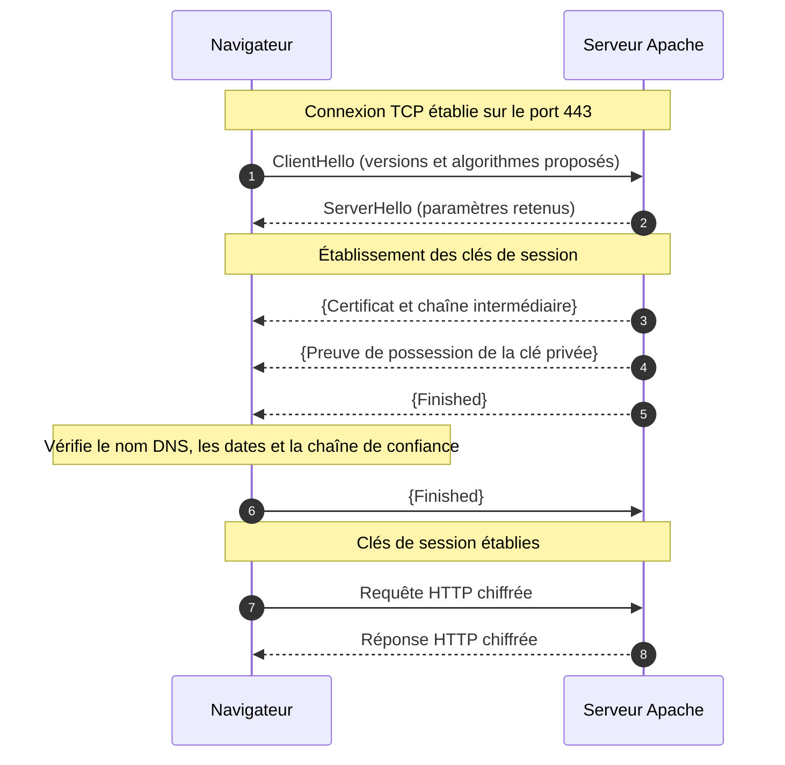
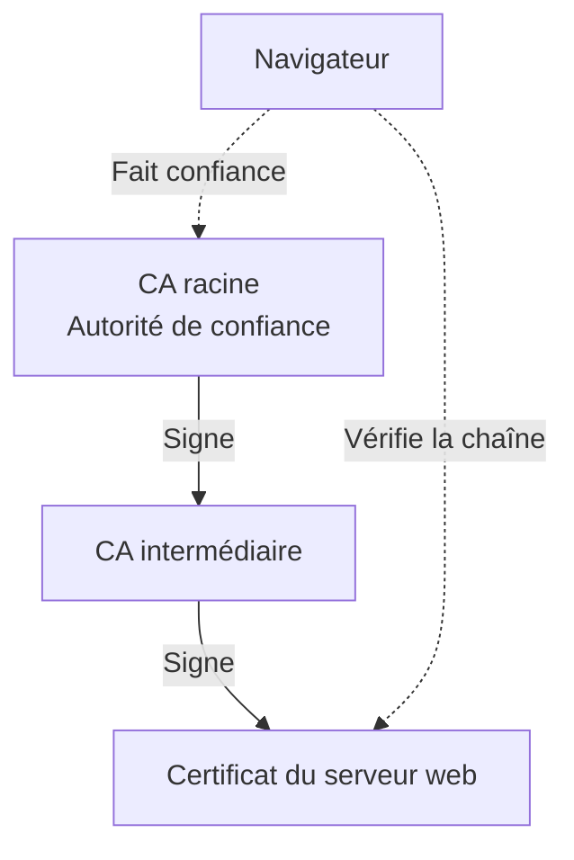
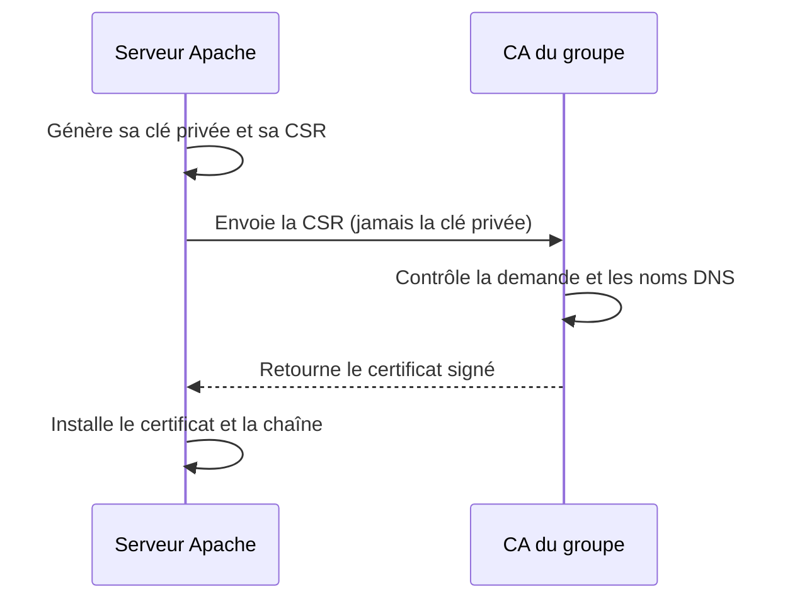

# 01 Cours- TLS, HTTPS et certificats numériques

## 1. Pourquoi sécuriser les communications ?

Avec **HTTP**, les échanges entre le navigateur et le serveur ne sont pas chiffrés. Un tiers capable d'intercepter le trafic peut les lire ou tenter de les modifier.

**HTTPS** utilise **TLS** (*Transport Layer Security*) pour protéger la connexion.

| Garantie | Rôle de TLS |
|---|---|
| **Confidentialité** | Chiffrer les données échangées. |
| **Intégrité** | Détecter une modification des données protégées. |
| **Authentification** | Permettre au client de vérifier l'identité du serveur. |

TLS fonctionne entre le protocole applicatif (HTTP, IMAP, SMTP…) et le transport TCP dans les exemples étudiés ici.


| Service | Port TCP habituel | TLS |
|---|---:|---|
| HTTP | 80 | Non |
| HTTPS | 443 | Oui |
| IMAPS | 993 | Oui, dès la connexion |
| SMTP avec STARTTLS | 587 | Activé après le début de la connexion |


!!! warning "TLS et STARTTLS"
    Un service sécurisé n'utilise pas toujours un port distinct : **STARTTLS** permet d'activer TLS sur une connexion initialement non chiffrée.

!!! danger "Les limites de HTTPS"
    HTTPS ne garantit ni la fiabilité du site consulté, ni l'absence de vulnérabilités de son application, ni sa disponibilité. Il protège les échanges jusqu'au point où TLS se termine.

## 2. Comment TLS protège-t-il une connexion ?

TLS combine plusieurs mécanismes cryptographiques :

| Élément | À quoi sert-il ? |
|---|---|
| **Clé privée du serveur** | Prouver que le serveur possède la clé correspondant à son certificat, notamment en signant la négociation. |
| **Certificat et clé publique** | Permettre au navigateur de vérifier l'identité du serveur. |
| **Échange de clés (ECDHE)** | Établir des secrets partagés sans les transmettre en clair. |
| **Clés symétriques de session** | Chiffrer les échanges et en protéger l'intégrité. |

La **cryptographie asymétrique** intervient notamment dans les signatures et l'authentification. La **cryptographie symétrique**, plus efficace pour les volumes de données, protège ensuite les requêtes et réponses HTTP.

### Une connexion HTTPS en TLS 1.3



*Schéma simplifié : les messages entre accolades sont déjà protégés par les clés de négociation TLS 1.3. Le certificat n'est pas envoyé en clair en TLS 1.3.*

!!! tip "À retenir"
    Le **certificat** ne chiffre pas toutes les pages web. Il sert à authentifier le serveur ; les **clés de session symétriques** protègent ensuite les données.

## 3. Certificats et chaîne de confiance

Un certificat numérique **X.509** associe une **clé publique** à une identité. Pour un serveur web, on y trouve notamment :

- les **noms DNS** autorisés dans l'extension **SAN** (*Subject Alternative Name*) ;
- la **clé publique** du serveur ;
- la **période de validité** ;
- l'**autorité émettrice** et sa signature numérique.

Une **autorité de certification** (*CA*) signe des certificats. Le navigateur vérifie que le certificat présenté peut être relié à une **CA racine de confiance**.



La validation porte aussi sur le **nom DNS demandé**, les **dates** et les **usages autorisés**. Un certificat valide pour `www.chartres.sportludique.fr` n'est pas automatiquement valide pour `intranet.chartres.sportludique.fr`, même si les deux noms désignent la même adresse IP.

### Et les certificats autosignés ?

Une CA racine utilise généralement un certificat autosigné. Ce certificat devient une **ancre de confiance** lorsqu'il est explicitement approuvé par le client. En revanche, un certificat serveur directement autosigné n'est généralement pas reconnu par défaut.

!!! note "SportLudique : une hiérarchie de confiance"
    **Au Socle**, chaque groupe utilise une **CA autonome**, dont le certificat public doit être approuvé par les clients.

    **En Avancé**, la **CA racine SportLudique**, administrée par les enseignants, signe les **CA intermédiaires des groupes**. Chaque groupe utilise ensuite sa CA pour signer les certificats de ses services (Apache, Stalwart, LDAPS…).

    **[Télécharger le certificat public de la CA racine](../../../medias/certificats/sportludique-root.crt.pem)**

    En Avancé, les postes clients doivent faire confiance à cette racine pour valider les certificats des groupes. **La clé privée de la CA racine n'est jamais distribuée.**

## 4. De la clé privée au certificat signé

Pour obtenir un certificat, le serveur crée une **clé privée** et une **CSR** (*Certificate Signing Request*). La CSR contient sa clé publique et les informations demandées. La CA contrôle la demande, puis signe le certificat.



| Fichier | Contenu | Diffusion |
|---|---|---|
| `web.key` | Clé privée du serveur | **Secrète**, conservée sur le serveur |
| `web.csr` | Demande de certificat | Transmise à la CA |
| `web.crt` | Certificat signé | Public |
| `ca-<ville>.crt` | Certificat de la CA autonome | Public, approuvé par les clients au Socle |
| `ca-intermediaire.crt` | Certificat de la CA du groupe signé par la racine | Public, utilisé en Avancé |
| `sportludique-root.crt.pem` | Certificat de la CA racine | Public, approuvé par les clients en Avancé |
| `fullchain.pem` | Certificat serveur puis intermédiaire | Public, utilisé en Avancé |

Le format **PEM** est un encodage texte courant pour les certificats et les clés. Les commandes de création, de lecture et de vérification figurent dans la [fiche OpenSSL](04-openssl-aide-memoire.md).

## 5. La PKI SportLudique

Une **PKI** (*Public Key Infrastructure*) organise les autorités de certification et la gestion des certificats.

L'organisation suivante correspond au niveau **Avancé**.

| Autorité | Périmètre |
|---|---|
| **SportLudique Root CA** | Signe les CA intermédiaires des cinq groupes. |
| **CA Chartres** | `chartres.sportludique.fr` et ses sous-domaines. |
| **CA Orléans** | `orleans.sportludique.fr` et ses sous-domaines. |
| **CA Tours** | `tours.sportludique.fr` et ses sous-domaines. |
| **CA Bourges** | `bourges.sportludique.fr` et ses sous-domaines. |
| **CA Blois** | `blois.sportludique.fr` et ses sous-domaines. |

Le service partagé `mail.sportludique.fr` relève du prestataire, pas d'une CA de groupe. La CA racine **n'a pas besoin d'être joignable pendant chaque connexion HTTPS** : le navigateur vérifie les certificats à partir des informations dont il dispose.

Les certificats ont une durée de validité limitée : ils doivent être **renouvelés**. En cas de compromission, ils peuvent aussi être **révoqués**, à condition que les clients disposent d'un mécanisme permettant de vérifier cette révocation.

## 6. Automatiser la délivrance des certificats

En entreprise, il serait peu pratique de créer et renouveler tous les certificats manuellement. Le protocole **ACME** automatise ces opérations.

Avec **Let's Encrypt**, **Certbot** peut demander et renouveler les certificats Apache. Avec le challenge **DNS-01**, le demandeur prouve qu'il contrôle un nom en publiant un enregistrement DNS TXT, par exemple :

```dns
_acme-challenge.www.chartres.sportludique.fr.
```

Le principe d'ACME est présenté ici **sans mise en œuvre**.

### Quelques solutions à connaître

| Solution | Rôle |
|---|---|
| **OpenSSL** | Outils et bibliothèques pour manipuler clés, CSR, certificats et connexions TLS. |
| **AD CS** | Service de certification intégré à Windows Server et Active Directory. |
| **step-ca** | Service de CA privée pouvant proposer ACME. |
| **Let's Encrypt** | Autorité publique proposant des certificats gratuits via ACME. |
| **DigiCert, Sectigo…** | Autorités publiques proposant des certificats et des services associés. |

### HTTPS et sites frauduleux


!!! info "Un certificat HTTPS ne prouve pas qu'un site est honnête"
    Un site frauduleux peut disposer d'un certificat valide pour son propre domaine. **Vérifiez l'adresse du site** : HTTPS protège la connexion, pas la fiabilité du contenu.

## 7. Pour passer à la pratique

- [Socle — Avancé - Création de votre CA](02-tls-creation-ca.md)
- [Tous — Configurer Apache avec TLS](03-tls-apache.md)
- [Validation des connaissances](05-tls-pki-quiz.md)
- [Fiche technique OpenSSL](04-openssl-aide-memoire.md)

## Références

- [RFC 8446 — TLS 1.3](https://www.rfc-editor.org/rfc/rfc8446.html)
- [RFC 5280 — Certificats X.509](https://www.rfc-editor.org/rfc/rfc5280.html)
- [RFC 8555 — ACME](https://www.rfc-editor.org/rfc/rfc8555.html)
