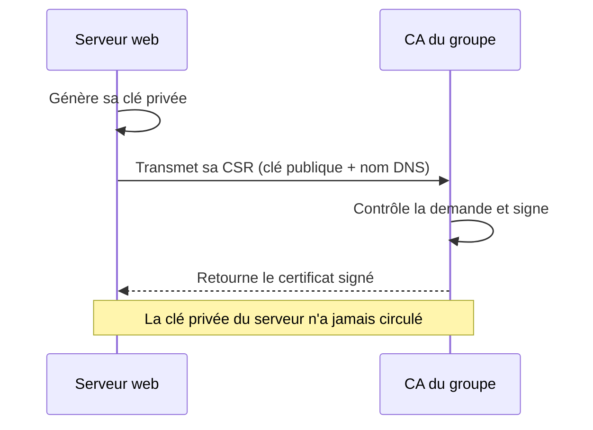
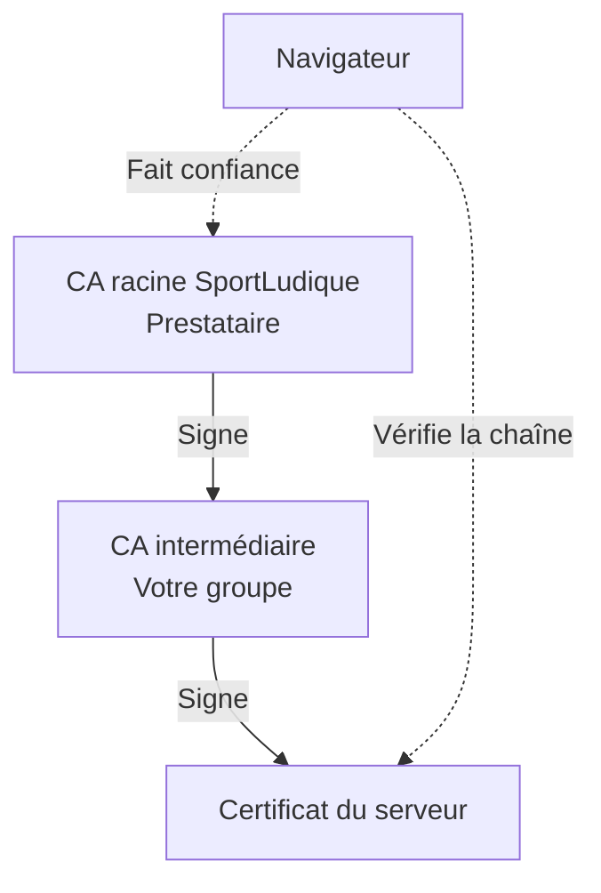
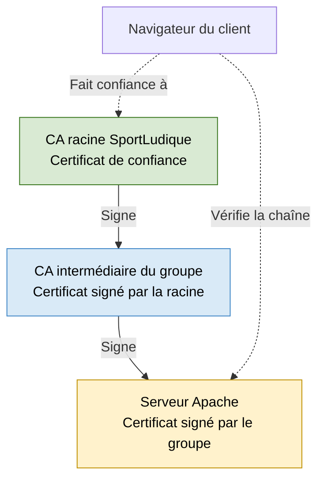
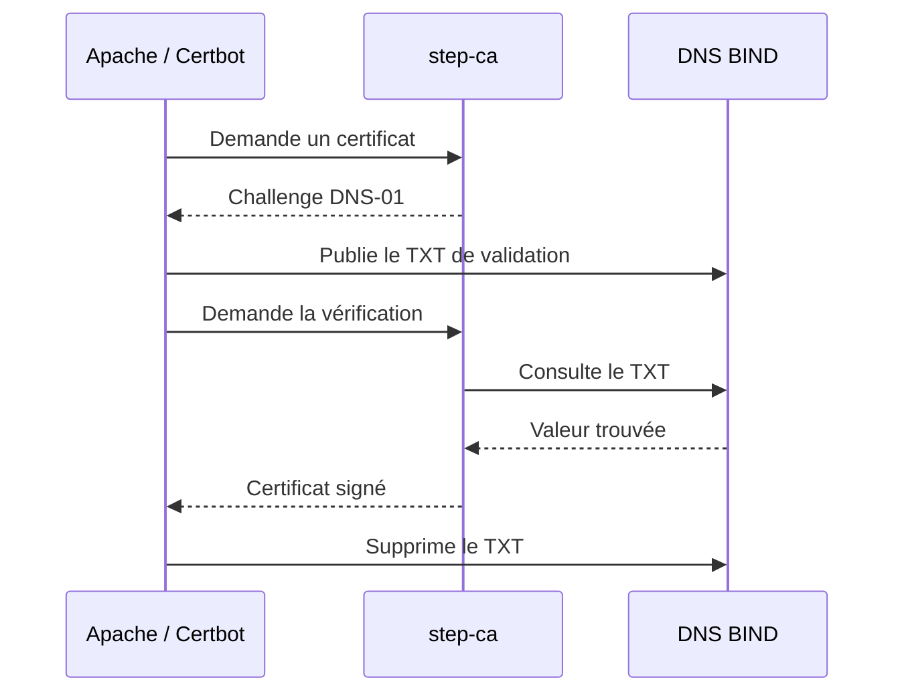

# 02 - CA — Créer l'autorité de certification de votre groupe

!!! abstract "Mission"
    Votre groupe doit pouvoir délivrer les certificats de ses serveurs. Vous allez d'abord créer une **CA autonome** avec OpenSSL, puis la faire reconnaître par la **CA racine SportLudique**.

    - **Socle :** créer une CA autosignée et signer un premier certificat de serveur.
    - **Avancé :** conserver la clé privée de la CA, faire signer sa demande par le prestataire et devenir une **CA intermédiaire**.
    - **Expert :** comprendre comment automatiser l'émission avec **step-ca et ACME**.

**Prérequis :** Zone DNS fonctionnelle.

!!! warning "Une règle absolue"
    Une **clé privée ne se transmet jamais** : ni au prestataire, ni dans un compte rendu, ni sur Git. Seules les demandes de signature (**CSR**) et les certificats publics peuvent circuler.

## Socle — Votre première autorité de certification

### 1. Préparer l'environnement de travail

OpenSSL est un outil en ligne de commande très répandu pour générer des clés, créer des certificats et vérifier des connexions TLS. Vérifiez qu'il est installé :

```bash
openssl version
```

### Préparation de l'environnement

Vérifiez la présence d'OpenSSL et de `tree`. Installez-les si nécessaire :

```bash
sudo apt update
sudo apt install openssl tree
```

Dans votre répertoire personnel, créez un dossier `pki-groupe` en respectant l'arborescence suivante :

```text
pki-groupe/
├── autorite/
│   ├── certificats/
│   └── cles/
└── serveur/
    ├── certificats/
    ├── cles/
    └── demandes/
```

Cette organisation permet de distinguer les fichiers de **l'autorité de certification (CA)** de ceux du **serveur web**.

Vérifiez votre travail avec la commande `tree`.

!!! warning "Clés privées"
    Les clés privées sont confidentielles. Assurez-vous que les répertoires `cles/` ne sont accessibles qu'à leur propriétaire.

    **Rappel :** la commande `chmod` permet de modifier les permissions d'accès.

| Dossier | Utilité |
|---|---|
| `autorite/cles/` | Clé privée de l'autorité de certification (CA) |
| `autorite/certificats/` | Certificat de la CA |
| `serveur/cles/` | Clé privée du serveur web |
| `serveur/demandes/` | Demande de certificat (CSR) du serveur |
| `serveur/certificats/` | Certificat du serveur signé par la CA |

### 2. Générer la clé privée de votre CA

Générez une clé RSA de 4096 bits, **chiffrée avec une phrase de passe** :

```bash
openssl genpkey -algorithm RSA -aes-256-cbc \
  -pkeyopt rsa_keygen_bits:4096 \
  -out autorite/cles/ca-<ville>.key
```

OpenSSL demande une phrase de passe. Elle sera nécessaire à chaque signature effectuée par la CA.

!!! danger "Conservez précieusement votre phrase de passe"
    La **phrase de passe (passphrase)** protège la clé privée de votre autorité de certification (CA).

    Elle sera demandée chaque fois que vous utiliserez cette clé pour **signer les certificats de vos différents services** (Apache, messagerie, etc.).

    **Si vous la perdez, vous ne pourrez plus utiliser cette clé privée pour signer de nouveaux certificats.**

Vérifiez que la clé existe, sans afficher son contenu secret :

```bash
ls -l autorite/cles/ca-<ville>.key
openssl pkey -in autorite/cles/ca-<ville>.key -noout -check
```

??? question "Pourquoi protéger la clé privée de la CA par une phrase de passe ?"
    Parce qu'une personne qui récupère cette clé pourrait signer de faux certificats au nom de votre autorité. Le chiffrement limite les conséquences d'un vol du fichier, sans remplacer les permissions et les sauvegardes.

### 3. Créer le certificat autosigné de la CA

Une CA autonome est **sa propre autorité racine** : elle signe son propre certificat. Ce certificat doit être explicitement approuvé par les clients.

```bash
openssl req -new -x509 -days 365 \
  -key autorite/cles/ca-<ville>.key \
  -out autorite/certificats/ca-<ville>.crt
```

Examinez le certificat :

```bash
openssl x509 -in autorite/certificats/ca-<ville>.crt \
  -noout -subject -issuer -dates

openssl x509 -in autorite/certificats/ca-<ville>.crt \
  -noout -text
```

**À observer :** `Subject` et `Issuer` désignent la même CA ; `CA:TRUE` autorise cette clé à signer des certificats.

??? question "Un certificat autosigné est-il nécessairement frauduleux ?"
    Non. Il n'est simplement **pas reconnu par défaut** par les clients. Sa confiance doit être établie par un autre moyen, par exemple une installation explicite et vérifiée.

### Création de la demande de certificat du serveur web

Nous allons créer un certificat pour le serveur Apache, accessible avec deux noms :

- `www.chartres.sportludique.fr` : nom principal du serveur.
- `chartres.sportludique.fr` : nom alternatif permettant d'accéder au même site sans `www`.

Adaptez ces noms à votre ville.

**1. Générer la clé privée du serveur**

```bash
openssl genpkey -algorithm RSA -pkeyopt rsa_keygen_bits:3072 \
  -out serveur/cles/web.key
```

**2. Créer la demande de certificat (CSR)**

```bash
openssl req -new -sha256 \
  -key serveur/cles/web.key \
  -out serveur/demandes/web.csr \
  -addext "subjectAltName=DNS:www.chartres.sportludique.fr,DNS:chartres.sportludique.fr"
```

OpenSSL vous demande plusieurs informations. Renseignez notamment :

| Champ | Exemple |
|---|---|
| Country Name | `FR` |
| Organization Name | `SportLudique` |
| Common Name (CN) | `www.chartres.sportludique.fr` |

Les autres champs peuvent être laissés vides.

!!! warning "Common Name (CN) et Subject Alternative Name (SAN)"
    Le **CN** désigne ici le nom principal du serveur.

    L'extension **SAN** contient les noms DNS pour lesquels le certificat sera valable. Les navigateurs modernes vérifient les SAN, et non le seul CN.

    L'option `-addext` permet de renseigner cette extension, car OpenSSL ne la demande pas dans son dialogue interactif.

!!! tip "Attention à la résolution DNS"
    Un certificat contenant plusieurs noms DNS ne crée pas automatiquement les enregistrements correspondants.

    Vérifiez que votre zone DNS contient les enregistrements nécessaires pour les deux noms :

    ```dns
    @       IN A      192.0.2.10
    www     IN CNAME  chartres.sportludique.fr.
    ```

    Remplacez l'adresse IP d'exemple par celle de votre serveur web.

**3. Vérifier la CSR**

```bash
openssl req -in serveur/demandes/web.csr -noout -text
```

Repérez les champs **Subject**, **Common Name** et **X509v3 Subject Alternative Name**.

Vérifiez que les deux noms DNS apparaissent dans les SAN.

!!! question "À vous de réfléchir"
    Pourquoi faut-il déclarer `www.chartres.sportludique.fr` et `chartres.sportludique.fr` dans les SAN alors qu'ils désignent le même serveur web ?

### 5. Signer le certificat serveur avec votre CA autonome

Pour ce premier essai, nous utilisons `openssl x509 -req` : **pas de registre de CA à administrer au Socle**.

La CA doit imposer les usages du certificat délivré, plutôt que reprendre aveuglément toutes les extensions de la CSR.

Signez la CSR :

```bash
openssl x509 -req -days 365 \
  -in serveur/demandes/web.csr \
  -CA autorite/certificats/ca-autonome.crt \
  -CAkey autorite/cles/ca-groupe.key \
  -CAserial autorite/ca.srl \
  -CAcreateserial \
  -out serveur/certificats/web.crt \
  -copy_extensions copy
```

!!! info "Option `-copy_extensions copy`"
    Cette option permet de **conserver les extensions présentes dans la CSR**, notamment les noms DNS déclarés dans le champ **SAN**.

    Sans elle, ces noms ne seraient pas automatiquement intégrés au certificat signé.

    Dans une PKI réelle, la CA doit vérifier les extensions demandées avant de les accepter.

!!! info "Pourquoi un fichier `.srl` apparaît-il ?"
    Il mémorise un numéro de série pour les certificats signés avec cette commande. C'est suffisant pour la découverte ; en Avancé, nous utiliserons un **registre de délivrance** plus complet.

Contrôlez le résultat :

```bash
openssl x509 -in serveur/certificats/web-autonome.crt \
  -noout -subject -issuer -dates -ext subjectAltName
```

**Résultat attendu :** `OK`.



### Validation du Socle

??? question "1 — Quelles sont les deux clés privées créées ?"
    Celle de la CA, utilisée pour signer les certificats, et celle du serveur, utilisée pour prouver son identité lors de TLS.

??? question "2 — Pourquoi le navigateur ne fait-il pas encore confiance à cette CA ?"
    Son certificat autosigné n'est pas installé parmi les autorités approuvées par le client.

??? question "3 — Quel fichier faut-il transmettre pour demander un certificat ?"
    La CSR (`web.csr`), jamais la clé privée (`web.key`).

## Avancé — Devenir une CA intermédiaire SportLudique

### 1. Comprendre le changement

Au Socle, votre CA était autonome. Désormais, **la racine SportLudique du prestataire signe votre CA**. Vous conservez **la même clé privée**, mais recevez un **nouveau certificat de CA**.



!!! warning "Deux certificats, une seule clé"
    Conservez `ca-<ville>-autonome.crt` pour comprendre le Socle, mais **n'utilisez plus ce certificat autosigné comme émetteur** pour les nouveaux certificats. Le certificat intermédiaire signé par le prestataire le remplace dans la chaîne utilisée en Avancé.

### 2. Créer la CSR de votre CA existante

```bash
openssl req -new -sha256 \
  -key autorite/cles/ca-groupe.key \
  -out autorite/demandes/ca-groupe.csr \
  -subj "/C=FR/O=SportLudique/CN=CA <ville> SportLudique"

openssl req -in autorite/demandes/ca-groupe.csr -noout -verify -text
```

**Transmettez uniquement** `ca-groupe.csr` au prestataire (votre enseignant). Précisez votre groupe et son sous-domaine autorisé (`ville.sportludique.fr`). Le prestataire contrôle la demande et signe avec les extensions d'une **CA intermédiaire** (`CA:TRUE`, `pathlen:0`, usages de signature, contraintes DNS adaptées).

### 3. Récupérer les certificats et vérifier la confiance

Téléchargez le [certificat public de la CA racine SportLudique](../../../medias/certificats/sportludique-root.crt.pem) et récupérez auprès du prestataire le certificat intermédiaire signé.

!!! warning "Vérifier l'empreinte de la CA racine"
    Avant de faire confiance au certificat téléchargé, vérifiez son empreinte SHA-256 :

    ```bash
    openssl x509 -in sportludique-root.crt.pem -noout -fingerprint -sha256
    ```

    **Empreinte SHA-256 de référence :**

    ```text
    63:AF:BC:08:20:1F:75:82:43:40:83:50:DA:28:15:F8:
    0A:A5:33:A0:AB:3D:E4:B0:C5:3E:C3:77:5B:1C:6B:0A
    ```

    Les deux empreintes doivent être **strictement identiques**.
    En cas de différence, n'importez pas le certificat dans les autorités de confiance.

### Vérification de la chaîne de confiance

Après avoir récupéré les deux certificats, vérifiez l'empreinte de la CA racine :

```bash
openssl x509 -in autorite/certificats/sportludique-root.crt.pem \
  -noout -fingerprint -sha256
```

Comparez le résultat à l'empreinte de référence communiquée précédemment.

Vérifiez ensuite que votre **CA intermédiaire a bien été certifiée par la CA racine SportLudique** :

```bash
openssl verify \
  -CAfile autorite/certificats/sportludique-root.crt.pem \
  autorite/certificats/ca-intermediaire.crt
```

**Résultat attendu :**

```text
autorite/certificats/ca-intermediaire.crt: OK
```

Ce résultat confirme que le certificat de votre CA intermédiaire peut être validé à partir de la CA racine SportLudique.

**À contrôler :** `CA:TRUE`, `pathlen:0`, usages `keyCertSign` / `cRLSign`, et contraintes de noms DNS du groupe si elles sont prévues dans le certificat signé.

### 4. Vérifier que la clé de la CA n'a pas changé

Comparez l'empreinte de la clé publique extraite de la clé privée et du nouveau certificat :

```bash
openssl pkey -in autorite/cles/ca-groupe.key -pubout -outform DER | openssl dgst -sha256
openssl x509 -in autorite/certificats/ca-intermediaire.crt -pubkey -noout | \
  openssl pkey -pubin -outform DER | openssl dgst -sha256
```

Les deux empreintes doivent être **identiques**.

### 5. Découvrir le registre d'une CA

Au Socle, une commande suffisait pour signer. Pour gérer plusieurs certificats, leur renouvellement et leur révocation, OpenSSL propose `openssl ca` et un **registre**.

Préparez ce registre **une seule fois**, sans écraser un registre déjà utilisé :

```bash
mkdir -p autorite/newcerts autorite/crl
touch autorite/index.txt
openssl rand -hex 16 > autorite/serial
printf '1000\n' > autorite/crlnumber
```

| Élément | Rôle |
|---|---|
| `index.txt` | Liste des certificats délivrés et de leur état |
| `serial` | Prochain numéro de série |
| `newcerts/` | Copies des certificats délivrés |
| `crl/`, `crlnumber` | Préparation des listes de révocation |

Créez `autorite/openssl.cnf` :

```ini
[ ca ]
default_ca = CA_default

[ CA_default ]
dir = ./autorite
database = $dir/index.txt
new_certs_dir = $dir/newcerts
serial = $dir/serial
crlnumber = $dir/crlnumber
certificate = $dir/certificats/ca-intermediaire.crt
private_key = $dir/cles/ca-<ville>.key
default_md = sha256
default_days = 90
default_crl_days = 7
policy = policy_server
copy_extensions = none
unique_subject = no

[ policy_server ]
countryName = optional
organizationName = optional
commonName = supplied
```

!!! info "Ce qui change"
    `openssl ca` enregistre les certificats émis. `copy_extensions = none` évite de recopier automatiquement les extensions de la CSR : **la CA choisit les SAN et usages autorisés** dans un fichier d'extensions qu'elle contrôle.

### 6. Émettre un nouveau certificat serveur

Reprenez la CSR du serveur et son fichier d'extensions du Socle, après avoir vérifié les noms demandés. Signez avec **le certificat intermédiaire** :

```bash
openssl ca -config autorite/openssl.cnf \
  -in serveur/demandes/web.csr \
  -extfile serveur/demandes/web.ext \
  -out serveur/certificats/web-intermediaire.crt \
  -notext -days 200
```

!!! info "Durée de validité des certificats"
    L'option `-days 200` fixe la durée de validité du certificat à **200 jours**.

    Dans ce TP, cette durée est choisie pour simplifier les manipulations. En pratique, les certificats TLS publics ont des durées de validité de plus en plus courtes : **200 jours maximum depuis mars 2026, 100 jours à partir de mars 2027, puis 47 jours à partir de mars 2029**.

    Cette évolution rend indispensable l'**automatisation du renouvellement**, notamment avec ACME (Let's Encrypt).

Puis vérifiez la chaîne complète :

```bash
openssl verify -show_chain \
  -verify_hostname "www.ville.sportludique.fr" \
  -CAfile autorite/certificats/sportludique-root.crt.pem \
  -untrusted autorite/certificats/ca-intermediaire.crt \
  serveur/certificats/web.crt
```

**Résultat attendu :** `OK`. En cas d'échec, vérifiez les dates de validité, les extensions et le nom DNS. La CA intermédiaire et la racine doivent rester valides pendant la durée du certificat serveur.

!!! info "Vérification de la chaîne de confiance"
      Cette commande vérifie que le certificat du serveur web est bien signé par votre CA intermédiaire, elle-même certifiée par la CA racine SportLudique.

      L'option -verify_hostname vérifie également que le certificat est valable pour le nom DNS indiqué, grâce au champ SAN.

      Adaptez www.ville.sportludique.fr à votre ville.

### Préparer la chaîne de certificats pour Apache

Votre serveur web possède désormais un certificat signé par **la CA intermédiaire de votre groupe**, elle-même certifiée par **la CA racine SportLudique**.

La chaîne de confiance est donc la suivante :



Lors d'une connexion HTTPS, Apache doit présenter au navigateur :

1. **Le certificat du serveur web**, qui prouve son identité.
2. **Le certificat de la CA intermédiaire**, qui permet de remonter jusqu'à la racine SportLudique.

Le navigateur possède déjà le certificat de la CA racine dans son magasin de confiance.

**Création du fichier `fullchain.pem` :**

```bash
cat serveur/certificats/web-intermediaire.crt \
    autorite/certificats/ca-intermediaire.crt \
    > serveur/certificats/fullchain.pem
```

Cette commande regroupe les deux certificats publics dans un même fichier, dans l'ordre attendu par Apache : **serveur puis CA intermédiaire**.

!!! info "Que contient `fullchain.pem` ?"
    ```text
    -----BEGIN CERTIFICATE-----
    Certificat du serveur web
    -----END CERTIFICATE-----

    -----BEGIN CERTIFICATE-----
    Certificat de la CA intermédiaire
    -----END CERTIFICATE-----
    ```

    Ce fichier ne contient **aucune clé privée**. La clé privée du serveur reste dans `serveur/cles/web.key`.

!!! warning "À quelle autorité le navigateur doit-il faire confiance ?"
    Le client doit faire confiance à **la CA racine SportLudique**, et non directement à la CA intermédiaire du groupe.

    Il peut ainsi vérifier toute la chaîne de certification, depuis le serveur Apache jusqu'à l'autorité racine.

Le déploiement du certificat dans Apache et l'importation de la CA racine dans le navigateur sont étudiés dans le [TP Apache HTTPS](tls-socle.md).

### Validation de l'Avancé

??? question "1 — Avez-vous recréé la clé privée de la CA ?"
    Non : la même clé privée est utilisée. Seul le certificat de CA change.

??? question "2 — Quel certificat doit être approuvé par les postes clients ?"
    Le certificat public de la **CA racine SportLudique**, après vérification de son empreinte.

??? question "3 — Pourquoi faut-il émettre un nouveau certificat serveur ?"
    Le certificat du Socle est signé sous l'identité de la CA autonome. Le nouveau certificat doit être émis par la CA intermédiaire, afin de construire la chaîne vers la racine SportLudique.

**Livrables :** CSR de la CA, certificat intermédiaire, contrôle de la chaîne, certificat serveur renouvelé et extrait du registre OpenSSL. Aucune clé privée.

## Expert — Vers l'automatisation

Signer manuellement chaque CSR fonctionne dans un laboratoire, mais devient fastidieux lorsque les services et les renouvellements se multiplient.

Le protocole **ACME** permet d'automatiser les demandes. Dans SportLudique, **step-ca** peut exploiter la CA intermédiaire du groupe ; **Certbot** peut demander un certificat et prouver le contrôle du nom DNS grâce au challenge **DNS-01**.



!!! tip "À retenir"
    **ACME automatise** les étapes que vous venez de réaliser à la main. Il ne remplace ni la vérification des droits sur les noms DNS ni la protection des clés privées.

La mise en œuvre de step-ca, de Certbot et des mises à jour DNS dynamiques est abordée dans le [TP Expert — ACME et DNS-01](tls-expert.md).

## Ressources

- [Cours — TLS, HTTPS et certificats](01-tls-presentation.md)
- [Fiche technique — OpenSSL](fiche-openssl.md)
- [TP — Apache HTTPS](tls-socle.md)
