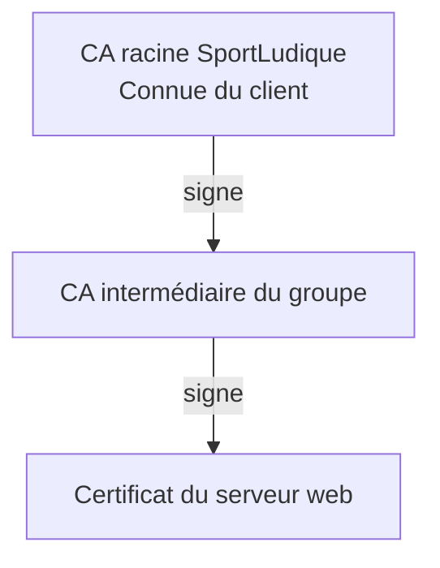

# 03- TLS — Apache publier un site en HTTPS

**Mission :** sécuriser le site réalisé dans le [TP Apache](../web/apache.md) et vérifier son accès depuis un poste client. Vous utilisez **les clés et certificats déjà produits dans le TP PKI** : aucune nouvelle clé, CSR ou autorité de certification ne doit être créée ici.

**Prérequis :** site HTTP accessible par son nom DNS, Apache ou Nginx installé et fonctionnel, accès administrateur au serveur et au poste de test, fichiers du TP PKI disponibles.

!!! info "Deux situations possibles"
    - **CA autonome (Socle PKI)** : le certificat du serveur est signé par votre CA autonome. Le poste client devra faire confiance au **certificat public de cette CA**.
    - **CA intermédiaire (Avancé PKI)** : le certificat du serveur est signé par la CA de votre groupe, elle-même signée par la racine SportLudique. Le poste client devra faire confiance au [certificat public de la CA racine SportLudique](../../../medias/certificats/sportludique-root.crt.pem).

## 1. Vérifier le site existant

Adaptez les noms à votre ville : Chartres, Orléans, Tours, Bourges ou Blois.

Vérifiez que le site répond déjà en HTTP, par exemple :

```bash
curl -I http://www.chartres.sportludique.fr/
```

Retrouvez le répertoire du site (normalement `/var/www/sportludique-public`) et le fichier de configuration du serveur web. Corrigez d'abord tout problème de DNS, de routage ou de HTTP.

## 2. Observer les échanges HTTP

Depuis un **poste client distinct**, ouvrez Wireshark et capturez une requête HTTP vers votre site. Utilisez le filtre `http` ou `tcp.port == 80`.

```bash
curl "http://www.chartres.sportludique.fr/?message=bonjour-sportludique"
```

Retrouvez la méthode HTTP, le nom demandé et le marqueur `bonjour-sportludique` dans la capture.

??? question "HTTP et confidentialité"
    Pourquoi le marqueur est-il lisible dans Wireshark ? Que pourrait observer un équipement placé sur le trajet réseau ?

## 3. Récupérer les fichiers du TP PKI

Vous avez déjà généré la clé privée et fait signer le certificat du serveur dans le TP PKI. **Ne régénérez pas ces fichiers.**

| Fichier du TP PKI | Rôle |
|---|---|
| `serveur/cles/web.key` | Clé privée du serveur web |
| `serveur/certificats/web.crt` **ou** `web-intermediaire.crt` | Certificat du serveur signé par votre CA |
| `autorite/certificats/ca-<ville>.crt` | Certificat public de votre CA autonome (Socle PKI) |
| `autorite/certificats/ca-intermediaire.crt` | Certificat public de votre CA intermédiaire (Avancé PKI) |

!!! warning "Attention aux clés privées"
    La clé `web.key` reste sur le serveur. **Ne la transmettez jamais au navigateur ni à un autre groupe.** Le poste client ne reçoit que le certificat public de l'autorité à laquelle il doit faire confiance.

### Cas d'une CA intermédiaire : préparer la chaîne publique

Le serveur doit présenter son certificat **et** celui de la CA intermédiaire :



Sur la machine où se trouvent les fichiers du TP PKI :

```bash
cat serveur/certificats/web-intermediaire.crt \
    autorite/certificats/ca-intermediaire.crt \
    > serveur/certificats/fullchain.pem
```

**Ordre : certificat du serveur, puis certificat intermédiaire.** Le certificat racine n'est pas ajouté à ce fichier : c'est le client qui doit déjà lui faire confiance.

Dans le cas d'une **CA autonome**, utilisez simplement `web.crt` comme certificat présenté par le serveur : il n'y a pas de certificat intermédiaire à ajouter.

## 4. Installer les certificats sur le serveur web

Sur le serveur Apache ou Nginx, préparez les dossiers de destination :

```bash
sudo mkdir -p /etc/ssl/sportludique/certs
sudo mkdir -p /etc/ssl/sportludique/private
```

Copiez depuis votre répertoire de travail PKI les fichiers nécessaires vers ces dossiers :

- `web.key` vers `/etc/ssl/sportludique/private/web.key` ;
- **CA autonome :** `web.crt` vers `/etc/ssl/sportludique/certs/web.crt` ;
- **CA intermédiaire :** `fullchain.pem` vers `/etc/ssl/sportludique/certs/fullchain.pem`.

Si les fichiers sont sur une autre VM, transférez-les par un moyen sécurisé (par exemple `scp`). Protégez la clé privée sur le serveur :

```bash
sudo chown root:root /etc/ssl/sportludique/private/web.key
sudo chmod 600 /etc/ssl/sportludique/private/web.key
```

!!! tip "À retenir"
    Le certificat public peut être distribué. La **clé privée du serveur** doit rester confidentielle. Elle est nécessaire au fonctionnement de HTTPS, mais ne doit jamais être placée dans un répertoire publié par le serveur web.

## 5. Activer HTTPS

Choisissez uniquement l'onglet correspondant à votre serveur web. Les exemples utilisent Chartres : adaptez le nom DNS à votre groupe.

Apache : copiez le fichier default-ssl.conf, puis adaptez-le à votre site.

Nginx : copiez le fichier default situé dans /etc/nginx/sites-available/, puis adaptez-le à votre site.

=== "Apache"

    Activez le module SSL :

    ```bash
    sudo a2enmod ssl
    ```

    Créez `/etc/apache2/sites-available/sportludique-ssl.conf` :

     ```bash
    sudo cp /etc/apache2/sites-available/default-ssl.conf /etc/apache2/sites-available/www.ville.sportludique.fr.conf
    ```

    ```apache
    <VirtualHost *:443>
        ServerName www.chartres.sportludique.fr
        DocumentRoot /var/www/sportludique-public

        SSLEngine on
        SSLCertificateFile /etc/ssl/sportludique/certs/fullchain.pem
        SSLCertificateKeyFile /etc/ssl/sportludique/private/web.key

        <Directory /var/www/sportludique-public>
            Require all granted
        </Directory>
    </VirtualHost>
    ```

    **Avec une CA autonome**, remplacez `fullchain.pem` par `web.crt` dans `SSLCertificateFile`.

    Activez le site, testez la configuration et rechargez Apache :

    ```bash
    sudo a2ensite sportludique-ssl.conf
    sudo apache2ctl configtest
    sudo systemctl reload apache2
    ```

=== "Nginx"

    Créez `/etc/nginx/sites-available/sportludique-ssl` :

    ```nginx
    server {
        listen 443 ssl;
        server_name www.chartres.sportludique.fr;
        root /var/www/sportludique-public;
        index index.html;

        ssl_certificate /etc/ssl/sportludique/certs/fullchain.pem;
        ssl_certificate_key /etc/ssl/sportludique/private/web.key;

        location / {
            try_files $uri $uri/ =404;
        }
    }
    ```

    **Avec une CA autonome**, remplacez `fullchain.pem` par `web.crt` dans `ssl_certificate`.

    Activez le site, testez la configuration et rechargez Nginx :

    ```bash
    sudo ln -s /etc/nginx/sites-available/sportludique-ssl /etc/nginx/sites-enabled/
    sudo nginx -t
    sudo systemctl reload nginx
    ```

!!! warning "Accès réseau"
    Vérifiez que le DNS pointe vers le bon serveur et que les règles de filtrage, de routage et éventuellement de DNAT autorisent les connexions **TCP 443**. La directive `ServerName` ou `server_name` ne crée pas d'enregistrement DNS.

## 6. Installer l'autorité de confiance sur le poste client

Depuis un **poste distinct**, ouvrez le site `https://www.chartres.sportludique.fr/` (adaptez le nom). Une alerte de confiance peut apparaître tant que la CA n'a pas été importée.

Téléchargez ou copiez **le certificat public de l'autorité à approuver** :

- **CA autonome :** `ca-<ville>.crt`, issu du TP PKI de votre groupe ;
- **CA intermédiaire :** [sportludique-root.crt.pem](../../../medias/certificats/sportludique-root.crt.pem), fourni par le prestataire.

En passant du Socle à l'Avancé, retirez du magasin de confiance le certificat de la CA autonome pour vérifier que la chaîne est bien validée à partir de la racine SportLudique.

!!! warning "Contrôler la racine SportLudique"
    Avant d'importer la racine SportLudique, vérifiez son empreinte :

    ```bash
    openssl x509 -in sportludique-root.crt.pem -noout -fingerprint -sha256
    ```

    **Empreinte SHA-256 de référence :**

    ```text
    3C:8F:51:57:6E:C0:EF:51:94:9C:D5:12:E0:C8:BD:8A:CC:BF:DD:9B:FD:C0:50:00:9D:CE:FC:D6:AE:08:5F:0B
    ```

    N'importez pas le certificat si l'empreinte diffère. Cette valeur doit être obtenue par un canal fiable indépendant du téléchargement.

=== "Debian / Linux"

    Copiez le certificat public de la CA choisie sur le poste, puis installez-le dans le magasin système (avec une extension `.crt`) :

    ```bash
    sudo cp certificat-ca.crt /usr/local/share/ca-certificates/sportludique.crt
    sudo update-ca-certificates
    ```

    Remplacez `certificat-ca.crt` par le nom du fichier téléchargé. Firefox peut utiliser un magasin distinct selon sa configuration.

=== "Windows"

    Ouvrez `certlm.msc` et importez le certificat public dans **Autorités de certification racines de confiance** de l'ordinateur local. Des droits administrateur sont nécessaires.

=== "Firefox / Thunderbird"

    Ouvrez les paramètres de certificats, puis **Autorités**. Importez le certificat public de la CA et autorisez la confiance pour l'identification des sites/serveurs si l'option est proposée. Vérifiez le magasin réellement utilisé par l'application.

Rechargez le site. Il ne doit plus afficher d'alerte de confiance, de nom ou de validité.

## 7. Vérifier le chiffrement et le nom DNS

Depuis le poste client, testez HTTPS :

```bash
curl -I https://www.chartres.sportludique.fr/
```

Si le magasin de confiance du poste n'est pas encore configuré, vous pouvez préciser explicitement le certificat public de votre CA :

```bash
curl --cacert certificat-ca.crt https://www.chartres.sportludique.fr/
```

Vérifiez également le certificat présenté par le serveur dans votre navigateur : **nom DNS (SAN), émetteur, dates de validité et chaîne de certification**.

Réalisez ensuite une nouvelle capture Wireshark sur le poste client, cette fois avec le filtre `tcp.port == 443` : comparez-la avec la capture HTTP de l'étape 2.

```bash
curl "https://www.chartres.sportludique.fr/?message=bonjour-sportludique"
```

??? question "HTTP ou HTTPS ?"
    Pourquoi le marqueur visible dans la capture HTTP n'apparaît-il plus en clair dans la capture HTTPS ? Quel rôle jouent respectivement le certificat et TLS ?

??? question "Vérification du nom"
    Que se passerait-il si vous accédiez au serveur avec un nom DNS absent des champs SAN du certificat ?

## 8. Validation du travail

Votre travail est validé lorsque :

- le site reste accessible en HTTP et répond également en HTTPS ;
- le serveur web utilise **la clé privée et le certificat produits dans le TP PKI**, sans les régénérer ;
- le navigateur reconnaît l'autorité de certification attendue ;
- le nom DNS correspond à un SAN du certificat ;
- vous pouvez expliquer la différence entre les captures HTTP et HTTPS ;
- vous savez distinguer `web.key`, `web.crt`, `ca-<ville>.crt`, `ca-intermediaire.crt` et `fullchain.pem`.
