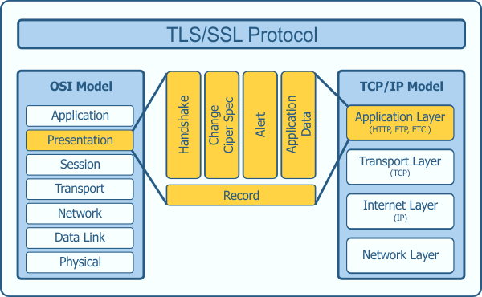
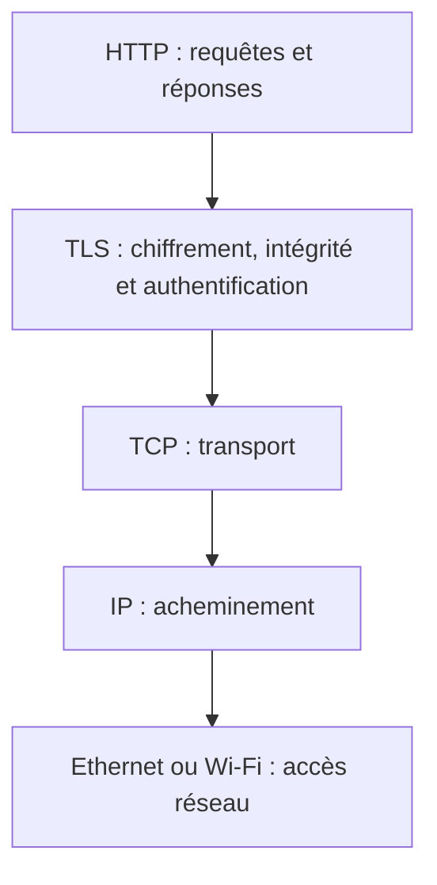
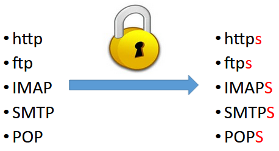
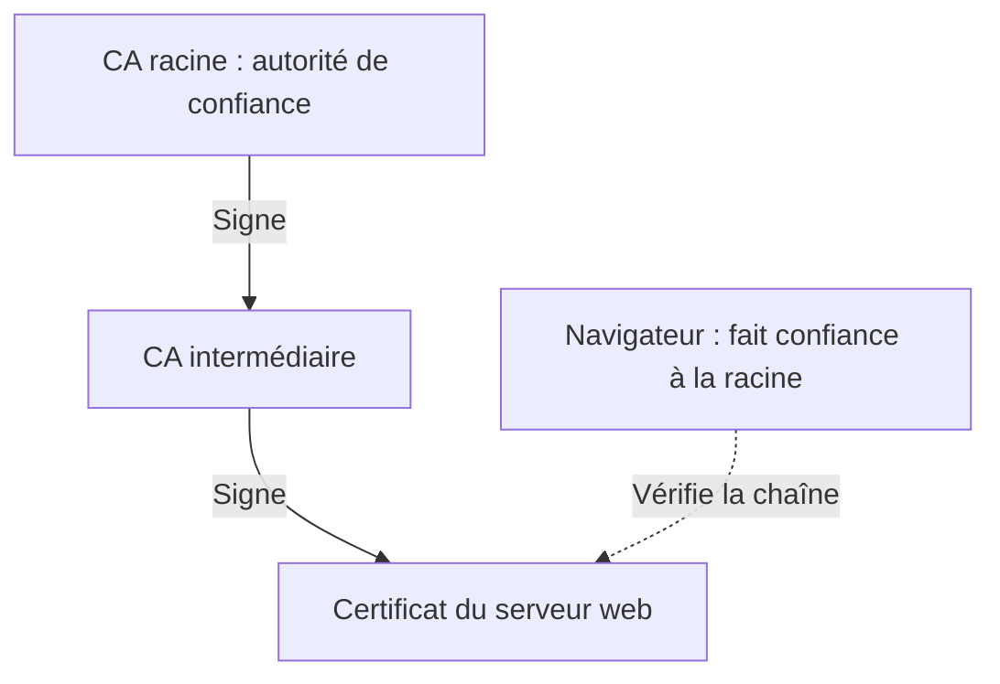
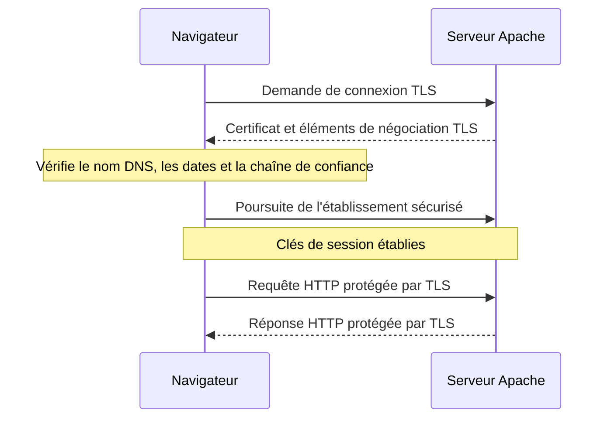
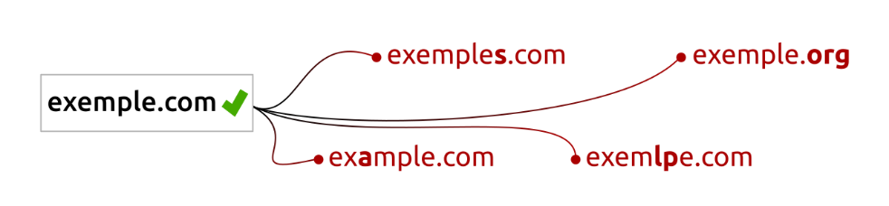

# TLS, HTTPS et certificats numériques

!!! info "SportLudique — Comprendre avant de configurer"
    Cette ressource présente les principes de **TLS**, des **certificats X.509** et des **autorités de certification**.

    La mise en pratique est proposée dans le document [Travail à faire — TLS et PKI](tls-pki.md), avec trois niveaux : **Socle**, **Avancé** et **Expert**.

## 1. Pourquoi sécuriser les communications ?

Lorsqu'un navigateur consulte un site web en **HTTP**, les données applicatives circulent sans chiffrement HTTP. Une personne capable d'intercepter le trafic peut potentiellement lire les informations échangées ou les modifier.

Avec **HTTPS**, le navigateur utilise le protocole **TLS** (*Transport Layer Security*) pour protéger les échanges avec le serveur web.

TLS apporte principalement trois garanties :

| Propriété | Question à se poser | Apport de TLS |
|---|---|---|
| **Confidentialité** | Un tiers peut-il lire les données échangées ? | TLS chiffre les données entre le client et le serveur TLS. |
| **Intégrité** | Un tiers peut-il modifier discrètement les données ? | TLS permet de détecter une modification des échanges protégés. |
| **Authentification** | Le client communique-t-il avec le serveur attendu ? | Le serveur présente un certificat que le client doit valider. |

!!! warning "TLS ne sécurise pas tout"
    HTTPS ne garantit **ni l'honnêteté du propriétaire du site**, ni l'absence de failles dans l'application web, ni la sécurité du poste client. Il protège les communications jusqu'au **point de terminaison TLS** : serveur Apache ou éventuel reverse proxy.

### Où se situe TLS ?

TLS se place **au-dessus du transport TCP** et **en dessous des échanges applicatifs HTTP**. Dans une présentation simplifiée du modèle OSI, on peut le rapprocher de la couche 6 (*Présentation*) ; ce n'est toutefois pas une correspondance stricte.

### HTTP et HTTPS

| Service | Port TCP habituel | Protection TLS |
|---|---:|---|
| HTTP | 80 | Non |
| HTTPS | 443 | Oui |

D'autres services utilisent également TLS, par exemple pour la messagerie. **Attention :** un protocole sécurisé ne dispose pas toujours d'un port distinct : certains services peuvent activer TLS sur une connexion existante, notamment avec **STARTTLS**.

??? question "Analyse — HTTPS et critères DICP"
    Un utilisateur saisit son mot de passe dans un formulaire de connexion.

    Quels critères de sécurité **DICP** sont protégés par TLS lors de la transmission du mot de passe ? Justifiez votre réponse en précisant les mécanismes utilisés et leurs limites.

    **Réponse attendue :**

    - **Confidentialité (C)** : TLS chiffre les données échangées. Un attaquant qui intercepte les communications ne peut normalement pas lire le mot de passe.
    - **Intégrité (I)** : TLS permet de détecter toute modification des données transmises grâce à des mécanismes cryptographiques d'authentification des messages.
    - **Disponibilité (D)** : TLS ne garantit pas la disponibilité du service. Une attaque par déni de service peut toujours empêcher l'accès au site.
    - **Preuve (P)** : TLS authentifie le serveur à l'aide de son certificat et de la preuve de possession de sa clé privée. Il ne fournit toutefois pas, à lui seul, une preuve juridiquement opposable de l'identité de l'utilisateur ou de ses actions.

    **Limite :** TLS ne protège pas l'utilisateur qui saisit volontairement son mot de passe sur un site frauduleux disposant d'un certificat valide.

    !!! warning "Exigence de rédaction"
        Une réponse comme **« HTTPS sécurise la connexion »** est insuffisante.

        Vous devez identifier les **critères DICP concernés**, expliquer les **mécanismes de protection** et préciser leurs **limites**.

## 2. De SSL à TLS : un peu d'histoire

**SSL** (*Secure Sockets Layer*) est l'ancêtre de TLS. Il a été développé dans les années 1990 pour sécuriser les communications sur le Web.

Ses anciennes versions présentant de graves faiblesses, **SSL ne doit plus être utilisé**. Le protocole qui lui a succédé est **TLS** (*Transport Layer Security*).

| Protocole | Repère historique | Situation aujourd'hui |
|---|---|---|
| SSL 2.0 / SSL 3.0 | Années 1990 | Obsolètes et non sécurisés |
| TLS 1.0 / TLS 1.1 | À partir de 1999 | Obsolètes |
| TLS 1.2 | 2008 | Encore utilisé avec une configuration appropriée |
| TLS 1.3 | 2018 | Version moderne, à privilégier |

On rencontre encore les expressions « certificat SSL » et « module SSL », notamment `mod_ssl` dans Apache. **Le terme technique correct pour les communications modernes est TLS.**

## 3. Comment le navigateur fait-il confiance au serveur ?

Chiffrer une communication ne suffit pas : il faut aussi être sûr de **l'identité du serveur** avec lequel on communique.

Lors d'une connexion HTTPS, le serveur présente un **certificat numérique X.509**. Celui-ci contient notamment :

- l'identité du titulaire, notamment les **noms DNS autorisés** pour le serveur dans le champ **SAN** (*Subject Alternative Name*) ;
- la **clé publique** du serveur ;
- les dates de validité du certificat ;
- l'identité de son **émetteur** (*Issuer*) ;
- une **signature numérique** de l'autorité qui l'a délivré.

!!! info "Clé publique et clé privée"
    Une paire de clés comprend une **clé privée**, qui doit rester secrète, et une **clé publique**, qui peut être communiquée.

    Le certificat distribue notamment la **clé publique** du serveur. La clé privée correspondante reste sur le serveur et intervient dans l'authentification TLS. En TLS moderne, le chiffrement des données de session utilise ensuite des clés symétriques négociées pour cette connexion.

### L'autorité de certification : un tiers de confiance

Une **autorité de certification** (*Certification Authority* ou **CA**) signe des certificats. On peut la comparer à un notaire qui atteste une information après certaines vérifications.

Le navigateur doit pouvoir établir une **chaîne de confiance** jusqu'à une autorité racine qu'il reconnaît.

!!! note "Deux architectures possibles"
    Une CA racine peut **signer directement** un certificat serveur, comme dans le niveau Socle du travail pratique. Dans une PKI plus élaborée, la racine signe une **CA intermédiaire**, qui délivre ensuite les certificats des serveurs.

### Et un certificat autosigné ?

Un certificat est dit **autosigné** lorsqu'il est signé avec la clé privée correspondant à sa propre clé publique.

- Un **certificat serveur directement autosigné** n'est généralement pas reconnu par défaut par un navigateur.
- Le **certificat d'une CA racine** est lui aussi généralement autosigné ! Il devient une **ancre de confiance** lorsque le navigateur ou le système lui fait explicitement confiance.

**Ce n'est donc pas la présence d'une autosignature qui suffit à déterminer si le certificat sera accepté, mais la validation du nom, de la chaîne de certification, de la période de validité et de la confiance accordée à la racine.**

### Pourquoi le nom DNS est-il important ?

Le navigateur vérifie que le nom demandé, par exemple `www.chartres.sportludique.fr`, figure dans les **SAN** du certificat. Le simple champ **Common Name (CN)** ne suffit plus pour cette vérification.

!!! example "Exemple SportLudique"
    Si Apache présente un certificat valable uniquement pour `www.chartres.sportludique.fr`, un client utilisant `intranet.chartres.sportludique.fr` peut obtenir une erreur de nom, **même lorsque les deux noms correspondent à la même adresse IP**.

??? question "Analyse — Chaîne de confiance"
    Pourquoi un navigateur affiche-t-il une alerte devant un certificat signé par une CA que vous venez de créer ?

    **Réponse :** la signature peut être techniquement correcte, mais le navigateur ne connaît pas cette CA comme autorité de confiance. Le problème n'est pas nécessairement le chiffrement : c'est la **validation de l'identité du serveur**.

## 4. Le principe d'une connexion HTTPS

Le détail des messages TLS est plus complexe, notamment selon la version négociée. Pour ce cours, on retient la logique suivante :

!!! tip "Point essentiel"
    Le certificat sert à **authentifier le serveur**, tandis que TLS permet ensuite de protéger les **échanges HTTP**. Ce sont deux mécanismes complémentaires.

## 5. OpenSSL et Let's Encrypt : pourquoi étudier les deux ?

### OpenSSL : comprendre les opérations

**OpenSSL** est un ensemble de bibliothèques et d'outils permettant notamment de générer des clés, créer des demandes de signature (**CSR**), signer et examiner des certificats, et tester TLS.

Dans SportLudique, nous utilisons OpenSSL pour **comprendre concrètement** les rôles du serveur web et de l'autorité de certification.

### Let's Encrypt : automatiser sur Internet

**Let's Encrypt** est une autorité de certification publique qui délivre gratuitement des certificats TLS. Des clients comme **Certbot** peuvent automatiser les démarches, la validation du contrôle d'un nom de domaine et le renouvellement des certificats.

Cela répond à un besoin opérationnel : **un administrateur n'a pas vocation à signer manuellement tous les certificats de ses sites publics.**

| Avec OpenSSL dans le TP | Avec Let's Encrypt en production |
|---|---|
| Nous créons notre propre autorité. | Une autorité publique reconnue délivre le certificat. |
| Nous générons et signons manuellement les demandes. | Un client ACME automatise les échanges et les validations. |
| Le client doit faire confiance à notre CA locale. | Les navigateurs courants reconnaissent normalement la chaîne de confiance publique. |
| Objectif : **apprendre les mécanismes**. | Objectif : **exploiter et renouveler facilement HTTPS**. |

!!! warning "Une CA privée peut aussi être utilisée en entreprise"
    Let's Encrypt est adapté à de nombreux **sites publics**. Une **PKI interne** reste parfaitement pertinente pour des services privés, des équipements ou des applications dont l'organisation maîtrise les postes clients et leurs magasins de confiance.

    À l'inverse, un nom purement interne de l'environnement SportLudique ne permet pas automatiquement d'obtenir un certificat public : la méthode de validation du domaine doit être compatible avec les exigences de l'autorité publique.

## 6. HTTPS ne signifie pas « site honnête »

Un escroc peut exploiter HTTPS pour héberger une fausse page de connexion sur un domaine qu'il contrôle. Le trafic sera chiffré, même si le site est malveillant.

### Exemple de typosquatting

!!! danger "Ne confondez pas sécurité du transport et confiance dans le site"
    La présence de HTTPS signifie que la **connexion peut être protégée et l'identité du serveur vérifiée pour le nom demandé**. Elle ne prouve ni la légitimité du contenu, ni l'absence de phishing.

    **Vérifiez toujours l'adresse du site** et le contexte dans lequel un lien vous est proposé.

Ce principe rejoint les quatre critères de sécurité étudiés en cybersécurité (**DICP**) : disponibilité, intégrité, confidentialité et preuve. TLS contribue principalement à la **confidentialité**, à l'**intégrité des échanges** et à l'**authentification du serveur** ; il n'assure pas, à lui seul, la disponibilité du service ni une preuve juridique de l'identité de son propriétaire.

## 7. À retenir avant le travail pratique

!!! success "Les cinq idées essentielles"
    1. **HTTPS = HTTP protégé par TLS** (habituellement sur TCP 443).
    2. **Le certificat présente notamment la clé publique et les noms DNS du serveur.**
    3. **Une autorité de certification signe des certificats** ; le navigateur valide une chaîne de confiance.
    4. **La clé privée doit rester secrète**, particulièrement celle de l'autorité de certification.
    5. **OpenSSL sert ici à comprendre** ce que des solutions comme Let's Encrypt automatisent en pratique.

La mise en œuvre est décrite dans [Travail à faire — TLS et PKI](tls-pki.md) : 

- **Socle** (CA sur Apache), 
- **Avancé** (CA séparée), 
- **Expert** (CA racine hors ligne et CA intermédiaire).
