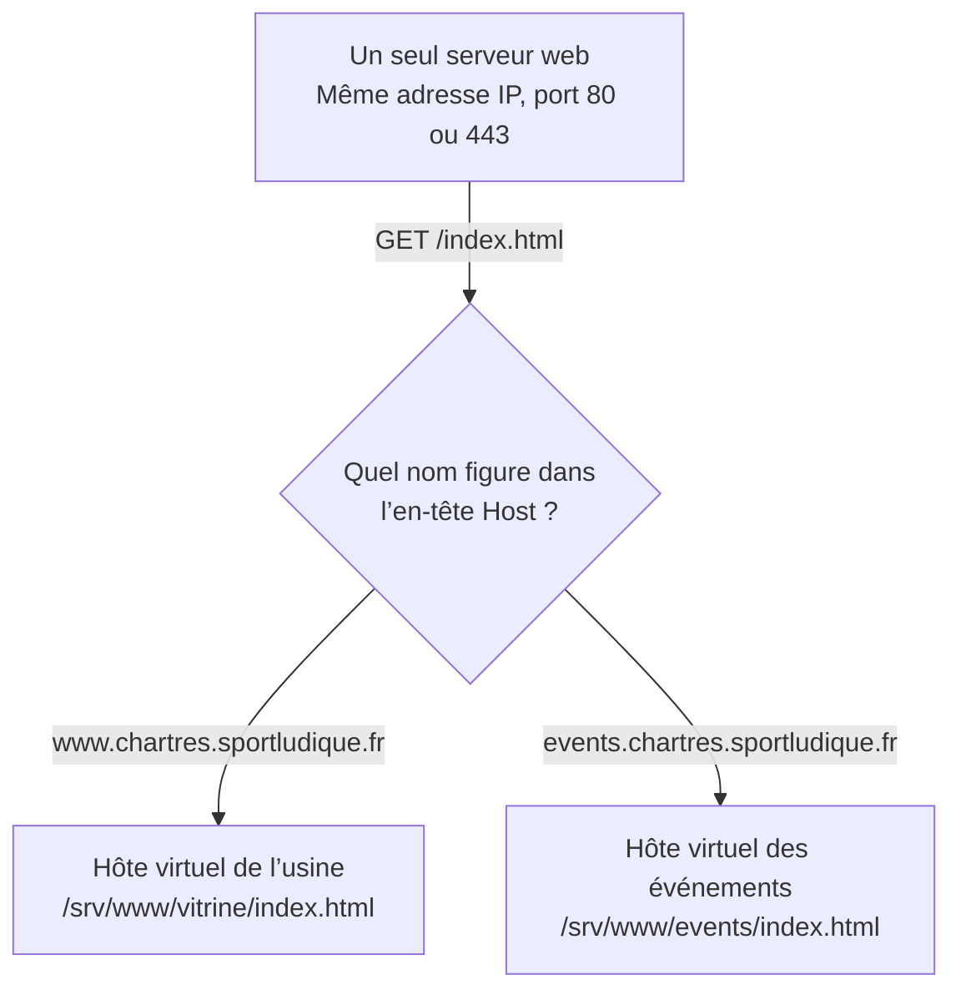

# Héberger plusieurs sites sur un même serveur

## Situation et objectif

SportLudique souhaite que chaque usine dispose de deux sites web : un site de présentation de l’usine (activités, savoir-faire et produits fabriqués) et un site consacré à ses événements locaux (portes ouvertes, visites et démonstrations).

Ces deux sites sont constitués de fichiers HTML, CSS et JavaScript exécuté dans le navigateur.

Vous disposez d’un seul serveur web pour votre usine. Les deux FQDN, `www.ville.sportludique.fr` et `events.ville.sportludique.fr`, doivent utiliser la même adresse IP et les ports web habituels. Remplacez ville par le nom de votre site géographique.

**Comment le serveur peut-il déterminer quel site retourner lorsque plusieurs noms correspondent à la même adresse IP ?**

Les acquis sur DNS, les systèmes, le réseau et TLS sont mobilisés directement. Vous choisissez le logiciel serveur et recherchez sa configuration dans sa documentation officielle.

## 1. Une machine peut héberger plusieurs sites

Un **serveur physique** est une machine matérielle. Un **serveur virtuel**, au sens de la virtualisation, est une machine disposant de son propre système invité sur un hyperviseur. Dans les deux cas, un logiciel tel qu'Apache ou Nginx peut servir plusieurs sites.

Un **site web** est un ensemble de ressources associé à une publication : nom, contenu, règles d'accès et paramètres de service. Il ne correspond pas nécessairement à une machine ou à un processus distinct.

L'**hébergement mutualisé** consiste à partager des ressources entre plusieurs sites. Ici, les sites partagent le système, le service web, la mémoire, le processeur et le stockage. Un *hôte virtuel* est une configuration du service web ; ce n'est pas une machine virtuelle.

## 2. Du nom DNS au bon contenu

La résolution DNS permet au client de trouver une adresse de destination. Elle ne transmet pas au serveur web le nom que le client avait recherché. Pour distinguer les sites, le serveur examine aussi la requête HTTP.

Exemple en HTTP/1.1, après établissement de la connexion :

```http
GET /index.html HTTP/1.1
Host: produits.sportludique.fr

```


La ligne `GET` indique la ressource demandée. L'en-tête **`Host`** indique le nom visé, avec éventuellement un port. Le même chemin `/index.html` peut donc désigner des fichiers différents selon le site. En HTTP/2 et HTTP/3, le pseudo-en-tête `:authority` porte cette information d'autorité.

Le service sélectionne une configuration compatible avec l'adresse et le port de réception, puis avec le nom demandé. Apache parle de **VirtualHost** ; Nginx utilise notamment des blocs **`server`** et la directive **`server_name`**.

| Critère de distinction | Exemple | Conséquence |
| --- | --- | --- |
| Nom | Deux FQDN, même IP et même port | Adapté au besoin de SportLudique |
| Adresse IP | Une IP différente par site | Nécessite plusieurs adresses utilisables |
| Port | Même IP, ports 8080 et 8081 | Le port doit généralement apparaître dans l'URL |

Un nom inconnu ne doit pas conduire involontairement à une publication sensible. Identifiez le comportement de l'hôte par défaut et prévoyez une réponse maîtrisée aux noms non prévus. Un en-tête `Host` est fourni par le client : il ne prouve pas son identité et ne constitue pas une autorisation d'accès.

### Le cas de HTTPS

La négociation TLS précède la requête HTTP. Le client transmet habituellement le nom visé au moyen de **SNI**, ce qui permet de sélectionner le certificat avant de lire `Host`. Le certificat présenté doit couvrir le nom demandé et être reconnu par le client.

SNI intervient dans TLS ; `Host` intervient dans HTTP. Ils ne sont pas interchangeables. Le choix d'un certificat couvrant plusieurs noms sera approfondi dans le [support sur le reverse proxy](02-reverse-proxy.md).

## 3. Séparer les contenus

Attribuez à chaque site une racine documentaire distincte, par exemple `/srv/www/vitrine` et `/srv/www/events`. Le choix du nom détermine quelle racine sera utilisée pour rechercher une ressource.

Cette organisation facilite les déploiements et limite les erreurs de publication. Elle doit s'accompagner de permissions adaptées : le service doit pouvoir lire les contenus, sans disposer systématiquement du droit de les modifier. Les sauvegardes, dépôts de code, secrets et fichiers de configuration ne doivent pas être placés dans une racine publiée.

Deux répertoires ne constituent pas une isolation forte. Un même processus disposant de droits sur les deux sites peut accéder aux deux contenus. Une erreur globale ou une saturation peut également affecter les deux publications.

### Que signifie « statique » ?

Le serveur transmet des fichiers sans exécuter de logique applicative pour générer leur contenu. Le navigateur interprète HTML et CSS et exécute le JavaScript reçu. Un site statique peut donc comporter un menu interactif, des filtres ou des animations.

Un script côté client peut appeler une API, mais le traitement de cette API appartient alors à un service côté serveur. Le code JavaScript envoyé au navigateur est consultable : il ne doit contenir aucun mot de passe de base de données ni secret applicatif.

## 4. Apache ou Nginx ?

Les deux logiciels répondent au besoin. La décision dépend de l'environnement et des compétences disponibles, pas d'un classement universel de performances.

| Solution | Intérêt dans ce projet | Point à prendre en compte |
| --- | --- | --- |
| Apache HTTP Server | Hôtes virtuels, modules nombreux, délégation possible de certains réglages par `.htaccess` | La délégation doit être autorisée et maîtrisée ; elle n'est pas nécessaire ici |
| Nginx | Service de fichiers et sélection des sites dans une configuration centralisée | Ne lit pas les fichiers `.htaccess` ; leurs règles doivent être traduites si une application en dépend |

Pour une future application dynamique, le serveur web et le moteur applicatif peuvent être distincts : PHP-FPM, un service Node.js ou une application ASP.NET, par exemple. Le choix actuel d'un serveur pour deux sites statiques n'impose pas la technologie des futures applications.

## 5. Travail à réaliser

1. Choisissez deux FQDN adaptés à votre périmètre SportLudique et prévoyez leur résolution vers une même IP.
2. Sélectionnez Apache ou Nginx et justifiez ce choix en quelques phrases.
3. Publiez deux sites réellement distincts, chacun comportant du HTML, une feuille CSS et une interaction JavaScript simple.
4. Séparez les répertoires, les permissions et, si utile pour le diagnostic, les journaux des deux publications.
5. Déterminez le comportement pour un nom inconnu et pour un accès par adresse IP.

Présentez le lien entre FQDN, hôte virtuel et racine documentaire. La configuration complète est à construire à partir des documentations, sans modèle de VirtualHost imposé.

## 6. Vérifier et expliquer

Votre démonstration doit apporter les preuves suivantes :

- Les deux noms se résolvent vers la même adresse, sur les mêmes ports de publication.
- Chaque FQDN retourne le contenu attendu, même si les deux sites possèdent un fichier nommé `index.html`.
- Les outils réseau du navigateur montrent le nom visé et les chargements HTML, CSS et JavaScript.
- Une modification du premier site ne remplace pas les fichiers du second.
- Un nom inconnu reçoit la réponse choisie, sans exposer un site interne par défaut.
- Si HTTPS est utilisé, chaque nom est accepté sans ignorer les erreurs de certificat.

Expliquez pourquoi arrêter le service web affecte les deux sites. Distinguez l'indépendance des contenus de celle des ressources et de la disponibilité.

**Pour poursuivre :** les deux sites resteront mutualisés lorsque vous ajouterez une application sur un second serveur dans le [support 2 — Reverse proxy](02-reverse-proxy.md).

## Documentation officielle

- [Apache — Hôtes virtuels basés sur le nom](https://httpd.apache.org/docs/2.4/vhosts/name-based.html) : comprendre la sélection de l'hôte.
- [Nginx — Traitement d'une requête](https://nginx.org/en/docs/http/request_processing.html) : étudier l'adresse, le port et le serveur par défaut.
- [Nginx — Noms des serveurs](https://nginx.org/en/docs/http/server_names.html) : distinguer sélection HTTP et sélection lors de TLS.
