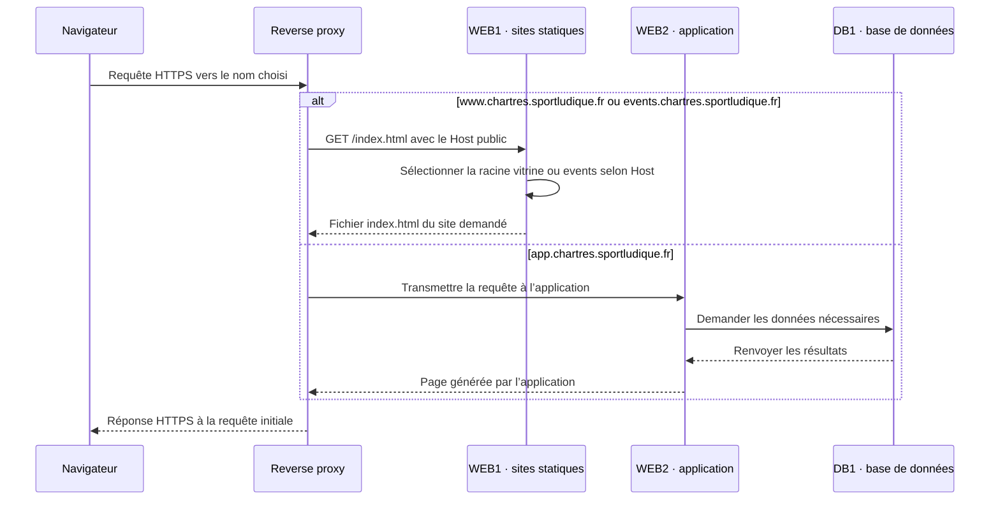
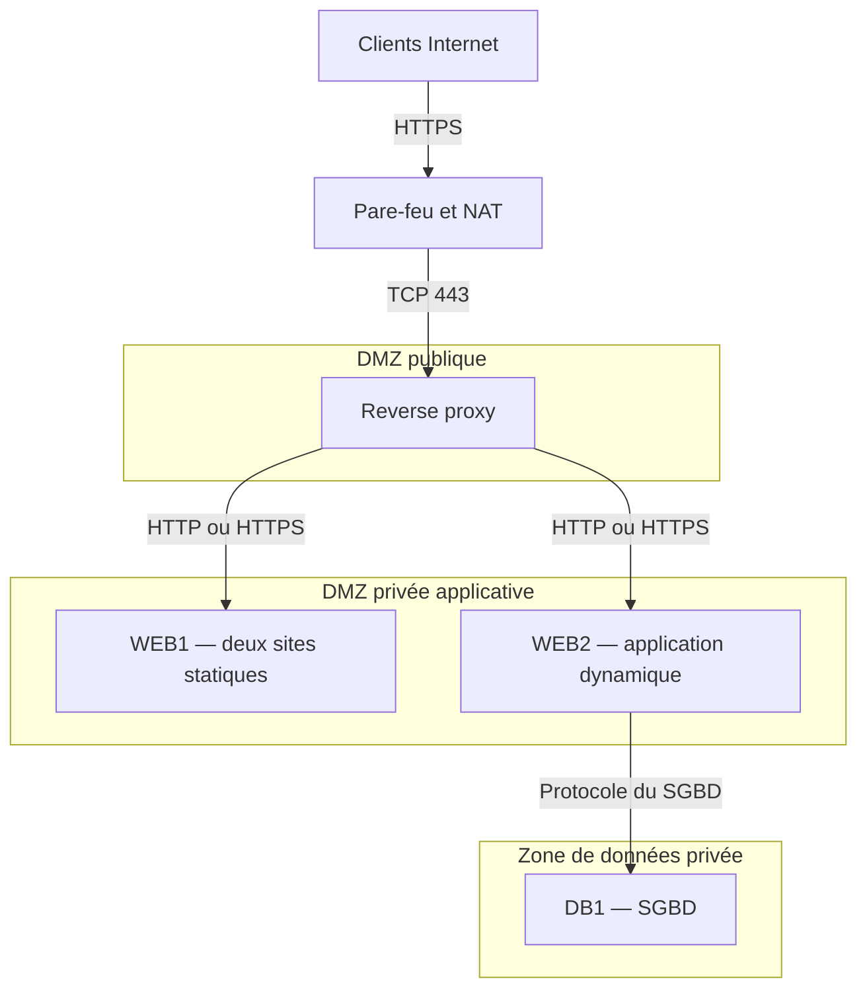

# Publier plusieurs applications avec un reverse proxy

## Situation et objectif

SportLudique souhaite ajouter une application dynamique développée par les étudiants SLAM ou choisie par votre groupe (par exemple WordPress vu dans le bloc 1). Elle doit utiliser un serveur de base de données distinct.

L'infrastructure comprend désormais un serveur web hébergeant les deux sites statiques, un second serveur exécutant l'application et un serveur de base de données. Une seule adresse IP publique est disponible.

**Comment publier ces services avec leurs propres FQDN, sur le port HTTPS habituel, tout en limitant leur exposition et en protégeant les données ?**

Le DNS, le routage, les pare-feu et la PKI sont des acquis. La conception de l'architecture doit être validée à l'oral avant le déploiement.

## 1. Séparer les applications et conserver un point d'entrée

Les [hôtes virtuels](01-hebergement-mutualise.md) permettent de partager un serveur web. Ils ne suppriment pas les contraintes de ressources, de dépendances ou de maintenance. Une application peut nécessiter PHP-FPM, Node.js, ASP.NET avec Kestrel ou IIS, et un SGBD adapté à son fonctionnement.

Des VM, conteneurs ou services séparés permettent différents degrés d'isolation. Une machine par application n'est pas une obligation générale ; dans cette mission, le second serveur sert à matérialiser la séparation entre les sites statiques et l'application dynamique.

Une traduction de destination classique ne peut pas choisir entre ces serveurs d'après le nom HTTP lorsque les requêtes arrivent sur la même IP publique et le même port 443. Des ports publics différents seraient possibles, mais ne répondraient pas au besoin de publication retenu.

Le **reverse proxy** reçoit les requêtes au nom des services publiés, contacte le serveur approprié, puis transmet sa réponse au client. Cette transmission interne n'est pas une redirection HTTP : le navigateur conserve le FQDN public.

Un **forward proxy** agit pour des clients qui accèdent à des services externes. Un **reverse proxy** agit devant les services que l'on publie. Ici, le client accède à l'URL habituelle du site sans configurer de proxy dans son navigateur.

## 2. Du frontend au backend

Le **frontend** est le côté qui reçoit les connexions clientes ; le **backend** est le service interne auquel le proxy s'adresse. Ce vocabulaire décrit des rôles, pas nécessairement des machines distinctes.



Les trois noms publics aboutissent à la même IP publique. Le pare-feu transmet le trafic HTTPS au reverse proxy. Après terminaison TLS, celui-ci sélectionne le backend d'après le nom HTTP. WEB1 doit recevoir le nom initial pour choisir son propre hôte virtuel.

Le proxy doit reconnaître les noms autorisés et traiter explicitement les autres. Il ne doit pas construire librement une destination interne à partir d'un nom fourni par le client. Les adresses de backend doivent mener aux serveurs internes : utiliser un nom qui revient vers l'IP publique du proxy peut créer une boucle.

**Envoyer trois noms vers deux serveurs différents ne constitue pas une répartition de charge d'une même application.** Cette dernière sera étudiée dans le [support 4](04-load-balancing.md).

## 3. Choisir le logiciel du reverse proxy

| Solution | Atouts pour ce rôle | Contraintes ou points d'attention |
| --- | --- | --- |
| Nginx | Configuration centralisée, proxy HTTP, terminaison TLS et service de fichiers | Adapter les réglages aux besoins de l'application ; pas de prise en charge des `.htaccess` |
| Apache HTTP Server | Modules `mod_proxy`, `mod_proxy_http` et `mod_ssl` ; cohérence avec une infrastructure Apache existante | Sélectionner les modules et règles utiles ; contrôler les interactions avec les autres fonctions |
| HAProxy | Proxy TCP/HTTP, routage et répartition de charge, contrôles de santé | N'a pas vocation à remplacer un serveur généraliste de fichiers ou un moteur applicatif |

**Nginx est privilégié pour la réalisation.** Une autre solution reste recevable si elle est justifiée. Les performances dépendent notamment du trafic, du TLS, des modules et de la configuration ; elles ne se déduisent pas du seul nom du logiciel.

## 4. Transmettre les informations utiles à l'application

Le backend voit normalement une connexion provenant du proxy. Sans information complémentaire, ses journaux peuvent enregistrer l'adresse du proxy et il peut croire que le visiteur utilise HTTP alors que l'accès public est en HTTPS.

| En-tête | Information transmise | Usage possible |
| --- | --- | --- |
| `Host` | Nom public demandé | Hôte virtuel, URL de l'application |
| `X-Forwarded-For` | Adresse cliente ou chaîne d'adresses de relais | Journalisation, contrôles applicatifs |
| `X-Real-IP` | Adresse cliente choisie par le proxy | Information simple d'origine ; convention non universelle |
| `X-Forwarded-Proto` | Schéma public, ici `https` | Redirections, URL absolues, cookies sécurisés |

Ces en-têtes sont des conventions répandues ; `Forwarded` dispose d'une normalisation distincte. Leur présence ne garantit pas leur authenticité.

Extrait illustratif dans un contexte Nginx de proxy HTTP, **avec un seul proxy recevant directement les connexions des clients et sans réécriture préalable de leur adresse** :

```nginx
proxy_set_header Host $host;
proxy_set_header X-Real-IP $remote_addr;
# Remplace une éventuelle valeur fournie par le client.
proxy_set_header X-Forwarded-For $remote_addr;
proxy_set_header X-Forwarded-Proto $scheme;
```

`$host` est le nom déterminé par Nginx selon sa logique de sélection ; ce n'est pas une copie brute garantie de l'en-tête reçu. L'application doit elle aussi limiter les noms acceptés.

La variante `$proxy_add_x_forwarded_for` conserve l'en-tête existant et ajoute l'adresse du pair. Dans une chaîne de proxies, cette conservation exige une politique explicite de confiance : les valeurs initiales peuvent avoir été injectées par le client.

Le backend doit accepter ces informations uniquement de proxies identifiés, et le filtrage doit empêcher de contourner le point d'entrée. Sinon, un client pourrait usurper son adresse déclarée ou influencer les redirections. Si un second proxy est ajouté, la politique doit être revue : `$remote_addr` désignera alors éventuellement le relais précédent.

## 5. Choisir où s'arrête TLS

### Socle — HTTPS public et HTTP interne

La connexion TLS du navigateur se termine sur le reverse proxy. Celui-ci possède le certificat de publication, sa chaîne intermédiaire et sa clé privée. La racine de confiance est installée chez les clients selon votre PKI.

Le proxy établit ensuite une autre connexion, en HTTP, vers WEB1 ou WEB2. Les requêtes, cookies et réponses peuvent donc circuler en clair sur ce segment. Cette option est admise pour le socle avec des zones cloisonnées et des flux filtrés ; le caractère « interne » du réseau ne fournit pas une protection cryptographique.

### Plusieurs noms et certificat wildcard

Un certificat peut contenir plusieurs noms dans son extension **SAN**, ou un nom wildcard. La seule présence d'un nom dans le DNS ne l'ajoute pas au certificat.

| Nom demandé | Couvert par le seul SAN `*.sportludique.fr` ? |
| --- | --- |
| `www.sportludique.fr` | Oui |
| `app.sportludique.fr` | Oui |
| `sportludique.fr` | Non : ajouter ce nom explicitement si nécessaire |
| `app.chartres.sportludique.fr` | Non : un niveau supplémentaire est présent |

Pour des publications sous `chartres.sportludique.fr`, un wildcard `*.chartres.sportludique.fr` peut être pertinent. Un wildcard TLS n'est pas une règle DNS et ne crée aucun enregistrement.

La compromission de sa clé privée permet d'usurper les noms couverts auprès de clients amenés à contacter l'attaquant. Limitez les copies de la clé, ses accès et sa présence dans les sauvegardes ou dépôts. Un renouvellement doit être anticipé ; une compromission impose aussi de traiter la révocation et le remplacement de la clé.

### Avancé — HTTPS également vers les backends

Le reverse proxy ouvre une nouvelle session TLS vers chaque backend. Il déchiffre toujours les échanges entre les deux connexions : il ne s'agit pas d'un tunnel TLS continu entre le navigateur et l'application.

Chaque backend possède un certificat et sa propre clé privée. Le proxy doit vérifier la chaîne de confiance **et le nom attendu du backend**. Il n'est pas nécessaire de recopier la clé wildcard publique sur tous les serveurs internes.

Extrait conceptuel Nginx, à intégrer dans un contexte adapté :

```nginx
proxy_pass https://10.20.20.12;
proxy_ssl_server_name on;
proxy_ssl_name web2.backend.sportludique.fr;
proxy_ssl_trusted_certificate /etc/nginx/pki/autorites-backend.pem;
proxy_ssl_verify on;
proxy_ssl_verify_depth 2;
```

L'IP désigne la destination ; `proxy_ssl_name` fixe le nom vérifié et envoyé par SNI. Le certificat interne doit couvrir ce nom. Le fichier de confiance et la profondeur de vérification sont à adapter à votre chaîne. Avec Nginx, utiliser une URL `https://` ne suffit pas à activer la vérification du certificat upstream.

Le nom TLS interne peut être différent du `Host` public transmis à l'application. Une erreur de confiance ou de nom doit provoquer un échec, et non conduire à désactiver la vérification.

## 6. Cloisonner les services et protéger la base

Une **DMZ publique** accueille ici le point d'entrée publié. Une **DMZ privée** désigne une zone de services internes qui n'est pas publiée directement depuis Internet. Ces appellations ne suffisent pas à assurer la sécurité : les interfaces, VLAN, routes et règles de filtrage matérialisent la séparation.

Voici une proposition d'architecture à discuter. Les flèches représentent les connexions autorisées à établir, pas des accès généraux entre zones. Le pare-feu filtre également les communications interzones.



Le découpage en deux zones privées limite aussi les déplacements latéraux. Si web et base partagent un même VLAN sans contrôle supplémentaire, un pare-feu inter-VLAN ne filtre pas leurs échanges directs. Une variante d'architecture est possible, à condition de montrer où s'appliquent réellement les restrictions.

### Déduire les règles des besoins

| Source | Destination | Flux à justifier |
| --- | --- | --- |
| Internet | Point d'entrée public | TCP 443 ; TCP 80 seulement si une redirection HTTPS est prévue |
| Reverse proxy | WEB1 et WEB2 | Port HTTP ou HTTPS retenu |
| WEB2 | DB1 | Port du SGBD choisi, depuis la seule source applicative autorisée |
| Administration autorisée | Machines administrées | Protocoles d'administration nécessaires, depuis le réseau ou bastion prévu |

Les réponses sont prises en charge par le suivi d'état des connexions. Les autres flux sont refusés par défaut. Documentez séparément DNS, synchronisation horaire, sauvegardes, journaux et mises à jour : n'ouvrez pas un accès général pour les rendre possibles.

Internet, le reverse proxy et WEB1 n'ont pas besoin d'ouvrir de connexion au SGBD. Aucun NAT public ne doit publier son port ou son interface d'administration. Le SGBD écoute sur l'interface prévue et applique ses propres contrôles d'accès.

### Le réseau ne remplace pas les droits applicatifs

Le compte utilisé par WEB2 n'est pas administrateur du SGBD. Ses droits sont limités aux bases, tables et opérations nécessaires. Un compte distinct peut être prévu pour les migrations de schéma plutôt que de conserver ces privilèges en fonctionnement normal.

Les identifiants restent côté serveur, hors des racines web, du JavaScript client et des dépôts de code. Protégez aussi leurs fichiers de configuration, journaux et sauvegardes. La compromission de WEB2 pourrait donner à l'attaquant les droits de ce compte : leur limitation réduit l'impact sans supprimer le risque.

Le chiffrement du flux WEB2–DB1 dépend des exigences et des possibilités du SGBD. **HTTPS jusqu'à WEB2 ne chiffre pas automatiquement la connexion SQL.** Justifiez ce choix séparément.

Prévoyez une sauvegarde cohérente des données, un stockage distinct et un essai de restauration. La base reste un point de défaillance tant que sa disponibilité n'est pas traitée. Ni le reverse proxy ni la séparation en DMZ ne la rendent redondante.

## 7. Travail attendu et validation

### Avant le déploiement : présenter l'architecture à l'oral

Présentez votre schéma logique, les zones et le plan d'adressage, les enregistrements DNS, la matrice des flux et les règles de filtrage. Expliquez le parcours d'une requête pour chacun des trois FQDN.

Justifiez les technologies choisies, la position du SGBD, les droits de son compte applicatif, le niveau TLS, l'emplacement de chaque certificat et de chaque clé. Indiquez les segments où les données restent en clair et les composants qui demeurent des points de défaillance.

**L'architecture doit être validée avant sa mise en œuvre.**

### Après le déploiement : produire des preuves

- Les trois FQDN utilisent la même IP publique ; chaque publication renvoie le bon contenu.
- Les sites statiques restent sur WEB1 ; WEB2 utilise effectivement DB1.
- Le certificat public est accepté pour chaque nom, sans contournement des erreurs TLS.
- Une tentative d'accès direct aux backends et à DB1 depuis l'extérieur est bloquée.
- WEB1 et le reverse proxy ne peuvent pas ouvrir de connexion au SGBD ; WEB2 le peut avec les seuls droits requis.
- L'application produit des URL et redirections HTTPS cohérentes ; ses journaux identifient correctement le client.
- Un faux `X-Forwarded-For` envoyé par un client n'est pas accepté comme une origine fiable.
- En avancé, un certificat backend non approuvé ou portant un nom incorrect bloque la communication. Effectuez ce test de façon contrôlée puis rétablissez le certificat valide.

Vérifiez aussi les fonctions réellement utilisées : authentification, dépôt de fichiers, API et, si l'application en dépend, WebSocket. Un affichage de page d'accueil ne valide pas l'ensemble du fonctionnement.

**Pour poursuivre :** étudiez la panne du point d'entrée dans le [support 3 — Haute disponibilité](03-haute-disponibilite.md).

## Documentation officielle

- [Nginx — Module proxy HTTP](https://nginx.org/en/docs/http/ngx_http_proxy_module.html) : directives `proxy_pass`, `proxy_set_header` et `proxy_ssl_*`.
- [Nginx — Sécuriser les connexions upstream](https://docs.nginx.com/nginx/admin-guide/security-controls/securing-http-traffic-upstream/) : confiance envers les backends.
- [Apache — mod_proxy](https://httpd.apache.org/docs/2.4/mod/mod_proxy.html) : possibilités du proxy Apache.
- [HAProxy — Documentation](https://www.haproxy.org/#docs) : sélectionner le manuel correspondant à la version installée.
- [RFC 9525 — Identité des services TLS](https://www.rfc-editor.org/rfc/rfc9525.html#section-6.3) : règles de correspondance des wildcards.
