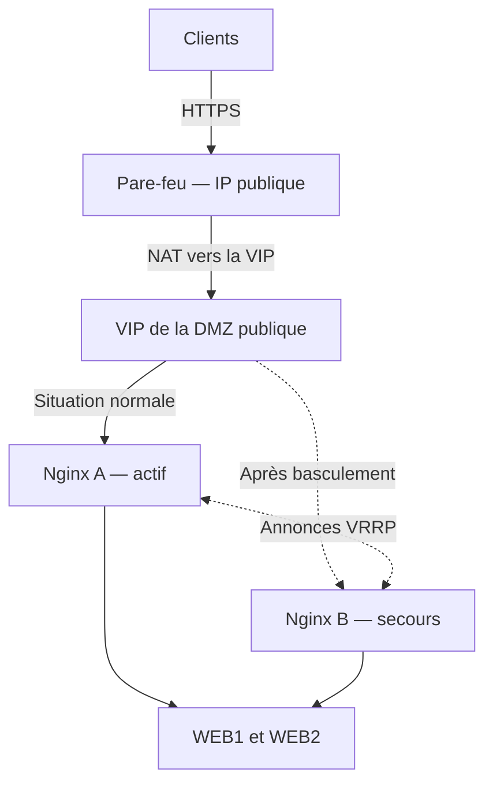

# Assurer la disponibilité du point d'entrée

## Situation et objectif

SportLudique publie plusieurs sites et une application au moyen d'un reverse proxy Nginx. Les services internes fonctionnent, mais l'arrêt de ce proxy coupe l'accès à toutes les publications.

**Comment maintenir l'accès aux applications si le reverse proxy principal tombe en panne ?**

L'objectif est d'étudier deux reverse proxies Nginx et un mécanisme de basculement. Les notions de publication et de TLS sont développées dans le [support 2](02-reverse-proxy.md). La réplication des applications relève d'une autre évolution, présentée dans le [support 4](04-load-balancing.md).

## 1. Identifier ce que l'on veut rendre disponible

Un **SPOF**, ou *Single Point of Failure*, est un composant dont la panne suffit à interrompre le service considéré. Le reverse proxy unique constitue ici un SPOF pour toutes les publications.

La **disponibilité** décrit la possibilité d'utiliser un service pendant une période donnée. Elle se mesure du point de vue de l'usage attendu : afficher une page ne suffit pas à prouver que la consultation du catalogue ou l'enregistrement d'une commande fonctionne.

La **redondance** consiste à disposer de plusieurs composants capables d'assurer une fonction. Elle prépare la reprise, mais ne garantit ni un basculement automatique ni la cohérence de leurs configurations.

La **tolérance aux pannes** désigne la capacité à continuer à fournir le service malgré certaines défaillances. Elle doit être définie pour un périmètre : panne d'un processus, d'une VM, d'un hyperviseur ou d'un équipement réseau, par exemple.

Avant de proposer une solution, fixez une durée d'interruption acceptable et les usages à préserver. Un basculement en quelques secondes n'est pas une absence totale d'interruption.

## 2. Actif/passif et actif/actif

| Architecture | Fonctionnement | Conséquence |
| --- | --- | --- |
| Actif/passif | Un nœud reçoit le trafic ; un autre est prêt à reprendre | Plus simple à étudier ; le nœud de secours doit pouvoir supporter toute la charge |
| Actif/actif | Plusieurs nœuds reçoivent du trafic simultanément | Nécessite un mécanisme de distribution ; la charge après panne doit rester supportable |

Un processus Nginx peut fonctionner sur les deux machines alors qu'une seule reçoit les requêtes publiques. « Passif » signifie ici que le nœud ne porte pas le point d'entrée actif.

Deux reverse proxies ne deviennent pas actif/actif simplement parce qu'ils possèdent le même contenu. De même, ajouter plusieurs adresses DNS ne reproduit pas à lui seul un mécanisme de reprise maîtrisé : caches et comportements des clients influencent le résultat.

## 3. Une VIP pour conserver une destination stable

Une **adresse IP virtuelle**, ou VIP, est une adresse de service portée par le nœud actif. Chaque machine conserve aussi sa propre adresse pour l'administration et les échanges entre pairs.

Dans le scénario étudié, la VIP appartient au sous-réseau de la DMZ publique. Le pare-feu traduit le trafic de l'IP publique vers cette VIP. Les clients continuent donc d'utiliser les mêmes FQDN et la même adresse publique après basculement.

!!! info "Le basculement de la VIP s’effectue en couche 3"
    Nous avons déjà étudié la haute disponibilité d’Apache avec Pacemaker. Ici, Nginx fonctionne sur les deux serveurs. Le pare-feu transmet les connexions HTTPS vers une même adresse IP virtuelle (VIP), portée par le serveur actif. Si ce serveur tombe en panne, le serveur de secours reprend la VIP grâce à Keepalived et à VRRP.

    **Le basculement s’effectue en couche 3** car la ressource transférée est une adresse IP. **La détection d’une panne peut aussi s’appuyer sur la couche 7** si Keepalived teste la réponse HTTP de Nginx. Ce contrôle permet de déclencher la reprise même lorsque la VM reste joignable.



La VIP est une adresse, pas une troisième machine. Pour cette VIP, un seul nœud doit être actif à un instant donné. Le déplacement de l'adresse fait évoluer les informations de voisinage réseau ; en IPv4, des annonces ARP gratuites aident notamment les équipements à joindre le nouveau porteur.

Le montage suppose que le réseau et la virtualisation autorisent ce fonctionnement. Deux VM placées dans des réseaux sans possibilité de déplacement de cette adresse ne forment pas automatiquement une paire opérationnelle.

## 4. VRRP et Keepalived

**VRRP** organise l'élection d'un nœud actif et l'échange d'annonces permettant aux autres de détecter sa disparition. **Keepalived** est un logiciel qui met notamment en œuvre VRRP et peut faire dépendre le rôle du nœud de contrôles locaux.

Les pairs doivent partager les paramètres de leur instance et disposer de priorités cohérentes. Leur identifiant d'instance doit éviter les conflits avec les autres groupes présents sur le même réseau. Vérifiez aussi le filtrage : VRRP utilise le protocole IP 112, ce n'est pas un port TCP ou UDP. Le mode d'échange, multicast ou unicast selon le déploiement, doit être explicitement choisi.

Le **failover**, ou basculement, consiste à transférer le rôle actif à un nœud opérationnel. Son délai dépend de la détection, de l'élection et de la convergence réseau.

Keepalived ne copie pas la configuration de Nginx, ne renouvelle pas ses certificats et ne réplique pas automatiquement ses connexions. Il ne remplace pas la préparation du serveur de secours.

## 5. Détecter la bonne panne

| Niveau contrôlé | Ce qu'un succès établit | Ce qu'il ne prouve pas |
| --- | --- | --- |
| Machine ou annonces VRRP | Le pair répond ou annonce son rôle | Que Nginx accepte les requêtes |
| Processus Nginx | Un processus existe | Qu'il écoute et répond correctement |
| Requête HTTP locale | Le service local traite la requête testée | Que tous les backends fonctionnent |
| Transaction depuis l'extérieur | Le parcours testé fonctionne, avec DNS, TLS et application | Que toutes les fonctionnalités sont disponibles |

Si seule la disparition de la machine est détectée, un arrêt de Nginx peut laisser la VIP sur un nœud incapable de servir les clients. Il faut donc relier un contrôle pertinent du service à la décision de basculement.

Avec Keepalived, recherchez les mécanismes `vrrp_script` et `track_script`. Définissez ce que le test vérifie, sa fréquence, son délai maximal et le nombre d'échecs ou de succès requis. Selon le choix de configuration, un échec peut faire passer l'instance en défaut ou modifier sa priorité ; vérifiez que cette modification suffit réellement à provoquer la reprise par le pair.

Un contrôle local doit viser le nœud testé, pas la VIP qui pourrait déjà être portée par l'autre. Les scripts de contrôle doivent être fiables, courts et non modifiables par un utilisateur non autorisé.

### Éviter un basculement sans effet

Si les deux proxies dépendent du même WEB2 indisponible, transférer la VIP ne répare pas l'application. Un contrôle trop global risque de provoquer des basculements répétés pour une panne commune aux deux nœuds.

Séparez donc la décision de reprise du proxy et la supervision de bout en bout. Les deux sont utiles, mais ne déclenchent pas nécessairement la même action.

Une perte des annonces entre pairs peut conduire chacun à se croire actif : c'est une situation de **split-brain**, avec concurrence sur la VIP. Étudiez ce risque et prévoyez sa détection. La panne du lien entre les nœuds n'est pas équivalente à l'arrêt propre d'un serveur.

## 6. Préparer un secours réellement utilisable

Les deux proxies doivent connaître les mêmes publications, backends, règles de confiance envers les en-têtes et paramètres TLS. Chacun doit posséder les certificats et les clés nécessaires pour présenter une identité valide aux clients après la reprise.

Prévoyez une source de configuration commune, un déploiement contrôlé et une validation avant rechargement. Un outil de gestion de configuration tel qu'Ansible peut éviter les copies manuelles divergentes. Les clés privées exigent un canal et des droits adaptés ; elles ne doivent pas être déposées en clair dans un dépôt de code ordinaire.

Le renouvellement des certificats doit atteindre les deux nœuds et entraîner leur prise en compte par les services. Vérifiez également la présence des autorités de confiance utilisées pour les connexions HTTPS internes.

La synchronisation ne concerne pas seulement les fichiers : les versions logicielles, modules, permissions et accès réseau doivent permettre le même service. Le pare-feu doit autoriser les deux proxies à joindre les backends, selon l'adresse source effectivement employée par chacun.

## 7. Ce qui se passe pendant la reprise

La VIP permet aux nouvelles connexions de rejoindre le second proxy. Les connexions TCP/TLS déjà établies ne sont généralement pas transférées dans cette architecture. Un téléchargement, une connexion WebSocket ou une requête en cours peut être interrompu.

Le navigateur peut ouvrir une nouvelle connexion, mais l'application doit gérer les conséquences d'une interruption. Une opération d'écriture ne doit pas être répétée aveuglément : la commande a pu être enregistrée avant que sa réponse ne soit perdue.

Définissez aussi le comportement au retour du premier nœud : reprise automatique du rôle par préemption ou maintien du nœud devenu actif. Un retour trop rapide et des contrôles instables peuvent provoquer des oscillations.

Nous avons déjà étudié la haute disponibilité d’Apache avec Pacemaker. Ici, Nginx est démarré sur les deux serveurs et chacun est prêt à traiter les requêtes. Le pare-feu transmet les connexions HTTPS vers une adresse IP virtuelle (VIP), portée par un seul serveur à la fois. En cas de panne du serveur actif, Keepalived permet au second de reprendre cette adresse.

On est sur une haute disponibilité de la couche 3 pas de la couche 7.

````mermaid
sequenceDiagram
    participant C as Navigateur
    participant F as Pare-feu
    participant A as Proxy A
    participant B as Proxy B

    Note over A,B: A porte la VIP. B est en secours.
    A-->>B: Annonces VRRP périodiques
    C->>F: Connexion HTTPS à l’IP publique
    F->>A: DNAT vers la VIP portée par A
    A-->>F: Réponse HTTPS
    F-->>C: Réponse reçue

    Note over A: Arrêt brutal de la VM
    Note over C,A: La connexion en cours est interrompue
    B->>B: Le délai d’attente des annonces VRRP expire
    B->>B: Devient actif et prend la VIP
    B-->>F: Annonce ARP gratuite sur la DMZ

    C->>F: Nouvelle connexion HTTPS à la même IP publique
    F->>B: Même règle DNAT, VIP désormais portée par B
    B-->>F: Réponse HTTPS
    F-->>C: Accès rétabli
````

## 8. Travail attendu : concevoir et éprouver la redondance

Produisez un schéma avec les deux adresses propres, la VIP, le NAT, les interfaces et les flux de contrôle. Justifiez les priorités, le contrôle de santé, le délai de reprise visé et la politique de retour à la normale.

Proposez le protocole suivant, puis relevez les résultats si vous mettez la solution en œuvre :

| Scénario | Observation attendue |
| --- | --- |
| Situation normale | Un seul porteur de la VIP ; toutes les publications accessibles |
| Arrêt de la VM active | Reprise de la VIP par le secours ; mesure du délai avant succès des nouvelles requêtes |
| Arrêt de Nginx, VM maintenue en fonctionnement | Le contrôle du service provoque également une reprise |
| Arrêt de WEB2 | Mise en évidence d'une panne applicative que le changement de proxy ne résout pas |
| Rétablissement du premier proxy | Comportement conforme à la politique de préemption choisie |
| Renouvellement du certificat suivi d'un basculement | Identité TLS valide sur les deux nœuds |

Utilisez des requêtes répétées et horodatées, les journaux et l'observation du porteur de la VIP. Relevez la dernière réponse correcte, les erreurs et la première réponse correcte après reprise. Distinguez les nouvelles connexions d'une connexion longue déjà ouverte.

Terminez par les **SPOF restants** : pare-feu, commutateur, alimentation, DNS, stockage, hyperviseur commun, serveur applicatif ou SGBD. Deux VM sur le même hôte ne protègent pas contre la panne de cet hôte. Une erreur de configuration diffusée aux deux nœuds constitue également une panne commune.

## Documentation officielle

- [Keepalived — Documentation](https://keepalived.org/documentation/) : comprendre les rôles et l'architecture du logiciel.
- [Keepalived — Référence de configuration](https://keepalived.org/documentation/keepalived-conf/) : étudier les instances VRRP, `track_script`, les priorités et la préemption dans la version utilisée.
- [Nginx — Contrôle du service](https://nginx.org/en/docs/control.html) : distinguer validation, rechargement et arrêt.

**Suite :** [répartir les requêtes d'une même application entre plusieurs instances](04-load-balancing.md), tout en conservant la disponibilité du point d'entrée.
