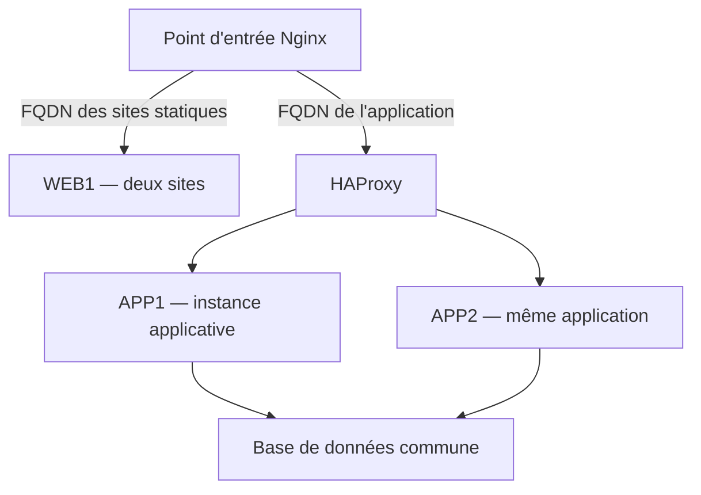
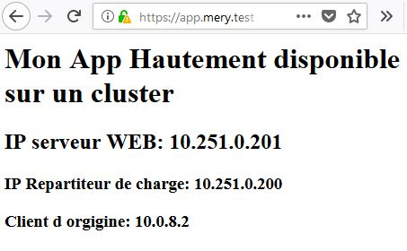

# Répartir la charge d'une même application

## Situation et objectif

L'application de SportLudique reçoit davantage de visites. L'entreprise souhaite faire fonctionner plusieurs instances de cette application et répartir les requêtes entre elles.

!!! question "Problématique"
    Comment utiliser plusieurs serveurs sans compromettre les sessions, la cohérence des données et la disponibilité du service ?

Les deux sites statiques peuvent rester mutualisés sur WEB1. La nouvelle évolution concerne l'application dynamique : une instance APP1 et une instance APP2 doivent proposer les mêmes fonctionnalités et accéder à des données cohérentes.

## 1. Distinguer routage, répartition et reprise

Le [reverse proxy](02-reverse-proxy.md) choisissait la bonne application d'après le FQDN. Le `load balancing`, ou la `répartition de charge`, choisit une instance parmi plusieurs capables de traiter la demande pour la même application.

Envoyer `www.chartres.sportludique.fr` vers un serveur statique et `app.chartres.sportludique.fr` vers un serveur dynamique est du routage entre publications. Répartir les requêtes de `app.chartres.sportludique.fr` entre APP1 et APP2 est de la répartition de charge.

Le **`failover`** répond à la panne d'un composant ; il ne nécessite pas que les deux nœuds travaillent simultanément. Un répartiteur peut à la fois distribuer le trafic et retirer une instance défaillante, mais sa propre disponibilité doit être traitée séparément.

!!! warning "HAProxy et Nginx : des possibilités différentes"
    **HAProxy** ne se limite pas à la répartition de charge HTTP/HTTPS. Il peut également fonctionner en **mode TCP (couche 4)** et répartir des connexions pour de nombreux services : SMTP, IMAP, SSH, bases de données (MySQL, PostgreSQL), etc.

    **Nginx** est principalement un serveur web et un reverse proxy HTTP/HTTPS. Il permet également de réaliser du **load balancing HTTP/HTTPS (couche 7)**.

    Attention toutefois : Nginx peut aussi répartir des connexions **TCP et UDP (couche 4)** grâce à son module `stream`.

    Le choix entre HAProxy et Nginx dépend donc des protocoles à prendre en charge et des fonctionnalités attendues.

## 2. Choisir où placer la répartition

Pour conserver l'architecture précédente, le reverse proxy Nginx peut transmettre les requêtes de l'application à HAProxy, qui sélectionne APP1 ou APP2. Les sites statiques continuent d'emprunter leur chemin vers WEB1.



Ce schéma montre les flux applicatifs ; les pare-feu et zones du [support 2](02-reverse-proxy.md) restent nécessaires. HAProxy est accessible depuis les proxies autorisés ; les instances applicatives ne sont pas publiées directement et seules celles qui en ont besoin accèdent au SGBD.

Ce montage ajoute un relais. Il est intéressant pour distinguer les rôles, mais n'est pas obligatoire :

- Nginx peut lui-même répartir la charge vers APP1 et APP2.

- HAProxy peut devenir le point d'entrée public, gérer TLS et sélectionner les publications, tout en conservant WEB1.

- Un HAProxy interne peut être redondé si l'on conserve les deux couches.

Choisissez une architecture et justifiez chaque composant. Si HAProxy remplace Nginx en frontal, adaptez la [redondance du point d'entrée](03-haute-disponibilite.md) au nouveau service. S'il reste seul derrière deux Nginx redondants, il devient un SPOF pour l'application dynamique.

## 3. Répartir en niveau 4 ou en niveau 7


### Répartition de charge : couche 4 ou couche 7 ?

| Mode | Principe | Conséquence |
| --- | --- | --- |
| **Couche 4 (TCP)** | Le répartiteur choisit un serveur en fonction des informations de transport (adresses IP, ports). | Toutes les données d'une même connexion TCP sont transmises au même serveur. |
| **Couche 7 (HTTP)** | Le répartiteur analyse les requêtes HTTP et peut appliquer des règles sur le nom de domaine, l'URL, les en-têtes ou les cookies. | Les requêtes peuvent être orientées vers différents serveurs selon des critères applicatifs. |

**La gestion de TLS dépend du mode de fonctionnement choisi :**

- **En couche 4**, le répartiteur peut transmettre les connexions HTTPS sans déchiffrer leur contenu (*TLS passthrough*). Il ne peut donc pas analyser les requêtes HTTP. Il peut toutefois exploiter certaines informations visibles, comme le SNI.
- **En couche 7**, pour analyser les requêtes HTTPS, le répartiteur doit accéder au contenu HTTP déchiffré. Il peut terminer la connexion TLS puis transmettre les requêtes aux serveurs, en HTTP ou en HTTPS (*réencryptage TLS*).


!!! info "Ne pas confondre SNI, CN, SAN et FQDN"
    - **FQDN (Fully Qualified Domain Name)** : nom de domaine complet d'une machine ou d'un service, par exemple `www.chartres.sportludique.fr`.
    - **CN (Common Name)** : champ du certificat X.509 qui pouvait historiquement identifier le serveur. Il n'est plus utilisé pour vérifier son nom dans les certificats TLS modernes.
    - **SAN (Subject Alternative Name)** : extension du certificat qui indique les noms DNS (ou adresses IP) pour lesquels le certificat est valide.
    - **SNI (Server Name Indication)** : extension de TLS par laquelle le client indique le nom du serveur qu'il souhaite joindre lors de la négociation TLS.

    **À retenir :** le SNI est envoyé par le client lors de la connexion TLS, tandis que le CN et le SAN sont des informations contenues dans le certificat présenté par le serveur. Le FQDN désigne simplement un nom de domaine complet.


!!! note "Attention aux tests de répartition de charge"
    Rafraîchir plusieurs fois une page dans un navigateur ne garantit pas de solliciter des serveurs différents. Les navigateurs réutilisent les connexions TCP et HTTP peut transporter plusieurs requêtes sur une même connexion.

    **Une connexion TCP ne doit pas être confondue avec une session utilisateur.** La répartition de charge ne garantit pas, à elle seule, la persistance des sessions applicatives.


### Création des pages de démonstration

Sur chacun des deux serveurs Apache, créez une page `index.php` permettant d'identifier le serveur qui traite la requête.

Les deux pages affichent les mêmes informations. Le second serveur utilise un **fond jaune** pour faciliter l'observation de la répartition de charge.

=== "Serveur 1 — APP1"

    ```php
    <html>
        <h1>Mon App Hautement disponible sur un cluster</h1>
    <?php
    echo "<h2>IP serveur WEB: ".$_SERVER['SERVER_ADDR']."</h2>";
    echo "<h3>IP Repartiteur de charge: ".$_SERVER['REMOTE_ADDR']."</h3>";
    echo "<h3>Client d'origine: ".($_SERVER['HTTP_X_FORWARDED_FOR'] ?? 'Non transmis')."</h3>";
    ?>
    </html>
    ```

=== "Serveur 2 — APP2"

    ```php
    <html>
    <body style="background-color:yellow;">
        <h1>Mon App Hautement disponible sur un cluster</h1>
    <?php
    echo "<h2>IP serveur WEB: ".$_SERVER['SERVER_ADDR']."</h2>";
    echo "<h3>IP Repartiteur de charge: ".$_SERVER['REMOTE_ADDR']."</h3>";
    echo "<h3>Client d'origine: ".($_SERVER['HTTP_X_FORWARDED_FOR'] ?? 'Non transmis')."</h3>";
    ?>
    </body>
    </html>
    ```

!!! info "Informations affichées"
    - **`SERVER_ADDR`** : adresse IP du serveur Apache qui traite la requête.
    - **`REMOTE_ADDR`** : adresse IP du répartiteur HAProxy, qui établit la connexion vers Apache.
    - **`HTTP_X_FORWARDED_FOR`** : adresse IP du client d'origine, transmise par HAProxy grâce à la directive `option forwardfor`.

    Lors des tests, vérifiez que l'adresse du serveur web change, tandis que l'adresse du répartiteur et celle du client restent identiques.

## 4. HAProxy et Nginx

### Organisation d'un répartiteur de charge

Dans **HAProxy**, la configuration repose principalement sur deux éléments :

- **`frontend`** : point d'entrée qui reçoit les connexions des clients et les oriente vers un backend.
- **`backend`** : groupe de serveurs disponibles pour traiter les demandes. Chaque serveur est déclaré avec une directive `server`.

Le répartiteur sélectionne un serveur selon une politique de répartition (*round robin*, pondération, nombre de connexions actives, etc.).

Il peut également effectuer des **contrôles de santé (health checks)** afin de détecter un serveur indisponible et de l'exclure temporairement de la répartition.

**Nginx** propose des fonctionnalités comparables grâce à ses groupes `upstream`, mais les mécanismes de contrôle de santé disponibles dépendent de son édition.

!!! note "Choix de la solution"
    L'activité utilise **HAProxy** pour étudier la répartition de charge et les contrôles de santé. Une autre solution, comme Nginx, reste envisageable à condition de justifier ce choix technique.

### Suivre une requête dans les fichiers de configuration

Pour cet exemple, **HAProxy reçoit directement les connexions des clients** à destination de `app.mery.test` et répartit les requêtes entre plusieurs serveurs web.

Dans un premier temps, les échanges s'effectuent en **HTTP**, afin de se concentrer sur le fonctionnement du répartiteur et les politiques de distribution des requêtes.

La **sécurisation des échanges HTTPS et la terminaison TLS sur HAProxy** seront étudiées dans un second temps.

**Sur HAProxy** — Configurez un `frontend` pour recevoir les requêtes HTTP et un `backend` regroupant les serveurs web. Les adresses IP utilisées sont données à titre d'exemple.


**Sur HAProxy** — Modifiez le fichier `/etc/haproxy/haproxy.cfg` en ajoutant les sections `frontend` et `backend` à la suite des sections `global` et `defaults` existantes.

L'adresse IP indiquée dans `bind` doit être configurée sur une interface réseau du serveur HAProxy. Les délais d'attente (`timeout connect`, `timeout client`, `timeout server`) sont définis dans la section `defaults`.

```haproxy
frontend myapp
    bind 10.251.0.200:80
    mode http
    default_backend application

backend application
    mode http
    balance roundrobin
    server app1 10.251.0.201:80 check
    server app2 10.251.0.202:80 check
```

**Analyse de la configuration :**

1. **`frontend myapp`** : définit le point d'entrée des connexions clientes. HAProxy écoute sur l'adresse `10.251.0.200`, port `80`, en mode HTTP.
2. **`default_backend application`** : indique le groupe de serveurs auquel les requêtes sont transmises.
3. **`balance roundrobin`** : répartit les requêtes successivement entre les serveurs disponibles.
4. **`server app1` et `server app2`** : déclarent les deux serveurs web et leurs adresses IP respectives.
5. **`check`** : active un contrôle de disponibilité. Dans cette configuration, HAProxy vérifie que chaque serveur accepte les connexions TCP sur le port 80. Un serveur indisponible est temporairement exclu de la répartition.

Validez le fichier avant de recharger le service.

```bash
haproxy -c -f /etc/haproxy/haproxy.cfg
```

### Observer le résultat sur les deux instances

Les captures suivantes proviennent de la maquette Apache d’origine, publiée sous `app.mery.test`. Le principe à observer est le même pour SportLudique. Comparez la barre d’adresse et la ligne **IP serveur WEB**. Le fond jaune identifie visuellement le second serveur.


### Variante de la maquette d’origine — HAProxy termine TLS

Dans cette variante, le navigateur contacte directement HAProxy. Le certificat présenté doit couvrir le FQDN public. Pour étudier cette variante avec le backend précédent, remplacez le frontend `depuis_nginx` par celui-ci. Adaptez l’adresse d’écoute et le chemin du fichier PEM contenant le certificat, sa chaîne intermédiaire et la clé privée.

```haproxy
frontend publication_https
    bind 10.251.0.200:443 ssl crt /etc/haproxy/certs/app.chartres.sportludique.fr.pem
    mode http
    http-request set-header X-Forwarded-Proto https
    http-request set-header X-Forwarded-For %[src]
    default_backend application
```





## 5. Choisir un algorithme


### Les algorithmes de répartition de charge

HAProxy propose plusieurs algorithmes permettant de déterminer vers quel serveur transmettre les requêtes.

| Algorithme HAProxy | Principe | Intérêt et limites |
| --- | --- | --- |
| `roundrobin` | Répartit les requêtes à tour de rôle entre les serveurs disponibles, en tenant compte de leur pondération. | Simple et adapté aux serveurs de capacités comparables. Ne tient pas compte du coût réel des requêtes. |
| `leastconn` | Privilégie les serveurs ayant le moins de connexions actives, en tenant compte de leur pondération. | Adapté aux connexions longues ou de durées variables. Ne mesure pas directement la charge CPU. |
| `source` | Calcule un hash à partir de l'adresse IP du client pour sélectionner un serveur. | Favorise l'affinité de session : un même client est généralement dirigé vers le même serveur. Limites : NAT, changement d'IP ou indisponibilité d'un serveur. |
| `uri` | Calcule un hash à partir de l'URI demandée pour sélectionner un serveur. | Intéressant pour répartir des ressources entre serveurs de cache. Ne garantit pas la persistance des sessions utilisateur. |

!!! info "Équivalences avec Nginx"
    Nginx propose des mécanismes de répartition comparables, configurés dans un groupe `upstream`.

    | HAProxy | Nginx | Particularité |
    | --- | --- | --- |
    | `roundrobin` | `round robin` | Comportement par défaut de Nginx, sans directive spécifique. |
    | `leastconn` | `least_conn` | Privilégie les serveurs ayant le moins de connexions actives. |
    | `source` | `ip_hash` | Favorise l'affinité d'un client avec un serveur selon son adresse IP. Les méthodes de hachage ne sont pas identiques. |
    | `uri` | `hash $request_uri` | Répartition fondée sur l'URI de la requête. |

    **Exemple Nginx avec affinité par adresse IP :**

    ```nginx
    upstream application {
        ip_hash;
        server 10.251.0.201:80;
        server 10.251.0.202:80;
    }
    ```

    **Équivalent fonctionnel avec HAProxy :**

    ```haproxy
    backend application
        mode http
        balance source
        server app1 10.251.0.201:80 check
        server app2 10.251.0.202:80 check
    ```

!!! warning "Affinité et persistance des sessions"
    L'affinité par adresse IP (`source` ou `ip_hash`) ne garantit pas la conservation des sessions applicatives.

    Si un serveur devient indisponible, les requêtes sont redirigées vers un autre serveur, qui ne possède pas nécessairement les données de session du client.

    Pour garantir la continuité des sessions, il faut envisager un **stockage partagé des sessions** (base de données, Redis, etc.) ou un mécanisme adapté à l'application.

Une pondération 2:1 vise davantage de trafic vers la première instance. Elle ne garantit ni deux fois plus de performances ni une proportion exacte sur un petit échantillon. L'affinité, les pannes et la durée des échanges peuvent modifier la distribution observée.

## 7. Préserver les sessions et les données


### Sessions utilisateurs

Un utilisateur se connecte à une application sur APP1. Le serveur conserve les informations de sa session (identifiant, panier, préférences, etc.) dans sa mémoire locale.

Si la requête suivante est dirigée vers APP2, ce dernier ne dispose pas nécessairement de ces informations. L'utilisateur risque alors de perdre sa session, voire de devoir s'authentifier à nouveau.

**Comment garantir la continuité des sessions lorsque les requêtes sont réparties entre plusieurs serveurs ?**

Trois solutions peuvent être envisagées :

- **Affinité de session (sticky session)** : le répartiteur dirige les requêtes d'un utilisateur vers le même serveur, par exemple grâce à un cookie ou à son adresse IP (`balance source`). Cette solution est simple, mais si le serveur tombe en panne, les sessions stockées localement sont perdues.

- **Stockage partagé des sessions** : les serveurs APP1 et APP2 utilisent un stockage commun, par exemple Redis. Un utilisateur peut ainsi passer d'un serveur à l'autre sans perdre sa session, tant que ce stockage reste disponible.

- **Sessions sans état côté serveur (stateless)** : les informations nécessaires à l'authentification sont portées par un jeton, par exemple un JWT signé. Chaque serveur peut vérifier ce jeton sans consulter une session locale. Cette approche nécessite toutefois une gestion rigoureuse des clés, de l'expiration et de la révocation.

!!! info "Redis : une base de données en mémoire vive"
    **Redis** est une base de données de type **clé-valeur**, qui conserve principalement ses données en mémoire vive (RAM).

    Contrairement à une base relationnelle comme PostgreSQL ou MariaDB, Redis est particulièrement adapté au stockage et à la consultation rapides de données temporaires.

    Il est notamment utilisé pour :

    - **Les sessions utilisateurs** : partager les informations de session entre plusieurs serveurs web.
    - **Le cache applicatif** : conserver temporairement des résultats pour éviter de solliciter systématiquement la base de données principale.

    Redis peut également enregistrer ses données sur disque grâce à des mécanismes de persistance.

    **Attention :** Redis devient un service commun dont la disponibilité doit être assurée. Une panne de Redis peut affecter simultanément toutes les instances applicatives.

### Fichiers et données métier

Un fichier téléversé sur le disque local d'APP1 n'apparaît pas automatiquement sur APP2. Prévoyez un stockage partagé, un stockage objet ou un mécanisme de réplication adapté. Étudiez la cohérence, les permissions et le comportement en cas d'indisponibilité de ce stockage.

Les deux instances doivent utiliser une base cohérente. Dupliquer les serveurs web ne réplique pas le SGBD. Des écritures concurrentes nécessitent des transactions et des contraintes applicatives adaptées ; la cohérence ne repose pas sur le répartiteur.

Les versions du code, paramètres, secrets de signature et schémas de données doivent être compatibles. Une tâche planifiée lancée sur chaque instance peut s'exécuter deux fois : identifiez les traitements qui exigent une coordination.

## Pour relire les captures de la maquette initiale

Dans cette maquette, les noms des applications aboutissent directement à HAProxy. Repérez les serveurs Apache sur le schéma, puis retrouvez leurs adresses dans les lignes `server`. Pour SportLudique, le parcours principal ajoute Nginx devant le répartiteur.


La maquette publiait aussi `app2.mery.test` sur les deux serveurs Apache. Comparez les captures ci-dessous à celles de la première application. Le nom demandé identifie la publication, puis l’adresse affichée dans la page identifie l’instance qui a répondu.


## Documentation officielle

- [HAProxy — Documentation par version](https://www.haproxy.org/#docs) : choisir la référence correspondant à votre installation.

- [HAProxy — Manuel de configuration 3.0](https://www.haproxy.org/download/3.0/doc/configuration.txt) : exemples de référence pour `backend`, `balance`, `http-check`, `server` et la persistance ; adapter à votre version.

- [HAProxy — Contrôles de santé](https://www.haproxy.com/documentation/haproxy-configuration-tutorials/reliability/health-checks/) : choisir un contrôle TCP ou HTTP.

- [Nginx — Répartition de charge HTTP](https://nginx.org/en/docs/http/load_balancing.html) : comparer les algorithmes et les contrôles passifs.
