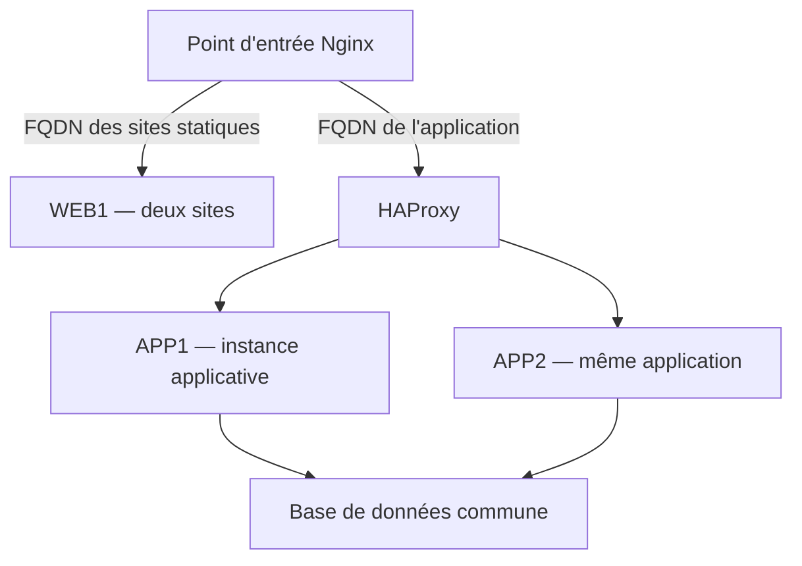
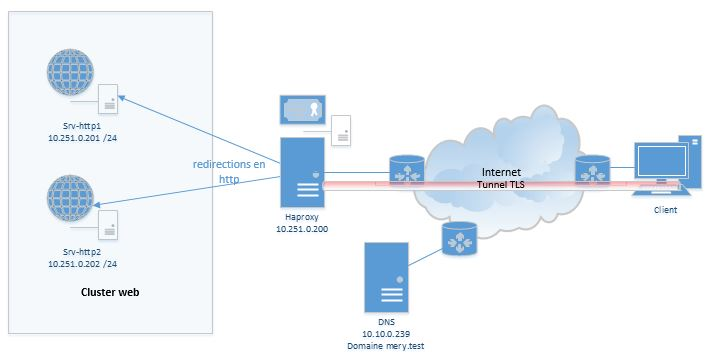
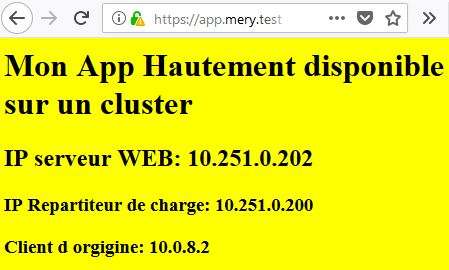
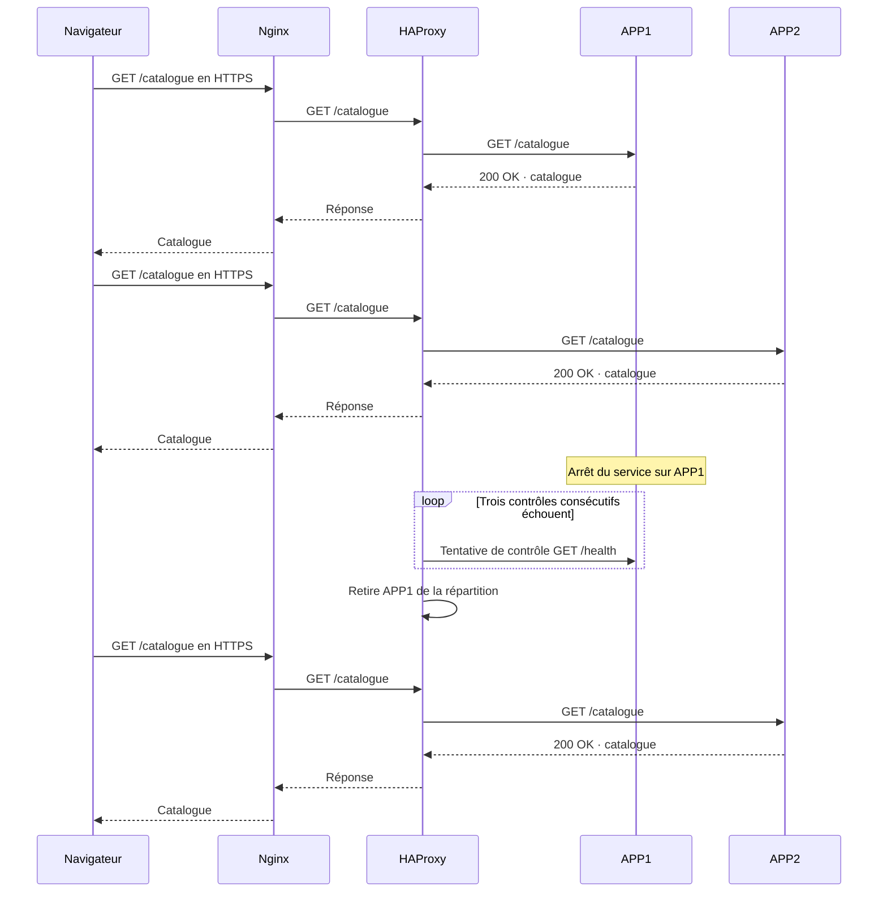
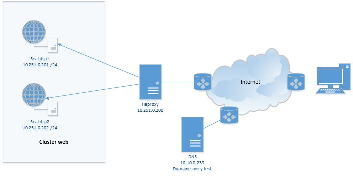

# Répartir la charge d'une même application

## Situation et objectif

L'application de SportLudique reçoit davantage de visites. L'entreprise souhaite faire fonctionner plusieurs instances de cette application et répartir les requêtes entre elles.

****Comment utiliser plusieurs serveurs sans compromettre les sessions, la cohérence des données et la disponibilité du service ?****

Les deux sites statiques peuvent rester mutualisés sur WEB1. La nouvelle évolution concerne l'application dynamique : une instance APP1 et une instance APP2 doivent proposer les mêmes fonctionnalités et accéder à des données cohérentes.

## 1. Distinguer routage, répartition et reprise

Le [reverse proxy](02-reverse-proxy.md) choisissait la bonne application d'après le FQDN. Le ****load balancing****, ou répartition de charge, choisit une instance parmi plusieurs capables de traiter la demande pour la même application.

Envoyer `www.chartres.sportludique.fr` vers un serveur statique et `app.chartres.sportludique.fr` vers un serveur dynamique est du routage entre publications. Répartir les requêtes de `app.chartres.sportludique.fr` entre APP1 et APP2 est de la répartition de charge.

Le **`failover`** répond à la panne d'un composant ; il ne nécessite pas que les deux nœuds travaillent simultanément. Un répartiteur peut à la fois distribuer le trafic et retirer une instance défaillante, mais sa propre disponibilité doit être traitée séparément.

## 2. Choisir où placer la répartition

Pour conserver l'architecture précédente, le reverse proxy Nginx peut transmettre les requêtes de l'application à HAProxy, qui sélectionne APP1 ou APP2. Les sites statiques continuent d'emprunter leur chemin vers WEB1.



Ce schéma montre les flux applicatifs ; les pare-feu et zones du [support 2](02-reverse-proxy.md) restent nécessaires. HAProxy est accessible depuis les proxies autorisés ; les instances applicatives ne sont pas publiées directement et seules celles qui en ont besoin accèdent au SGBD.

Ce montage ajoute un relais. Il est intéressant pour distinguer les rôles, mais n'est pas obligatoire :

- Nginx peut lui-même répartir la charge vers APP1 et APP2.

- HAProxy peut devenir le point d'entrée public, gérer TLS et sélectionner les publications, tout en conservant WEB1.

- Un HAProxy interne peut être redondé si l'on conserve les deux couches.

Choisissez une architecture et justifiez chaque composant. Si HAProxy remplace Nginx en frontal, adaptez la [redondance du point d'entrée](03-haute-disponibilite.md) au nouveau service. S'il reste seul derrière deux Nginx redondants, il devient un SPOF pour l'application dynamique.

## 3. Répartir en niveau 4 ou en niveau 7

| Mode | Décision et visibilité | Conséquence |
| --- | --- | --- |
| Niveau 4, ici TCP | Choix d'un backend pour une connexion, sans traitement HTTP | Toutes les données de cette connexion vont au même backend |
| Niveau 7, ici HTTP | Lecture de la requête ; règles possibles sur le nom, le chemin ou les en-têtes | Routage applicatif et possibilité de choisir une instance pour les requêtes |

En transfert TLS transparent sur TCP, le répartiteur ne déchiffre pas le contenu HTTP : il ne peut donc pas lire `Host` ou un cookie. Certains montages inspectent le SNI lorsqu'il est visible ; cela ne fournit pas l'ensemble des capacités d'un proxy HTTP.

Pour analyser HTTP sur un accès HTTPS, le répartiteur doit disposer du trafic déchiffré, soit parce qu'il termine TLS, soit parce qu'un proxy précédent lui transmet HTTP. Une nouvelle connexion TLS vers les instances est possible et doit vérifier leur identité selon les principes du support 2.

Une connexion persistante n'est pas une session utilisateur. La réutilisation de connexions et le multiplexage HTTP peuvent influencer les observations : ne concluez pas à une alternance stricte à partir de deux rafraîchissements dans un navigateur.

## 4. HAProxy et Nginx

HAProxy organise notamment sa configuration autour d'un `frontend`, qui reçoit le trafic, et d'un `backend`, qui décrit les destinations et leur politique de sélection. Un `pool` est le groupe d'instances candidates ; chaque ligne `server` de HAProxy décrit un membre de ce groupe.

Nginx peut assurer la même fonction au moyen de groupes `upstream`. Il permet notamment le round robin, les pondérations et le choix selon le nombre de connexions. Il peut ainsi cumuler service de fichiers, reverse proxy et répartition de charge.

HAProxy est particulièrement adapté à l'étude des contrôles de santé actifs et des politiques de répartition. Nginx dispose de contrôles passifs ; vérifiez dans la documentation de votre version et de votre édition les possibilités de contrôles actifs, certaines fonctions étant associées à NGINX Plus. Ne transposez pas une directive d'une édition à l'autre sans vérification.

L'activité privilégie `HAProxy`, tout en permettant une autre solution motivée. La documentation doit correspondre à la version installée.

### Suivre une requête dans les fichiers de configuration

Pour cet exemple, Nginx termine TLS. Les trois noms publics utilisent la même IP de publication. Seul le bloc du site `app.chartres.sportludique.fr` transmet ses requêtes à HAProxy. Les deux sites statiques restent sur WEB1.

**Sur Nginx** — Dans le bloc `server` HTTPS de l’application, étudié dans le support 2, adaptez la destination de `location /`. Les adresses sont données à titre d’exemple. Ici Nginx reçoit directement les connexions clientes.

```nginx
location / {
    proxy_pass http://10.251.0.200:80;
    proxy_set_header Host $host;
    proxy_set_header X-Forwarded-Proto $scheme;
    proxy_set_header X-Forwarded-For $remote_addr;
    proxy_set_header X-Real-IP $remote_addr;
}
```

**Sur HAProxy** — Dans `/etc/haproxy/haproxy.cfg`, ajoutez ces deux sections après les réglages `global` et `defaults` de votre installation. L’adresse de `bind` doit être portée par HAProxy. Les délais de connexion, client et serveur sont définis dans `defaults`.

```haproxy
frontend depuis_nginx
    bind 10.251.0.200:80
    mode http
    default_backend application

backend application
    mode http
    balance roundrobin
    server app1 10.251.0.201:80 check
    server app2 10.251.0.202:80 check
```

1. **Où arrive la requête ?** La destination de `proxy_pass` correspond à l’adresse et au port de `bind`.
2. **Quel groupe reçoit la requête ?** Le nom qui suit `default_backend` correspond à la section `backend application`.
3. **Qui répond ?** HAProxy choisit une instance disponible parmi les lignes `server`. Dans cet extrait, `check` teste l’ouverture de la connexion TCP.

Validez le fichier avant de recharger le service.

```bash
haproxy -c -f /etc/haproxy/haproxy.cfg
```

### Observer le résultat sur les deux instances

Les captures suivantes proviennent de la maquette Apache d’origine, publiée sous `app.mery.test`. Le principe à observer est le même pour SportLudique. Comparez la barre d’adresse et la ligne **IP serveur WEB**. Le fond jaune identifie visuellement le second serveur.


### Variante de la maquette d’origine — HAProxy termine TLS

Dans cette variante, le navigateur contacte directement HAProxy. Le certificat présenté doit couvrir le FQDN public. Pour étudier cette variante avec le backend précédent, remplacez le frontend `depuis_nginx` par celui-ci. Adaptez l’adresse d’écoute et le chemin du fichier PEM contenant le certificat, sa chaîne intermédiaire et la clé privée.

```haproxy
frontend publication_https
    bind 10.251.0.200:443 ssl crt /etc/haproxy/certs/app.chartres.sportludique.fr.pem
    mode http
    http-request set-header X-Forwarded-Proto https
    http-request set-header X-Forwarded-For %[src]
    default_backend application
```







## 5. Choisir un algorithme

| Politique | Principe | Cas pertinent et limite |
| --- | --- | --- |
| Round Robin | Distribution à tour de rôle entre les instances disponibles, avec prise en compte éventuelle des poids | Simple avec des instances comparables ; le nombre de requêtes ne mesure pas leur coût |
| Least Connections | Préférence pour l'instance ayant le moins de connexions actives, selon la pondération | Utile lorsque les durées de connexion diffèrent ; ne mesure pas directement la charge CPU |
| Répartition pondérée | Attribution d'un poids relatif aux instances dans un algorithme compatible | Permet de tenir compte de capacités différentes ; un poids n'est pas une mesure automatique de capacité |

Une pondération 2:1 vise davantage de trafic vers la première instance. Elle ne garantit ni deux fois plus de performances ni une proportion exacte sur un petit échantillon. L'affinité, les pannes et la durée des échanges peuvent modifier la distribution observée.

Justifiez votre choix avec la nature des requêtes, les ressources disponibles et des mesures. Un catalogue simple et des traitements longs ne présentent pas forcément le même profil.

## 6. Contrôler la santé des instances

Un contrôle ****passif**** utilise les erreurs observées lors du trafic réel. Un contrôle ****actif**** sonde périodiquement une instance, même en l'absence de visiteurs.

Un test TCP vérifie que la connexion peut s'établir. Il ne prouve pas que l'application est capable de répondre correctement. Une requête HTTP vers une ressource dédiée peut vérifier plus précisément l'aptitude à recevoir du trafic.

Dans le fichier précédent, remplacez la section `backend application` par celle-ci. Le frontend continue de désigner le même groupe.

```haproxy
backend application
    mode http
    balance roundrobin
    option httpchk
    http-check send meth GET uri /health ver HTTP/1.1 hdr Host app.chartres.sportludique.fr
    http-check expect status 200
    server app1 10.251.0.201:80 check inter 3s fall 3 rise 2
    server app2 10.251.0.202:80 check inter 3s fall 3 rise 2
```

L'application doit réellement fournir `/health` et accepter le nom indiqué. `fall` fixe le nombre d'échecs avant retrait, `rise` le nombre de succès avant réintégration et `inter` l'intervalle des contrôles. Le délai réel de détection dépend aussi des délais d'attente et de l'instant de la panne ; il ne se réduit pas systématiquement à une multiplication exacte.

Le contrôle doit être peu coûteux, ne pas modifier les données et ne pas exposer d'informations sensibles. Choisissez s'il teste seulement l'instance ou aussi une dépendance indispensable. Si la base commune tombe, les deux instances peuvent échouer simultanément : la répartition ne réparera pas cette dépendance.

Après détection, les nouvelles requêtes sont dirigées vers les instances restantes selon la politique retenue. Les requêtes déjà engagées peuvent échouer. Une répétition automatique d'une opération d'écriture présente un risque de doublon si son résultat est inconnu.

### Suivre les requêtes avant et après une panne

Le navigateur consulte toujours `https://app.chartres.sportludique.fr/catalogue`. Les deux premières requêtes illustrent une distribution possible sans affinité. Les contrôles de santé s’exécutent indépendamment des visites.



**À expliquer à l’oral** — Que peut observer un visiteur entre la panne d’APP1 et son retrait ? Après son redémarrage, combien de contrôles réussis faut-il avant qu’APP1 reçoive de nouvelles requêtes ?

## 7. Préserver les sessions et les données

### Sessions utilisateurs

Un utilisateur se connecte sur APP1, qui conserve sa session en mémoire locale. Si la requête suivante arrive sur APP2, cette instance peut ne pas reconnaître la session. La présence du même code sur les deux machines ne résout pas ce problème.

Plusieurs approches sont possibles :

- ****Affinité de session****, par exemple avec un cookie : orienter un utilisateur vers la même instance. Elle limite certains changements d'instance mais ne préserve pas les données locales lors d'une panne.

- ****Stockage partagé des sessions**** : les instances consultent un service commun. Sa sécurité, sa capacité et sa disponibilité doivent alors être étudiées.

- ****Mécanisme sans état local****, lorsque l'application le permet : les instances valident des éléments communs, par exemple un jeton signé, avec une gestion cohérente des clés, de l'expiration et de la révocation.

Une affinité fondée sur l'adresse IP peut concentrer de nombreux utilisateurs derrière un même NAT. Elle doit être choisie en connaissance de cause, pas ajoutée pour masquer un défaut de conception.

### Fichiers et données métier

Un fichier téléversé sur le disque local d'APP1 n'apparaît pas automatiquement sur APP2. Prévoyez un stockage partagé, un stockage objet ou un mécanisme de réplication adapté. Étudiez la cohérence, les permissions et le comportement en cas d'indisponibilité de ce stockage.

Les deux instances doivent utiliser une base cohérente. Dupliquer les serveurs web ne réplique pas le SGBD. Des écritures concurrentes nécessitent des transactions et des contraintes applicatives adaptées ; la cohérence ne repose pas sur le répartiteur.

Les versions du code, paramètres, secrets de signature et schémas de données doivent être compatibles. Une tâche planifiée lancée sur chaque instance peut s'exécuter deux fois : identifiez les traitements qui exigent une coordination.

### Conserver une chaîne de confiance cohérente

Si Nginx et HAProxy sont chaînés, revoyez la transmission de l'adresse cliente et du schéma public. HAProxy ne doit pas remplacer aveuglément `https` par `http` simplement parce que la liaison Nginx–HAProxy est en HTTP. Les en-têtes sont acceptés uniquement depuis les relais autorisés, conformément au [support 2](02-reverse-proxy.md).

## 8. Mesurer la capacité réelle

Deux instances peuvent augmenter la capacité applicative, mais le SGBD, le stockage, le réseau ou le répartiteur peuvent devenir le facteur limitant. Deux VM utilisant les mêmes ressources physiques peuvent aussi entrer en concurrence.

Comparez, dans des conditions semblables, le débit utile, les temps de réponse et le taux d'erreurs avec une puis deux instances. Le simple fait d'observer des réponses provenant des deux machines prouve une distribution, pas un gain de performances.

Après perte d'une instance, la capacité restante doit supporter la charge visée. Un service qui reste joignable mais répond trop lentement n'atteint pas forcément l'objectif de disponibilité.

## Pour relire les captures de la maquette initiale

Dans cette maquette, les noms des applications aboutissent directement à HAProxy. Repérez les serveurs Apache sur le schéma, puis retrouvez leurs adresses dans les lignes `server`. Pour SportLudique, le parcours principal ajoute Nginx devant le répartiteur.





La maquette publiait aussi `app2.mery.test` sur les deux serveurs Apache. Comparez les captures ci-dessous à celles de la première application. Le nom demandé identifie la publication, puis l’adresse affichée dans la page identifie l’instance qui a répondu.


## Documentation officielle

- [HAProxy — Documentation par version](https://www.haproxy.org/#docs) : choisir la référence correspondant à votre installation.

- [HAProxy — Manuel de configuration 3.0](https://www.haproxy.org/download/3.0/doc/configuration.txt) : exemples de référence pour `backend`, `balance`, `http-check`, `server` et la persistance ; adapter à votre version.

- [HAProxy — Contrôles de santé](https://www.haproxy.com/documentation/haproxy-configuration-tutorials/reliability/health-checks/) : choisir un contrôle TCP ou HTTP.

- [Nginx — Répartition de charge HTTP](https://nginx.org/en/docs/http/load_balancing.html) : comparer les algorithmes et les contrôles passifs.

****À relier :**** la [mutualisation des sites](01-hebergement-mutualise.md), la [publication sécurisée](02-reverse-proxy.md) et la [disponibilité du point d'entrée](03-haute-disponibilite.md) restent des fonctions complémentaires de cette architecture.
