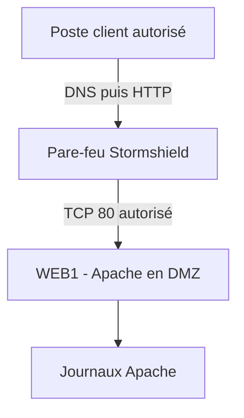
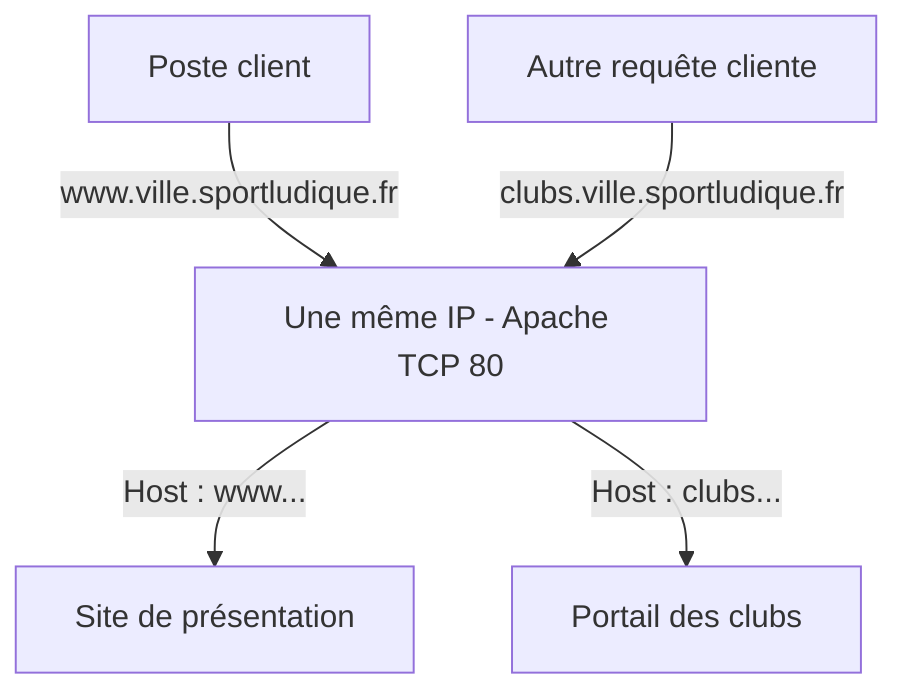
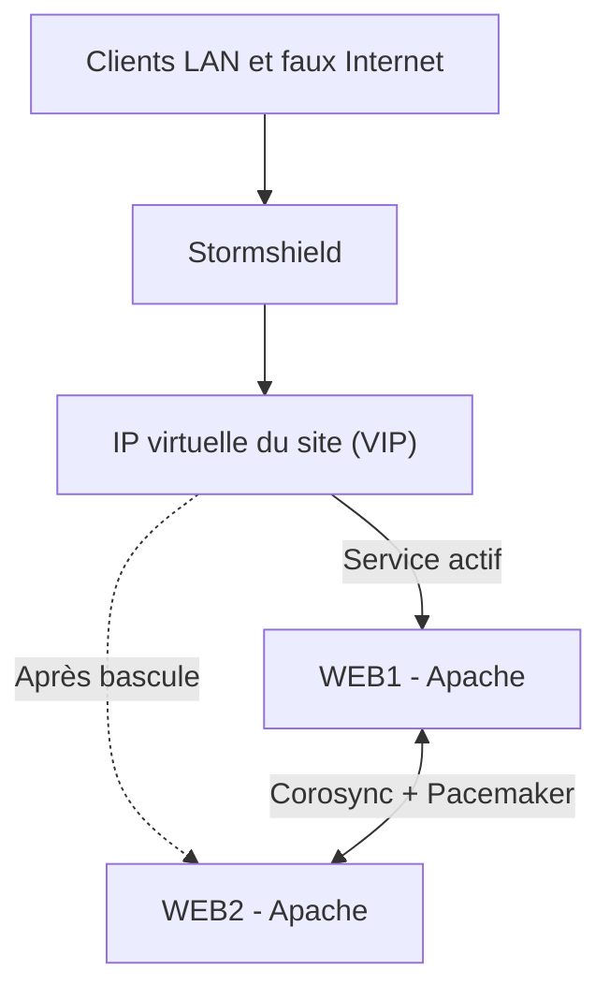

# Service web — Apache et hôtes virtuels

Dans SportLudique, vous déployez **Apache dans la DMZ** pour publier le site de votre ville. Il doit être accessible **depuis le réseau extérieur pédagogique (« faux Internet »)** ainsi que **depuis les postes du LAN autorisés par les règles de filtrage Stormshield**. Vous vérifierez ces deux accès depuis des postes clients, en utilisant le FQDN du site.

Ce module est consacré à la mise en place et à l'administration d'un serveur web Apache : configuration des VirtualHosts, publication des sites et disponibilité du service.

Les premières activités sont réalisées en HTTP (TCP 80) afin de maîtriser le fonctionnement du serveur avant d'aborder la sécurisation des échanges.

Le protocole HTTPS et la gestion des certificats sont traités dans le module `PKI`. Le TP Socle HTTPS peut être réalisé dès la fin du Socle Apache, indépendamment des activités avancées sur les VirtualHosts et la haute disponibilité.

## Introduction 

### Parcours et résultats attendus

!!! info "Comment travailler avec ce support"
    Les trois parcours sont **progressifs** : l'Avancé suppose le Socle validé ; l'Expert s'appuie sur les deux précédents.

    - **Socle — obligatoire** : installer Apache sur Debian, créer un premier site et son vhost, résoudre son FQDN et tester l'accès depuis un client autorisé.
    - **Avancé — approfondissement** : héberger plusieurs sites sur la même IP, expliquer la sélection du vhost et distinguer un site public d'un site interne par des restrictions effectives.
    - **Expert — autonomie** : mettre en œuvre une bascule **actif/passif** entre deux serveurs Apache avec **Corosync et Pacemaker**, puis tester les pannes.

    À chaque niveau, apportez des **preuves techniques** : commande, configuration, adresse du poste de test, résultat obtenu et interprétation. Une capture d'écran du navigateur seule ne suffit pas.

**Prérequis :** IPv4, routage, VLAN, filtrage Stormshield, résolution DNS et bases du protocole HTTP.

| Niveau | Travail à réaliser | Validation attendue |
|---|---|---|
| **Socle** | Un site statique avec son VirtualHost sur la VM Debian de DMZ. | Accès HTTP par le bon FQDN, contenu attendu, filtrage justifié et journal d'accès exploitable. |
| **Avancé** | Deux sites distincts sur la même IP ; contrôle d'accès pour un site interne. | Sélection correcte des vhosts par leur nom, journaux séparés, tests autorisé/refusé. |
| **Expert** | Deux serveurs Apache en actif/passif, Corosync, Pacemaker et une adresse IP virtuelle (VIP). | Même FQDN avant/après bascule, contenu cohérent et délai de reprise mesuré. |

### Culture professionnelle — Les principaux serveurs web

#### Quelques repères historiques

| Date | Repère |
|---|---|
| **1990** | Tim Berners-Lee crée au CERN le premier serveur web. Le Web est un service d'Internet, pas un synonyme d'Internet. |
| **1995** | Apache HTTP Server apparaît, dans la continuité de NCSA HTTPd. |
| **1996** | Microsoft lance IIS pour les serveurs Windows. |
| **Années 2000** | Nginx se développe, notamment pour traiter de nombreuses connexions HTTP. |

Sources : [CERN](https://home.cern/science/computing/the-birth-of-the-web/short-history-web/), [Apache](https://httpd.apache.org/ABOUT_APACHE), [Microsoft](https://news.microsoft.com/source/1996/02/12/microsoft-ships-internet-information-server-free-product-outperforms-unix/).

#### Trois références à connaître

| Serveur web | Écosystème | À retenir |
|---|---|---|
| **Apache HTTP Server** | Libre, notamment sur Linux | Serveur du TP : modules, VirtualHosts, règles d'accès et journaux. |
| **Nginx** (« engine X ») | Libre, notamment sur Linux | Alternative à Apache ; peut également servir de reverse proxy. |
| **Microsoft IIS** (*Internet Information Services*) | Windows Server | Hébergement web dans l'environnement Microsoft, notamment pour ASP.NET. |

!!! info "Pour votre veille technologique"
    D'autres serveurs web existent, comme **LiteSpeed / OpenLiteSpeed** ou **Caddy**. Il suffit ici de savoir qu'ils proposent d'autres approches de l'hébergement web : leur installation n'est pas demandée.

    **Traefik, HAProxy et Envoy** sont principalement utilisés comme *reverse proxies* et/ou répartiteurs. Ces fonctions, utiles bien au-delà du seul serveur Apache, seront étudiées dans **des supports dédiés**. Ne les confondez pas avec les trois serveurs web à connaître dans cette fiche.

#### Un aperçu du marché

Selon le [relevé W3Techs du 12 octobre 2026](https://w3techs.com/technologies/comparison/ws-apache,ws-litespeed,ws-nginx), parmi les sites dont le serveur web est identifié, **Nginx (30,6 %)**, **Apache (21,7 %)** et **LiteSpeed (14,1 %)** occupent une place importante. Ce sont des statistiques sur les sites observables, **pas** un recensement de tous les serveurs des entreprises : les CDN et reverse proxies peuvent masquer la technologie réellement utilisée à l'origine.

!!! success "Culture professionnelle attendue"
    Savoir identifier **Apache, Nginx et IIS** et expliquer qu'ils peuvent répondre au même besoin d'hébergement web, avec des environnements et des méthodes d'administration différents.


### Service local, service interne ou service public ?

#### 1.1 Trois situations à distinguer

| Situation | Qui peut accéder au service ? | Ce que le test démontre |
|---|---|---|
| **Test local sur le serveur** | Un programme exécuté sur le serveur utilise par exemple `127.0.0.1`. | Apache répond localement. Cela ne valide ni le réseau, ni le DNS des clients, ni le pare-feu. |
| **Service interne** | Des postes du LAN, de VLAN autorisés ou des utilisateurs connectés par VPN. | Le service est accessible dans le périmètre prévu. Il peut être hébergé dans une DMZ sans être publié sur Internet. |
| **Service exposé publiquement** | Des clients provenant d'Internet peuvent atteindre le point d'entrée web. | Le service est publié vers l'extérieur. Une authentification éventuelle ne supprime pas cette exposition. |

!!! danger "Ne pas confondre écoute et exposition"
    Une écoute sur `0.0.0.0:80` signifie que le service écoute sur toutes les adresses IPv4 locales. Elle ne prouve pas son accessibilité depuis Internet : routage, filtrage et éventuelle traduction d'adresse interviennent aussi.

    Inversement, une adresse privée en DMZ ne garantit pas qu'un serveur soit inaccessible depuis Internet : une redirection de port ou un reverse proxy peut publier son service.

#### 1.2 DNS, routage et filtrage : trois mécanismes différents

| Élément | Service interne | Site web accessible depuis un réseau extérieur |
|---|---|---|
| **Résolution DNS** | DNS interne, éventuellement accessible aux utilisateurs VPN. | DNS du réseau extérieur vers le point d'entrée du service. |
| **Accès réseau** | Routage et règles de filtrage entre VLAN autorisés. | Point d'entrée joignable depuis l'extérieur, filtrage et éventuellement DNAT ou reverse proxy. |
| **Administration** | SSH depuis les réseaux ou postes d'administration autorisés. | L'ouverture du site aux visiteurs ne doit pas ouvrir son administration aux visiteurs. |

!!! example "SportLudique : un Internet simulé"
    Le réseau extérieur pédagogique **simule Internet**. Un site peut y être « publié » tout en restant inaccessible depuis le véritable Internet.

    Dans votre compte rendu, distinguez les tests effectués **sur la VM**, **depuis le LAN**, **depuis le VPN** ou **depuis le réseau extérieur pédagogique**. Chaque essai démontre une accessibilité différente.

#### 1.3 Ce que fait un serveur web

Un serveur web est un logiciel qui **répond à des requêtes HTTP**. Une application peut produire les pages, Apache peut les servir et un reverse proxy peut se placer devant ; ce sont des fonctions distinctes.

Le navigateur résout le nom du site, établit une connexion, puis envoie une requête HTTP. Apache sélectionne le site concerné et renvoie une réponse : page HTML, image, fichier ou résultat d'une application.

| Élément | Rôle |
|---|---|
| Adresse IP | Permet d'atteindre la machine ou le point d'entrée du service. |
| Port TCP | Identifie ici le service HTTP : port 80. |
| Nom du site | Permet de sélectionner le site demandé parmi les vhosts. |
| Chemin dans l'URL | Identifie une ressource à l'intérieur du site. |

## Socle 

### 2.1— Mettre en service un premier site

**Mission :** mettre en ligne le site de votre ville SportLudique sur une VM Debian située dans la DMZ. À la fin du Socle, les clients autorisés du **LAN** et du **réseau extérieur pédagogique** doivent obtenir le bon contenu à l'adresse `http://www.ville.sportludique.fr/`.



Ce schéma simplifie le chemin de consultation. Le DNS peuvent emprunter d'autres trajets ; précisez-les dans votre tableau de flux.

### 2.2 Préparer le déploiement

Les commandes suivantes concernent **Debian et l'organisation de son paquet Apache2**. Elles sont exécutées avec un compte disposant des droits nécessaires ; adaptez l'usage de `sudo`.

Avant de commencer, relevez :

- l'adresse du serveur web et son réseau DMZ ;
- sa passerelle et son résolveur DNS ;
- le FQDN retenu pour le site ;
- les réseaux clients autorisés ;
- le poste ou réseau autorisé à administrer le serveur.

Dans les exemples, `www.ville.sportludique.fr` désigne le site. **Remplacez `ville` par le nom attribué à votre groupe**. Les noms du projet sont utilisés dans son DNS pédagogique ; les écrire dans un fichier ne crée aucun enregistrement sur le DNS public.

### 2.3 Installer Apache et vérifier son fonctionnement

```bash
sudo apt update
sudo apt install apache2 curl
sudo systemctl enable --now apache2
sudo systemctl status apache2
sudo ss -lntp
```

Repérez le processus Apache et le port d'écoute. Testez ensuite sur le serveur :

```bash
curl -I http://127.0.0.1/
```

Une réponse HTTP montre qu'un serveur répond. Une page de bienvenue par défaut **ne valide pas votre propre site**.

### 2.4 Comprendre l'organisation des fichiers

| Chemin | Rôle |
|---|---|
| `/etc/apache2/apache2.conf` | Configuration générale. |
| `/etc/apache2/ports.conf` | Directives d'écoute, notamment `Listen`. |
| `/etc/apache2/sites-available/` | Configurations des sites disponibles. |
| `/etc/apache2/sites-enabled/` | Liens symboliques vers les sites activés. |
| `/var/www/` | Emplacement usuel des contenus web. |
| `/var/log/apache2/` | Journaux Apache. |

!!! tip "Un fichier par site"
    Conservez les fichiers fournis par Debian comme références et créez vos propres fichiers `.conf`. Les sites par défaut ne sont pas indispensables au démarrage d'Apache : vous pourrez les désactiver une fois votre configuration prête.

### 2.5 Créer le contenu du site

```bash
sudo install -d -m 755 /var/www/sportludique-public
sudo nano /var/www/sportludique-public/index.html
```

Exemple de contenu :

```html
<!doctype html>
<html lang="fr">
<head>
  <meta charset="utf-8">
  <title>SportLudique — Site public</title>
</head>
<body>
  <h1>SportLudique — Site public</h1>
  <p>Ville : à compléter — Serveur : WEB1</p>
</body>
</html>
```

Apache doit pouvoir traverser les répertoires et lire les fichiers. Pour ce site statique, un répertoire en `755` et un fichier en `644` conviennent :

```bash
sudo chmod 644 /var/www/sportludique-public/index.html
```

!!! danger "Droits minimaux"
    Ne faites pas de `chmod 777`. Le processus web n'a pas besoin de modifier les pages d'un site statique. Ne placez jamais de clés privées, de sauvegardes ou de mots de passe dans le répertoire publié.

### 2.6 Définir le premier VirtualHost

Un **hôte virtuel**, ou **vhost**, associe un site à un nom et à une configuration : répertoire racine, règles d'accès et journaux. Un même Apache peut héberger plusieurs vhosts.

Créez `/etc/apache2/sites-available/sportludique-public.conf` :

```apache
<VirtualHost *:80>
    ServerName www.ville.sportludique.fr
    DocumentRoot /var/www/sportludique-public

    <Directory /var/www/sportludique-public>
        Options None
        AllowOverride None
        Require all granted
    </Directory>

    ErrorLog ${APACHE_LOG_DIR}/sportludique-public_error.log
    CustomLog ${APACHE_LOG_DIR}/sportludique-public_access.log combined
</VirtualHost>
```

| Directive | Explication |
|---|---|
| `<VirtualHost *:80>` | Configuration applicable aux connexions sur le port 80 des adresses locales concernées. Ne crée pas à elle seule une écoute. |
| `ServerName` | FQDN principal de ce site. Ne crée pas l'enregistrement DNS. |
| `DocumentRoot` | Répertoire contenant les ressources publiées. |
| `<Directory ...>` | Règles appliquées à ce répertoire du système de fichiers. |
| `Options None` | Désactive ici les options telles que l'affichage automatique du contenu des répertoires. |
| `AllowOverride None` | Ne prend pas en compte les fichiers `.htaccess`. |
| `Require all granted` | Autorise l'accès au contenu à tout client qui atteint ce contexte, sous réserve des autres contrôles. |
| `ErrorLog` / `CustomLog` | Journaux d'erreurs et d'accès propres au site. |

Les commentaires Apache doivent être écrits **sur des lignes séparées commençant par `#`**, pas à la suite d'une directive.

### 2.7 Activer, contrôler et recharger

```bash
sudo a2ensite sportludique-public.conf
sudo apache2ctl configtest
```

Si le résultat indique `Syntax OK`, rechargez la configuration :

```bash
sudo systemctl reload apache2
sudo apache2ctl -S
```

`apache2ctl -S` permet de voir les vhosts interprétés par Apache et leur ordre. La validation de syntaxe ne prouve pas que le DNS, les droits ou les règles réseau soient corrects.


??? info "Activer un site Apache : comprendre a2ensite et les liens symboliques"

    Sur Debian, Apache distingue deux répertoires :

    - `/etc/apache2/sites-available/` : contient les **fichiers de configuration** des sites.
    - `/etc/apache2/sites-enabled/` : contient les **liens symboliques** vers les sites activés.

    Un **lien symbolique** est un fichier particulier qui pointe vers un autre fichier ou répertoire. Il fonctionne comme un raccourci : il ne contient pas une copie du fichier cible.

    Lorsque vous exécutez :

    ```bash
    sudo a2ensite sportludique-public.conf
    ```

    Debian crée un lien symbolique dans `sites-enabled` pointant vers le fichier de configuration situé dans `sites-available`.

    Pour le vérifier :

    ```bash
    ls -l /etc/apache2/sites-enabled/
    ```

    Exemple de résultat simplifié :

    ```text
    lrwxrwxrwx ... sportludique-public.conf -> ../sites-available/sportludique-public.conf
    ```

    **Comment lire cette ligne ?**

    - Le premier caractère **`l`** (lettre L minuscule) indique qu'il s'agit d'un lien symbolique, et non d'un fichier ordinaire (`-`) ou d'un répertoire (`d`).
    - `sportludique-public.conf` est le nom du lien.
    - La flèche **`->`** indique le fichier vers lequel pointe ce lien.
    - `..` signifie **répertoire parent** : on remonte d'un niveau avant d'accéder à `sites-available`.

    Apache charge ainsi la configuration des sites activés, sans qu'il soit nécessaire de copier leurs fichiers.

    **Désactiver un site**

    ```bash
    sudo a2dissite 000-default.conf
    ```

    Cette commande supprime uniquement le lien symbolique correspondant dans `sites-enabled`. **Le véritable fichier de configuration reste présent dans `sites-available`.** Vous pourrez donc réactiver le site ultérieurement.

    **Attention : activer ou désactiver un site ne recharge pas automatiquement Apache.** Il faut contrôler la configuration puis demander son rechargement :

    ```bash
    sudo apache2ctl configtest
    sudo systemctl reload apache2
    ```

    Le résultat `Syntax OK` confirme que la syntaxe est correcte, mais ne garantit pas le bon fonctionnement du site.


### 2.8 Configurer le DNS et tester depuis un client

Le test doit être fait depuis **un vrai poste client**, dans le réseau pour lequel vous annoncez l'accessibilité. Une requête exécutée uniquement sur la VM web ne valide pas la publication du service.

Ajoutez sur votre DNS d'autorité l'enregistrement du site vers l'adresse appropriée :

- **depuis le réseau interne**, l'adresse joignable du serveur ou du point d'entrée interne ;
- **depuis l'extérieur**, l'adresse du point d'entrée publié, pas une adresse privée inaccessible au client.

Vérifiez depuis le poste client :

```bash
nslookup www.ville.sportludique.fr
curl -I http://www.ville.sportludique.fr/
```

Sous Windows PowerShell, utilisez `curl.exe` pour appeler explicitement le programme curl.

Ouvrez aussi le site dans un navigateur et contrôlez **le contenu attendu**. Un code `200` provenant du mauvais site ne suffit pas.

!!! warning "Le fichier hosts est un outil de dépannage"
    Une entrée dans `/etc/hosts` sous Linux ou `C:\Windows\System32\drivers\etc\hosts` sous Windows ne modifie que la résolution de ce poste. Elle ne remplace pas la configuration DNS attendue dans le projet.

??? question "Analyse — HTTP répond, mais est-ce bien le bon site ?"
    Un navigateur affiche la page d'accueil par défaut d'Apache et `curl -I` renvoie `200`. Le Socle est-il validé ?

    **Non.** Vous avez démontré qu'un serveur HTTP répond, pas que le vhost attendu a été sélectionné. Contrôlez le contenu, le `ServerName`, la configuration active avec `apache2ctl -S` et le FQDN réellement demandé.


### 2.9 Maîtriser les flux et l'exposition

| Source | Destination | Flux | Usage |
|---|---|---|---|
| Réseau extérieur pédagogique (« faux Internet ») | Point d'entrée publié / serveur Apache en DMZ | TCP 80 | Consultation du site depuis l’extérieur pédagogique. |
| Postes du LAN autorisés | Serveur Apache en DMZ | TCP 80 | Consultation selon les règles Stormshield. |
| Poste ou VLAN de management autorisé | Serveur web | TCP 22, si SSH est utilisé | Administration. |

Documentez séparément les flux sortants nécessaires, par exemple les résolutions DNS, la synchronisation horaire et les mises à jour système. Une règle de pare-feu doit préciser **source, destination, service et action**.

Pour une publication via **DNAT**, le pare-feu traduit la destination des paquets vers le serveur DMZ et applique les règles de filtrage prévues. **NAT ne signifie pas autorisation.** Avec un reverse proxy, les requêtes sont reçues par un intermédiaire avant d'être transmises au serveur Apache.

!!! warning "Tester depuis le bon réseau"
    Un accès depuis le LAN à l'adresse du réseau extérieur peut dépendre d'un mécanisme de NAT loopback. Pour prouver qu'un site est accessible depuis l'extérieur pédagogique, lancez le test **depuis ce réseau extérieur**, pas seulement depuis le LAN.

!!! warning "HTTP est employé ici pour comprendre Apache"
    Les requêtes et réponses HTTP circulent **sans chiffrement applicatif**. N'utilisez pas cette configuration pour transmettre des identifiants ou des données sensibles. La sécurisation des communications sera réalisée dans le support dédié.

### 2.10 Observer les journaux

```bash
sudo tail -f /var/log/apache2/sportludique-public_access.log
sudo tail -n 30 /var/log/apache2/sportludique-public_error.log
sudo journalctl -u apache2 -n 50 --no-pager
```

Effectuez une requête depuis un client et identifiez dans le journal **l'horodatage, l'adresse IP source observée, l'URL demandée et le code de réponse**. Avec un proxy ou certaines traductions d'adresse, la source observée peut être celle d'un équipement intermédiaire.

| Code HTTP | Interprétation fréquente |
|---|---|
| `200` | Requête réussie. |
| `301` / `302` | Redirection ; vérifier l'en-tête `Location`. |
| `403` | Accès refusé. |
| `404` | Ressource introuvable. |
| `500` | Erreur interne au serveur. |

### 2.11 Constituer les preuves de fonctionnement

| Preuve | Observation attendue |
|---|---|
| `apache2ctl configtest` | Résultat `Syntax OK`. |
| `apache2ctl -S` | Vhost déclaré avec le FQDN attendu sur le port 80. |
| `nslookup` depuis le client | Le nom conduit à l'adresse prévue pour ce réseau. |
| `curl -I http://www.ville.sportludique.fr/` | Réponse HTTP du serveur attendu. |
| Navigateur depuis le LAN autorisé **et** depuis le faux Internet | Page affichée avec le **bon contenu** de votre ville depuis les deux réseaux. |
| Journal du vhost | Requête retrouvée avec horodatage, source et code HTTP. |
| Règles Stormshield | Consultation et administration limitées aux flux prévus. |

!!! success "Socle — Minimum requis"
    - Apache fonctionne sur Debian et le premier VirtualHost est actif.
    - Le site s'affiche par son FQDN depuis le **faux Internet** et depuis un **poste du LAN autorisé** par le filtrage Stormshield, pas seulement en local.
    - Le contenu affiché est celui de votre groupe.
    - Le DNS et les règles réseau nécessaires sont justifiés.
    - Les flux d'administration sont distincts de ceux de consultation.
    - Une requête de test est identifiée dans les journaux du site.
    - Vous expliquez la différence entre test local, accès interne et publication extérieure.

## Avancé 

### 3 — Plusieurs VirtualHosts et contrôle des accès

**Mission :** héberger **deux sites différents sur la même adresse IP** et démontrer qu'Apache sélectionne le bon site selon le nom demandé. Étudier ensuite les limites de cette séparation logique.

### 3.1 Une même IP, plusieurs sites

| Site | FQDN pédagogique | Répertoire |
|---|---|---|
| Présentation de SportLudique | `www.ville.sportludique.fr` | `/var/www/sportludique-public` |
| Portail des clubs | `clubs.ville.sportludique.fr` | `/var/www/sportludique-clubs` |

Les deux noms DNS doivent mener à la **même IP**. L'adresse IP permet de joindre le serveur, mais **ne choisit pas** le site. En HTTP/1.1, le navigateur transmet le nom demandé dans l'en-tête `Host`. Apache s'en sert pour choisir un vhost dont le `ServerName` ou un `ServerAlias` correspond.



!!! info "À quoi sert ServerAlias ?"
    `ServerAlias` ajoute **un autre nom au même vhost**. Il ne crée pas un site indépendant. Le nom supplémentaire doit lui aussi être correctement résolu dans le DNS pour les clients qui l'utilisent.

### 3.2 Créer le deuxième site et son VirtualHost

Sur WEB1, créez le dossier et une page d'accueil identifiables :

```bash
sudo install -d -m 755 /var/www/sportludique-clubs
sudo nano /var/www/sportludique-clubs/index.html
sudo chmod 644 /var/www/sportludique-clubs/index.html
```

Dans la page HTML, indiquez explicitement **« Portail des clubs »** et le nom de votre ville pour la distinguer du premier site.

Créez `/etc/apache2/sites-available/sportludique-clubs.conf` :

```apache
<VirtualHost *:80>
    ServerName clubs.ville.sportludique.fr
    DocumentRoot /var/www/sportludique-clubs

    <Directory /var/www/sportludique-clubs>
        Options None
        AllowOverride None
        Require all granted
    </Directory>

    ErrorLog ${APACHE_LOG_DIR}/sportludique-clubs_error.log
    CustomLog ${APACHE_LOG_DIR}/sportludique-clubs_access.log combined
</VirtualHost>
```

Activez le site sans désactiver le premier :

```bash
sudo a2ensite sportludique-clubs.conf
sudo apache2ctl configtest
sudo systemctl reload apache2
sudo apache2ctl -S
```

Complétez la zone DNS pour que `clubs.ville.sportludique.fr` soit résolu depuis les clients attendus. Testez successivement :

```bash
nslookup www.ville.sportludique.fr
nslookup clubs.ville.sportludique.fr
curl http://www.ville.sportludique.fr/
curl http://clubs.ville.sportludique.fr/
```

**Résultat :** les deux noms conduisent à la même adresse, mais le contenu affiché et les journaux utilisés sont différents.

### 3.3 Comprendre et isoler une erreur de sélection

Vérifiez les vhosts actifs avec `apache2ctl -S`. Pour tester la sélection par nom **sans dépendre de la résolution DNS**, imposez une IP temporaire avec `--resolve` :

```bash
curl --resolve clubs.ville.sportludique.fr:80:ADRESSE_IP_WEB \
    http://clubs.ville.sportludique.fr/
```

Remplacez `ADRESSE_IP_WEB` par l'adresse réelle du serveur. Le nom de l'URL est conservé dans la requête ; seul le résultat DNS est remplacé ponctuellement. **Un test `--resolve` réussi ne prouve pas que votre DNS fonctionne.**

Vous pouvez également afficher l'en-tête `Host` avec :

```bash
curl -v http://clubs.ville.sportludique.fr/
```

### 3.4 Que se passe-t-il si aucun nom ne correspond ?

Pour un ensemble adresse/port donné, Apache utilise le **premier vhost défini** lorsqu'aucun nom ne correspond. Un accès par l'IP du serveur peut donc afficher l'un des sites existants. `apache2ctl -S` permet d'identifier le vhost par défaut.

!!! danger "Un nom discret n'est pas une protection"
    Il ne suffit pas d'omettre le FQDN du DNS extérieur pour rendre un site privé. Un client qui atteint la même IP et le même port peut soumettre lui-même un en-tête `Host`.

    De même, un pare-feu filtrant sur **IP et port** ne distingue pas automatiquement deux sites partageant la même IP et le même TCP 80.

### 3.5 Restreindre un site au réseau d'administration

**Travail complémentaire du niveau Avancé :** ajoutez un troisième vhost réservé à un réseau de management autorisé, par exemple `gestion.ville.sportludique.fr`, avec son propre répertoire et des journaux séparés. Dans son bloc `<Directory>`, vous pouvez utiliser :

```apache
<Directory /var/www/sportludique-gestion>
    Options None
    AllowOverride None
    Require ip 192.0.2.0/24
</Directory>
```

**Attention :** `192.0.2.0/24` est un réseau réservé à la documentation, pas une adresse réelle de SportLudique. Remplacez ce préfixe par le réseau client à autoriser.

Réalisez deux tests à l'aide du même FQDN :

| Poste d'origine | Résultat attendu |
|---|---|
| Poste autorisé du réseau de management | Accès au contenu (`200` si la ressource existe). |
| Poste non autorisé, capable de joindre le serveur | Refus d'accès (`403`). |

En complément du contrôle Apache, le **filtrage réseau** doit rester conforme au périmètre prévu. Attention : si un reverse proxy intervient, Apache peut voir son adresse à la place de celle du poste client ; le diagnostic doit en tenir compte.

!!! success "Avancé — Validation"
    - Les deux sites obligatoires possèdent chacun leur répertoire, leur vhost et leurs journaux.
    - Les deux FQDN pointent vers la **même IP**, avec des contenus distincts.
    - Vous expliquez précisément les rôles du DNS, de `Host`, de `ServerName` et du vhost par défaut.
    - Vous savez isoler un problème DNS avec `curl --resolve` sans confondre ce test avec la validation DNS.
    - Un site de gestion est limité aux postes autorisés avec **une preuve d'accès autorisé et une preuve de refus**.

## Expert 

### 4 - Mettre en place un failover Apache avec Pacemaker

**Mission :** assurer une **bascule automatique actif/passif** entre deux serveurs Apache. Après la panne du serveur actif, les utilisateurs du LAN autorisés et du faux Internet doivent retrouver **le même site au même FQDN**, sans modifier leur configuration.



Le schéma illustre **deux états successifs** : il n'y a qu'**un seul nœud actif** pour les ressources du service à un instant donné.

### 4.1 Comprendre le principe

| Composant | Rôle |
|---|---|
| **WEB1 et WEB2** | Deux VM Debian avec Apache et le même site statique. |
| **Corosync** | Permet aux nœuds d'échanger des informations sur leur état et leur appartenance au cluster. |
| **Pacemaker** | Supervise les ressources et décide de leur placement ou de leur redémarrage. |
| **Adresse IP virtuelle (VIP)** | Adresse stable utilisée par le DNS et le point d'entrée du service ; elle est portée par le nœud actif. |

L'agent de ressource **`IPaddr2`** peut gérer la VIP et l'agent **`apache`** peut gérer le service Apache. Ces deux ressources doivent être configurées pour fonctionner **ensemble sur le même nœud**, avec un ordre de démarrage adapté. <https://manpages.debian.org/testing/resource-agents/ocf_heartbeat_apache.7.en.html>

Dans SportLudique, les deux VM web doivent pouvoir héberger la VIP sur le **réseau DMZ approprié**. Le DNS du site mène à cette VIP depuis le réseau qui la joint directement ; lorsque le service est publié via un DNAT, le point d'entrée extérieur est traduit vers **la VIP**, pas vers l'IP fixe de WEB1. Le filtrage LAN et extérieur reste à valider.

### 4.2 Mettre en place le cluster

1. Déployer **WEB2** et vérifier que les deux Apache servent le même contenu et utilisent des configurations cohérentes.
2. Installer et configurer **Corosync / Pacemaker** avec un mécanisme fiable de quorum et de protection contre le démarrage simultané des ressources sur deux nœuds.
3. Déclarer les deux ressources du service : **VIP** et **Apache**, puis définir leur colocalisation et l'ordre de démarrage.
4. Configurer le DNS, le routage et les règles Stormshield pour que la publication vise le **point d'entrée stable**.
5. Vérifier depuis des clients du **LAN** et du **faux Internet** que le site est accessible lorsque WEB1 est actif.

Quelques observations utiles sur les nœuds du cluster :

```bash
sudo crm_mon -1
ip -br address
sudo systemctl status pacemaker corosync
```

La vérification du service doit aller **au-delà d'un simple ping** : le cluster doit détecter qu'Apache ne rend plus le service attendu. Le comportement après l'arrêt du processus Apache dépendra de la politique définie : Pacemaker peut d'abord tenter un **redémarrage local**, puis déplacer la ressource si nécessaire.

!!! tip "Surveiller Apache sans exposer son administration"
    L'agent Apache utilise généralement une URL de contrôle (souvent fournie par `mod_status`). Si elle est activée, **limitez son accès à la boucle locale**. Évitez aussi que le service Apache soit démarré indépendamment des décisions du cluster.


!!! warning "Une haute disponibilité exige d'éviter le split-brain"
    Un cluster de **deux nœuds** pose la question du **quorum** : comment décider quel nœud doit rester actif lorsqu'ils ne communiquent plus ? Il faut prévoir une stratégie adaptée, par exemple un témoin de quorum (*qdevice*) et un mécanisme de **fencing** opérationnel pour isoler un nœud défaillant lorsque c'est nécessaire.

    Désactiver ces protections pour « faire marcher le TP » peut produire une démonstration de bascule, mais **pas** une architecture de haute disponibilité fiable. Ces limites devront être expliquées et traitées pour valider l'Expert.

### 4.3 Tester la bascule (*failover*)

| Situation provoquée | Ce qu'il faut vérifier |
|---|---|
| Fonctionnement normal | VIP présente sur un seul nœud, bon site depuis le LAN et le faux Internet. |
| Arrêt du service Apache sur le nœud actif | Détection de la panne et récupération du service (redémarrage local ou bascule selon la politique). |
| Arrêt complet de la VM active | La VIP et le service sont repris par le second nœud, selon les protections et règles du cluster. |
| Retour de la VM | Pas de double VIP ; réintégration maîtrisée et contenu cohérent. |

Depuis un **client** extérieur aux deux VM, effectuez des requêtes répétées vers le **FQDN habituel** et relevez le temps de rétablissement :

```bash
while true; do
    date '+%H:%M:%S'
    curl --silent --show-error --max-time 3 --output /dev/null \
        --write-out 'HTTP %{http_code} - %{time_total} s\n' \
        http://www.ville.sportludique.fr/ || echo 'ECHEC'
    sleep 1
done
```

Une bascule peut interrompre certaines connexions en cours. Vérifiez aussi le **contenu** et non seulement un code `200`. Les pages, fichiers de configuration et journaux doivent rester cohérents et identifiables sur chaque nœud (copie contrôlée, Ansible, etc.).

!!! warning "Identifier les pannes qui ne sont pas couvertes"
    Deux VM sur le même hyperviseur ne protègent pas contre sa panne. Le pare-feu, le réseau, le DNS et le stockage peuvent rester des points uniques de défaillance. Distinguez **disponibilité d'Apache** et **disponibilité de toute la chaîne de publication**.

!!! success "Expert — Validation"
    Vous démontrez une **bascule actif/passif** avec Corosync et Pacemaker, une **VIP unique**, un accès conservé via le **même FQDN** depuis les deux réseaux de clients, un **contenu identique**, ainsi que des essais de panne **horodatés**. Vous savez expliquer les mécanismes de quorum/fencing et les limites de la solution.

## Diagnostiques

### 5. Diagnostiquer dans le bon ordre

La méthode reste la même aux trois niveaux : **constater, isoler, contrôler, corriger, puis retester**. Ne modifiez pas simultanément DNS, Apache et les règles Stormshield, sous peine de perdre la cause de l'incident.

| Symptôme | Vérifications prioritaires |
|---|---|
| Aucun accès même en local | État du service, journaux, syntaxe et port d'écoute 80. |
| Accès local réussi, accès distant impossible | Adresse d'écoute, IP, passerelle, routage, filtrage et éventuel NAT. |
| Accès par IP mais pas par nom | Résolution DNS depuis le poste client et adresse obtenue. |
| Mauvais site affiché | FQDN demandé, en-tête `Host`, `ServerName`, vhosts activés et `apache2ctl -S`. |
| Erreur `403` | Règles `Require`, droits sur les fichiers/dossiers et index manquant avec listage interdit. |
| Erreur `404` | URL, `DocumentRoot` et présence du fichier demandé. |
| Erreur `500` | Journaux d'erreurs du site et configuration de l'application éventuelle. |
| Publication extérieure en échec | Test réellement extérieur, DNS du client, point d'entrée, DNAT/proxy et filtrage. |
| Après panne, retour du mauvais contenu | Synchronisation des contenus, état des ressources Pacemaker, VIP, quorum et journaux du cluster. |

!!! tip "Justifier avec une observation"
    « Ça ne marche pas » ne constitue pas un diagnostic. Indiquez le poste source, l'URL, l'adresse résolue, le résultat exact et la trace utile. Après correction, répétez le **même test** pour comparer.

## Autoévaluation — Questions de révision

### Socle

<quiz>
**1 — Un serveur web placé dans une DMZ est-il automatiquement accessible depuis l'extérieur ?**

- [ ] Oui, une DMZ est toujours accessible depuis Internet.
- [x] Non, son accessibilité dépend notamment du routage et des règles de filtrage.
- [ ] Oui, dès qu'Apache écoute sur le port 80.
- [ ] Non, un serveur en DMZ ne peut jamais être accessible depuis l'extérieur.

**Explication :** Une DMZ est une zone réseau, pas un mécanisme de publication automatique. Dans SportLudique, le serveur doit être accessible depuis le **faux Internet** et depuis les postes du **LAN autorisés par le pare-feu Stormshield**.
</quiz>

<quiz>
**2 — Un `curl http://127.0.0.1/` réussi sur le serveur prouve-t-il que le site est accessible aux clients ?**

- [ ] Oui, Apache fonctionne donc les clients peuvent accéder au site.
- [ ] Oui, si le navigateur du serveur affiche également la page.
- [x] Non, ce test vérifie uniquement que le service HTTP répond localement.
- [ ] Non, car curl ne permet pas de tester HTTP.

**Explication :** Il reste à vérifier l'adresse d'écoute, la résolution DNS, le routage et les règles de filtrage. Les tests doivent être effectués **depuis le LAN et le réseau extérieur pédagogique**.
</quiz>

<quiz>
**3 — Pourquoi configurer des journaux distincts pour chaque VirtualHost ?**

- [ ] Pour permettre à Apache de sélectionner le bon site.
- [x] Pour retrouver les requêtes et les erreurs concernant chaque site.
- [ ] Pour empêcher les utilisateurs d'accéder aux autres sites.
- [ ] Pour éviter de devoir configurer le DNS.

**Explication :** Les journaux permettent d'observer les requêtes, leur horodatage, l'adresse source observée et les codes HTTP. Ils facilitent le **diagnostic et la traçabilité**, sans identifier formellement une personne.
</quiz>

### Avancé

<quiz>
**4 — Deux noms DNS pointent vers une même adresse IP. Comment Apache sélectionne-t-il le site demandé en HTTP/1.1 ?**

- [ ] Le DNS indique directement à Apache le répertoire à utiliser.
- [ ] Apache sélectionne le site en fonction du port source du client.
- [x] Apache utilise l'en-tête HTTP `Host` et les directives `ServerName` ou `ServerAlias`.
- [ ] Apache affiche systématiquement le premier site configuré.

**Explication :** Le DNS permet de résoudre le nom en adresse IP. L'en-tête **`Host`** permet ensuite à Apache de sélectionner le **VirtualHost** correspondant, avec son propre `DocumentRoot`.

Si aucun nom ne correspond, Apache utilise le VirtualHost par défaut pour l'adresse et le port concernés.
</quiz>

<quiz>
**5 — Un VirtualHost absent du DNS est-il nécessairement inaccessible ?**

- [ ] Oui, Apache refuse toute requête dont le nom n'existe pas dans le DNS.
- [x] Non, un client peut transmettre explicitement le nom du site dans l'en-tête `Host`.
- [ ] Oui, car `ServerName` interroge systématiquement le DNS.
- [ ] Non, mais uniquement si le serveur dispose de plusieurs adresses IP.

**Explication :** **Masquer un nom DNS ne constitue pas une protection.** Un client capable d'atteindre le serveur peut préciser lui-même le nom du site demandé.

La restriction d'accès doit être assurée par un mécanisme adapté : filtrage, règles Apache ou authentification.
</quiz>

### Expert

<quiz>
**6 — Deux serveurs Apache sont configurés avec Pacemaker sur deux VM hébergées par le même hyperviseur. Quelles affirmations sont exactes ?**

- [x] Pacemaker peut organiser la reprise du service sur un autre nœud.
- [ ] L'architecture protège contre toutes les pannes matérielles.
- [x] Une panne de l'hyperviseur peut rendre les deux serveurs indisponibles.
- [x] La disponibilité dépend également du réseau, du pare-feu et des autres composants de l'infrastructure.

**Explication :** La haute disponibilité doit être étudiée sur l'ensemble de l'architecture.

Pacemaker permet notamment de gérer les ressources du cluster et leur bascule, mais **deux VM sur un même hyperviseur constituent toujours un point de défaillance commun**.

Une architecture fiable nécessite également une gestion adaptée du quorum et du fencing.
</quiz>


## Références techniques

- [Apache — Fichiers de configuration](https://httpd.apache.org/docs/2.4/configuring.html)
- [Apache — Hôtes virtuels par nom](https://httpd.apache.org/docs/2.4/vhosts/name-based.html)
- [Apache — Sélection des hôtes virtuels](https://httpd.apache.org/docs/2.4/vhosts/details.html)
- [Nginx — Site officiel](https://nginx.org/en/)
- [Microsoft IIS — Présentation](https://www.iis.net/overview)
- [ClusterLabs — Documentation Pacemaker](https://clusterlabs.org/pacemaker/doc/)
- [Agents de ressources Apache](https://manpages.debian.org/testing/resource-agents/ocf_heartbeat_apache.7.en.html) et [IPaddr2](https://manpages.debian.org/bookworm/resource-agents/ocf_heartbeat_IPaddr2.7.en.html)
