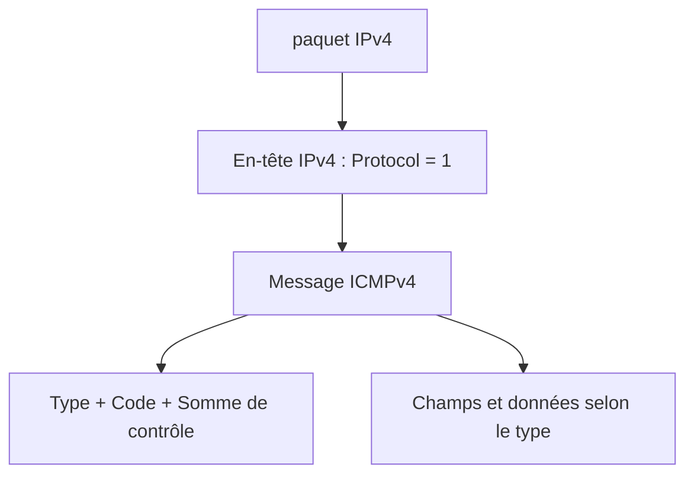
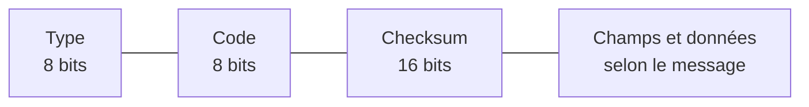
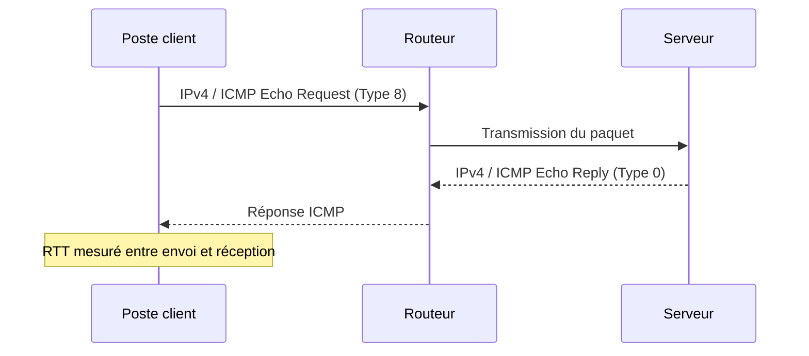
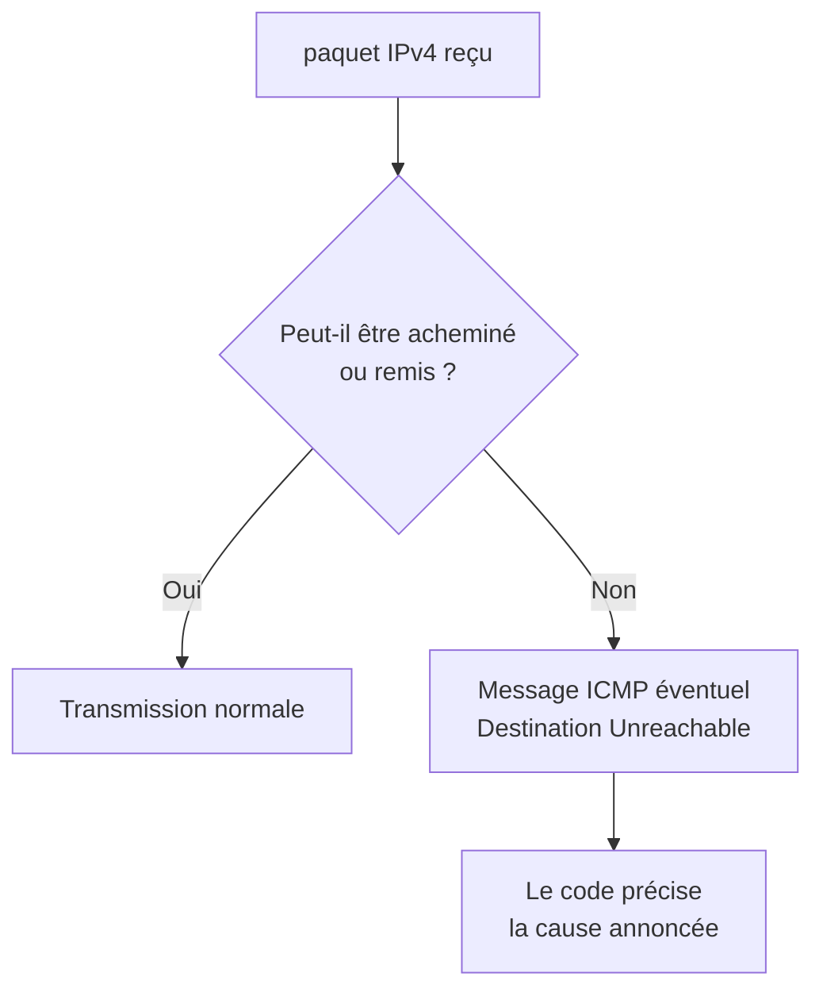
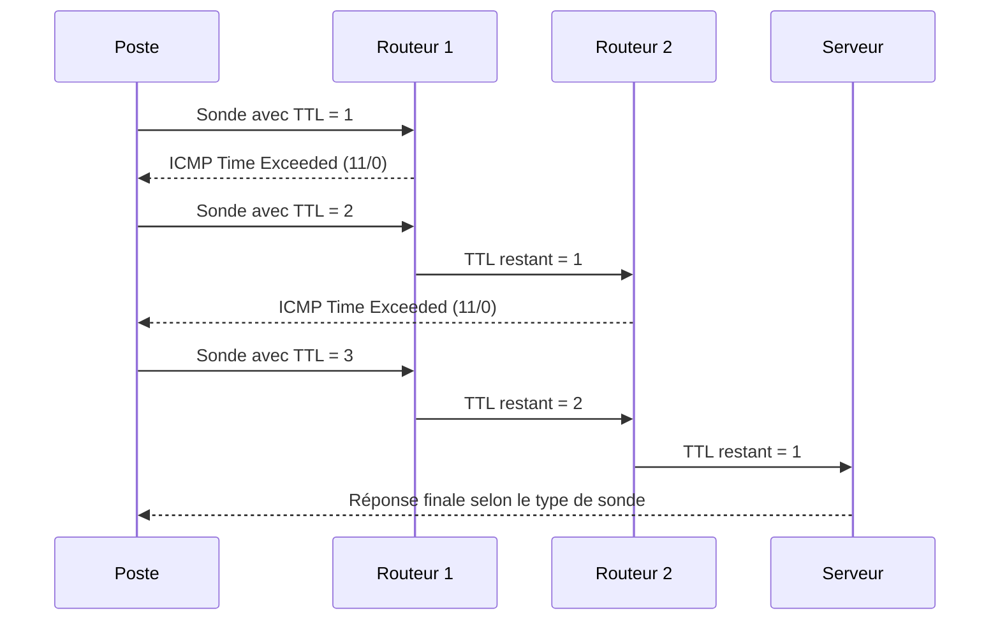
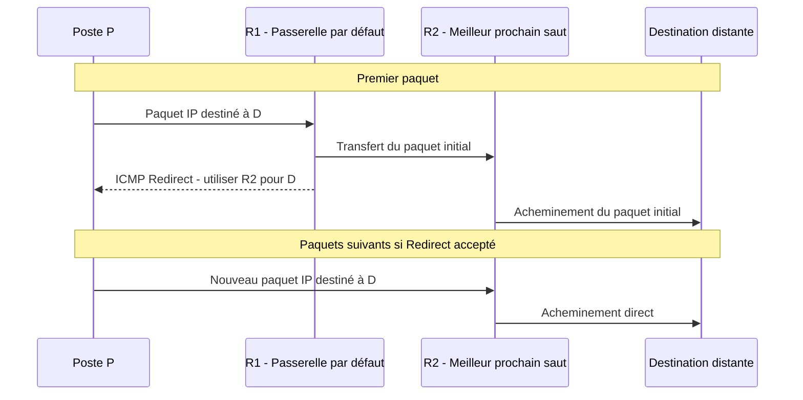
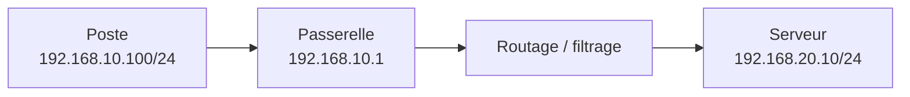

# ICMPv4 — Messages de contrôle et diagnostic du réseau IPv4

!!! abstract "Objectifs du cours"
    Comprendre le rôle du protocole **ICMP (Internet Control Message Protocol)** dans IPv4, interpréter ses principaux **types et codes**, expliquer le fonctionnement de `ping`, `traceroute`, des messages d'erreur et du diagnostic des problèmes d'acheminement.

    Ce cours porte **uniquement sur ICMPv4**. Les détournements malveillants du protocole sont étudiés dans le [référentiel de cybersécurité — couche 3](../../03-cybersecurit/couche3.md) 


!!! danger "ICMP ne se résume pas au PING !"

    La commande **`ping`** est l'utilisation la plus connue d'ICMP. Elle utilise les messages **Echo Request (type 8)** et **Echo Reply (type 0)** pour tester l'accessibilité d'une machine.

    Mais ICMP sert également à **signaler des erreurs et à fournir des informations sur l'acheminement des paquets IP**.

    Par exemple :
    
    - **Destination Unreachable** : une destination ne peut pas être atteinte.
    - **Time Exceeded** : un paquet a été supprimé parce que son TTL a atteint zéro.
    - **Redirect** : un routeur signale à un hôte l'existence d'un meilleur prochain saut.

    **Un ping qui échoue ne signifie donc pas nécessairement que la machine distante est inaccessible !** Elle peut fonctionner normalement tout en bloquant les requêtes ICMP Echo. C'est le cas par défaut avec Windows qui bloque les ping entrants.

    À l'inverse, **un ping réussi ne garantit pas qu'un service applicatif (HTTP, SSH, DNS...) fonctionne**.


## Socle obligatoire

### 1. Pourquoi ICMP existe-t-il ?

IPv4 permet d'acheminer des paquets entre réseaux, **sans garantir leur livraison**. Lorsqu'un routeur ne peut pas transmettre un paquet ou qu'une condition particulière se produit, il peut être utile de prévenir l'émetteur. C'est l'un des rôles d'**ICMPv4**.

ICMP sert principalement à :

- **signaler certaines erreurs** d'acheminement ou de traitement des paquets IPv4 ;
- **fournir des informations de contrôle** sur le fonctionnement du réseau ;
- **tester et diagnostiquer** le chemin avec des outils tels que `ping` et `traceroute`.

!!! warning "ICMP n'est ni TCP ni UDP"
    ICMPv4 est transporté **directement dans un paquet IPv4**, identifié par le champ **Protocol = 1**. Il n'utilise donc **aucun numéro de port TCP ou UDP**.



!!! note "Un protocole de signalement, pas un mécanisme de réparation"
    Un message ICMP peut informer l'émetteur d'un problème, mais **ne répare pas** une route, une interface ou un service. Certains équipements et pare-feu peuvent aussi filtrer ces messages : **l'absence de réponse ICMP ne prouve pas qu'un hôte est éteint**.

### 2. Format d'un message ICMPv4

Tout message ICMPv4 commence par des champs communs :

| Champ | Taille | Signification |
| --- | ---: | --- |
| **Type** | 8 bits | Famille du message : Echo, erreur de destination, délai dépassé… |
| **Code** | 8 bits | Précision à l'intérieur d'un type ; sa signification dépend du type |
| **Checksum** | 16 bits | Somme de contrôle permettant de détecter certaines altérations du message ICMP |
| **Suite du message** | Variable | Identifiant, numéro de séquence, informations d'erreur, données… |



!!! tip "Méthode de lecture"
    Il faut lire **le couple Type / Code** : le type indique la catégorie et le code précise la raison. Le code `3`, par exemple, n'a pas de signification autonome.

### 3. Les principaux messages à reconnaître

| Type | Code | Nom du message | Utilité |
| ---: | ---: | --- | --- |
| **8** | 0 | **Echo Request** | Demande de réponse, utilisée par `ping` |
| **0** | 0 | **Echo Reply** | Réponse à Echo Request |
| **3** | Variable | **Destination Unreachable** | Destination ou acheminement impossible ; plusieurs causes possibles |
| **11** | 0 | **Time Exceeded — TTL expired** | TTL arrivé à zéro pendant l'acheminement |
| **5** | Variable | **Redirect** | Information de meilleur prochain saut possible |
| **12** | Variable | **Parameter Problem** | Problème dans l'en-tête IPv4 |

!!! note "À mémoriser"
    **Echo (8/0)**, **Destination Unreachable (3)** et **Time Exceeded (11)** sont prioritaires. Les numéros et codes plus rares sont à **savoir retrouver et interpréter**, pas à réciter intégralement.

### 4. Echo Request et Echo Reply : le fonctionnement de `ping`

L'outil `ping` envoie généralement des messages **ICMP Echo Request (type 8, code 0)** et attend des **Echo Reply (type 0, code 0)**. L'échange permet de tester si la destination répond à ICMP et d'estimer le **temps aller-retour (RTT)**.



Un Echo Request et sa réponse comportent notamment un **identifiant**, un **numéro de séquence** et des données permettant d'associer les réponses aux requêtes.

=== "Windows"

    ```powershell
    ping 192.168.20.10
    ping -n 4 192.168.20.10
    ping -i 2 192.168.20.10
    ```

    `-n` fixe le nombre de requêtes ; `-i` permet de fixer la valeur TTL des requêtes.

=== "Linux"

    ```bash
    ping -c 4 192.168.20.10
    ping -t 2 -c 1 192.168.20.10
    ```

    `-c` fixe le nombre de requêtes ; `-t` fixe le TTL.

!!! warning "Ce que `ping` ne démontre pas"
    Un `ping` réussi **ne garantit pas** qu'un service web ou une application fonctionne. Un `ping` sans réponse **ne suffit pas** à prouver une panne : ICMP peut être bloqué ou limité.

### 5. Destination Unreachable — Type 3

Ce message indique qu'un paquet IPv4 n'a pas pu être acheminé ou remis dans certaines conditions. Son **code** explique la raison annoncée.

| Type / Code | Signification | Situation illustrative |
| --- | --- | --- |
| **3 / 0** | Network Unreachable | Réseau inaccessible selon l'équipement émetteur |
| **3 / 1** | Host Unreachable | Hôte inaccessible (ex. impossibilité de résoudre un voisin sur un lien local) |
| **3 / 2** | Protocol Unreachable | Protocole IPv4 demandé non pris en charge par la destination |
| **3 / 3** | Port Unreachable | Aucun service à l'écoute sur le port UDP visé, par exemple |
| **3 / 13** | Communication Administratively Prohibited | Communication interdite par une politique de filtrage |



!!! warning "Les codes sont des indications, pas une certitude absolue"
    Un routeur ou un pare-feu peut **ne pas envoyer** de message, en limiter le débit ou employer une politique de filtrage particulière. La formulation affichée par un outil dépend aussi de l'OS.

### 6. TTL et Time Exceeded — Type 11

Le champ **TTL (Time To Live)** appartient à **l'en-tête IPv4**, pas à ICMP. Chaque routeur qui transmet un paquet doit diminuer son TTL d'au moins 1. Lorsqu'il devient nul avant transmission, le paquet est détruit et le routeur émet normalement un **ICMP Time Exceeded, type 11 code 0**, sous réserve des règles d'émission ICMP.

Cette règle évite qu'un paquet circule indéfiniment en cas de boucle de routage.



!!! tip "À comprendre"
    Le **TTL est décrémenté par les routeurs**, et non par les switches Ethernet lors d'une commutation classique. Le nombre de routeurs traversés correspond au nombre de *sauts* (*hops*).

### 7. `traceroute` / `tracert` : découvrir les sauts

`traceroute` exploite des **sondes avec des TTL successifs** (1, 2, 3…) pour provoquer des réponses ICMP Time Exceeded des routeurs intermédiaires. La technique permet d'identifier une partie du chemin vers une destination.

!!! info "Des sondes différentes selon l'outil"
    - **Windows `tracert`** emploie traditionnellement des **Echo Request ICMP**.
    - Sous **Linux**, `traceroute` utilise souvent des **sondes UDP par défaut** ; l'option `-I` demande des sondes ICMP Echo et `-T` des sondes TCP lorsque l'outil le permet.
    - Avec des sondes UDP vers un port non ouvert, la destination peut répondre **ICMP Destination Unreachable, code 3 (Port Unreachable)**.

=== "Windows"

    ```powershell
    tracert 192.168.20.10
    tracert -d 192.168.20.10
    ```

    `-d` évite la résolution inverse DNS des adresses des routeurs, pour accélérer et simplifier l'affichage.

=== "Linux"

    ```bash
    traceroute -n 192.168.20.10
    traceroute -I -n 192.168.20.10
    ```

    `-n` désactive la résolution inverse des ip ; <br/>
    `-I` utilise ICMP Echo avec `traceroute`.

!!! warning "Un astérisque n'est pas une preuve de panne"
    Un saut peut ne pas répondre à ICMP ou limiter ses réponses, tout en **continuant à acheminer correctement les paquets**. 


!!! warning "Traceroute : attention au chemin retour !"

    Un `traceroute` lancé depuis un poste A vers un serveur B permet
    d'observer les routeurs traversés par les sondes **dans le sens A → B**.

    Il ne permet pas de connaître le chemin emprunté par les paquets
    dans le sens inverse **B → A**.

    En effet, les décisions de routage sont prises indépendamment
    dans chaque sens : on parle de **routage asymétrique** lorsque
    les chemins aller et retour sont différents.

    Pour étudier les deux sens, il faut réaliser deux mesures :

    **Depuis le poste A :**

    ```bash
    traceroute 192.168.20.10
    ```

    **Depuis le serveur B :**

    ```bash
    traceroute 192.168.10.10
    ```


### Autoévaluation — TTL et traceroute


<quiz>
Pourquoi une sonde avec un TTL = 1 ne franchit-elle normalement pas le premier routeur ?
- [ ] Le premier routeur bloque systématiquement les messages ICMP.
- [x] Le routeur décrémente le TTL à 0, abandonne le paquet initial et renvoie normalement un message ICMP Time Exceeded à l'émetteur.
- [ ] Le routeur transmet le paquet avec un TTL = 0.
- [ ] Le poste destinataire refuse les paquets dont le TTL est inférieur à 2.
> **Explication :** Le routeur décrémente le TTL de 1. Lorsqu'il atteint 0, il abandonne le paquet initial et génère normalement un message ICMP Time Exceeded (type 11, code 0). Ce message permet à traceroute d'identifier le routeur qui a arrêté le paquet.
</quiz>


<quiz>
Quel message ICMP est généralement renvoyé lorsqu'un paquet est détruit parce que son TTL atteint zéro ?
- [ ] Type 0, Code 0 — Echo Reply
- [ ] Type 3, Code 1 — Host Unreachable
- [x] Type 11, Code 0 — Time Exceeded
- [ ] Type 8, Code 0 — Echo Request
> **Explication :** Le message ICMP Type 11, Code 0 signale que le TTL a expiré pendant l'acheminement du paquet. C'est ce mécanisme qu'exploite traceroute pour découvrir les routeurs intermédiaires.
</quiz>

<quiz>
Dans un traceroute, un saut affiche `* * *`. Que peut-on en conclure ?
- [ ] Le routeur est nécessairement en panne.
- [ ] Le paquet ne peut plus atteindre sa destination.
- [ ] Le routeur suivant est inaccessible.
- [x] Aucune réponse n'a été reçue dans le délai prévu, mais le routeur peut continuer à acheminer les paquets.
> **Explication :** Un routeur peut filtrer ou limiter ses réponses ICMP tout en transmettant normalement les paquets. Il faut observer les sauts suivants avant de conclure à une interruption.
</quiz>

<quiz>
Un traceroute effectué depuis le poste A vers le serveur B permet-il de connaître le chemin retour ?
- [ ] Oui, les paquets empruntent obligatoirement les mêmes routeurs dans les deux sens.
- [x] Non, il faut également effectuer un traceroute depuis B vers A pour étudier le chemin inverse.
- [ ] Oui, mais uniquement si tous les routeurs répondent aux messages ICMP.
- [ ] Non, car traceroute ne fonctionne que dans un seul sens sur un réseau IP.
> **Explication :** Le routage peut être asymétrique. Chaque routeur prend ses décisions selon sa propre table de routage. Un second traceroute depuis B vers A permet d'observer le chemin emprunté par les sondes dans le sens inverse, sans garantir qu'il correspond exactement au chemin des réponses de la première mesure.
</quiz>


## Concepts avancés

### 8. ICMP Redirect — Type 5

Un **routeur IPv4** peut informer un poste qu'il existe un **meilleur prochain saut** pour atteindre une destination. Ce message ne modifie pas le paquet déjà transmis : il informe l'hôte, qui **peut** adapter ses décisions d'acheminement ultérieures selon son système et sa configuration.

**Exemple :** le poste P utilise R1 comme passerelle, mais R2 est un meilleur prochain saut pour le réseau destination. **P, R1 et R2 se trouvent sur le même segment IP local.** R1 achemine le paquet vers R2 sur **l'interface par laquelle le paquet est arrivé**, et peut envoyer un Redirect à P.



| Code | Signification historique |
| ---: | --- |
| **0** | Redirect for Network |
| **1** | Redirect for Host |
| **2** | Redirect for Type of Service and Network |
| **3** | Redirect for Type of Service and Host |

!!! warning "Un conseil de routage, pas un ordre universel"
    L'acceptation des Redirect est **dépendante du système**, de sa configuration et de contrôles de cohérence (passerelle actuelle, prochain saut sur le lien local, etc.). Certains systèmes les ignorent. Un Redirect n'implique pas nécessairement une modification visible de la route par défaut.

!!! note "À distinguer"
    Un Redirect est un **message envoyé par un routeur à un hôte**. Il ne remplace pas un protocole de routage dynamique entre routeurs.

    Les risques de faux Redirect sont étudiés dans la [fiche cybersécurité couche 3](../cyber/couche3.md#icmp-redirect).

### 9. Lire et analyser les messages ICMP dans Wireshark

Dans Wireshark, le filtre d'affichage suivant permet d'isoler ICMPv4 :

```text
icmp
```

Filtres plus ciblés :

```text
icmp.type == 8
icmp.type == 0
icmp.type == 3
icmp.type == 11
icmp.type == 5
```

!!! tip "Méthode de diagnostic"
    Pour interpréter une capture :

    1. Identifier **l'adresse IP source** et **la destination** du message ICMP.
    2. Lire **Type et Code**, puis leur signification.
    3. Examiner, pour les messages d'erreur, **l'en-tête et les premiers octets du paquet incriminé** inclus dans la réponse (la quantité disponible peut varier).
    4. Relier cette information à la **topologie**, aux **routes**, aux **ACL** et au **contexte du test**.

## Expertise — Diagnostiquer un incident d'acheminement

### 11. Étude de cas : « Le serveur ne répond pas »

Un poste `192.168.10.100/24` utilise `192.168.10.1` comme passerelle. Il doit atteindre un serveur `192.168.20.10/24`.

Le technicien dispose de plusieurs observations possibles :

- `ping` vers la passerelle : réponse reçue ;
- `ping` vers le serveur : aucune réponse ;
- `traceroute` : premier saut visible, puis astérisques ;
- un essai TCP vers le service attendu : résultat à vérifier ;
- des règles de filtrage existent entre les deux réseaux.




### Autoévaluation — Diagnostic ICMP et routage

<quiz>
Une passerelle répond au ping depuis un poste. Peut-on en conclure que le réseau distant est accessible ?
- [ ] Oui, car la passerelle garantit l'accès à tous les réseaux.
- [x] Non, cela prouve seulement que la passerelle répond aux requêtes ICMP Echo dans les conditions du test.
- [ ] Oui, si le poste possède une passerelle par défaut.
- [ ] Non, car un routeur ne peut pas répondre au ping.
> **Explication :** Une réponse ICMP Echo Reply confirme que la passerelle est joignable pour ce test. Elle ne garantit ni la présence d'une route vers le réseau distant, ni le bon fonctionnement du chemin retour, ni l'absence de filtrage.
</quiz>

<quiz>
Un traceroute affiche `* * *` au deuxième saut, mais les sauts suivants répondent. Que peut-on conclure ?
- [ ] Le deuxième routeur est nécessairement en panne.
- [ ] Le deuxième routeur bloque tous les paquets.
- [x] Le routeur peut continuer à acheminer les paquets sans répondre aux sondes de traceroute.
- [ ] Le réseau distant est forcément inaccessible.
> **Explication :** Un routeur peut filtrer ou limiter l'émission de messages ICMP Time Exceeded tout en assurant normalement le transit des paquets. La présence de réponses aux sauts suivants confirme que les sondes poursuivent leur chemin.
</quiz>

<quiz>
Un poste atteint sa passerelle, mais pas un serveur distant. Quelles vérifications sont pertinentes ? (Plusieurs réponses possibles)
- [x] Examiner les tables de routage et les chemins aller et retour.
- [x] Vérifier les ACL et les journaux des pare-feu.
- [x] Tester directement le service applicatif concerné.
- [x] Rechercher des messages ICMP Destination Unreachable et examiner les captures réseau.
- [ ] Conclure immédiatement que le serveur distant est en panne.
> **Explication :** Le diagnostic doit progresser par hypothèses : routage, filtrage, disponibilité du service et analyse des messages réseau. Selon les observations, on pourra également contrôler ARP et l'état du serveur.
</quiz>

<quiz>
Pourquoi ne faut-il pas simplement autoriser tous les messages ICMP sur un pare-feu ?
- [ ] Parce qu'ICMP est systématiquement un protocole malveillant.
- [ ] Parce qu'ICMP est uniquement utilisé par la commande ping.
- [x] Parce qu'il faut autoriser les messages utiles au fonctionnement et au diagnostic tout en limitant les usages abusifs.
- [ ] Parce qu'aucun message ICMP n'est nécessaire au fonctionnement d'un réseau IPv4.
> **Explication :** Certains messages ICMP sont indispensables ou utiles au diagnostic, notamment Time Exceeded et Destination Unreachable. D'autres usages peuvent être détournés pour perturber ou reconnaître un réseau. Une politique de filtrage doit tenir compte des besoins réels et des risques.
</quiz>


## Synthèse — Ce qu'il faut savoir faire

- Expliquer pourquoi ICMPv4 est associé à IPv4 et pourquoi il n'utilise pas de ports.
- Associer **Echo Request / Echo Reply** à `ping`.
- Distinguer **Destination Unreachable** et **Time Exceeded** et interpréter leurs principaux codes.
- Expliquer le **TTL** et les sondes successives de `traceroute`.
- Décrire les conditions d'émission d'un **ICMP Redirect**.
- Utiliser les outils de diagnostic sans confondre **absence de réponse ICMP** et **absence de connectivité**.

!!! warning "Ouverture cybersécurité"
    ICMP peut aussi être utilisé ou falsifié dans des scénarios de saturation, de réflexion et de détournement du trafic. Les attaques et contre-mesures sont étudiées dans la [fiche dédiée à la couche 3](../../03-cybersecurite/couche3.md).

## Références

- [RFC 792 — Internet Control Message Protocol](https://www.rfc-editor.org/rfc/rfc792)
- [RFC 1812 — Requirements for IP Version 4 Routers](https://www.rfc-editor.org/rfc/rfc1812)
- [RFC 1122 — Requirements for Internet Hosts](https://www.rfc-editor.org/rfc/rfc1122)
- [RFC 6633 — Deprecation of ICMP Source Quench](https://www.rfc-editor.org/rfc/rfc6633)
- [IANA — ICMP Parameters](https://www.iana.org/assignments/icmp-parameters/icmp-parameters.xhtml)
