# 11 — Docker : déployer et exploiter des applications conteneurisées

## Introduction

Dans le contexte SportLudique, les services web sont déployés sur un serveur Debian 13. Le frontal HTTPS existant termine TLS et transmet les requêtes HTTP aux services internes. Les conteneurs applicatifs ne gèrent donc ni les certificats ni HTTPS.

| Niveau | Objectif | Durée indicative |
|---|---|---|
| 🟢 Socle | Consommer des images du registry | 4 h |
| 🟠 Avancé | Intégrer des conteneurs, réseaux et volumes | +4 h |
| 🔴 Expert | Construire des images et sécuriser une stack | +4 h ou davantage |

## 🟢 Socle — Consommer des images

### 1. Virtualisation et conteneurisation

Une machine virtuelle possède son propre noyau. Un conteneur Linux partage le noyau de son hôte, tout en disposant d'espaces de noms isolant notamment ses processus, son réseau et ses montages. Les cgroups permettent de contrôler ses ressources.

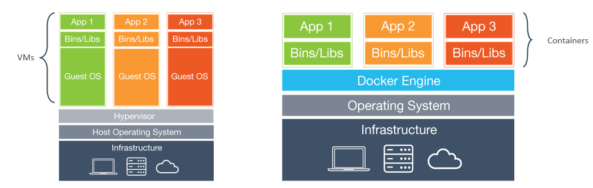

| Machine virtuelle | Conteneur |
|---|---|
| Noyau propre | Noyau partagé |
| Système invité complet | Application et dépendances |
| Hyperviseur | Moteur de conteneurs |

### 2. Architecture Docker

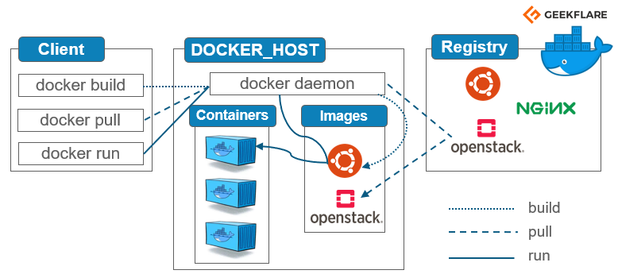

- **Image** : modèle constitué de couches en lecture seule.
- **Conteneur** : instance d'une image, avec une couche d'écriture propre.
- **Registry** : dépôt d'images, par exemple Docker Hub.
- **Daemon** : service `dockerd` qui gère les objets Docker.
- **Client** : commande `docker` qui communique avec le daemon via son API.

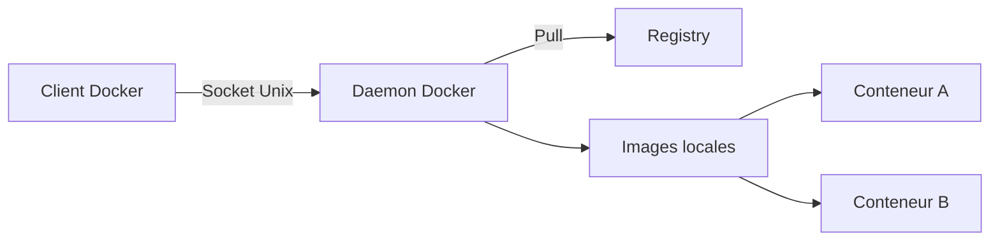

### 3. Installation sur Debian 13

Sur une VM Debian 13 dédiée, suivre la [documentation officielle : installation de Docker Engine sur Debian](https://docs.docker.com/engine/install/debian/), section **Install using the apt repository**. Installer également les plugins Buildx et Compose indiqués dans cette procédure.

Vérifier l'installation :

```bash
sudo systemctl status docker
sudo docker version
sudo docker compose version
sudo docker run --rm hello-world
```

### 4. Images et cycle de vie

Rechercher une image officielle sur [Docker Hub](https://hub.docker.com/), consulter ses tags et sa documentation. Dans `nginx:stable-alpine`, `nginx` est le dépôt et `stable-alpine` le tag. Un tag peut évoluer ; un digest identifie précisément un contenu. `docker pull` télécharge une image, `docker run` crée un conteneur (et télécharge l'image si nécessaire).

```bash
sudo docker pull nginx:stable-alpine
sudo docker image ls
sudo docker run -d --name web nginx:stable-alpine
sudo docker ps
sudo docker logs web
sudo docker exec -it web sh
```

Dans le conteneur :

```sh
hostname
ls /usr/share/nginx/html
exit
```

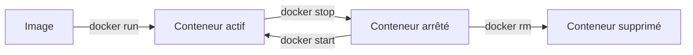

```bash
sudo docker stop web
sudo docker ps -a
sudo docker start web
sudo docker stop web
sudo docker rm web
```

!!! note
    `docker run` crée un nouveau conteneur. `docker start` redémarre un conteneur existant. Arrêter un conteneur ne supprime pas sa couche d'écriture.

### 5. Publication des ports

```bash
sudo docker run -d --name web1 -p 8080:80 nginx:stable-alpine
sudo docker run -d --name web2 -p 8081:80 nginx:stable-alpine
curl http://localhost:8080
curl http://localhost:8081
sudo docker ps
```

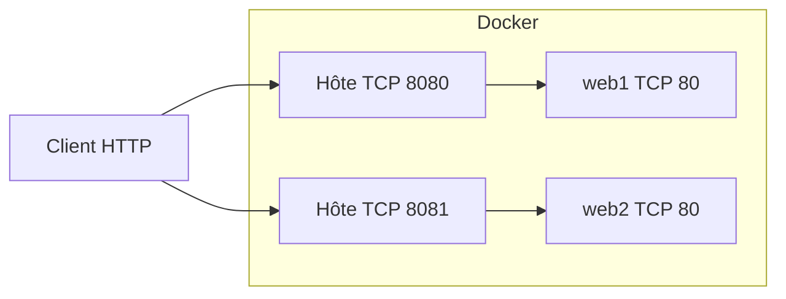

`-p 8080:80` signifie **port hôte:port conteneur**. Deux conteneurs peuvent écouter sur le même port interne, mais ne peuvent pas publier simultanément le même port sur la même adresse hôte.

!!! warning
    Sans adresse explicite, Docker publie généralement sur toutes les interfaces de l'hôte. `-p 127.0.0.1:8080:80` limite l'accès à l'hôte local. `EXPOSE` dans un Dockerfile ne publie aucun port.

**Manipulation :** tester depuis un autre poste avec l'adresse IP du serveur. Expliquer pourquoi `localhost` ne désigne pas le serveur depuis ce poste.

### 6. Un conteneur est remplaçable

```bash
sudo docker exec web1 sh -c 'echo test > /tmp/temoin'
sudo docker stop web1
sudo docker start web1
sudo docker exec web1 cat /tmp/temoin
sudo docker rm -f web1
sudo docker run -d --name web1 -p 8080:80 nginx:stable-alpine
sudo docker exec web1 cat /tmp/temoin
```

Le dernier test échoue : le fichier appartenait au conteneur supprimé.

Les solutions de persistance seront étudiées au niveau Avancé.

### 7. Docker Compose : déploiement déclaratif

```bash
sudo docker rm -f web1 web2
mkdir -p ~/docker/socle
cd ~/docker/socle
```

Créer `compose.yaml` :

```yaml
services:
  web:
    image: nginx:stable-alpine
    ports:
      - "8080:80"
    restart: unless-stopped
```

!!! note "compose.yaml ou docker-compose.yml ?"
    Historiquement, le fichier de configuration de Docker Compose était nommé `docker-compose.yml`.

    Aujourd'hui, Docker recommande l'utilisation du nom `compose.yaml`. Les anciens noms restent néanmoins compatibles.

    De même, la commande `docker-compose` a été remplacée par `docker compose`, désormais intégrée à la CLI Docker.

    Vous rencontrerez encore fréquemment ces anciennes conventions dans les documentations et les dépôts GitHub.

    Dans ce support, nous utiliserons la syntaxe actuelle : `compose.yaml` et `docker compose`.


```bash
sudo docker compose config
sudo docker compose up -d
sudo docker compose ps
sudo docker compose logs web
sudo docker compose down
sudo docker compose up -d
```

Compose décrit les services dans un fichier YAML. `up -d` crée et démarre les services ; `down` supprime les conteneurs et le réseau du projet. Les réseaux et volumes seront approfondis au niveau Avancé.

!!! note "Le mode détaché (-d)"
    L'option `-d` (pour *detached mode*) permet de démarrer les conteneurs en arrière-plan et de récupérer immédiatement la main sur le terminal.

    Sans cette option, les journaux d'exécution (logs) s'affichent directement dans le terminal.

    Pour consulter les journaux d'un service démarré en arrière-plan, utilisez `sudo docker compose logs`.

    L'option `-f` (*follow*) permet de suivre ces journaux en temps réel : `sudo docker compose logs -f`.

    Le mode détaché est généralement privilégié pour les services destinés à fonctionner en permanence.

### Validation Socle

Déployer deux serveurs web issus du registry, sur les ports 8080 et 8081, avec un seul fichier Compose. Identifier leurs images, vérifier les réponses HTTP et consulter les journaux. Fournir le fichier Compose et les résultats des tests. Aucun Dockerfile ni volume demandé.

<quiz>
**Que signifie `8080:80` ?**

- [x] Le port 8080 de l'hôte est associé au port 80 du conteneur.
- [ ] Le conteneur écoute obligatoirement sur 8080.
- [ ] Le port 80 de l'hôte est publié.
</quiz>

<quiz>
**Quelle opération supprime la couche d'écriture d'un conteneur ?**

- [ ] docker stop
- [x] docker rm
- [ ] docker logs
</quiz>

## 🟠 Avancé — Intégrer des conteneurs

### 8. Accès au daemon sans sudo

```bash
sudo usermod -aG docker "$USER"
```

Se déconnecter puis se reconnecter. Vérifier avec `id` et `docker ps`.

!!! danger "Groupe docker"
    L'accès au socket du daemon rootful confère des privilèges équivalents à root. Cette manipulation est réservée aux comptes administrateurs autorisés sur les VM de TP.

Les commandes suivantes sont exécutées sans sudo après cette configuration.

### 9. Persistance des données

Arrêter le projet Socle avant de réutiliser ses ports :

```bash
cd ~/docker/socle
docker compose down
```

#### 9.1 Bind mount

```bash
sudo mkdir -p /srv/sportludique/www
sudo sh -c 'echo "Bienvenue chez SportLudique" > /srv/sportludique/www/index.html'
docker run -d --name web -p 8080:80 \
  -v /srv/sportludique/www:/usr/share/nginx/html:ro nginx:stable-alpine
curl http://localhost:8080
```

Modifier le fichier sur l'hôte, puis actualiser la page. Supprimer et recréer le conteneur avec le même montage : le contenu reste disponible.

#### 9.2 Volume nommé

```bash
docker volume create donnees
docker run --rm -v donnees:/data alpine:3 sh -c 'echo persistant > /data/test.txt'
docker run --rm -v donnees:/data alpine:3 cat /data/test.txt
docker volume inspect donnees
```

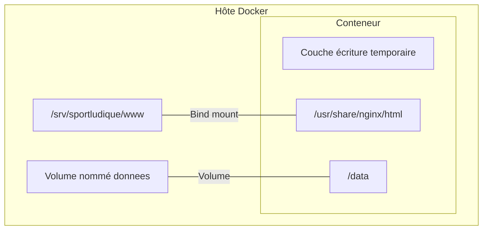

| Type | Usage |
|---|---|
| Bind mount | Configuration, contenu web accessible depuis l'hôte |
| Volume nommé | Données applicatives gérées par Docker |
| Couche d'écriture | Fichiers temporaires du conteneur |

!!! warning
    Un volume n'est pas une sauvegarde. Sa suppression entraîne la perte de ses données. Le suffixe `:ro` interdit l'écriture via le montage concerné.

Nettoyer le conteneur de test avant de poursuivre (les fichiers et le volume restent disponibles) :

```bash
docker rm -f web
```

### 10. Réseaux Docker et DNS interne

```bash
docker network ls
docker network create sport-net
docker run -d --name serveur --network sport-net nginx:stable-alpine
docker network inspect sport-net
docker run --rm --network sport-net alpine:3 wget -qO- http://serveur
```

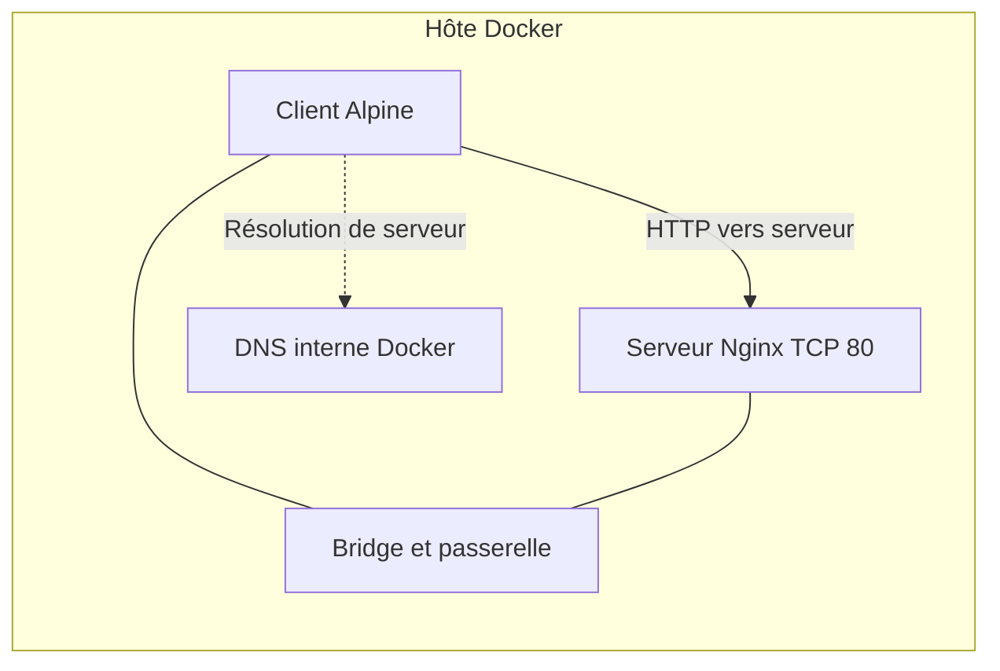

Sur un bridge créé par l'utilisateur, Docker fournit une résolution DNS par nom. Le bridge par défaut `bridge` ne fournit pas cette résolution automatique par nom de conteneur.

```bash
docker run --rm --network sport-net alpine:3 nslookup serveur
docker run --rm alpine:3 wget -T 3 -qO- http://serveur
```

Le second test doit échouer : le client ne partage pas le réseau `sport-net`. Aucun port du serveur n'a été publié sur l'hôte.

```bash
docker rm -f serveur
docker network rm sport-net
```

### 11. Stack WordPress et MariaDB

```bash
mkdir -p ~/docker/avance
cd ~/docker/avance
umask 077
```

Créer `.env` avec deux mots de passe distincts, robustes et propres au groupe :

```dotenv
DB_PASSWORD=REMPLACER_PAR_UN_SECRET
DB_ROOT_PASSWORD=REMPLACER_PAR_UN_AUTRE_SECRET
```

Créer `compose.yaml` :

```yaml
services:
  wordpress:
    image: wordpress:6-php8.3-apache
    ports:
      - "8080:80"
    environment:
      WORDPRESS_DB_HOST: db:3306
      WORDPRESS_DB_NAME: sportludique
      WORDPRESS_DB_USER: sport
      WORDPRESS_DB_PASSWORD: ${DB_PASSWORD:?Mot de passe requis}
    volumes:
      - wordpress_data:/var/www/html
    depends_on:
      db:
        condition: service_healthy
    restart: unless-stopped
  db:
    image: mariadb:11.4
    environment:
      MARIADB_DATABASE: sportludique
      MARIADB_USER: sport
      MARIADB_PASSWORD: ${DB_PASSWORD:?Mot de passe requis}
      MARIADB_ROOT_PASSWORD: ${DB_ROOT_PASSWORD:?Mot de passe requis}
    volumes:
      - db_data:/var/lib/mysql
    healthcheck:
      test: ["CMD", "healthcheck.sh", "--connect", "--innodb_initialized"]
      interval: 10s
      timeout: 5s
      retries: 10
    restart: unless-stopped
volumes:
  wordpress_data:
  db_data:
```

```bash
docker compose up -d
docker compose ps
docker compose logs db
docker compose exec wordpress getent hosts db
docker compose exec wordpress php -r '$s=fsockopen("db",3306); echo "Connexion TCP OK\n"; fclose($s);'
```

`docker compose down` conserve les volumes nommés ; `docker compose down -v` supprime aussi les volumes du projet hors volumes externes.

Le service `db` est joignable par son nom DNS sur le réseau du projet. Il ne possède aucune section `ports`. `depends_on` associé au healthcheck attend que la base soit déclarée saine avant de démarrer WordPress.

!!! warning
    Ne pas versionner `.env`. Les variables d'environnement restent accessibles aux administrateurs Docker. Un fichier `.env` n'est pas un coffre-fort de secrets.

### 12. Intégration au frontal HTTPS existant

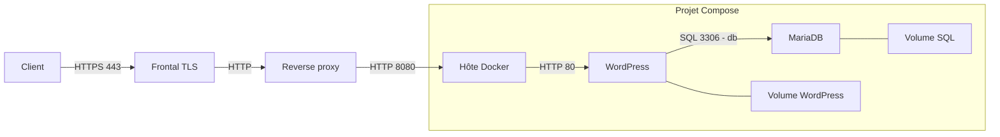

Configurer le frontal existant pour transmettre les requêtes au port 8080 du serveur Docker. Conserver le nom d'hôte et transmettre le protocole original (`X-Forwarded-Proto: https`). Si le frontal et le reverse proxy sont distincts, préserver cette information entre les deux équipements et ne faire confiance qu'aux en-têtes du frontal autorisé.

Exemple de bloc Nginx sur le frontal qui termine TLS, dans un serveur HTTPS déjà configuré, si ce frontal assure également le rôle de reverse proxy. Si les deux équipements sont distincts, le frontal transmet au reverse proxy, qui transmet ensuite au serveur Docker :

```nginx
location / {
    proxy_pass http://IP_SERVEUR_DOCKER:8080;
    proxy_set_header Host $host;
    proxy_set_header X-Forwarded-Proto $scheme;
    proxy_set_header X-Forwarded-For $proxy_add_x_forwarded_for;
}
```

Remplacer l'adresse par celle du serveur. Vérifier que WordPress reconnaît HTTPS derrière le proxy et que son URL publique utilise HTTPS. Restreindre l'accès au port 8080 au frontal autorisé, via le filtrage réseau adapté à Docker ; ne pas supposer qu'une simple règle UFW suffit.

**Tests :** accéder au site par son FQDN HTTPS, vérifier le certificat côté frontal, créer un article, recréer la stack avec `down` puis `up -d`, vérifier que l'article est conservé.

### 13. Administration avec Portainer

Portainer utilise l'API Docker pour administrer les images, conteneurs, réseaux, volumes et stacks.

```bash
docker volume create portainer_data
docker run -d --name portainer --restart=unless-stopped \
  -p 9443:9443 \
  -v /var/run/docker.sock:/var/run/docker.sock \
  -v portainer_data:/data portainer/portainer-ce:lts
```

Accéder à `https://IP_SERVEUR_DOCKER:9443` depuis le réseau d'administration et créer immédiatement le compte administrateur. Le HTTPS de cette interface d'administration est distinct du HTTPS des applications, géré par le frontal.

!!! danger
    Portainer dispose d'un accès privilégié au daemon via son socket. Ne jamais publier cette interface sur Internet. Restreindre son accès au réseau d'administration.

| Action Portainer | Équivalent CLI |
|---|---|
| Containers | docker ps -a |
| Images | docker image ls |
| Networks | docker network ls |
| Volumes | docker volume ls |
| Logs | docker logs NOM |
| Stacks | docker compose |

**Manipulation :** retrouver les objets WordPress, consulter les logs et déployer une stack de test distincte depuis Portainer avec un port libre. Ne pas redéployer le projet WordPress existant sous un autre nom.

### Validation Avancé

Fournir le schéma logique, le fichier Compose sans secrets, les tests DNS et TCP internes, la preuve de persistance et l'accès HTTPS via le frontal. Expliquer pourquoi MariaDB n'a pas besoin d'un port publié.

<quiz>
**Comment WordPress joint-il MariaDB dans le projet Compose ?**

- [x] Par le nom de service db et le port 3306.
- [ ] Par localhost:3306.
- [ ] Uniquement par un port publié sur l'hôte.
</quiz>

<quiz>
**Le groupe docker permet-il une utilisation réellement non privilégiée ?**

- [ ] Oui.
- [x] Non, le socket rootful donne un contrôle privilégié sur l'hôte.
</quiz>

## 🔴 Expert — Construire et sécuriser des images

### 14. Construire une image personnalisée

Modernisation de l'ancienne stack LAMP du support. L'illustration historique présente le principe de séparation des fichiers ; l'arborescence suivante est celle à utiliser pour ce TP.

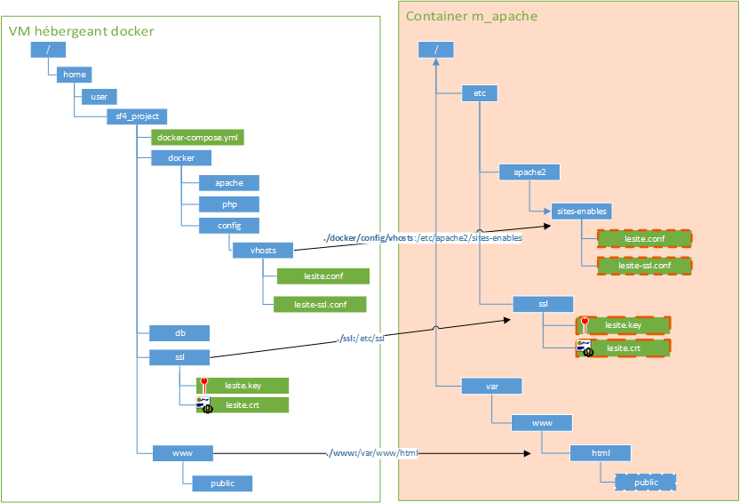

```text
expert/
├── compose.yaml
├── .env
├── .gitignore
├── docker/
│   ├── nginx/default.conf
│   └── php/
│       ├── Dockerfile
│       └── .dockerignore
└── www/index.php
```

Créer les répertoires :

```bash
mkdir -p ~/docker/expert/{docker/nginx,docker/php,www}
cd ~/docker/expert
```

`docker/php/Dockerfile` :

```dockerfile
FROM php:8.4-fpm-alpine
RUN docker-php-ext-install pdo_mysql
WORKDIR /var/www/html
EXPOSE 9000
```

`docker/php/.dockerignore` :

```text
.git
.env
```

| Instruction | Rôle |
|---|---|
| FROM | Image de base |
| RUN | Commande exécutée pendant la construction |
| COPY | Copie de fichiers du contexte vers l'image |
| WORKDIR | Répertoire de travail |
| USER | Utilisateur d'exécution |
| CMD | Commande ou arguments par défaut |
| ENTRYPOINT | Point d'entrée du conteneur |
| EXPOSE | Documentation du port interne |

```bash
docker build -t sportludique/php:1.0 docker/php
docker image history sportludique/php:1.0
docker run --rm sportludique/php:1.0 php -m
```

Relancer la construction et observer le cache. L'image hérite du point d'entrée et de la commande PHP-FPM de l'image officielle.

#### Publier une image dans un registry (option Expert)

Avec un compte Docker Hub et un dépôt autorisé, remplacer `MON_COMPTE` par son identifiant :

```bash
docker login
docker tag sportludique/php:1.0 MON_COMPTE/sportludique-php:1.0
docker push MON_COMPTE/sportludique-php:1.0
docker pull MON_COMPTE/sportludique-php:1.0
docker logout
```

Ne jamais intégrer de secret dans une image. Utiliser un dépôt privé si le contenu ne doit pas être public.

### 15. Cloisonner une architecture Nginx / PHP-FPM / MariaDB

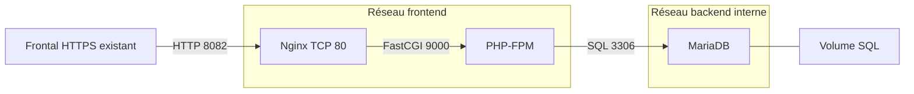

`docker/nginx/default.conf` :

```nginx
server {
    listen 80;
    root /var/www/html;
    index index.php;
    location / {
        try_files $uri $uri/ =404;
    }
    location ~ \.php$ {
        try_files $uri =404;
        include fastcgi_params;
        fastcgi_param SCRIPT_FILENAME $document_root$fastcgi_script_name;
        fastcgi_pass php:9000;
    }
}
```

`www/index.php` :

```php
<?php
try {
    $pdo = new PDO('mysql:host=db;dbname=sportludique;charset=utf8mb4',
        'sport', getenv('DB_PASSWORD'));
    echo 'SportLudique : connexion SQL OK';
} catch (PDOException $e) {
    http_response_code(503);
    echo 'Base indisponible';
}
```

Créer `.env` comme au niveau Avancé, avec de nouveaux secrets, et `.gitignore` contenant `.env`.

`compose.yaml` :

```yaml
services:
  web:
    image: nginx:stable-alpine
    ports:
      - "8082:80"
    volumes:
      - ./www:/var/www/html:ro
      - ./docker/nginx/default.conf:/etc/nginx/conf.d/default.conf:ro
    networks: [frontend]
    depends_on: [php]
    restart: unless-stopped
  php:
    build: ./docker/php
    image: sportludique/php:1.0
    environment:
      DB_PASSWORD: ${DB_PASSWORD:?Mot de passe requis}
    volumes:
      - ./www:/var/www/html:ro
    networks: [frontend, backend]
    depends_on:
      db:
        condition: service_healthy
    restart: unless-stopped
  db:
    image: mariadb:11.4
    environment:
      MARIADB_DATABASE: sportludique
      MARIADB_USER: sport
      MARIADB_PASSWORD: ${DB_PASSWORD:?Mot de passe requis}
      MARIADB_ROOT_PASSWORD: ${DB_ROOT_PASSWORD:?Mot de passe requis}
    volumes:
      - db_data:/var/lib/mysql
    networks: [backend]
    healthcheck:
      test: ["CMD", "healthcheck.sh", "--connect", "--innodb_initialized"]
      interval: 10s
      timeout: 5s
      retries: 10
    restart: unless-stopped
networks:
  frontend:
  backend:
    internal: true
volumes:
  db_data:
```

```bash
docker compose up -d --build
curl http://localhost:8082
docker compose exec php getent hosts db
docker compose exec web nslookup db
docker network ls
```

Le test DNS depuis Nginx doit échouer. PHP appartient aux deux réseaux ; Nginx et MariaDB ne partagent aucun réseau. Le réseau backend interne ne fournit pas d'accès externe direct à la base.

### 16. Réduire les privilèges et les ressources

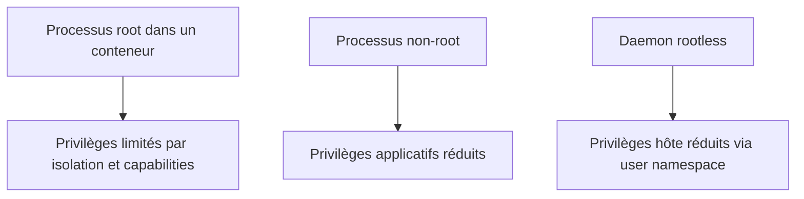

Tester un conteneur non-root indépendant :

```bash
docker run --rm --user 1000:1000 --read-only \
  --cap-drop ALL --security-opt no-new-privileges:true \
  --memory 128m --cpus 0.5 alpine:3 id
```

```bash
docker run --rm --user 1000:1000 --read-only alpine:3 touch /test
```

Le second test doit échouer. Dans Compose, on peut appliquer à un service compatible :

```yaml
    user: "1000:1000"
    read_only: true
    cap_drop: [ALL]
    security_opt:
      - no-new-privileges:true
    mem_limit: 128m
    cpus: 0.5
```

!!! warning
    Ne pas appliquer aveuglément ces options à MariaDB, Nginx ou PHP-FPM : vérifier les UID/GID, répertoires inscriptibles, ports et capabilities nécessaires. Tester une mesure à la fois. Un processus non-root ne signifie pas que le daemon est rootless.

### 17. Docker rootless

Utiliser une **VM dédiée** et un compte ordinaire distinct, sans appartenance au groupe docker. Ne pas effectuer la migration sur un serveur partagé ou en production.

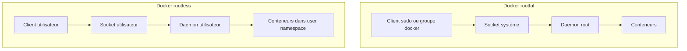

Depuis le compte administrateur :

```bash
sudo apt install -y uidmap dbus-user-session docker-ce-rootless-extras
sudo systemctl disable --now docker.service docker.socket
```

Vérifier que le compte rootless dispose d'au moins 65536 UID et GID subordonnés dans `/etc/subuid` et `/etc/subgid`. Debian les attribue généralement à la création d'un compte ordinaire ; sinon demander à l'administrateur d'attribuer des plages libres, sans chevauchement.

Ouvrir une véritable session SSH avec le compte rootless (pas `su` depuis root) :

```bash
grep "^$(id -un):" /etc/subuid /etc/subgid
dockerd-rootless-setuptool.sh install
systemctl --user enable --now docker
docker context ls
docker context use rootless
docker info
```

Depuis un compte administrateur, autoriser le démarrage hors session si nécessaire : `sudo loginctl enable-linger NOM_UTILISATEUR`.

Depuis le compte rootless :

```bash
docker run -d --name web -p 8080:80 nginx:stable-alpine
curl http://localhost:8080
ps -eo user,pid,args | grep '[d]ockerd'
docker info --format '{{json .SecurityOptions}}'
```

Vérifier la présence de `rootless` dans les options de sécurité et le propriétaire du daemon. Les images, volumes et conteneurs rootful ne sont pas automatiquement transférés vers le daemon rootless.

!!! note
    Le socket rootless se trouve généralement dans `$XDG_RUNTIME_DIR/docker.sock`. Les ports inférieurs à 1024 nécessitent une configuration supplémentaire ; le frontal HTTPS évite ici ce besoin. Les limites de ressources nécessitent notamment cgroup v2 et une délégation systemd adaptée.

Reproduire la stack Expert depuis un répertoire appartenant au compte rootless. Vérifier les droits des bind mounts. Portainer rootful n'administre pas automatiquement ce nouveau daemon.

Documentation : [Docker rootless](https://docs.docker.com/engine/security/rootless/).

### 18. Exploitation : sauvegarde, restauration et mise à jour

Depuis le répertoire du projet Expert actif, créer une donnée témoin dans MariaDB :

```bash
docker compose exec db sh -c 'mariadb -u root -p"$MARIADB_ROOT_PASSWORD" sportludique -e "CREATE TABLE IF NOT EXISTS temoin (id INT PRIMARY KEY); INSERT IGNORE INTO temoin VALUES (1);"'
```

Sauvegarder logiquement la base :

```bash
mkdir -p sauvegardes
chmod 700 sauvegardes
umask 077
docker compose exec -T db sh -c 'mariadb-dump -u root -p"$MARIADB_ROOT_PASSWORD" --single-transaction sportludique' > sauvegardes/sportludique.sql
test -s sauvegardes/sportludique.sql
```

Restaurer dans une base de test distincte sur la VM de TP :

```bash
docker compose exec db sh -c 'mariadb -u root -p"$MARIADB_ROOT_PASSWORD" -e "CREATE DATABASE restauration_test;"'
docker compose exec -T db sh -c 'mariadb -u root -p"$MARIADB_ROOT_PASSWORD" restauration_test' < sauvegardes/sportludique.sql
docker compose exec db sh -c 'mariadb -u root -p"$MARIADB_ROOT_PASSWORD" restauration_test -e "SELECT * FROM temoin;"'
```

Sauvegarder également `compose.yaml`, les Dockerfiles, les configurations, les fichiers web et les secrets dans un emplacement protégé hors de la VM. Pour WordPress, prévoir en plus une sauvegarde cohérente de son volume applicatif.

```bash
docker compose pull web db
docker compose build --pull php
docker compose up -d
docker compose ps
docker compose logs --tail=50
curl http://localhost:8082
```

Les tags utilisés dans le TP sont évolutifs. En production, valider les versions et les digests, analyser les vulnérabilités, sauvegarder avant mise à jour et prévoir un retour arrière compatible avec les données.

### Validation Expert

Présenter une stack fonctionnelle avec image PHP personnalisée, deux réseaux, base non publiée, frontal HTTPS externe et persistance. Démontrer l'isolation réseau, la restauration SQL et le fonctionnement rootless. Justifier les mesures de sécurité retenues et leurs limites.

<quiz>
**Quelle différence caractérise Docker rootless ?**

- [ ] Seul le client Docker est non-root.
- [x] Le daemon et les conteneurs fonctionnent dans un contexte utilisateur non privilégié sur l'hôte.
- [ ] Le groupe docker remplace le daemon.
</quiz>

<quiz>
**Un volume nommé constitue-t-il une sauvegarde ?**

- [ ] Oui, automatiquement.
- [x] Non, il assure la persistance mais nécessite une stratégie de sauvegarde.
</quiz>

## Aide-mémoire

| Commande | Fonction |
|---|---|
| `docker image ls` | Images locales |
| `docker ps -a` | Tous les conteneurs |
| `docker inspect NOM` | Configuration détaillée |
| `docker logs NOM` | Journaux |
| `docker exec -it NOM sh` | Shell si disponible |
| `docker stats` | Consommation des ressources |
| `docker network inspect NOM` | Réseau et membres |
| `docker volume inspect NOM` | Informations sur un volume |
| `docker compose config` | Validation du modèle (peut afficher les secrets) |
| `docker compose up -d` | Déploiement |
| `docker compose down` | Arrêt et suppression des conteneurs du projet |
| `docker compose logs -f` | Suivi des journaux |

## Pour aller plus loin

Docker Swarm et Kubernetes permettent d'orchestrer des applications sur plusieurs nœuds. Ils ne sont pas nécessaires pour les objectifs de ce module.

- [Documentation Docker](https://docs.docker.com/)
- [Docker Compose](https://docs.docker.com/compose/)
- [Portainer](https://docs.portainer.io/)
