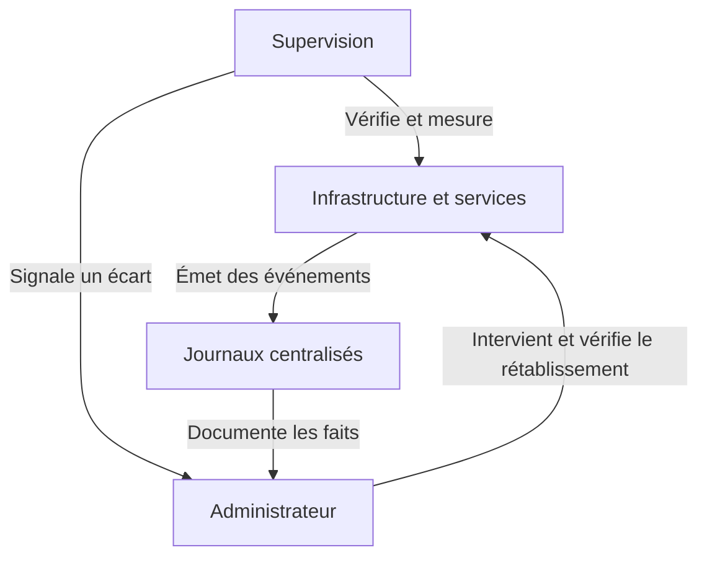

# Comprendre les enjeux de l’exploitation d’un système d’information

## Une application inaccessible pour les usagers

[SportLudique](../../00-contexte/01-présentation.md) exploite plusieurs sites reliés entre eux. Des serveurs Windows et Linux, des équipements réseau et des services comme le DNS, la messagerie ou le partage de fichiers permettent aux équipes de travailler chaque jour.

Un utilisateur indique que l’application de gestion ne s’ouvre plus. Le serveur est-il joignable ? Le service web répond-il depuis le site de l’utilisateur ? D’autres sites sont-ils touchés ? Quel changement a précédé la panne ? Comment repérer les signes d’un incident similaire la prochaine fois ?

!!! question "Par quoi commencer ?"
    Depuis votre poste, le serveur répond au ping. Qu’est-ce que cette réponse permet de conclure sur le réseau ? Quel contrôle permettrait de vérifier que l’application est utilisable depuis le site concerné ?

## Exploiter le système d’information

**Exploiter** un système d’information consiste à faire fonctionner les services au quotidien et à organiser leur remise en service en cas d’interruption. L’équipe suit leur état, traite les incidents, réalise des opérations planifiées et vérifie les effets de ses interventions. Elle tient à jour les procédures dont un autre administrateur aura besoin pour prendre le relais.

La **disponibilité** s’évalue du point de vue de l’usage attendu. Un serveur peut répondre sur le réseau alors qu’une application renvoie une erreur. Pour mesurer la disponibilité, il faut préciser ce qu’on teste, depuis quel emplacement et sur quelle période.

La **continuité de service** concerne la capacité à maintenir une activité acceptable pendant une perturbation et à rétablir le niveau normal. Elle peut s’appuyer sur un mode dégradé, un service de secours ou une restauration. La direction métier et l’équipe informatique définissent ensemble le délai d’interruption acceptable. Si des données doivent être restaurées, elles déterminent aussi la perte de données acceptable.

## Trois démarches complémentaires

| Domaine | Question principale | Exemple concret |
|---|---|---|
| **Supervision** | Est-ce que mon infrastructure fonctionne correctement ? | Surveiller par SNMP l'état des interfaces d'un commutateur, leur trafic et détecter une liaison interrompue. |
| **Journalisation** | Que s'est-il passé sur mon infrastructure ? | Centraliser les journaux des contrôleurs de domaine pour retrouver les tentatives d'authentification échouées. |
| **Observabilité** | Pourquoi mon infrastructure présente-t-elle un dysfonctionnement ? | Croiser les métriques CPU, mémoire, disque et les journaux d'une VM pour comprendre l'origine de ses ralentissements. |

!!! info "Trois domaines complémentaires"
    - **La supervision** permet de détecter un problème et de déclencher une alerte.
    - **La journalisation** conserve les événements produits par les équipements et les systèmes pour permettre leur analyse.
    - **L'observabilité** exploite notamment les métriques, les journaux et les traces pour comprendre le comportement d'un système et rechercher les causes d'un dysfonctionnement.

### Exemple : dysfonctionnement d'un serveur de fichiers

Un utilisateur ne parvient plus à accéder aux fichiers partagés de son entreprise.

1. **Supervision :** une alerte signale que le volume de stockage du serveur de fichiers est saturé.
2. **Journalisation :** les journaux montrent des erreurs d'écriture et des échecs d'accès aux fichiers.
3. **Observabilité :** le rapprochement des métriques de stockage, de leur évolution dans le temps et des événements système permet de comprendre qu'un traitement automatisé remplit progressivement le volume.

**À retenir :** la supervision détecte, la journalisation documente, l'observabilité aide à expliquer.

La supervision vérifie des états attendus et suit leur évolution. La journalisation fournit des événements datés dont on peut reconstituer le contexte. L’**observabilité** désigne la capacité à comprendre ce qui se passe à l’intérieur d’un système à partir des signaux qu’il rend accessibles. Elle dépend autant de la qualité des signaux que des outils utilisés pour les exploiter.

| Signal | Ce qu’il apporte |
| --- | --- |
| **Journal** | Un fait daté, par exemple une tentative de connexion refusée. |
| **Métrique** | Une valeur mesurée dans le temps, par exemple le temps de réponse de la page. |
| **Trace applicative** | Le parcours d’une requête et la durée de ses opérations, par exemple du frontal à l’API puis à la base. Ces informations nécessitent une instrumentation adaptée. |

## De l'alerte au rétablissement

Un utilisateur signale qu'une application métier n'est plus accessible depuis le réseau de son entreprise.

L'application est publiée derrière un **reverse proxy (proxy inverse)** qui reçoit les connexions HTTPS et les transmet au serveur applicatif.

| Heure | Constat | Action de l'équipe |
|---|---|---|
| 09 h 12 | Un administrateur modifie le port de destination de l'application dans la configuration du reverse proxy. | Cette intervention constitue un changement de configuration. |
| 09 h 13 | La supervision détecte une erreur HTTP 502 lors du contrôle HTTPS. | Une alerte est déclenchée. L'équipe vérifie l'étendue de l'indisponibilité. |
| 09 h 14 | Les journaux du reverse proxy indiquent un refus de connexion vers le serveur applicatif. | L'équipe compare le port configuré sur le reverse proxy avec celui réellement utilisé par l'application. |
| 09 h 16 | Une incohérence entre les deux ports est confirmée. | L'équipe identifie la cause du dysfonctionnement et décide de revenir à la configuration précédente. |
| 09 h 18 | La supervision confirme le retour à un fonctionnement normal. | L'équipe vérifie le rétablissement du service depuis un poste utilisateur et documente l'incident. |

Dans cet exemple :

- **La supervision** détecte l'indisponibilité du service et déclenche une alerte.
- **La journalisation** fournit des informations techniques permettant d'orienter le diagnostic.
- **L'analyse des configurations** permet de confirmer l'origine du dysfonctionnement.
- **La gestion des incidents** organise les actions nécessaires au rétablissement du service.

!!! info "Traçabilité des actions d'administration"
    Les journaux système et applicatifs ne permettent pas toujours de savoir précisément **qui a effectué une modification, à quel moment et quelles commandes ont été exécutées**.

    Dans un environnement professionnel, un **bastion d'administration** peut centraliser les accès aux équipements et serveurs. Certaines solutions de **PAM (Privileged Access Management)**, comme **WALLIX Bastion**, permettent notamment de contrôler les accès privilégiés et d'enregistrer les sessions d'administration SSH ou RDP.

    Ces technologies contribuent à la traçabilité et à la sécurité des opérations d'administration.

    Leur mise en œuvre dépasse le périmètre de ce module, qui se concentre sur **la supervision et la centralisation des journaux**.

## Le vocabulaire de la gestion des services informatiques (ITIL)

Le référentiel **ITIL (Information Technology Infrastructure Library)** propose un vocabulaire commun pour organiser la gestion des services informatiques.

**Événement (Event)**

Tout changement d'état significatif pour la gestion d'un service informatique ou d'un élément de configuration.

*Exemple : une interface réseau passe de l'état UP à DOWN.*

**Alerte (Alert)**

Notification indiquant qu'un seuil a été atteint, qu'une condition particulière a été détectée ou qu'une intervention peut être nécessaire.

*Exemple : Zabbix déclenche une alerte lorsque l'espace disque disponible devient inférieur à 10 %.*

**Incident (Incident)**

Interruption non planifiée d'un service ou réduction de la qualité d'un service.

*Exemple : les utilisateurs ne peuvent plus accéder à leur serveur de fichiers.*

**Problème (Problem)**

Cause réelle ou potentielle d'un ou de plusieurs incidents.

*Exemple : un défaut de configuration provoque régulièrement des interruptions du service DHCP.*

**Changement (Change)**

Ajout, modification ou suppression d'un élément susceptible d'avoir un effet direct ou indirect sur un service informatique.

*Exemple : modifier la configuration d'un reverse proxy pour publier une nouvelle application.*

!!! warning "Ne pas confondre"
    - Un **événement** n'est pas nécessairement une anomalie.
    - Une **alerte** ne correspond pas obligatoirement à un incident.
    - Un **incident** peut être détecté par la supervision ou signalé directement par un utilisateur.
    - Un **problème** désigne une cause réelle ou potentielle, pas simplement un incident particulièrement grave.
    - Un **changement** peut corriger un incident, mais également en provoquer un s'il est mal maîtrisé.

    Plusieurs événements et alertes peuvent être associés à un même incident.

## Améliorer l’exploitation après l’incident

Consignez le symptôme, le périmètre, les faits vérifiés, l’action réalisée et la preuve du rétablissement. À partir de ce retour d’expérience, l’équipe peut ajouter un contrôle de l’accès au service applicatif, vérifier les paramètres avant un changement et documenter le retour à la configuration précédente.

Un indicateur peut aussi révéler une dégradation progressive, par exemple un disque qui se remplit semaine après semaine. La tendance donne le temps d’organiser l’intervention avant l’interruption du service.

## Parcours

1. [Journaux, Syslog et centralisation des événements](01-journalisation.md)
2. [Panorama des solutions de supervision et de journalisation](02-solutions.md)
3. [Mission de journalisation](03-mission-journalisation.md) ou [mission de supervision](04-mission-supervision.md)

Les missions relèvent de la troisième période du projet. Vous pouvez les commencer dès que vous disposez de services a "surveiller"

## Pour approfondir

- [OpenTelemetry — Introduction à l’observabilité](https://opentelemetry.io/fr/docs/concepts/observability-primer/)
