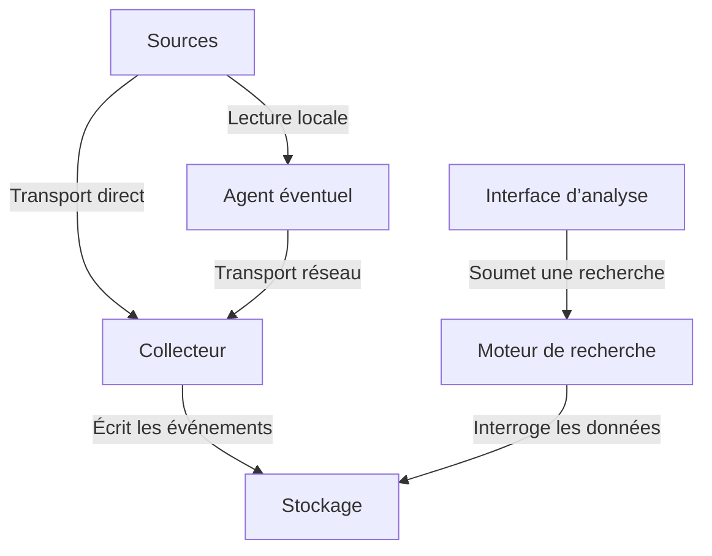

# Journaux, Syslog et centralisation des événements

## Lire un événement

Les systèmes enregistrent des faits pour aider à diagnostiquer un défaut, suivre un changement, retracer un accès ou comprendre une activité. Un même incident peut laisser des indices dans plusieurs journaux.

| Famille | Exemple | Informations à rechercher |
| --- | --- | --- |
| Système | Un service redémarre. | Hôte, unité ou service, heure et résultat du démarrage. |
| Réseau | Un port de commutateur change d’état. | Équipement, interface, état précédent et nouvel état si disponible. |
| Applicative | Le frontal web n’arrive plus à joindre l’application. | Service, destination, code d’erreur, identifiant de requête si disponible. |
| Sécurité | Un serveur refuse une connexion SSH. | Machine d’origine du journal, compte de test, adresse du client et raison du refus si journalisée. |


### Identifier l'origine d'un événement

Lorsqu'un serveur centralise les journaux de plusieurs équipements, il doit être possible de déterminer **quel équipement a produit chaque événement**.

Un message Syslog peut notamment contenir :

- **Un horodatage** : date et heure de l'événement.
- **Un nom d'hôte** : équipement ou serveur déclaré comme source.
- **Une application ou un processus** : service à l'origine du message.
- **Un niveau de gravité** : importance attribuée à l'événement.
- **Un message** : description de ce qui s'est produit.

Exemple d'un message Syslog émis par un serveur SSH :

```text
Nov 9 10:42:15 srv-linux sshd[1254]: Failed password for admin from 192.168.10.25 port 54321 ssh2
```

On peut identifier :

| Élément | Valeur | Signification |
|---|---|---|
| Horodatage | Nov 9 10:42:15 | Date et heure de l'événement |
| Hôte | srv-linux | Serveur ayant produit le message |
| Processus | sshd[1254] | Service SSH et identifiant du processus |
| Événement | Failed password | Échec d'authentification |
| Adresse IP | 192.168.10.25 | Client ayant tenté de se connecter |

!!! warning "Attention aux adresses IP"
    L'adresse IP présente dans le contenu d'un journal n'est pas nécessairement celle de l'équipement qui l'a envoyé.

    Dans cet exemple, `192.168.10.25` désigne le **client SSH**, et non le serveur `srv-linux`.

    De plus, un message Syslog peut transiter par un relais avant d'atteindre le collecteur. L'adresse IP de l'émetteur réseau peut alors être celle du relais.

    Le nom d'hôte déclaré dans un message ne constitue pas, à lui seul, une preuve de l'identité de sa source.

### Structurer les journaux pour faciliter leur exploitation

Les équipements et les systèmes ne produisent pas tous des journaux au même format.

Un serveur Linux, un contrôleur de domaine Windows, un pare-feu et un commutateur enregistrent des informations différentes.

Pour faciliter les recherches et les analyses, une plateforme de centralisation peut **extraire les informations importantes et les organiser dans des champs**.

Par exemple :

| Champ | Exemple |
|---|---|
| `timestamp` | 2026-11-09T10:42:15 |
| `host` | srv-linux |
| `service` | sshd |
| `event` | authentication_failure |
| `source_ip` | 192.168.10.25 |
| `username` | admin |

Ces informations peuvent être représentées au format JSON :

```json
{
  "timestamp": "2026-11-09T10:42:15",
  "host": "srv-linux",
  "service": "sshd",
  "event": "authentication_failure",
  "source_ip": "192.168.10.25",
  "username": "admin"
}
```

Cette structuration permet notamment de :

- Rechercher tous les échecs d'authentification sur plusieurs serveurs.
- Identifier les adresses IP à l'origine de nombreuses tentatives.
- Filtrer les événements provenant d'un équipement particulier.
- Construire des tableaux de bord et suivre l'évolution des événements.


!!! info "À retenir — Pourquoi centraliser et structurer les journaux ?"
    Chaque système, équipement réseau ou application produit ses propres journaux, généralement **stockés localement et dans des formats différents**.

    Cette diversité complique leur exploitation : pour rechercher un événement, l'administrateur doit consulter plusieurs machines, connaître l'emplacement des fichiers et comprendre leur structure.

    Deux besoins apparaissent alors :

    - **Centraliser** : regrouper les journaux de plusieurs sources sur une plateforme commune afin de faciliter leur consultation, leur conservation et leur analyse.
    - **Structurer** : extraire et organiser les informations importantes (date, équipement, service, adresse IP, utilisateur, type d'événement, etc.) dans des champs identifiables.

    Une fois **centralisés et structurés**, les journaux deviennent beaucoup plus faciles à exploiter. Il est notamment possible de :

    - Rechercher des événements sur l'ensemble de l'infrastructure.
    - Filtrer et croiser les informations provenant de plusieurs équipements.
    - Effectuer des requêtes, notamment avec un langage de type **SQL**.
    - Produire des statistiques, des tableaux de bord et détecter des comportements anormaux.

    **L'objectif est de transformer des journaux techniques dispersés en informations exploitables pour l'administration et la sécurité du système d'information.**


## Établir une chronologie des événements

Lorsqu'un incident survient, l'administrateur doit souvent rapprocher les journaux de plusieurs équipements pour comprendre ce qui s'est passé.

**Encore faut-il que tous les équipements soient à la même heure !**

Prenons l'exemple d'une tentative de connexion SSH :

| Équipement | Heure enregistrée | Événement |
|---|---|---|
| Pare-feu | 10 h 02 | Connexion autorisée vers le serveur SSH |
| Serveur Linux | 10 h 07 | Échec d'authentification SSH |
| Serveur Linux | 10 h 08 | Authentification SSH réussie |

Si l'horloge du serveur Linux avance de cinq minutes, les journaux donnent une chronologie trompeuse alors que ces événements peuvent être directement liés.

### Synchroniser les horloges avec NTP

Le protocole **NTP (Network Time Protocol)** permet de synchroniser les horloges des équipements et des serveurs sur une référence de temps commune.

Dans une infrastructure professionnelle, il est recommandé de :

- Configurer une synchronisation NTP sur les serveurs, commutateurs, routeurs et pare-feu.
- Utiliser des sources de temps cohérentes pour l'ensemble de l'infrastructure.
- Prendre en compte les fuseaux horaires lors de l'analyse des journaux. L'utilisation de l'UTC facilite leur rapprochement.

!!! warning "Heure de l'événement et heure de réception"
    L'heure à laquelle un événement est enregistré sur un équipement peut être différente de celle à laquelle il arrive sur le serveur de centralisation.

    Par exemple, un équipement peut conserver temporairement des journaux pendant une coupure réseau et les transmettre plusieurs minutes plus tard.

    **Pour reconstituer un incident, il faut privilégier l'heure réelle des événements, à condition que les horloges des équipements soient correctement synchronisées.**


## Du journal local à la chaîne centralisée

Chaque système ou équipement conserve généralement ses journaux localement, par exemple dans le journal systemd (journald) sous Linux ou dans le journal des événements Windows.

Cette journalisation locale présente plusieurs limites : la capacité de stockage et la durée de conservation peuvent être restreintes, les journaux peuvent devenir inaccessibles en cas de panne de l'équipement, et leur consultation sur de nombreuses machines, parfois réparties sur plusieurs sites, rend les investigations longues et fastidieuses.

La centralisation des journaux permet de regrouper les événements provenant de différentes sources sur une plateforme commune. Elle facilite ainsi leur consultation, leur conservation, leur recherche et leur rapprochement, notamment lors de l'analyse d'un incident.



| Fonction | Rôle |
| --- | --- |
| **Source** | Produit l’événement ou tient le journal d’origine. |
| **Agent éventuel** | Lit ou reçoit des événements au plus près de la source, puis les transmet. Certains équipements savent émettre directement. |
| **Transport** | Acheminement entre deux composants. À chaque liaison, identifiez le protocole, le sens, le port s’il y en a un et la protection éventuelle. |
| **Collecteur** | Reçoit, filtre, transforme ou répartit les messages. Il peut écrire en fichiers ou transmettre à une plateforme. |
| **Stockage** | Conserve les données dans des fichiers ou dans le stockage d’une plateforme. |
| **Moteur de recherche** | Exécute les requêtes sur les données stockées, parfois à l’aide d’index. |
| **Interface d’analyse** | Permet de lancer des recherches, de lire les résultats et de construire des vues. |

Un logiciel peut assurer plusieurs fonctions. Pour un périmètre simple, des fichiers et une recherche locale peuvent suffire.

## Syslog, du message au transport

### Format du message

**Syslog** fournit un cadre pour les messages d’événement. Deux formats reviennent souvent dans les documentations.

| Référence | Ce que l’on rencontre |
| --- | --- |
| **RFC 3164** | Description historique du Syslog BSD. En-tête souvent court, date locale sans année ni fuseau et corps largement textuel. Des variantes existent selon les équipements. |
| **RFC 5424** | Format normalisé avec version, horodatage plus précis lorsqu’il est fourni, nom d’hôte, application, identifiant de processus, identifiant de message et données structurées. Certains champs peuvent porter la valeur absente `-`. |


Dans un message Syslog, le nombre placé entre chevrons (`< >`) est appelé **PRI (Priority)**. Il permet d'identifier deux informations :

- **Facility (origine)** : indique la catégorie du service ou du système ayant généré le message (authentification, messagerie, noyau, etc.).
- **Severity (niveau de gravité)** : indique l'importance du message, de l'urgence maximale (`Emergency`) au simple message de débogage (`Debug`).

Ces deux informations sont regroupées dans une seule valeur numérique, calculée selon la formule :

`PRI = 8 × Facility + Severity`

**Exemple :** un message provenant du service d'authentification (`authpriv`, code 10), avec un niveau de gravité `Error` (code 3), possède un PRI de :

`PRI = 8 × 10 + 3 = 83`

Le message Syslog commence donc par `<83>`.

Cette valeur permet notamment aux collecteurs Syslog de **trier, filtrer et orienter les messages** selon leur catégorie et leur gravité.


<div class="grid" markdown>

<div markdown>

**Facility — Origine du message**

| Code | Facility | Description |
|---|---|---|
| 0 | `kern` | Noyau |
| 1 | `user` | Applications utilisateur |
| 2 | `mail` | Messagerie |
| 3 | `daemon` | Services système |
| 4 | `auth` | Authentification |
| 5 | `syslog` | Service Syslog |
| 6 | `lpr` | Impression |
| 7 | `news` | Usenet |
| 8 | `uucp` | UUCP |
| 9 | `cron` | Tâches planifiées |
| 10 | `authpriv` | Authentification privée |
| 11 | `ftp` | Transfert de fichiers |
| 16 à 23 | `local0` à `local7` | Usages locaux |

</div>

<div markdown>

**Severity — Niveau de gravité**

| Code | Severity |
|---|---|
| 0 | Emergency |
| 1 | Alert |
| 2 | Critical |
| 3 | Error |
| 4 | Warning |
| 5 | Notice |
| 6 | Informational |
| 7 | Debug |

</div>

</div>


!!! info "À retenir"
    - **Facility** : identifie la catégorie d'origine du message. Sa valeur numérique ne représente aucune hiérarchie.
    - **Severity** : indique le niveau de gravité. Plus sa valeur est faible (de 7 à 0), plus la gravité est élevée.
    - **PRI** : combine la Facility et la Severity. **On ne peut pas comparer la gravité de deux messages en comparant directement leurs valeurs PRI.**


!!! example "Exemple de priorité Syslog"
    Un serveur SSH génère un événement avec les caractéristiques suivantes :

    - **Facility** : `authpriv` (code 10), correspondant aux événements d'authentification.
    - **Severity** : `Notice` (code 5), correspondant à un événement normal mais significatif.

    La priorité Syslog est calculée ainsi :

    `PRI = 8 × 10 + 5 = 85`

    Le message commence donc par `<85>`.

    Le collecteur Syslog peut utiliser cette priorité pour **filtrer ou orienter les événements** selon leur catégorie et leur gravité.


### Acheminement

| Transport | Ce qu’il faut vérifier |
| --- | --- |
| **UDP** | Courant sur les équipements réseau, généralement sur UDP 514. Un datagramme peut être perdu ou arriver dans le désordre. L’émetteur ne reçoit pas d’accusé de livraison Syslog. |
| **TCP** | Transporte un flux d’octets ordonné. Les deux extrémités doivent s’accorder sur le découpage des messages, par exemple par longueur annoncée ou par délimiteur. Une connexion établie ne prouve pas que le message est conservé sur disque. |
| **TLS sur TCP** | Protège le transport lorsque les certificats et la vérification d’identité sont configurés correctement. Le port standard de Syslog sur TLS est TCP 6514. |

Il faut distinguer le format des messages et le protocole utilisé pour les transporter :

-  Le format définit la manière dont les informations sont organisées dans un message Syslog (horodatage, hôte, application, gravité, contenu, etc.).
-  Le transport définit la manière dont ces messages sont acheminés entre les équipements et le collecteur (UDP, TCP avec ou sans TLS).

Ces deux aspects sont indépendants : un message au format historique (RFC 3164) peut être transmis en TCP, tandis qu'un message au format RFC 5424 peut être transporté en UDP.

Il est donc nécessaire de vérifier que l'émetteur et le collecteur utilisent des configurations compatibles, notamment pour le protocole de transport, le port et le format des messages.

Une fois les journaux collectés, ils peuvent être filtrés, transformés et structurés, par exemple au format JSON, avant d'être transmis via HTTPS à une plateforme de stockage et d'analyse.

## Événements Windows et transfert natif


### Centralisation des journaux Windows

Windows dispose de son propre système de journalisation, appelé **Windows Event Log** (Observateur d'événements).

Les événements sont répartis dans plusieurs journaux, notamment :

- **System** : événements liés au fonctionnement du système d'exploitation, des pilotes et des services.
- **Application** : événements générés par les applications.
- **Security** : événements de sécurité, notamment les ouvertures de session et les tentatives d'authentification.

Chaque événement contient plusieurs informations : la date et l'heure, l'ordinateur concerné, la source (fournisseur), un identifiant (**Event ID**) et une description.

Par exemple, l'événement **4625** du journal `Security` correspond à un échec d'ouverture de session, à condition que l'audit des échecs de connexion soit activé.

#### Centraliser les événements avec WEF

Microsoft propose un mécanisme natif de centralisation des journaux Windows :

- **WEF (Windows Event Forwarding)** : permet aux machines Windows de transmettre des événements sélectionnés.
- **WEC (Windows Event Collector)** : désigne le serveur chargé de recevoir et de centraliser ces événements.

La communication repose sur **WinRM / WS-Management**.

Deux modes de fonctionnement sont possibles :

- **Source-initiated** : les machines sources contactent le collecteur. Dans un domaine Active Directory, une **GPO** peut distribuer automatiquement la configuration aux postes et serveurs.
- **Collector-initiated** : le collecteur contacte les machines sources définies dans un abonnement.

Un **abonnement** détermine les ordinateurs concernés et les événements à collecter.

Les événements centralisés sont généralement accessibles dans le journal `ForwardedEvents` du serveur collecteur, tout en conservant l'identification de l'ordinateur d'origine.

!!! info "Exploitation des événements Windows"
    WEF permet de **centraliser les journaux Windows sans installer d'agent supplémentaire** sur les machines sources.

    Les événements collectés peuvent ensuite être récupérés par un outil de collecte, transformés en données structurées et transmis à une plateforme d'analyse.

    Il est important de conserver les informations essentielles, notamment **l'ordinateur d'origine, l'Event ID, le fournisseur et l'horodatage**, pour permettre leur exploitation.

## Conserver et protéger les journaux

La centralisation des journaux ne suffit pas : il faut également garantir leur **disponibilité, leur intégrité et leur confidentialité** afin qu'ils restent exploitables, notamment lors d'un incident de sécurité.

Plusieurs bonnes pratiques doivent être respectées :

- **Sélection des événements** : déterminer quels équipements, services et événements doivent être journalisés. Une collecte excessive génère un volume important de données, consomme inutilement de l'espace disque et complique les recherches.

- **Durée de conservation (rétention)** : définir combien de temps les journaux doivent être conservés en fonction des besoins d'exploitation, de sécurité et des éventuelles obligations réglementaires. Le dimensionnement du stockage doit tenir compte du volume quotidien, des pics d'activité et des données supplémentaires nécessaires à leur indexation.

- **Rotation des journaux** : éviter que les fichiers de journaux ne grossissent indéfiniment. La rotation consiste à créer régulièrement de nouveaux fichiers et à archiver, compresser ou supprimer les anciens selon une politique définie. Sous Linux, l'outil `logrotate` permet notamment d'automatiser cette gestion pour les journaux stockés dans des fichiers.

- **Contrôle des accès et confidentialité** : limiter la consultation des journaux aux personnes autorisées. Ceux-ci peuvent contenir des informations sensibles (adresses IP, identifiants, données personnelles, etc.). Les échanges entre équipements et collecteurs doivent également être protégés lorsque cela est nécessaire, notamment par chiffrement.

- **Intégrité et traçabilité** : empêcher autant que possible la modification ou la suppression non autorisée des événements. La séparation des droits d'administration et de consultation, la restriction des permissions et la traçabilité des accès contribuent à préserver la fiabilité des journaux.

!!! warning "Attention à la saturation du stockage"
    Un serveur de centralisation peut recevoir **des milliers, voire des millions d'événements par jour**.

    Sans politique de conservation et de rotation adaptée, le stockage risque d'être saturé, entraînant la perte de nouveaux événements ou l'interruption de la collecte.

    **Une politique de journalisation doit donc toujours prévoir une durée de conservation, une capacité de stockage suffisante et une gestion des anciens journaux.**


## Références et suite

- [IETF — Syslog BSD, RFC 3164](https://www.rfc-editor.org/rfc/rfc3164.html) et [protocole Syslog, RFC 5424](https://www.rfc-editor.org/rfc/rfc5424.html)
- [IETF — Transport UDP, RFC 5426](https://www.rfc-editor.org/rfc/rfc5426.html), [transport TCP, RFC 6587](https://www.rfc-editor.org/rfc/rfc6587.html) et [transport TLS, RFC 5425](https://www.rfc-editor.org/rfc/rfc5425.html)
- [Microsoft — Windows Event Collector](https://learn.microsoft.com/en-us/windows/win32/wec/windows-event-collector) et [fonctionnement de WEF](https://learn.microsoft.com/fr-fr/windows/security/operating-system-security/device-management/use-windows-event-forwarding-to-assist-in-intrusion-detection)

Poursuivez avec le [panorama des solutions](02-solutions.md) ou la [mission de journalisation](03-mission-journalisation.md).
