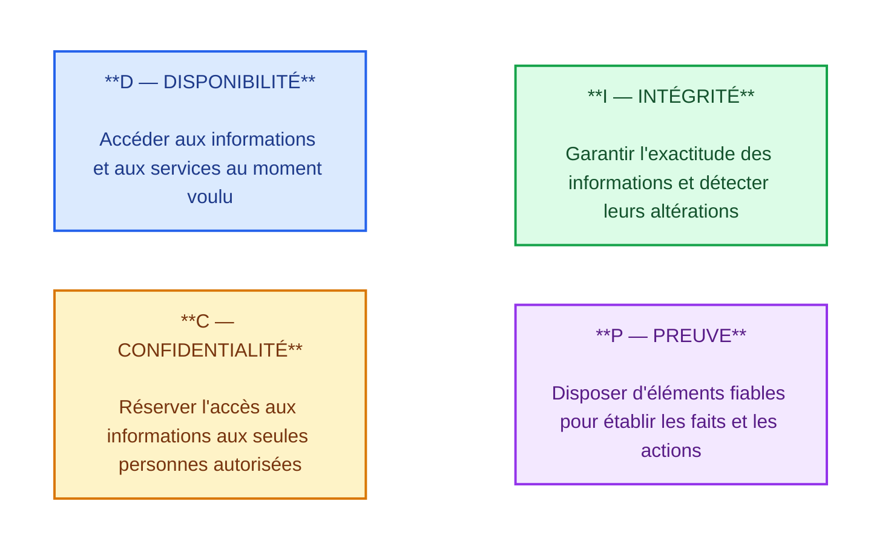
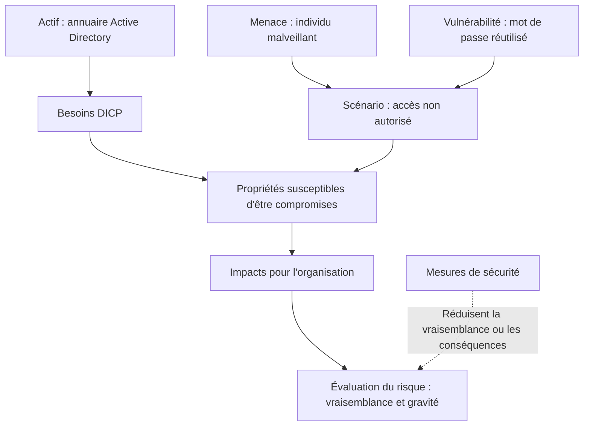
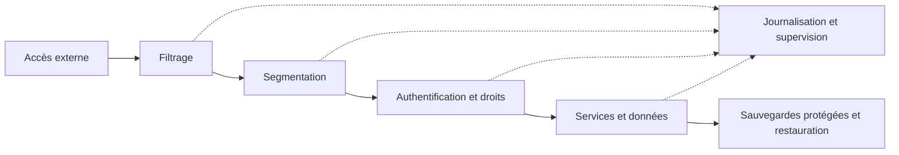
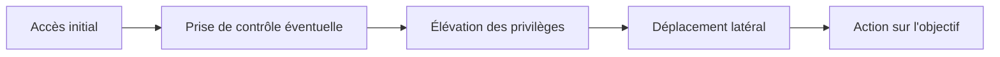
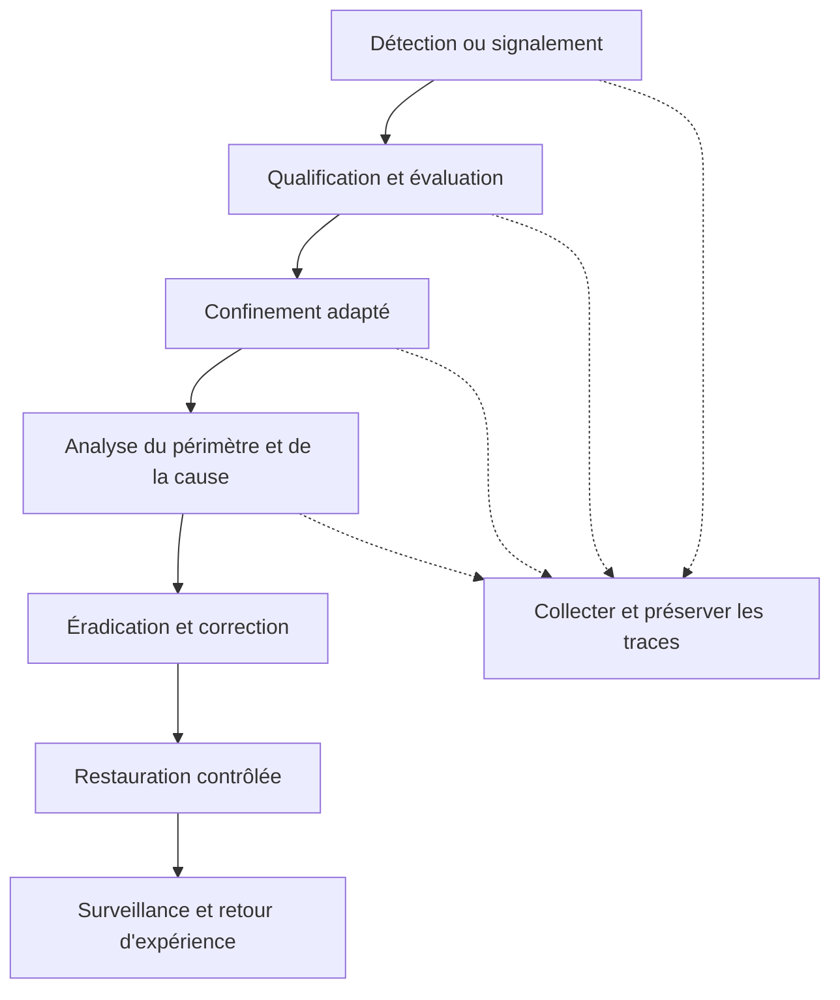
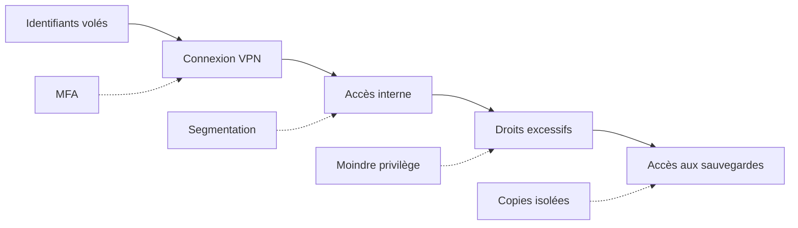

# 00 — Cybersécurité : référentiel général

!!! abstract "Objectif du référentiel"
    Ce référentiel centralise les connaissances nécessaires au projet **SportLudique 2026-2027**, aux études de cas et aux révisions de l'épreuve **E6 du BTS SIO**.

    C'est un **support de compréhension et de révision**, et non une liste de TP. Une protection étudiée n'est pas nécessairement déployée dans SportLudique.

## Socle obligatoire

### 1. Le modèle de référence DICP : que cherche-t-on à protéger ?

Avant de parler d'attaque ou de pare-feu, il faut définir **les besoins de sécurité des informations et des services**. Le modèle **DICP** distingue quatre propriétés complémentaires :

- **D — Disponibilité :** les services et informations sont accessibles aux utilisateurs autorisés **au moment voulu**.
- **I — Intégrité :** les informations et traitements ne subissent pas de modification ou de destruction **non autorisée ou accidentelle**.
- **C — Confidentialité :** seules les personnes ou les systèmes **autorisés** peuvent prendre connaissance des informations.
- **P — Preuve :** il est possible de disposer d'éléments **fiables et vérifiables** pour établir des actions ou des événements, et, lorsque cela est possible, en attribuer l'origine.

!!! example "Exemple — Annuaire Active Directory de SportLudique"
    - **D :** les utilisateurs doivent pouvoir ouvrir une session et accéder aux ressources.
    - **I :** les groupes, comptes et droits ne doivent pas être modifiés illicitement.
    - **C :** les informations sensibles de l'annuaire et les secrets d'authentification doivent être protégés.
    - **P :** les connexions et modifications sensibles doivent pouvoir être examinées à partir de traces suffisamment fiables.

!!! info "Preuve, authentification et traçabilité : trois notions liées, mais différentes"
    **Authentifier**, c'est vérifier une identité ou une origine. **Tracer**, c'est enregistrer des événements. **Apporter une preuve**, c'est pouvoir s'appuyer sur des éléments dont l'origine, l'intégrité, l'horodatage et la conservation sont suffisamment maîtrisés.

    Un journal peut constituer **un élément de preuve**, mais il n'est pas automatiquement fiable. Une signature électronique peut attester l'origine et l'intégrité d'un document selon le mécanisme utilisé ; elle ne prouve pas que son contenu est vrai.

!!! warning "Une attaque peut affecter plusieurs propriétés DICP"
    Un rançongiciel peut rendre des données **indisponibles (D)**, en modifier le contenu **(I)**, les exfiltrer **(C)** et effacer les traces nécessaires à l'enquête **(P)**. Ces effets ne sont pas systématiques : ils dépendent du scénario.

### 2. Identifier les risques à partir des besoins DICP

Un **actif** est un élément ayant une valeur pour l'organisation : données, service DNS, annuaire AD, serveur, équipement, réputation, etc. Les actifs ne présentent pas tous les mêmes exigences DICP. Pour un résolveur DNS, disponibilité et intégrité sont déterminantes ; pour une base de données personnelles, la confidentialité est aussi essentielle.

La démarche consiste à se demander **ce qui pourrait porter atteinte à ces propriétés, comment et avec quelles conséquences**.

!!! note "Vocabulaire essentiel"
    **Menace :** cause potentielle d'un événement dommageable, intentionnelle (attaquant) ou non (panne, erreur humaine).

    **Vulnérabilité :** faiblesse technique, humaine ou organisationnelle susceptible d'être exploitée, ou de favoriser un incident (logiciel non corrigé, droits excessifs, mauvaise procédure).

    **Scénario de risque :** enchaînement plausible d'événements conduisant à une atteinte à un actif.

    **Impact :** conséquence de l'événement : interruption, divulgation, perte financière, atteinte à la réputation, etc.

    **Risque :** possibilité d'un scénario dommageable, appréciée notamment selon sa **vraisemblance** et sa **gravité**.

    **Mesure de sécurité :** disposition technique ou organisationnelle visant à réduire la vraisemblance d'un incident, ses conséquences ou à en améliorer la détection et le traitement.

!!! example "Exemple guidé — Compte d'administration compromis"
    **Actif :** annuaire Active Directory et ressources qu'il contrôle.

    **Besoin DICP :** préserver l'intégrité des comptes et des autorisations ; garantir la disponibilité de l'authentification.

    **Menace et vulnérabilité :** un attaquant dispose d'un mot de passe réutilisé sur un accès exposé dépourvu de second facteur.

    **Scénario :** il se connecte avec le compte privilégié et modifie des droits.

    **Impacts :** modification des autorisations (**I**), accès possible à des données confidentielles (**C**), perturbation éventuelle des services (**D**).

    **Mesures :** MFA lorsque disponible, moindre privilège, comptes d'administration séparés, restrictions d'accès et journalisation protégée (**P**).

!!! warning "Ne pas confondre risque, vulnérabilité et attaque"
    « Logiciel non corrigé » désigne une **vulnérabilité** ; « hameçonnage » désigne une **technique d'attaque** ; « vol d'identifiants permettant de consulter des dossiers confidentiels » décrit un **scénario de risque**. Une cotation de type *vraisemblance × gravité* sert à prioriser les risques : ce n'est pas une mesure physique exacte.

### 3. Défense en profondeur et moindre privilège

La **défense en profondeur** associe plusieurs contrôles complémentaires. Si une mesure échoue, d'autres peuvent limiter la propagation, détecter l'incident ou faciliter la restauration.

Le **moindre privilège** consiste à n'attribuer que les droits nécessaires, pour la durée nécessaire. Les comptes d'administration doivent être distincts des comptes utilisés au quotidien.

!!! warning "Les limites de chaque protection"
    - Un **VLAN** sépare des domaines de diffusion Ethernet ; c'est le **filtrage inter-VLAN** qui contrôle les échanges routés.
    - **HTTPS** protège le canal et authentifie normalement le serveur ; il ne corrige pas les failles de l'application.
    - Un **VPN** protège la communication, mais ne garantit pas que le compte connecté est légitime ou que le poste est sain.
    - Un **SIEM** centralise et corrèle des événements ; il ne bloque pas automatiquement une attaque.
    - Une **sauvegarde** facilite la restauration ; elle n'empêche pas une fuite de données.

### 4. Lire le référentiel

| Niveau | Compétence attendue |
| --- | --- |
| **Socle obligatoire** | Décrire le mécanisme d'une attaque, identifier les propriétés DICP affectées et expliquer une protection essentielle. |
| **Concepts avancés** | Interpréter des observations, examiner des configurations et expliquer les limites des protections. |
| **Expertise** | Reconstituer un scénario combiné, concevoir et justifier des défenses et leurs vérifications. |

!!! note "Le modèle OSI est un repère pédagogique, pas une frontière stricte"
    DHCP et DNS sont des protocoles applicatifs, même si des attaques qui les visent perturbent le réseau. TLS et les sessions web ne correspondent pas strictement aux couches 6 et 5 du modèle théorique. Une attaque peut impliquer **plusieurs couches** et compromettre **plusieurs propriétés DICP**.

## Parcours par couches

| Fiche | Thèmes principaux |
| --- | --- |
| [Couche 1 — Accès physique](couche1.md) | Accès aux équipements, supports et environnement |
| [Couche 2 — Ethernet et commutation](couche2.md) | MAC, ARP, VLAN, DHCP et protections locales |
| [Couche 3 — Réseau](couche3.md) | IP, routage, ICMP et IPv6 |
| [Couche 4 — Transport](couche4.md) | TCP, UDP, ports, reconnaissance et saturation |
| [Couche 5 — Sessions](couche5.md) | Sessions, authentification et rejeu |
| [Couche 6 — Présentation](couche6.md) | TLS, HTTPS, certificats et confiance |
| [Couche 7 — Applications](couche7.md) | DNS, applications web et compromissions |

Consulter également le [tableau général des attaques](tableau-attaques.md) et la [synthèse pour les révisions](synthese-revisions.md).

## Concepts avancés — Analyser des observations

Face à une situation suspecte, distinguer **reconnaissance** (ex. scan de ports), **vulnérabilité** (ex. contrôle d'accès absent), **mauvaise configuration** (ex. interface d'administration exposée), **attaque** (action visant un objectif malveillant) et **indice** (observation qui admet plusieurs explications).

!!! example "Une anomalie n'est pas une preuve d'attaque"
    Des changements fréquents dans une table MAC peuvent résulter d'une boucle Ethernet ou d'une modification de topologie. Il faut **recouper les observations** avant de conclure.

Dans SportLudique, les sources possibles sont : tables MAC et ARP, baux DHCP, routes et ACL, journaux Stormshield, événements DNS et AD, journaux du reverse proxy, Graylog et SIEM.

!!! warning "Visibilité réelle"
    Un équipement ne voit pas nécessairement tous les flux. Vérifier les capteurs, les sources collectées, les horodatages, les droits d'accès et la conservation avant d'interpréter les traces.

## Expertise — Architecture et réponse à incident

Une attaque peut combiner un accès initial, une élévation de privilèges, un déplacement latéral et une action sur l'objectif ; la persistance n'est pas systématique.

En réponse à un incident, il faut agir selon les procédures de l'organisation. La **préservation des traces** doit être envisagée dès la détection : un confinement immédiat peut être nécessaire, mais certaines actions risquent de détruire des indices.

### Exemple transversal — Compte VPN compromis

Un attaquant obtient les identifiants d'un utilisateur VPN, accède au réseau interne puis tente d'atteindre des sauvegardes grâce à des permissions trop larges.

| Étape | Protection pertinente | Observation possible |
| --- | --- | --- |
| Connexion VPN | MFA, restriction des accès | Journaux d'authentification VPN |
| Accès interne | Segmentation et filtrage | Journaux du pare-feu |
| Exploitation de droits excessifs | Moindre privilège, comptes distincts | Événements AD et accès aux ressources |
| Accès aux sauvegardes | Isolation, comptes dédiés et copies protégées | Journaux de la plateforme de sauvegarde |

!!! tip "Attendu en expertise"
    Justifier **où intervient chaque mesure**, **quelles propriétés DICP elle protège**, **quelles limites elle présente** et **comment vérifier son efficacité**. Il n'est pas nécessaire de reproduire toutes les attaques dans SportLudique.

## Références

- [ANSSI — Guide d'hygiène informatique](https://messervices.cyber.gouv.fr/guides/guide-dhygiene-informatique) : principes de protection et d'administration.
- [ANSSI — Fondamentaux de la sauvegarde](https://messervices.cyber.gouv.fr/guides/fondamentaux-sauvegarde-systemes-dinformation) : sauvegarde et restauration.
- [CERT-FR](https://www.cert.ssi.gouv.fr/) : avis, alertes et vulnérabilités ; vérifier produits et versions concernés.
