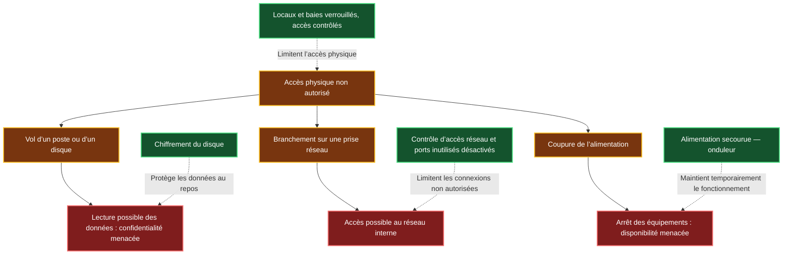
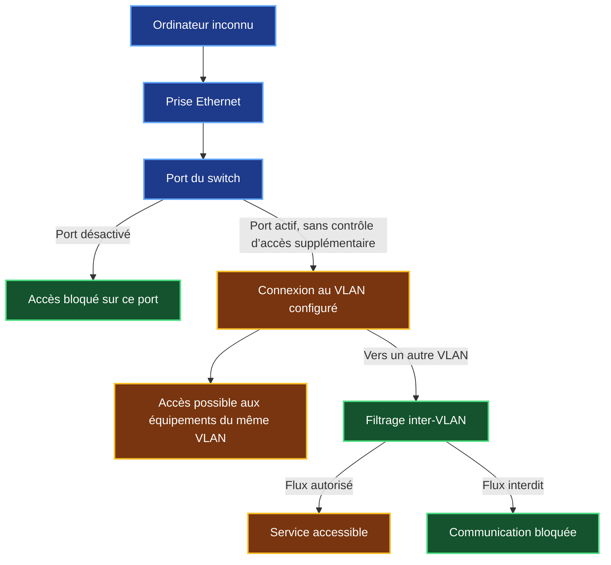
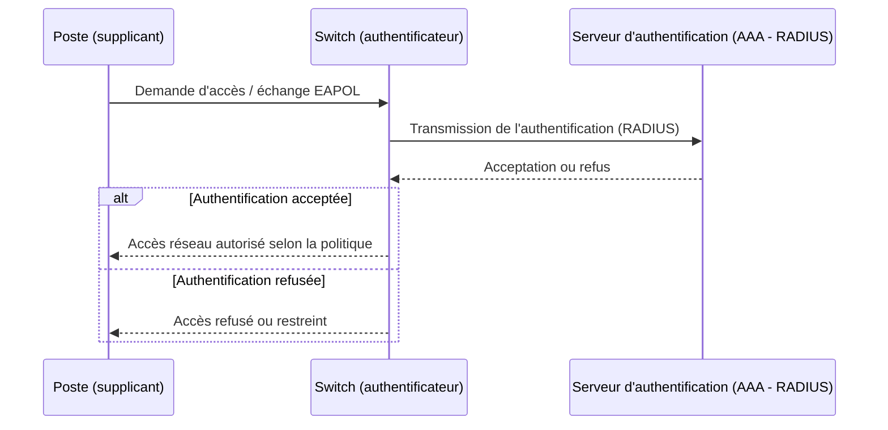

# 1 — Sécurité physique et accès aux équipements

[← Retour au référentiel](00-cybersecurite.md)

!!! abstract "Objectif de la fiche"
    Comprendre comment un **accès matériel non maîtrisé** peut compromettre la sécurité d'un système d'information et distinguer les protections **physiques**, **du poste** et **de l'accès réseau**.

    Les mécanismes de commutation et d'authentification réseau abordés en complément ne relèvent pas strictement de la couche physique du modèle OSI.

## Socle obligatoire

### 1. Pourquoi protéger l’accès physique ?

Un intrus qui accède à une salle peut voler un disque, brancher un équipement sur une prise réseau ou couper une alimentation. **Il peut ainsi compromettre la sécurité sans passer par une attaque depuis Internet.** Les conséquences dépendent des protections en place.



!!! warning "Un accès physique ne donne pas automatiquement tous les accès"
    Un disque chiffré, un poste verrouillé ou une prise réseau contrôlée peuvent limiter les possibilités de l’intrus. **Il faut identifier ce qu’il peut réellement faire avant de conclure sur les critères DICP menacés.**

!!! example "Cas SportLudique — Une personne entre dans la salle réseau"
    - Elle peut **débrancher** un switch ou un serveur : **disponibilité (D)**.
    - Elle peut **modifier** un câblage ou une configuration : **intégrité (I)**.
    - Elle peut **emporter** un disque non chiffré : **confidentialité (C)**.
    - Sans contrôle d'accès ni traces fiables, il peut être difficile d'**établir les faits (P)**.

!!! warning "Accès physique ≠ compromission automatique"
    Un disque chiffré et un poste verrouillé restent mieux protégés qu'une session ouverte. <br/>
    À l'inverse, une porte verrouillée ne suffit pas si des prises accessibles donnent directement accès au réseau d'administration.

### 2. Protéger les locaux, équipements et supports

| Situation | Mesure adaptée | Limite à connaître |
| --- | --- | --- |
| Accès à la salle ou à la baie | Serrure, contrôle des accès, gestion des clés | Une porte fermée ne protège pas une session ouverte |
| Poste laissé sans surveillance | Verrouillage automatique de session | Ne remplace pas la protection des données stockées |
| Vol de disque ou d'ordinateur | Chiffrement du disque, protection des clés de récupération | Les données d'une session déverrouillée restent exposées |
| Démarrage depuis un support externe | Paramétrage UEFI, restriction du démarrage externe, Secure Boot selon le matériel | Aucun réglage firmware ne supprime tout risque matériel |
| Périphérique USB inconnu | Politique de périphériques autorisés, restrictions GPO ou Linux | Bloquer l'automontage ne bloque pas tous les périphériques malveillants |
| Coupure ou manipulation d'équipement | Baie sécurisée, alimentation adaptée, surveillance | La vidéosurveillance documente, mais n'empêche pas l'accès |

!!! tip "À retenir"
    **La protection est cumulative** : contrôler l'entrée, sécuriser les matériels et protéger les sessions et les données. Une mesure seule ne suffit pas.

### 3. Une prise Ethernet constitue-t-elle un accès au SI ?

Une prise Ethernet reliée à un port actif peut permettre à un équipement de communiquer sur le réseau associé. **L'accès aux autres réseaux dépend ensuite des VLAN, du routage et du filtrage**.



!!! warning "VLAN de stationnement : ce qu'il fait réellement"
    Un port inutilisé peut être **désactivé administrativement** et affecté, par précaution, à un **VLAN isolé sans service**. Un VLAN de stationnement n'est **pas un honeypot**. Éviter le VLAN 1 pour les usages courants relève du durcissement, mais ne constitue pas en soi une protection d'accès.

!!! question "Question d'étude de cas"
    Un étudiant branche son ordinateur personnel sur une prise reliée au VLAN d'administration. **Quel est le problème de sécurité ?** Que faudrait-il vérifier sur la configuration du port et sur les règles de filtrage ?

## Concepts avancés — Contrôler l'accès au réseau

Les deux mécanismes ci-dessous relèvent principalement du **contrôle d'accès sur le réseau Ethernet** (couche 2), mais ils complètent la sécurisation des prises physiques.

### 4. Port Security : limiter les adresses MAC sur un port

Sur certains commutateurs, **Port Security** limite le nombre d'adresses MAC autorisées ou apprises sur un port d'accès. Cela peut réduire certains branchements non prévus, **sans authentifier véritablement la personne ou l'équipement** : une adresse MAC peut être usurpée.

```text
interface FastEthernet0/1
 switchport mode access
 switchport port-security
 switchport port-security maximum 1
 switchport port-security violation shutdown
```

!!! note "Lire cette configuration Cisco"
    L'exemple suppose **un seul poste**, sans téléphone IP ni hyperviseur. Si une violation survient, le port peut passer en état `err-disabled`. Vérifier avec `show port-security interface FastEthernet0/1` avant toute remise en service.

    Sans adresse MAC explicitement configurée, **le premier appareil appris n'est pas forcément légitime**.

### 5. IEEE 802.1X : authentifier avant d'ouvrir l'accès

Le principe est différent : le commutateur joue le rôle d'**authentificateur**, le poste celui de **supplicant**, et un serveur **RADIUS** participe à la décision d'autorisation. Le protocole EAP transporte la méthode d'authentification choisie ; **EAP-TLS** repose notamment sur des certificats.




!!! warning "Limites de l'authentification 802.1X"

    Certains équipements ne prennent pas en charge 802.1X.<br/>
    Le mécanisme **MAB (MAC Authentication Bypass)** permet
    de les autoriser à partir de leur adresse MAC, mais cette
    protection reste limitée car une adresse MAC peut être usurpée.

    Le contrôle d'accès dépend également de la disponibilité
    du serveur RADIUS et, selon la méthode EAP utilisée,
    de la gestion des certificats.

!!! example "Application dans l'infra SIO"

    La section SIO du lycée utilise déjà un serveur **RADIUS pour
    l'authentification Wi-Fi**.

    Le même principe peut être appliqué aux ports Ethernet :<br/>
    un switch joue alors le rôle d'authentificateur et consulte
    le serveur RADIUS avant d'autoriser l'accès au réseau.

!!! tip "Projet possible au semestre 2 — Contrôler l’accès au réseau avec 802.1X"
    **802.1X s’utilise aussi bien sur un réseau Wi-Fi, comme dans l’infrastructure SIO, que sur des prises Ethernet classiques.** Ce mécanisme de contrôle d’accès fonctionne au niveau de la **couche 2** : il n’est pas lié à un support physique particulier de couche 1.

    Avant d’autoriser un accès normal au réseau, le **switch ou le point d’accès Wi-Fi** s’appuie sur un **serveur RADIUS** pour authentifier l’utilisateur ou l’équipement.

    **Projet possible dans SportLudique au semestre 2 :** mettre en place ce contrôle d’accès avec **NPS (Windows Server) ou FreeRADIUS (Linux)**, puis vérifier qu’un équipement autorisé peut se connecter et qu’un équipement non authentifié ne peut pas accéder au réseau interne.

    **Pour aller plus loin :** utiliser des certificats et attribuer un VLAN selon le profil authentifié.

## Référence

- [ANSSI — Guide d'hygiène informatique](https://messervices.cyber.gouv.fr/guides/guide-dhygiene-informatique).
