# 2 — Liaison : Ethernet, ARP, DHCP et commutation

[← Retour au référentiel](00-cybersecurite.md)

!!! abstract "Objectif de la fiche"
    Comprendre comment une machine présente sur un réseau local peut perturber la **commutation**, tromper ses voisins ou détourner sa **configuration IP**. Identifier les propriétés **DICP** menacées et justifier des mesures de protection adaptées.

    **Repère OSI :** <br/>
    **Ethernet et ARP** sont étudiés ici pour leurs effets sur le réseau local. <br/>
    **DHCP est un protocole applicatif (UDP)** ; ses attaques figurent dans cette fiche parce qu'elles visent souvent les équipements et les postes d'un même LAN.

## Socle obligatoire

### 1. Pourquoi le réseau local est-il exposé ?

Un switch apprend les **adresses MAC sources** des trames reçues et les associe à ses ports. En IPv4, **ARP** permet de trouver l'adresse MAC correspondant à une adresse IP sur le réseau local. **DHCP** fournit aux clients les paramètres nécessaires à leur configuration IP.

Ces mécanismes facilitent le fonctionnement du réseau, mais ils ne vérifient pas systématiquement **l'identité** des équipements ou **la légitimité** des messages reçus.

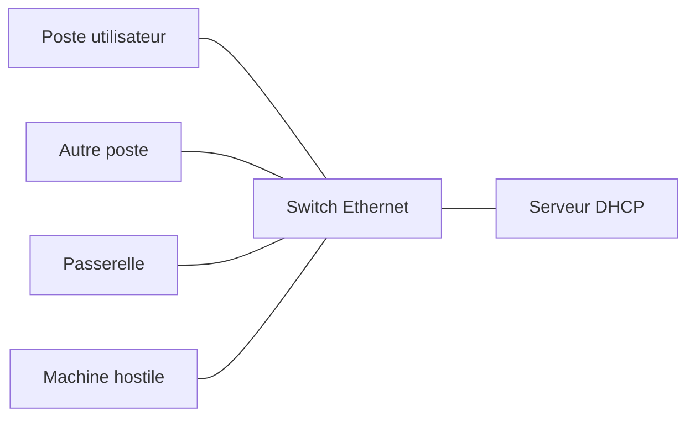

!!! warning "Un VLAN n'est pas une authentification"
    Un VLAN délimite notamment un **domaine de diffusion Ethernet**. Il limite la portée de certaines attaques locales, mais ne protège pas automatiquement deux postes **du même VLAN**. Le filtrage inter-VLAN agit sur les flux **routés**, pas sur toutes les communications locales.

### 2. ARP Spoofing / ARP Poisoning — empoisonnement ARP

**Principe.** ARP associe une **adresse IPv4 locale** à une **adresse MAC**. Un attaquant présent dans le domaine de diffusion peut envoyer une association mensongère, par exemple : « l'adresse IP de la passerelle correspond à ma MAC ».

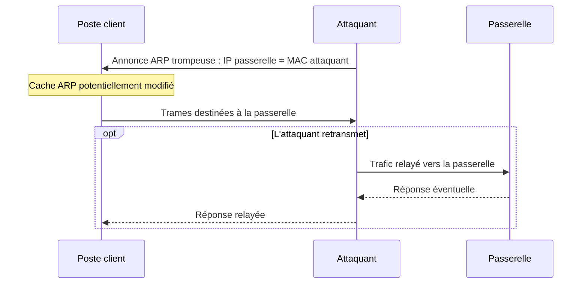

**Conditions :** l'attaquant doit pouvoir atteindre le poste sur le LAN et ses messages ARP doivent être acceptés. Pour intercepter des échanges dans les deux sens, d'autres conditions peuvent être nécessaires, notamment un détournement du chemin retour.

**Conséquences DICP :** 

| Propriété DICP | Conséquence possible |
| --- | --- |
| **Confidentialité (C)** | Lecture possible des données si elles ne sont pas protégées ou chiffrées |
| **Intégrité (I)** | Altération possible des échanges si l'attaquant peut modifier le trafic |
| **Disponibilité (D)** | Interruption possible si le trafic n'est plus correctement acheminé |

!!! note "Limite importante"
    Une interception du trafic ne permet pas automatiquement de lire le contenu
    d'une communication **HTTPS** ou d'un **VPN** correctement authentifié.
    En revanche, elle peut encore perturber ou bloquer les échanges.

!!! tip "Protections essentielles"
    **Dynamic ARP Inspection (DAI)** vérifie les associations IP/MAC sur les ports inspectés. La segmentation et l'isolation des ports peuvent réduire l'exposition selon le contexte.<br/>
    **TLS/HTTPS** protège le contenu des échanges correctement authentifiés, mais ne garantit pas leur disponibilité.<br/>
    **Port Security ne vérifie pas** à lui seul qu'une association IP/MAC annoncée dans ARP est légitime.

### 3. MAC Flooding — saturation de la table MAC

Un switch enregistre les adresses MAC sources qu'il rencontre. Un attaquant peut envoyer des trames portant de très nombreuses **MAC sources différentes** pour saturer cette table.

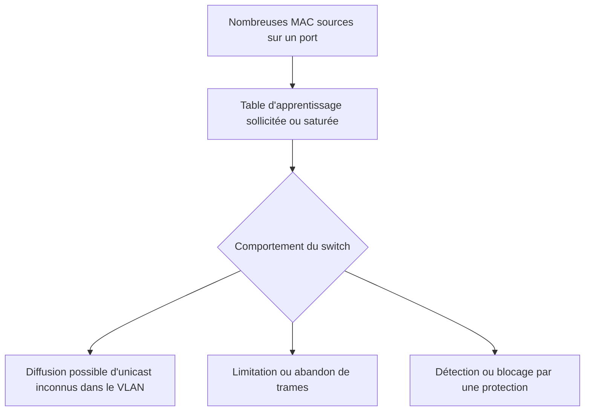

!!! warning "Ne pas écrire : « le switch devient un hub »"
    Le comportement dépend du modèle et de ses protections. Certaines trames **unicast inconnues** peuvent être diffusées dans le VLAN ; d'autres peuvent être limitées ou rejetées. Il n'y a pas de diffusion systématique de toutes les trames.

**Conséquences :** exposition potentielle de certains échanges (**C**) et perturbation (**D**). 

**Protection :** limiter le nombre de MAC apprises sur les ports utilisateurs (*Port Security*), contrôler les événements et distinguer l'attaque d'une boucle ou d'un équipement hébergeant plusieurs machines virtuelles.

### 4. MAC Spoofing — usurpation d'adresse MAC

Une machine adopte l'adresse MAC d'un autre équipement pour tenter de contourner une restriction fondée sur cette seule adresse. Des MAC dupliquées peuvent aussi entraîner une instabilité de la table de commutation.

!!! note "À retenir"
    **Une adresse MAC n'est pas une preuve d'identité.** Une liste de MAC autorisées ne remplace pas un mécanisme d'authentification tel que **802.1X**.

### 5. DHCP Starvation — épuisement des baux

L'attaquant multiplie les demandes DHCP en utilisant des **identités clientes variées** pour obtenir un grand nombre de baux. Si la plage d'adresses disponibles est épuisée, les nouveaux clients légitimes ne peuvent plus obtenir leur configuration IP (**D**).

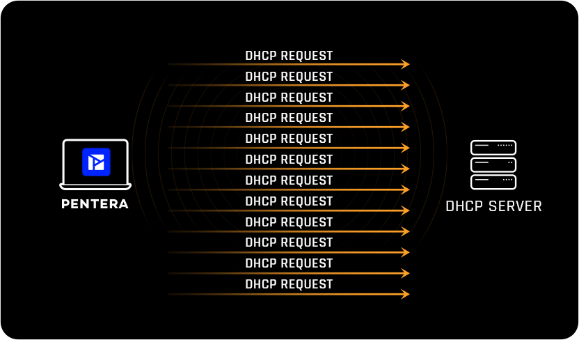

!!! tip "Limiter le risque"
    Une limitation de débit des messages DHCP sur les ports clients peut réduire certains abus. La surveillance du nombre de baux, leur durée et le dimensionnement du pool facilitent la détection et la résilience. Aucune de ces mesures ne constitue à elle seule une protection absolue.

### 6. Rogue DHCP / DHCP Spoofing — faux serveur DHCP

Un équipement non autorisé répond aux demandes DHCP et peut fournir des paramètres malveillants : **passerelle**, **serveur DNS** ou **adresse IP** inadaptés. Le client peut retenir sa réponse ; l'attaque **ne nécessite pas** de DHCP Starvation préalable.

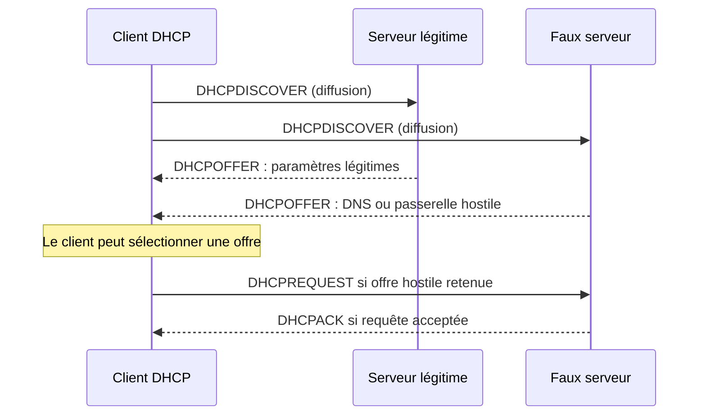

**Conséquences :** accès aux ressources perturbé (**D**), résolution de noms trompeuse (**I**), détournement potentiel d'échanges (**C**).

!!! example "Application SportLudique"
    Deux offres DHCP annoncent des **serveurs DNS différents**. Il faut relever l'adresse du serveur à l'origine de chaque offre, examiner le relais éventuel et vérifier le chemin des réponses légitimes.

!!! tip "Protection : DHCP Snooping"
    Le switch peut distinguer les ports **trusted** (sur lesquels les réponses du serveur sont autorisées) et les ports **untrusted** (ports clients). Il bloque alors les réponses DHCP serveur arrivant par un port non fiable. Le choix des ports trusted est essentiel.

## Concepts avancés

### 7. Trois protections complémentaires : DHCP Snooping, DAI et IP Source Guard

Ces mécanismes contrôlent des messages différents. **DHCP Snooping** filtre les réponses DHCP et construit une base d’associations (*bindings*). Cette base peut ensuite être exploitée par **DAI** pour contrôler les annonces ARP et par **IP Source Guard** pour limiter les adresses IP sources autorisées sur un port, selon les capacités du switch.

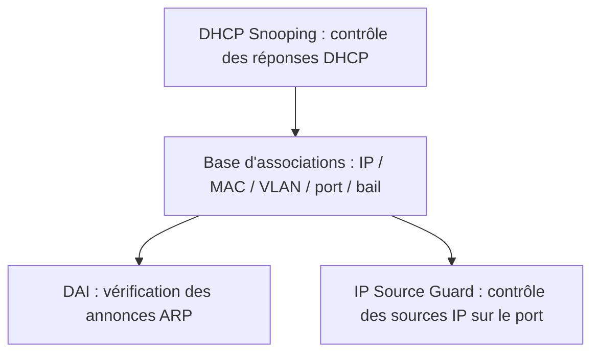

| Mécanisme | Rôle | Point de vigilance |
| --- | --- | --- |
| **DHCP Snooping** | Filtre les réponses DHCP venant des ports non fiables et peut constituer une base d'associations | Ports trusted et relais à identifier précisément |
| **DAI** (*Dynamic ARP Inspection*, inspection ARP dynamique) | Vérifie les associations IP/MAC annoncées par ARP | Clients à IP statique et ports exemptés à traiter |
| **IP Source Guard** (*protection des adresses IP sources*) | Restreint les adresses IP sources autorisées sur un port, parfois aussi la MAC | Nécessite des associations exploitables et un matériel compatible |

!!! warning "Les protections peuvent aussi provoquer une panne"
    Activer DAI ou IP Source Guard sans préparer les postes à **adresse statique**, les bindings et les exceptions peut bloquer du trafic légitime. Selon la plateforme, la conservation de la base après redémarrage doit également être vérifiée.

??? example "Exemple Cisco IOS — configuration indicative"
    Les interfaces et VLAN ci-dessous sont **fictifs**. Vérifier les commandes prises en charge par le modèle, la topologie, les relais DHCP et l'Option 82.

    ```text
    ip dhcp snooping
    ip dhcp snooping vlan 110,120
    interface GigabitEthernet0/1
     ip dhcp snooping trust
    interface GigabitEthernet0/10
     ip dhcp snooping limit rate 10
    ip arp inspection vlan 110,120
    interface GigabitEthernet0/10
     ip verify source
    ```

    Ici, `Gi0/1` représente un chemin **validé** vers le serveur ou le relais DHCP. Ne pas déclarer tous les trunks fiables par principe. Les règles de confiance de DAI sont à examiner séparément.

    Commandes de vérification possibles : `show ip dhcp snooping binding`, `show ip arp inspection`, `show ip verify source` (selon plateforme).


### 8. Analyse d’un scénario combiné

#### Scénario : détournement de la configuration réseau

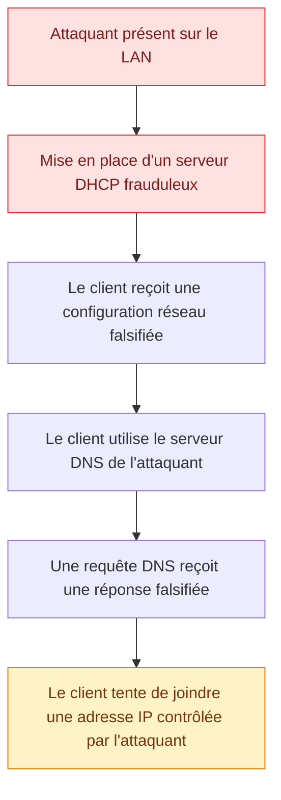

!!! question "Analyse de l'attaque"
    1. Pourquoi un client DHCP peut-il accepter une configuration provenant d'un serveur non autorisé ?
    2. Quelle information fournie par DHCP permet ici de détourner le trafic légitime ?
    3. Quelles propriétés du modèle **DICP** sont potentiellement compromises ? Justifier.
    4. Quelle protection peut être configurée sur les switchs pour empêcher les réponses DHCP provenant de ports non autorisés ?
    5. Le détournement DNS permet-il automatiquement d'usurper un site HTTPS disposant d'un certificat valide ? Justifier.
    6. Quels événements ou journaux permettraient de détecter cette attaque ?


??? success "Afficher le corrigé"

    **1. Pourquoi le client accepte-t-il un faux serveur DHCP ?**

    Le protocole DHCP ne prévoit pas d'authentification native du serveur. Un client peut donc accepter une offre provenant d'un serveur frauduleux s'il la reçoit et la sélectionne.

    Pour **augmenter ses chances de réussite**, l'attaquant peut préalablement réaliser une attaque **DHCP Starvation**, destinée à épuiser le pool d'adresses IP du serveur DHCP légitime.

    Les clients ne pouvant plus obtenir de bail auprès de ce dernier peuvent alors accepter les offres du serveur frauduleux.

    - **DHCP Starvation** : vise principalement la disponibilité du service DHCP.
    - **DHCP Spoofing** : vise à fournir aux clients une configuration réseau falsifiée.


    **2. Quelle information DHCP permet de détourner le trafic ?**

    Le serveur frauduleux peut fournir :

    - Une **passerelle par défaut** contrôlée par l'attaquant (option DHCP 3), permettant de détourner une partie du trafic vers d'autres réseaux.
    - Un **serveur DNS frauduleux** (option DHCP 6), permettant de falsifier les réponses aux requêtes de résolution de noms.

    Dans le scénario présenté, c'est **l'adresse du serveur DNS** qui est falsifiée.

    **3. Quelles propriétés DICP sont compromises ?**

    | Propriété | Conséquence possible |
    | --- | --- |
    | **C — Confidentialité** | Interception de données non protégées |
    | **I — Intégrité** | Falsification de réponses DNS ou modification de communications non protégées |
    | **D — Disponibilité** | Interruption des communications si les paramètres fournis sont incorrects |
    
    La propriété **Preuve** n'est pas directement compromise dans ce scénario, mais la conservation de traces fiables est importante pour l'enquête.

    **4. Quelle protection utiliser sur les switchs ?**

    Le **DHCP Snooping** permet de distinguer les ports autorisés (*trusted*) à transmettre des réponses DHCP serveur des ports non autorisés (*untrusted*).

    Les réponses DHCP provenant d'un port non autorisé sont rejetées.

    **5. Le détournement DNS permet-il d'usurper un site HTTPS ?**

    **Non, pas automatiquement.**

    Le client vérifie normalement le certificat TLS présenté par le serveur, notamment sa validité, sa chaîne de confiance et sa correspondance avec le nom demandé.

    Si l'attaquant ne possède pas de certificat accepté pour ce nom, le navigateur doit signaler une erreur de sécurité.

    **6. Comment détecter cette attaque ?**

    Plusieurs observations peuvent être recoupées :

    - Analyse des échanges DHCP : présence de plusieurs serveurs ou de paramètres inhabituels.
    - Vérification de la configuration IP et DNS reçue par les postes.
    - Consultation des journaux DHCP Snooping et des équipements réseau, si disponibles.
    - Analyse des requêtes et réponses DNS, lorsque leur journalisation est activée.
    - Recherche d'alertes TLS ou de connexions vers des adresses IP inattendues.

    !!! tip "À retenir"
        Le détournement DHCP peut compromettre plusieurs propriétés DICP sans exploiter de vulnérabilité logicielle : il exploite principalement **l'absence d'authentification native du serveur DHCP** et une confiance excessive dans les paramètres réseau reçus.


## Expertise

### 9. VLAN Hopping — franchissement de VLAN

Le VLAN Hopping regroupe des techniques permettant de contourner
la séparation logique entre VLAN au niveau Ethernet.

#### Switch Spoofing — négociation frauduleuse d'un trunk

Le protocole **DTP (Dynamic Trunking Protocol)**, propre à Cisco,
permet à deux équipements de négocier automatiquement
l'établissement d'une liaison trunk.

Deux modes de négociation existent notamment :

- `dynamic auto` : accepte de devenir trunk si le voisin
  initie une négociation compatible ;
- `dynamic desirable` : cherche activement à établir un trunk.

Un attaquant connecté à un port autorisant cette négociation
peut tenter de se faire passer pour un switch afin d'obtenir
un trunk et d'accéder à plusieurs VLAN autorisés sur cette liaison.

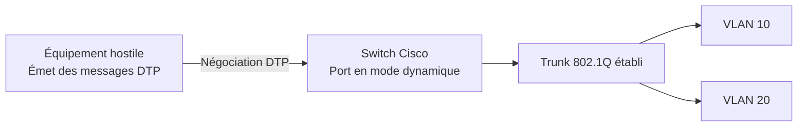


!!! tip "Configuration et sécurisation de DTP"

    Le protocole **DTP (Dynamic Trunking Protocol)** permet de négocier automatiquement l'établissement d'une liaison trunk entre équipements Cisco.

    Les modes `dynamic auto` et `dynamic desirable` peuvent permettre à un équipement hostile de négocier un trunk sur un port mal configuré.

    === "Configuration à risque"

        **Mode dynamic auto :**

        ```cisco
        interface GigabitEthernet0/10
         switchport mode dynamic auto
        ```

        Le port attend une proposition DTP compatible pour devenir trunk.

        **Mode dynamic desirable :**

        ```cisco
        interface GigabitEthernet0/10
         switchport mode dynamic desirable
        ```

        Le port cherche activement à négocier un trunk.

        !!! warning "Risque de Switch Spoofing"
            Un attaquant capable d'émettre des messages DTP peut tenter d'obtenir une liaison trunk et accéder aux VLAN autorisés sur celle-ci.

    === "Port utilisateur sécurisé"

        ```cisco
        interface GigabitEthernet0/10
         switchport mode access
         switchport access vlan 20
        ```

        Le port est configuré explicitement en mode **access** et ne négocie pas de trunk.

    === "Trunk sécurisé"

        ```cisco
        interface GigabitEthernet0/1
         switchport mode trunk
         switchport nonegotiate
         switchport trunk allowed vlan 10,20,30
        ```

        - `mode trunk` : établit un trunk statique.
        - `nonegotiate` : désactive l'émission de messages DTP.
        - `allowed vlan` : limite les VLAN transportés.

        Les deux extrémités doivent être configurées de manière cohérente.

    === "Diagnostic"

        **Examiner le mode configuré et le mode réellement actif :**

        ```cisco
        show interfaces GigabitEthernet0/1 switchport
        ```

        Repérer notamment :

        | Champ | Signification |
        | --- | --- |
        | `Administrative Mode` | Mode configuré |
        | `Operational Mode` | Mode effectivement actif |
        | `Negotiation of Trunking` | Émission de DTP activée ou désactivée |

        **Afficher les trunks actifs :**

        ```cisco
        show interfaces trunk
        ```

        **Consulter la configuration d'un port :**

        ```cisco
        show running-config interface GigabitEthernet0/1
        ```

        !!! note "Point de vigilance"
            Le mode par défaut varie selon les modèles Cisco. Une commande absente de la configuration ne signifie pas nécessairement que DTP est désactivé.


!!! note "DTP et VTP : deux protocoles différents"

    - **DTP** négocie l'établissement d'une liaison trunk.
    - **VTP (VLAN Trunking Protocol)** permet de diffuser
      des informations de configuration des VLAN entre switchs Cisco.

    Ces automatismes ne sont pas nécessaires dans SportLudique :
    les VLAN et les trunks sont configurés manuellement.


#### Double Tagging — exploitation de deux étiquettes 802.1Q

Cette technique vise à faire franchir à **une trame Ethernet** une frontière entre VLAN en exploitant le traitement du **VLAN natif** sur certains trunks 802.1Q. Elle est distincte de DTP : aucun trunk frauduleux n’a besoin d’être négocié.

Dans le scénario classique, l’attaquant se trouve dans le VLAN utilisé comme **VLAN natif** sur la liaison trunk. Il émet une trame portant deux étiquettes : une étiquette externe correspondant au VLAN natif, puis une étiquette interne correspondant au VLAN cible.

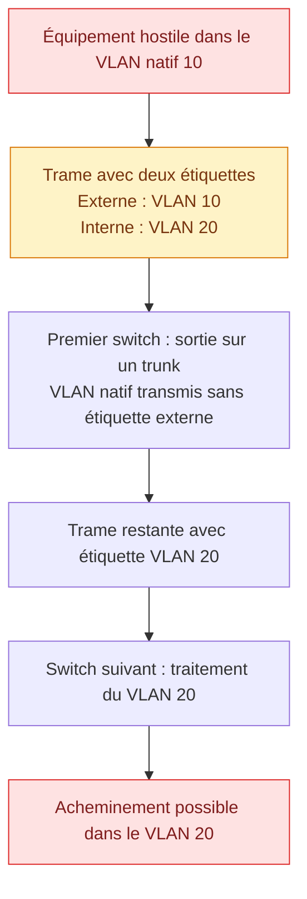

!!! warning "Une attaque dépendante de la topologie"
    Le scénario dépend de l’acceptation des trames doublement étiquetées et du comportement des équipements sur les trunks. Le VLAN cible doit également être transporté sur la liaison concernée. Ce mécanisme est généralement **unidirectionnel** : il ne garantit pas le retour du trafic vers l’attaquant.

!!! tip "Réduire l’exposition au Double Tagging"
    - Ne pas affecter de postes utilisateurs au **VLAN natif** d’un trunk.
    - Utiliser un VLAN natif dédié et cohérent aux deux extrémités de la liaison.
    - Marquer aussi le VLAN natif lorsque les équipements le permettent ; limiter les VLAN autorisés sur les trunks.

    Le **filtrage inter-VLAN** ne corrige pas une faille de séparation au niveau de la commutation Ethernet.

### 10. STP / BPDU Spoofing — manipulation de la topologie

Le protocole **STP (Spanning Tree Protocol)** permet d'éviter les **boucles Ethernet** lorsque plusieurs chemins existent entre les switchs.

Sans STP, une boucle peut entraîner une circulation répétée des trames de diffusion, une instabilité des tables MAC et une saturation du réseau.

#### Rappel — Fonctionnement de STP

STP construit une **topologie logique sans boucle** en plaçant certains ports dans un état qui empêche la transmission des trames de données.

Pour cela, les switchs échangent des **BPDU (Bridge Protocol Data Units)** afin de :

1. Élire un switch racine (**Root Bridge**).
2. Déterminer les meilleurs chemins vers cette racine.
3. Bloquer les chemins redondants pour éviter les boucles.

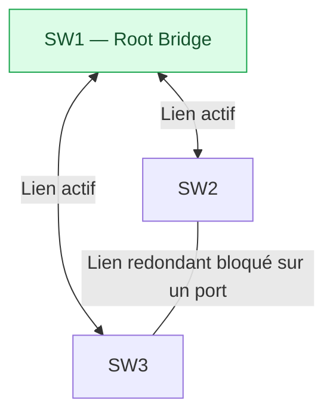

!!! info "Comment est élu le Root Bridge ?"

    Chaque switch possède un **BID (Bridge Identifier)** composé notamment d'une priorité et d'une adresse MAC.

    Le switch présentant le **BID le plus faible** devient Root Bridge.

    - Priorité plus faible : équipement favorisé.
    - À priorité égale : l'adresse MAC la plus faible départage les équipements.

    Sur les équipements Cisco, la priorité par défaut est généralement de **32768** (avec une extension liée au VLAN ou à l'instance selon le mode STP).

#### Les principales variantes de STP

Plusieurs évolutions de STP existent. Elles répondent notamment à deux besoins : **accélérer la convergence** et **gérer plusieurs VLAN**.

| Protocole | Signification | Particularité |
| --- | --- | --- |
| **STP** | Spanning Tree Protocol | Protocole historique IEEE 802.1D, convergence relativement lente |
| **RSTP** | Rapid Spanning Tree Protocol | Évolution IEEE 802.1w permettant une convergence plus rapide |
| **PVST+** | Per-VLAN Spanning Tree Plus | Variante Cisco utilisant une instance STP par VLAN |
| **Rapid-PVST+** | Rapid Per-VLAN Spanning Tree Plus | Variante Cisco associant convergence rapide et instance par VLAN |
| **MSTP** | Multiple Spanning Tree Protocol | Permet de regrouper plusieurs VLAN dans une même instance STP |

!!! note "PVST+ et MSTP : quelle différence ?"

    Avec **PVST+**, chaque VLAN dispose de son propre arbre STP et peut avoir son propre Root Bridge.

    Avec **MSTP**, plusieurs VLAN peuvent être associés à une même instance MST (*Multiple Spanning Tree*). Ils partagent alors la même topologie STP pour cette instance.

    MSTP permet ainsi de limiter le nombre d'instances STP à gérer sur un réseau comportant de nombreux VLAN.

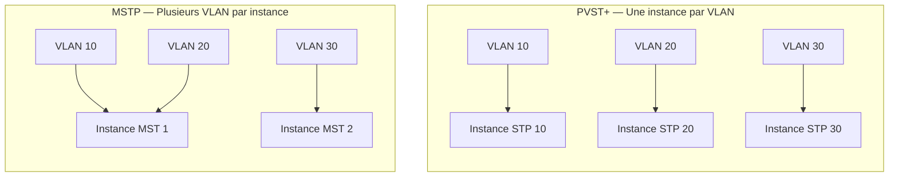

!!! warning "Interopérabilité entre constructeurs"

    Dans SportLudique, les switchs Cisco et Huawei peuvent utiliser des variantes différentes :

    - **Cisco :** notamment Rapid-PVST+ ou MST.
    - **Huawei :** notamment MSTP, et VBST sur les modèles compatibles (*VLAN-Based Spanning Tree*).

    L'interconnexion entre des équipements utilisant Rapid-PVST+ et MSTP nécessite une attention particulière aux frontières STP et à l'élection du Root Bridge.

    Des protocoles différents peuvent interopérer sous certaines conditions, mais il ne faut pas supposer que leur fonctionnement est identique.

#### Mécanisme de l'attaque — BPDU Spoofing

Les **BPDU ne sont pas authentifiées par les mécanismes STP classiques**.

Un équipement hostile connecté au réseau peut donc tenter d'émettre des BPDU annonçant un **BID plus faible** que celui du Root Bridge légitime.

Si ces BPDU sont acceptées, l'équipement hostile peut influencer l'élection du Root Bridge et modifier la topologie de commutation.

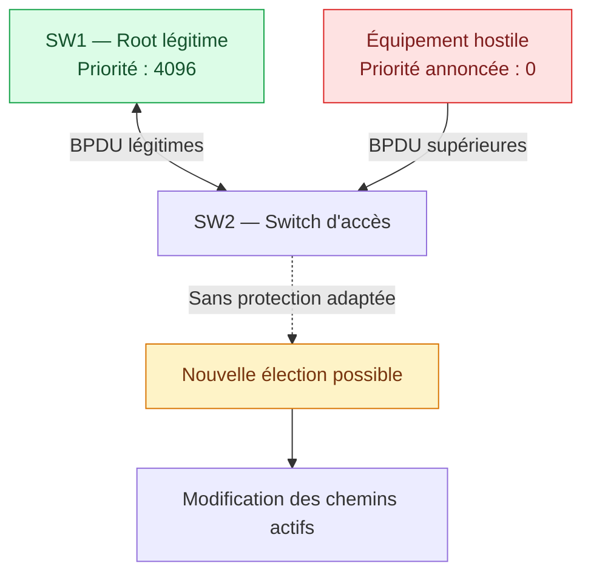

!!! warning "Conséquences possibles"

    Une modification non maîtrisée de la topologie peut provoquer :

    - une **interruption des communications** lors d'une reconvergence ;
    - des **chemins réseau sous-optimaux** ou une saturation de certaines liaisons ;
    - une **interception potentielle** si la nouvelle topologie fait transiter certains échanges par l'équipement hostile.

    La modification du Root Bridge ne garantit pas automatiquement une interception du trafic.

#### Contre-mesures — BPDU Guard et Root Guard

Les équipements administrables disposent de protections permettant de contrôler les BPDU reçues.

| Protection | Rôle | Emplacement habituel |
| --- | --- | --- |
| **BPDU Guard** | Met en défaut un port recevant des BPDU inattendues | Port utilisateur / port de bord |
| **Root Guard** | Empêche un voisin de devenir racine par un port déterminé | Liaison descendante vers un switch d'accès |
| **PortFast** | Accélère la transition d'un port de bord vers l'état de transmission | Port utilisateur |

!!! warning "PortFast n'est pas une protection contre les BPDU"

    PortFast est une optimisation destinée aux ports connectés à des équipements terminaux.

    Il **ne bloque pas les BPDU** et doit être associé à BPDU Guard lorsque l'objectif est d'empêcher un équipement inattendu de participer à STP.

#### Configurations Cisco — Protection et diagnostic

=== "BPDU Guard"

    Sur un port destiné à accueillir un poste utilisateur :

    ```cisco
    interface GigabitEthernet0/10
     switchport mode access
     spanning-tree portfast
     spanning-tree bpduguard enable
    ```

    **Fonctionnement :**

    Lorsqu'une BPDU est reçue, le port est placé en état `err-disabled`.

    Cela empêche un équipement connecté à ce port de participer à l'élection STP.

    !!! note "Remise en service"

        Le port doit être réactivé après identification de la cause, sauf si une récupération automatique a été configurée.

=== "Root Guard"

    Sur une liaison descendante vers un switch qui ne doit pas devenir racine :

    ```cisco
    interface GigabitEthernet0/2
     spanning-tree guard root
    ```

    **Fonctionnement :**

    Si le port reçoit des BPDU supérieures, il passe dans l'état `root-inconsistent` pour les instances concernées.

    Le port peut redevenir opérationnel lorsque les BPDU supérieures cessent.

    Contrairement à BPDU Guard, **Root Guard accepte les échanges STP normaux**.

=== "Élection du Root Bridge"

    **Définir une priorité STP :**

    ```cisco
    spanning-tree vlan 10 priority 4096
    ```

    Une priorité faible favorise l'élection de ce switch comme Root Bridge du VLAN 10 en mode PVST+ ou Rapid-PVST+.

    Les priorités configurables avec l'extension System ID utilisent généralement des multiples de 4096.

    **Vérifier l'élection :**

    ```cisco
    show spanning-tree vlan 10
    ```

    !!! tip "À identifier"

        - Le Root ID : identifiant du pont racine.
        - Le Bridge ID : identifiant du switch local.
        - Le rôle des ports : Root, Designated ou Alternate selon le protocole.

=== "Diagnostic"

    **Identifier le mode STP :**

    ```cisco
    show spanning-tree summary
    ```

    **Afficher la topologie :**

    ```cisco
    show spanning-tree
    ```

    **Examiner un port :**

    ```cisco
    show spanning-tree interface GigabitEthernet0/2 detail
    ```

    **Afficher les ports bloqués par des protections STP :**

    ```cisco
    show spanning-tree inconsistentports
    ```

    **Rechercher les interfaces désactivées :**

    ```cisco
    show interfaces status err-disabled
    ```

!!! tip "À retenir"

    **STP évite les boucles Ethernet, mais son élection peut être influencée par des BPDU non autorisées.**

    - **BPDU Guard** protège les ports de bord.
    - **Root Guard** empêche l'élection d'une racine indésirable à travers un port.
    - **PortFast** accélère l'activation des ports de bord, sans assurer leur sécurité.

    Sur un réseau comprenant plusieurs constructeurs, le choix de la variante STP et la cohérence des configurations sont essentiels.

---

## Références

- [ANSSI — Guide d'hygiène informatique](https://messervices.cyber.gouv.fr/guides/guide-dhygiene-informatique)
- [Cisco — Dynamic ARP Inspection (Catalyst 2960)](https://www.cisco.com/c/en/us/td/docs/switches/lan/catalyst2960/software/release/15-0_2_se/configuration/guide/scg2960/swdynarp.html)
- [Cisco — Diagnostic DAI et IP Source Guard](https://www.cisco.com/c/en/us/support/docs/switches/lan-switch-software/222274-troubleshoot-dynamic-arp-inspection-dai.html)
