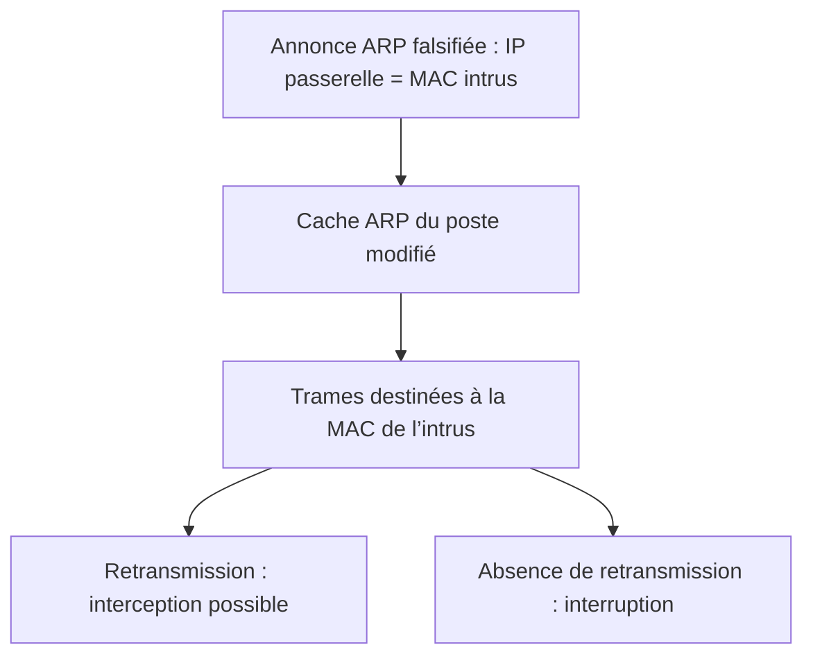

# 2 — Liaison : Ethernet, ARP, DHCP et commutation

[Retour au référentiel](cybersecu.md). DHCP est applicatif sur UDP ; il est traité ici pour ses effets sur l’accès au LAN.

## Socle obligatoire

### ARP Spoofing / Poisoning — usurpation et empoisonnement ARP

**Pourquoi cela fonctionne.** En IPv4, ARP associe une adresse IP locale à une MAC. Il n’authentifie pas les annonces. Un attaquant présent dans le même domaine Ethernet peut faire enregistrer sa MAC comme celle de la passerelle, parfois aussi tromper la passerelle sur la MAC du poste.

**Conditions et effets.** Les annonces doivent être acceptées. Le trafic passe alors par l’attaquant s’il le retransmet : interception (C), modification (I), ou perte de communication (D). Sans retransmission, on obtient surtout un déni de service.

**Protections et limites.** Dynamic ARP Inspection (DAI) contrôle les associations annoncées. La segmentation réduit le périmètre ; elle ne protège pas les membres d’un même VLAN entre eux. L’isolation des ports/Private VLAN peut empêcher certains échanges directs, selon la configuration. Les entrées ARP statiques conviennent à de très petits périmètres et demandent de la maintenance.

HTTPS ou un VPN correctement authentifié protège les données transportées malgré une interception ; cela n’empêche pas la perturbation. Un switch administrable permet des contrôles, mais ne les active pas nécessairement. Port Security ne valide pas une association IP/MAC ; DHCP Snooping seul ne filtre pas les annonces ARP.

**SportLudique.** Une passerelle conserve la même IP mais sa MAC change soudainement. Comparer les tables ARP, les ports associés aux MAC et les changements prévus avant de conclure.



### MAC Flooding — saturation de la table MAC

L’attaquant injecte de nombreuses adresses MAC sources sur un port. Si la capacité d’apprentissage est dépassée, des destinations peuvent devenir inconnues. Selon l’équipement et ses protections, les trames unicast inconnues sont diffusées dans le VLAN, limitées ou abandonnées : le switch ne devient pas systématiquement un hub.

**Conditions/risques.** Accès au LAN et volume suffisant ; confidentialité potentiellement dégradée et disponibilité perturbée. **Protection :** limiter les MAC sur les ports utilisateurs, surveiller les variations d’apprentissage ; le contrôle des unicast inconnus peut compléter selon le matériel. Port Security ne remplace pas le chiffrement.

**Exemple.** Un port utilisateur apprend des centaines de MAC sans hyperviseur prévu : rechercher un abus mais aussi une boucle ou un équipement intermédiaire.

### MAC Spoofing — usurpation d’adresse MAC

Un équipement copie la MAC d’un autre pour contourner un filtrage fondé sur cette adresse. Il doit avoir accès au réseau concerné ; des doublons peuvent provoquer des déplacements de MAC et des interruptions. Utiliser une authentification adaptée (802.1X), puis limiter les droits accordés. Une liste de MAC est une restriction, pas une preuve d’identité.

### DHCP Starvation — épuisement des baux

Des demandes avec identités clientes variées consomment les baux du serveur. Les clients légitimes ne reçoivent plus d’adresse (D). Il faut atteindre le serveur ou son relais et obtenir suffisamment de baux ; les identités ne reposent pas toujours uniquement sur la MAC Ethernet.


**Protection.** Limiter le débit DHCP sur les ports clients réduit l’abus ; une attaque distribuée ou lente peut subsister. Limiter les MAC aide dans certains scénarios. Dimensionnement du pool, durée des baux et supervision améliorent la capacité et la détection sans empêcher l’attaque. Des IP statiques préservent certains équipements mais ne sécurisent pas tout le LAN.

### DHCP Spoofing / Rogue DHCP — faux service DHCP

Un serveur non autorisé propose une adresse, une passerelle ou un DNS contrôlé par l’attaquant. Un client peut retenir cette offre ; **une starvation préalable n’est pas nécessaire**. Le détournement conduit à une interception, une résolution trompeuse ou une interruption (C/I/D).

« Rogue » désigne le serveur non autorisé ; « spoofing » insiste sur les réponses trompeuses. Ce ne sont pas deux degrés de dangerosité intrinsèque.

**Protection.** DHCP Snooping refuse les messages serveur reçus sur des ports non fiables. L’isolation et le filtrage limitent l’exposition ; les IDS/IPS peuvent alerter selon leur visibilité. Un poste en IP statique ne reçoit pas ces paramètres mais demeure exposé à d’autres attaques.

**SportLudique.** Deux offres DHCP fournissent des DNS différents : relever leur origine et vérifier le chemin du serveur/relai légitime.

## Concepts avancés

### DHCP Snooping, DAI et IP Source Guard : trois contrôles

| Fonction | Ce qui est contrôlé | Limite à retenir |
| --- | --- | --- |
| DHCP Snooping | Origine des messages DHCP serveur ; construction des bindings IP/MAC/VLAN/port/bail | Un port trusted mal placé ouvre une voie de confiance |
| DAI | Validité des associations IP/MAC dans ARP sur les ports inspectés | IP statiques et ports exemptés nécessitent un traitement adapté |
| IP Source Guard | Adresse source IP et, selon mode, MAC des paquets d’un port | Dépend des bindings et des capacités de la plateforme |

Exemple Cisco IOS **illustratif**, VLAN 10/20/30 et interfaces fictifs ; vérifier support matériel, relais, Option 82 et équipements statiques avant activation :

```text
ip dhcp snooping
ip dhcp snooping vlan 10,20,30
interface GigabitEthernet0/1
 ip dhcp snooping trust
interface GigabitEthernet0/10
 ip dhcp snooping limit rate 10
ip arp inspection vlan 10,20,30
interface GigabitEthernet0/10
 ip verify source
```

Le port G0/1 représente le chemin validé des réponses légitimes, éventuellement vers un relais ; tous les trunks ne doivent pas devenir trusted. Le seuil 10 est un exemple en paquets/seconde, pas une valeur universelle. La confiance DAI est distincte de celle du snooping ; ne pas exempter automatiquement une interconnexion.

Lire `show ip dhcp snooping binding`, `show ip arp inspection` et `show ip verify source`. Sans binding valide, un client statique peut être bloqué : prévoir bindings statiques/ARP ACL selon la fonction et le modèle. Une perte de la base après redémarrage peut provoquer des interruptions ; étudier sa persistance.

### VLAN Hopping — franchissement de VLAN

**Switch spoofing.** Un port qui négocie un trunk peut permettre à un équipement hostile d’émettre des trames pour plusieurs VLAN. Fixer les ports utilisateurs en access, désactiver la négociation DTP lorsque supportée, limiter les VLAN autorisés sur les trunks.

**Double tagging.** Dans certaines topologies, une première étiquette correspondant au VLAN natif est retirée sur une liaison ; une seconde peut être interprétée ensuite et orienter la trame vers un autre VLAN. L’attaquant doit notamment être dans le VLAN natif concerné. Ce mécanisme peut être unidirectionnel ; ce n’est pas automatiquement une session bidirectionnelle.

Séparer VLAN natif et VLAN utilisateurs, assurer une configuration cohérente des deux extrémités, et étudier le marquage du natif si supporté. Le filtrage inter-VLAN ne suffit pas contre un mauvais fonctionnement de la séparation L2.

### STP / BPDU Spoofing — manipulation de l’arbre de commutation

Un participant injecte des BPDU annonçant un meilleur bridge ID pour influencer l’élection de la racine. Un port acceptant ces BPDU permet une modification de topologie, une interruption et, selon les chemins, une interception.

BPDU Guard désactive un port de bord recevant des BPDU inattendues ; Root Guard empêche une racine indésirable sur une frontière appropriée. PortFast accélère la transition d’un port de bord et **ne bloque pas les BPDU**. Ne pas mettre BPDU Guard indistinctement sur les liaisons entre switches. Le choix dépend aussi de l’interopérabilité STP/RSTP/MSTP/PVST.

## Expertise — chaîne locale et validation

Un faux DHCP distribue un DNS hostile, puis une annonce ARP détourne la passerelle. Associer chaque étape au contrôle qui la traite, expliquer ce que TLS conserve comme protection et identifier les traces attendues. Vérifier le chemin des réponses DHCP, les clients statiques, la base de bindings et les ports exemptés avant de proposer un déploiement.

## Références

- [Cisco — DAI et IP Source Guard](https://www.cisco.com/c/en/us/support/docs/switches/lan-switch-software/222274-troubleshoot-dynamic-arp-inspection-dai.html).
- [Cisco Catalyst 2960 — Dynamic ARP Inspection](https://www.cisco.com/c/en/us/td/docs/switches/lan/catalyst2960/software/release/15-0_2_se/configuration/guide/scg2960/swdynarp.html).
