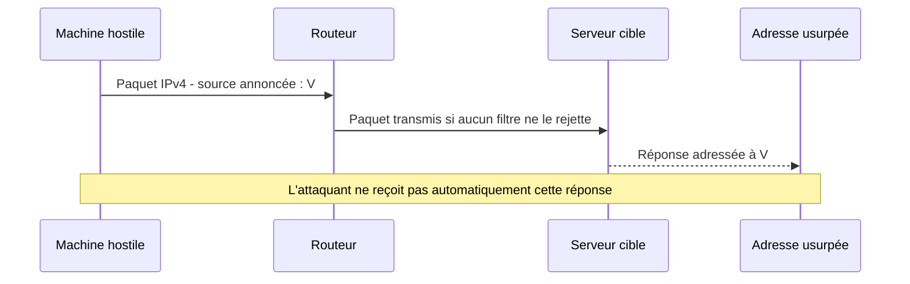
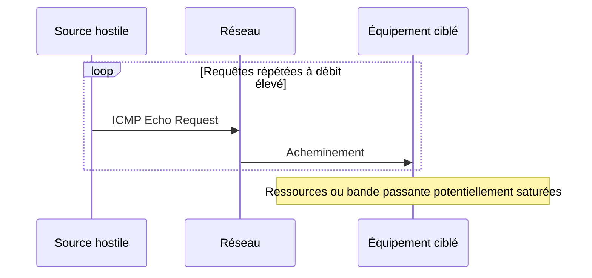
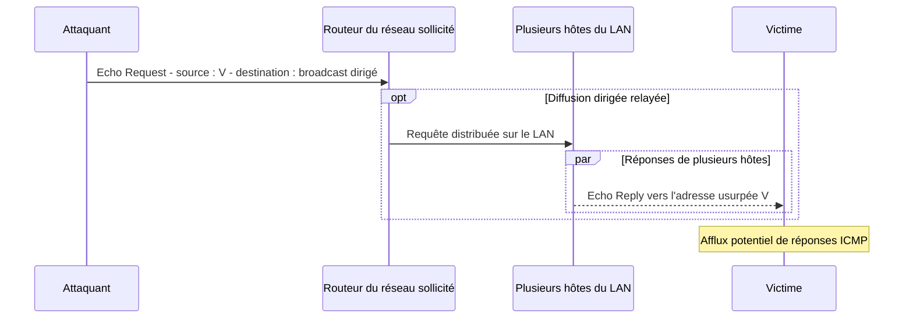
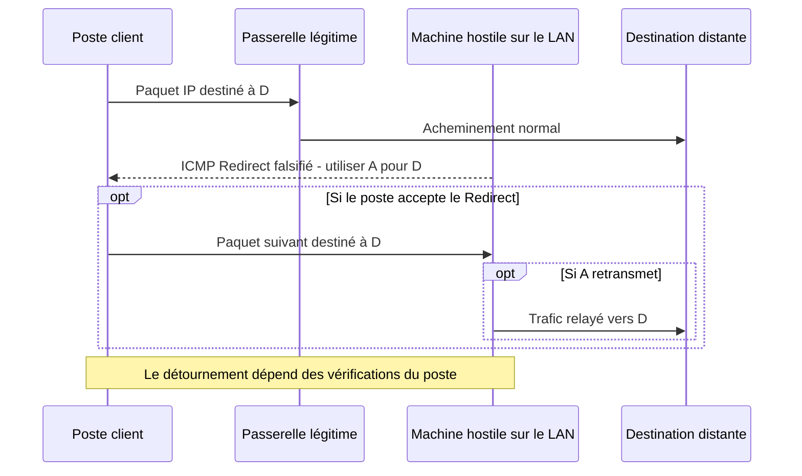
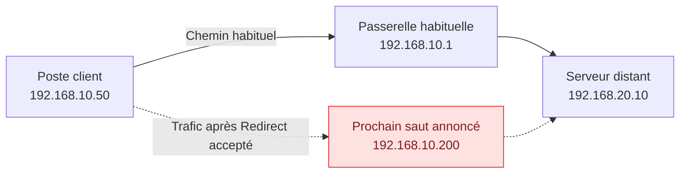
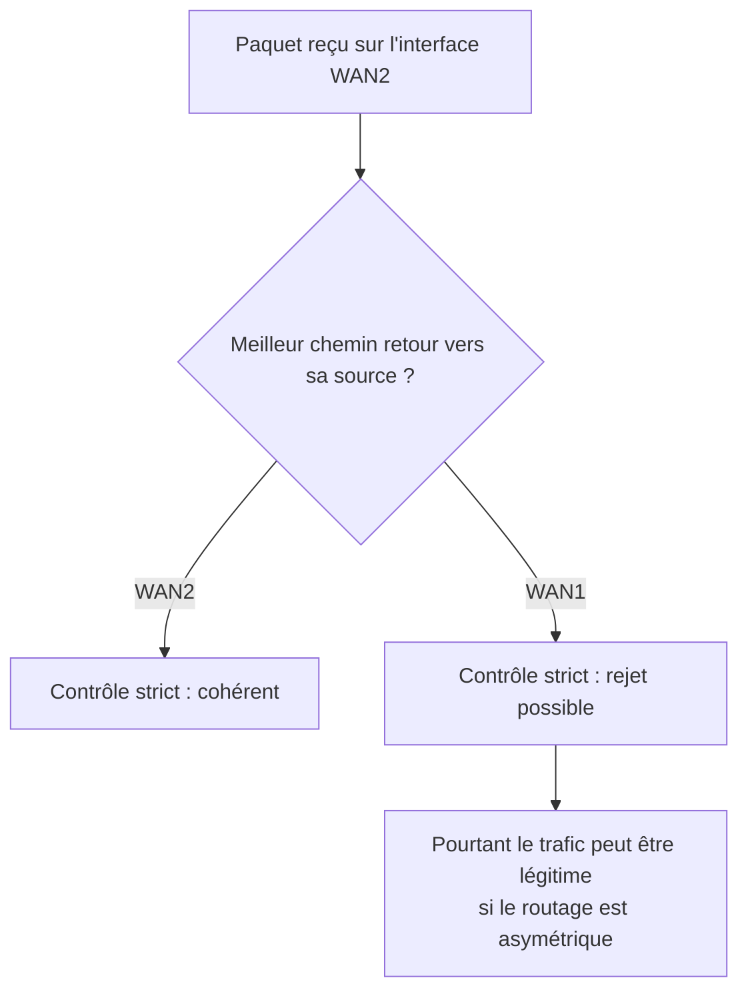
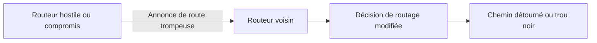

# 3 — Réseau : attaques IPv4, ICMP et routage

[← Retour au référentiel de cybersécurité](00-cybersecurite.md)

!!! abstract "Objectif de la fiche"
    Identifier les attaques exploitant **les adresses IPv4, les messages ICMP et les décisions de routage** ; expliquer leur mécanisme, leurs conséquences sur le **DICP** et les protections adaptées.

    Ce document traite **uniquement d'IPv4**. Le fonctionnement normal d'ICMP (types, codes, `ping`, `traceroute`, Redirect) est détaillé dans le [cours ICMP](../02-cours-reseau-system/07-icmp/icmp.md).

!!! info "Deux approches complémentaires"
    - **Cours ICMP :** comprendre ce que fait le protocole en fonctionnement normal.
    - **Fiche cyber :** comprendre comment un attaquant peut exploiter ce fonctionnement ou perturber le routage.

## Socle obligatoire

### 1. IP Spoofing — usurpation d'adresse IPv4

Une adresse IP source est inscrite dans l'en-tête par l'émetteur : **IPv4 n'authentifie pas cette adresse**. Un attaquant peut donc émettre un paquet dont l'adresse source prétend être celle d'une autre machine.

**Conditions :** l'attaquant doit pouvoir injecter des paquets et ceux-ci ne doivent pas être rejetés par les contrôles sur les adresses sources. Les réponses suivent normalement une route vers **l'adresse usurpée**, pas vers la machine qui a envoyé le paquet.

!!! warning "Usurper une IP ne signifie pas contrôler une connexion"
    Une adresse source falsifiée **ne suffit pas** pour établir une connexion TCP complète : l'attaquant ne reçoit normalement pas les réponses. L'usurpation peut toutefois être utile pour certains abus fondés sur UDP/ICMP, des mécanismes de réflexion ou des règles qui font une confiance excessive à l'adresse IP.

| DICP | Conséquence possible |
| --- | --- |
| **I — Intégrité** | Tromperie sur l'origine déclarée d'un paquet ou exploitation de règles fondées sur cette seule origine |
| **D — Disponibilité** | Perturbation ou saturation, notamment dans un scénario de réflexion |
| **C — Confidentialité** | Pas automatiquement compromise : il faut que le scénario permette aussi à l'attaquant de recevoir des données |
| **P — Preuve** | L'adresse IP source seule ne permet pas d'attribuer de façon certaine l'émission d'un paquet |

!!! tip "Protection contre l'IP Spoofing"

    Un routeur ou un pare-feu peut **rejeter les paquets dont l'adresse IP source est incohérente avec le réseau d'où ils proviennent**.

    Par exemple, un paquet arrivant depuis Internet avec une adresse IP source privée (`192.168.x.x`, `10.x.x.x` ou `172.16.x.x` à `172.31.x.x`) doit normalement être rejeté à cette frontière.

    **À retenir :** l'adresse IP source indiquée dans un paquet ne constitue pas une preuve de l'identité de son émetteur.

!!! example "SportLudique — Alerte IP Spoofing sur Stormshield"

    Lors de la mise en place de leur **DMZ**, les étudiants commettent parfois des erreurs de brassage réseau.

    Le pare-feu **Stormshield** détecte alors des paquets dont les adresses IP sources ne correspondent pas aux réseaux attendus sur les interfaces concernées et génère des alertes **IP Spoofing**.

    Il ne s'agit pas nécessairement d'une attaque : un mauvais branchement ou une erreur de configuration peut produire les mêmes symptômes.

    Face à une alerte IP Spoofing :

    1. Identifier l'interface concernée dans les journaux Stormshield.
    2. Vérifier l'adresse IP source du paquet rejeté.
    3. Comparer cette adresse avec le réseau attendu sur l'interface.
    4. Contrôler le brassage, les VLAN et la configuration réseau.

    **À retenir : une alerte de sécurité signale une anomalie, pas nécessairement une attaque.**

### 2. ICMP Flood — saturation par requêtes ICMP

Un attaquant envoie un volume important de messages **ICMP Echo Request** (type 8). Selon la cible et les débits, ce trafic peut saturer une liaison, solliciter le processeur ou mobiliser les fonctions de traitement des paquets.

**DoS (Denial of Service)** : déni de service depuis une ou plusieurs sources ; on parle généralement de **DDoS (Distributed Denial of Service)** lorsqu'un ensemble de sources distribuées participe à la saturation.

**DICP principalement menacé : D — Disponibilité.** Il n'est pas nécessaire d'usurper une adresse source pour réaliser un ICMP Flood.

!!! tip "Protection et limites"
    Limiter les débits ICMP destinés aux équipements ou au plan de contrôle, superviser les volumes et filtrer les abus. **Si la liaison Internet est déjà saturée, un filtrage sur le pare-feu local ne libère pas cette liaison** : il faut pouvoir agir en amont.

!!! warning "Ne pas confondre ICMP et ping"
    Un filtrage sélectif d'Echo Request peut être justifié. **Bloquer indistinctement tout ICMP** prive également le réseau de messages d'erreur et d'outils de diagnostic utiles. Voir le [cours ICMP](../icmp/icmp.md).

### 3. Smurf — réflexion et amplification ICMP (attaque historique)

Une attaque **Smurf** combine **IP Spoofing** et **diffusion dirigée** (*directed broadcast*).

L'attaquant envoie un message Echo Request vers une adresse de diffusion d'un réseau, mais indique **l'adresse IPv4 de la victime comme source**. Si les routeurs transmettent cette diffusion et si plusieurs hôtes y répondent, la victime reçoit leurs Echo Reply.

**DICP principalement menacé : D — Disponibilité.** L'attaque utilise un réseau tiers comme **réflecteur** ; elle peut produire davantage de réponses que de requêtes émises.

!!! note "Un cas historique à comprendre, pas à généraliser"
    Les routeurs actuels ne transmettent normalement pas les diffusions dirigées par défaut, et les hôtes ne répondent pas nécessairement à ces sollicitations. Le scénario dépend donc de conditions particulières, souvent absentes sur les réseaux récents.

!!! tip "Principales protections"
    Empêcher le relais des **diffusions dirigées** ; filtrer les sources IP usurpées ; appliquer des protections contre les saturations en amont si nécessaire.

### Autoévaluation — Socle

<quiz>
Un poste envoie un paquet IPv4 avec une adresse source usurpée. Que peut-on affirmer ?
- [ ] L'attaquant recevra systématiquement les réponses.
- [x] Les réponses seront normalement acheminées vers l'adresse IP usurpée.
- [ ] Le protocole IPv4 vérifie cryptographiquement l'identité de l'émetteur.
- [ ] L'usurpation permet nécessairement une connexion TCP complète.
> **Explication :** IPv4 ne garantit pas l'authenticité de l'adresse source. Le trajet retour dépend du routage vers l'adresse annoncée.
</quiz>

<quiz>
Quelle propriété DICP est principalement visée par un ICMP Flood ?
- [x] La disponibilité.
- [ ] La confidentialité uniquement.
- [ ] La preuve uniquement.
- [ ] L'authenticité d'un certificat TLS.
> **Explication :** Un flot de requêtes ICMP peut saturer les ressources ou la bande passante et dégrader l'accès au service.
</quiz>

<quiz>
Pourquoi l'attaque Smurf nécessite-t-elle des conditions particulières ?
- [ ] Parce qu'ICMP utilise le port UDP 7.
- [x] Parce que des équipements doivent relayer la diffusion dirigée et des hôtes doivent répondre.
- [ ] Parce qu'elle exige obligatoirement une connexion TCP.
- [ ] Parce que chaque Echo Reply revient à l'attaquant.
> **Explication :** Les réponses doivent être envoyées vers la victime dont l'adresse IP a été usurpée. Les diffusions dirigées sont généralement désactivées sur les routeurs modernes.
</quiz>

## Concepts avancés

### 4. ICMP Redirect Spoofing — détourner un prochain saut

Un **ICMP Redirect (type 5)** est normalement envoyé par un routeur à un poste pour lui indiquer qu'un **meilleur prochain saut** existe sur le réseau local. Le premier paquet est acheminé par la passerelle initiale ; si le poste accepte le message Redirect, il peut envoyer les paquets suivants directement au routeur conseillé.

!!! info "Prérequis indispensable"
    Revoir le [fonctionnement normal d'ICMP Redirect](../02-cours-reseau-system/07-icmp/icmp.md#icmp-redirect) dans le cours ICMP avant d'étudier son détournement. L'acceptation réelle dépend du système d'exploitation et de sa configuration.

**L'attaque** consiste à envoyer un Redirect falsifié afin de faire croire qu'un équipement contrôlé par l'attaquant est un meilleur prochain saut vers une destination.

!!! warning "Conditions de réussite"
    L'attaquant doit pouvoir atteindre le poste et produire un message susceptible de satisfaire ses vérifications (origine attendue, prochain saut sur le LAN, destination concernée...). **Les systèmes modernes ignorent generallement les Redirect** : leur simple réception ne prouve pas qu'une route a été modifiée.

| DICP | Conséquence possible |
| --- | --- |
| **C — Confidentialité** | Interception possible de données non protégées si le trafic passe effectivement par l'attaquant |
| **I — Intégrité** | Modification potentielle des échanges si l'attaquant relaie et altère le trafic |
| **D — Disponibilité** | Interruption des communications si le nouveau prochain saut ne transmet pas les paquets |

!!! note "HTTPS conserve son intérêt"
    Le détournement du chemin **ne permet pas automatiquement** de déchiffrer ni de modifier une session TLS correctement authentifiée. Il peut néanmoins empêcher l'accès au service.

!!! tip "Contre-mesures"
    Désactiver **l'acceptation des Redirect sur les postes** lorsqu'elle n'est pas utile ; empêcher l'émission de Redirect inutiles sur les routeurs ; contrôler les messages suspects et maintenir un routage cohérent. **Désactiver l'émission sur le routeur ne protège pas à lui seul un poste contre des Redirect forgés.**

### 5. Scénario — Un prochain saut inattendu

Une station utilise `192.168.10.1` comme passerelle par défaut pour atteindre `192.168.20.10`. Une capture montre un **ICMP Redirect** indiquant le prochain saut `192.168.10.200` (une machine du même LAN). Peu après, le trafic de la station vers la destination emprunte cette machine.

!!! question "Analyse du scénario"
    1. L'adresse de passerelle par défaut configurée sur le poste a-t-elle nécessairement changé ?
    2. Quel élément permettrait de vérifier que le poste **a accepté** la redirection ?
    3. Quelles propriétés DICP peuvent être affectées ?
    4. Quelles mesures proposer **sur le poste** et **sur le réseau** ?
    5. Pourquoi une différence entre les deux sens d'un `traceroute` ne prouve-t-elle pas à elle seule une attaque ?

??? success "Afficher le corrigé"
    **1.** Non. Un Redirect peut influencer l'acheminement vers une destination sans changer la passerelle par défaut affichée dans la configuration IP.

    **2.** Observer les décisions effectives de routage vers la destination (selon l'OS, routes, cache de destinations, captures réseau) et déterminer l'adresse MAC du prochain saut utilisé. **La capture du seul Redirect est insuffisante.**

    **3.** **C**, si des données non protégées sont interceptées ; **I**, si des échanges sont modifiés ; **D**, si les paquets ne sont plus acheminés. Ces impacts dépendent du comportement réel de l'attaquant et des protections applicatives.

    **4.** Sur le poste : contrôler ou désactiver l'acceptation des Redirect selon le besoin. Sur les routeurs : éviter les Redirect inutiles, vérifier le routage et filtrer les messages inappropriés. Sur le LAN : contrôler les accès et examiner les journaux et captures pertinents.

    **5.** Les décisions de routage aller et retour sont indépendantes : **un routage asymétrique peut être parfaitement légitime**. Il faut recouper les observations avant de conclure.

### 6. Reconnaissance par ICMP et limites des observations

Les messages ICMP peuvent aussi servir à **recueillir des informations** : disponibilité apparente d'un hôte par Echo, présence de routeurs intermédiaires par Time Exceeded, signalement d'une destination inaccessible.

!!! warning "Reconnaissance ≠ intrusion prouvée"
    Un `ping` ou un `traceroute` n'est pas en soi une attaque. Les mêmes outils servent à l'administration et au diagnostic. Leur interprétation dépend du contexte, de la fréquence des sondes, de la source et des autorisations.

    Un saut `* * *` ne démontre pas une panne : un routeur peut **transmettre des paquets sans émettre de réponse aux sondes**. Un `traceroute` depuis A vers B ne donne pas automatiquement le chemin B vers A : effectuer une mesure depuis B pour explorer le sens inverse.

## Expertise

### 7. uRPF — vérifier la plausibilité d'une adresse source

**uRPF (Unicast Reverse Path Forwarding)** compare l'adresse source d'un paquet aux informations de routage disponibles sur l'équipement, avant d'accepter le paquet.

| Mode | Vérification | Limite |
| --- | --- | --- |
| **Strict** | Le meilleur chemin de retour vers la source correspond à l'interface sur laquelle le paquet arrive | Peut rejeter un trafic légitime en cas de routage asymétrique |
| **Loose** | Une route admissible existe vers l'adresse source, sans imposer la même interface | Moins efficace pour détecter une adresse source usurpée mais routable |

!!! tip "Le bon contrôle au bon endroit"
    uRPF n'est pas un bouton « antispoofing parfait ». Avant activation, vérifier les routes, les liens multiples, la présence éventuelle d'une route par défaut, la gestion du mode choisi par le constructeur et les exceptions nécessaires.

### 8. Annonces de routage trompeuses — RIP et OSPF

Lorsqu'un réseau emploie un protocole de **routage dynamique**, des équipements échangent des informations permettant d'apprendre des routes. Un équipement hostile ou compromis peut chercher à annoncer des informations trompeuses.

| Terme | Rappel | Vigilance de sécurité |
| --- | --- | --- |
| **RIP** (*Routing Information Protocol*) | Protocole de routage à vecteur de distance | Contrôler qui peut annoncer des routes et sur quelles interfaces |
| **OSPF** (*Open Shortest Path First*) | Protocole de routage à état de liens | Contrôler les voisins, l'authentification et la cohérence des annonces |

!!! warning "Pas de généralisation"
    Les conditions d'une attaque dépendent du protocole et de la topologie : être sur le même réseau **ne suffit pas nécessairement** pour devenir voisin OSPF ou imposer une route. L'authentification des échanges ne protège pas contre un **routeur autorisé mais compromis**.

**Contre-mesures :** n'activer les protocoles que sur les interfaces utiles, employer des **interfaces passives** lorsque pertinent, authentifier les échanges si pris en charge, filtrer ou contrôler les routes attendues et surveiller les changements de voisinage.

### 9. Synthèse — Déterminer si une route a réellement été détournée

!!! question "Étude de diagnostic"
    Un pare-feu signale un chemin inhabituel vers un serveur, et une station a reçu un Redirect. Quels éléments permettent de différencier une erreur de configuration, un routage asymétrique légitime et un détournement ?

??? success "Éléments de réponse"
    **Collecter des faits avant de conclure :**

    1. Relever les adresses IP, masques, passerelles et routes pertinentes.
    2. Examiner l'origine du Redirect et vérifier les conditions d'acceptation sur le poste.
    3. Observer, par capture, l'adresse MAC du prochain saut et le chemin réellement emprunté.
    4. Comparer les observations sur les équipements traversés ; faire des mesures dans les deux sens si possible.
    5. Étudier les règles de filtrage, les journaux et les changements de configuration récents.
    6. Proposer un contrôle préventif adapté, puis **une vérification de son efficacité**.

    **Conclusion attendue :** un Redirect reçu ou un saut manquant dans `traceroute` ne suffit pas à prouver une attaque. Il faut établir une modification effective du comportement réseau et en rechercher l'origine.

<quiz>
Un pare-feu utilise uRPF strict. Quel scénario peut provoquer un faux positif ?
- [x] Le paquet arrive par WAN2 alors que la meilleure route de retour vers sa source passe par WAN1.
- [ ] Le paquet arrive par l'interface choisie pour le retour vers sa source.
- [ ] Un utilisateur ouvre une session HTTPS avec un certificat valide.
- [ ] Un switch désactive le protocole DTP.
> **Explication :** uRPF strict présume une cohérence entre l'interface d'entrée et la meilleure route de retour. Un réseau asymétrique peut ne pas respecter cette hypothèse.
</quiz>

## Références

- [Cours ICMPv4 — SportLudique](../icmp/icmp.md) : fonctionnement des types, codes et messages de contrôle.
- [RFC 792 — Internet Control Message Protocol](https://www.rfc-editor.org/rfc/rfc792) : description d'ICMPv4.
- [RFC 1122 — Requirements for Internet Hosts](https://www.rfc-editor.org/rfc/rfc1122) : traitement des messages ICMP côté hôte.
- [RFC 1812 — Requirements for IPv4 Routers](https://www.rfc-editor.org/rfc/rfc1812) : conditions d'émission des Redirect.
- [RFC 2827 / BCP 38 — Ingress Filtering](https://www.rfc-editor.org/rfc/rfc2827) et [RFC 3704 / BCP 84](https://www.rfc-editor.org/rfc/rfc3704) : filtrage antispoofing et routage asymétrique.
