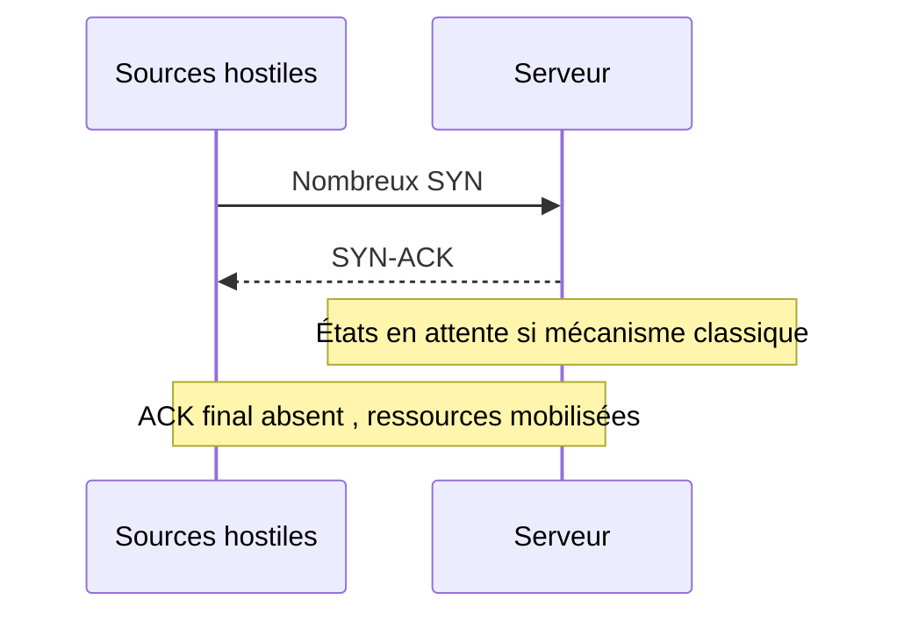

# 4 — Transport : TCP, UDP et reconnaissance

[Retour au référentiel](cybersecu.md)

## Socle obligatoire

### SYN Flood — saturation par ouvertures TCP incomplètes

TCP ouvre normalement une connexion par SYN, SYN-ACK, ACK. Un attaquant multiplie les SYN sans compléter l’échange ; le serveur peut conserver des états en attente jusqu’à expiration. Lorsque les ressources sont épuisées, les connexions légitimes échouent (D). Une source usurpée est possible mais pas obligatoire.

**Protection.** Les SYN cookies réduisent le besoin de conserver un état avant le dernier ACK. Un SYN proxy peut valider l’ouverture avant de solliciter le serveur. Limitation de débit et dimensionnement complètent. Un pare-feu avec suivi d’état peut lui-même être saturé ; un load balancer sans fonction adaptée n’est pas une protection automatique. Les cookies ne résolvent pas une saturation de bande passante.

**SportLudique.** Un service web reçoit beaucoup de SYN et peu d’ouvertures complètes. Comparer captures, états TCP et occupation des ressources ; une panne de chemin retour peut aussi produire des connexions incomplètes.

### UDP Flood — saturation UDP

UDP ne réalise pas d’ouverture préalable. Un volume de datagrammes peut épuiser lien, traitement réseau ou service cible ; certains ports fermés produisent aussi des erreurs ICMP (D). Il suffit de pouvoir atteindre la cible à un débit coûteux pour elle.

Filtrer les services inutiles réduit l’exposition ; limiter les débits protège certaines ressources. Une protection en amont est requise si la liaison est saturée. Un service UDP légitime doit rester accessible selon son besoin.

### Port scanning — scan de ports, reconnaissance

Un scan teste des ports TCP/UDP pour déduire les services accessibles. Il peut servir à l’audit autorisé ou à préparer une intrusion ; il n’est pas une compromission en soi. Nmap peut tenter l’identification de service, de version et d’OS ; ces résultats sont des indices, pas des certitudes. Certains scripts NSE sont intrusifs.

**Risque.** Informations utiles à une attaque ultérieure ; les tests peuvent perturber des services fragiles. **Protection.** N’exposer que les services nécessaires, filtrer selon les sources autorisées, maintenir les logiciels et détecter des comportements anormaux. Cacher une version ne corrige pas la vulnérabilité.

**SportLudique.** Comparer les ports attendus sur le reverse proxy aux ports observés depuis chaque zone. Un port accessible depuis le VLAN administration peut être volontaire, alors que le même accès depuis Internet serait une erreur.

## Concepts avancés

### TCP RST Injection — injection d’une remise à zéro TCP

RST termine une connexion dans les cas où il est accepté. Un attaquant forge un segment avec le tuple IP/ports de la connexion et un numéro de séquence acceptable. Un attaquant sur le chemin peut observer ces valeurs ; hors chemin, les deviner est plus difficile. **La seule usurpation d’IP ne suffit pas.**

**Risque :** interruption (D). Les piles TCP modernes appliquent des validations renforcées, notamment décrites par RFC 5961. Filtrage cohérent des sources, protection du chemin et surveillance complètent ; un IDS ne garantit pas le rejet, et supprimer tous les RST casse les terminaisons normales.

Illustration d’origine conservée comme repère sur les ports TCP ; elle ne constitue pas une démonstration de l’injection RST :

### Réflexion et amplification UDP

Une requête avec source usurpée fait répondre un tiers à la victime. Si la réponse est plus grande, il y a amplification. Certains services DNS ou NTP mal exposés peuvent être utilisés ainsi.

Limiter l’accès aux services susceptibles d’être réflecteurs, éviter un résolveur récursif ouvert, contrôler les débits et filtrer les sources usurpées. Côté victime, une mitigation en amont peut être nécessaire. Distinguer l’attaquant, le réflecteur et la victime pour choisir l’emplacement du contrôle.

## Expertise — choisir le bon point de protection

Devant une indisponibilité web, comparer débit de liaison, taux d’ouvertures TCP, tables d’état du pare-feu et requêtes HTTP. Une saturation du lien, un SYN Flood et un épuisement applicatif demandent des réponses différentes. Justifier l’action locale, la protection en amont et la continuité, sans promettre qu’une redondance interne absorbera tout DDoS.

## Référence

[RFC 5961 — robustesse TCP face aux injections](https://www.rfc-editor.org/info/rfc5961/).
